# Pixel Clash

Like my work? [Buy me a coffee ☕](https://buymeacoffee.com/redging.very.well)

A LAN auto-battler for 2-8 players, built for a Kids Coding Day. Players design
their own units (soldiers, towers, walls, factories) by **prompting an AI helper**
(Claude Code, or the OpenAI Codex CLI) in their browser. The helper writes the
unit's JavaScript and submits it to the game server, which checks it, prices it
and runs it in a sandbox. Players pick and place their army, and the battle
plays on the projector. Players only describe what they want; they never write
or paste code by hand.

<p align="center">
  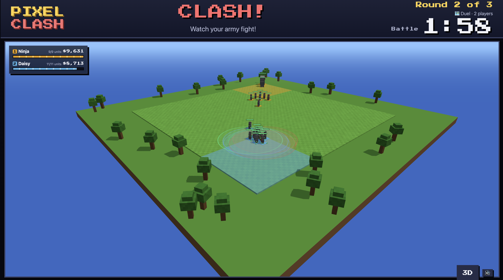
  <br><em>A battle on the projector (/screen), in the 3D view</em>
</p>

**Website:** [redging-very-well.github.io/ai-coding-arena](https://redging-very-well.github.io/ai-coding-arena/), a one-page showcase (served by GitHub Pages from `docs/index.html`).

## 3D and 2D battle views

The battle can be watched as a 3D voxel world, the default on `/screen` and `/play`, or in the original 2D isometric pixel-art view. Each pixel of a unit's sprite becomes a block in 3D, and fire, ice and lightning shots, auras, healing and splash all look different.

<table>
  <tr>
    <td width="50%" valign="top">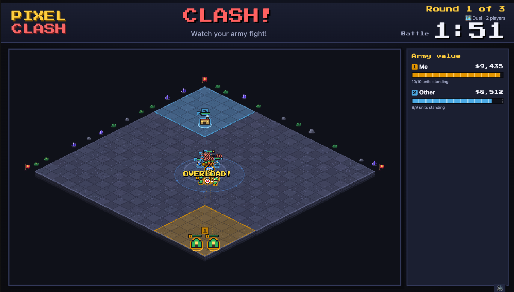<br><b>2D</b> · the original isometric pixel-art view</td>
    <td width="50%" valign="top">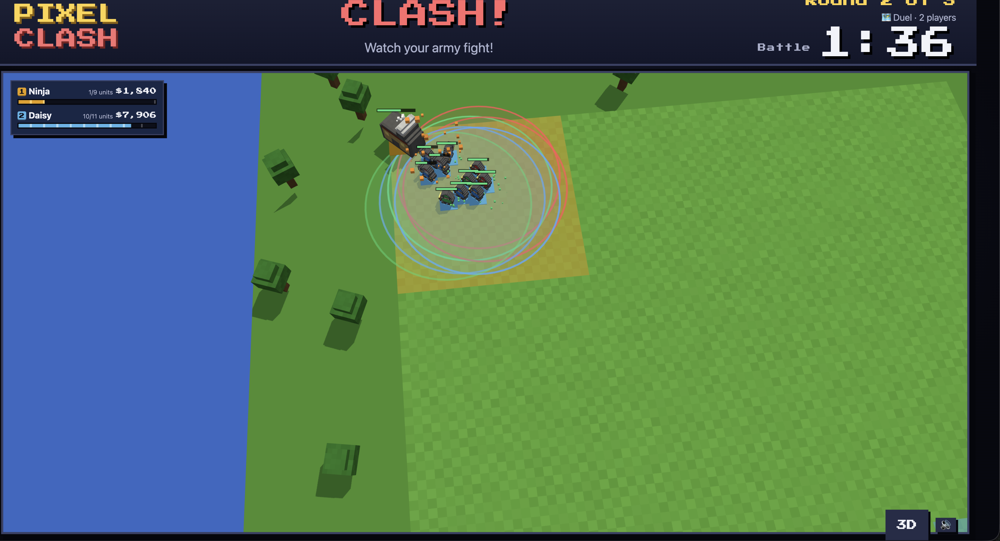<br><b>3D</b> · zoomed in on the fight: health bars, aura rings, sparks</td>
  </tr>
</table>

**Switching.** Use the 3D / 2D button on `/screen` and `/play` (or `D` on `/screen`). The choice is remembered per device. `?view=2d` or `?view=3d` in the address overrides it for one visit, and a browser without WebGL stays on 2D. `/observe` replays any stored battle in 3D (`/observe?round=N`).

**In 3D:**

| Key / action | What it does |
|---|---|
| Drag, scroll, right-drag | Orbit, zoom, pan |
| Click a unit | Follow it |
| `V` | Cycle orbit, follow and chase cameras |
| `N` (also `Tab` on `/screen`) | Next unit |
| `Esc` | Let go |

On `/screen` the keys work anywhere on the page. On `/play` they work after clicking the arena, so typing in the code editor is never affected.

## Screenshots

A round, in order (the battle is the picture above):

<table>
  <tr>
    <td width="50%" valign="top">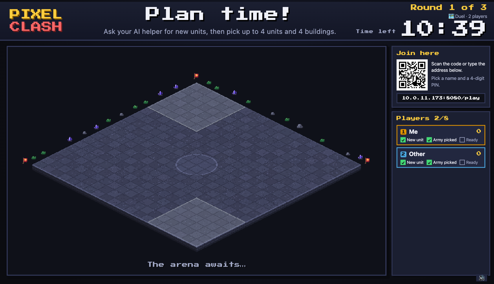<br><b>Plan</b> · the projector shows the timer and the join QR</td>
    <td width="50%" valign="top">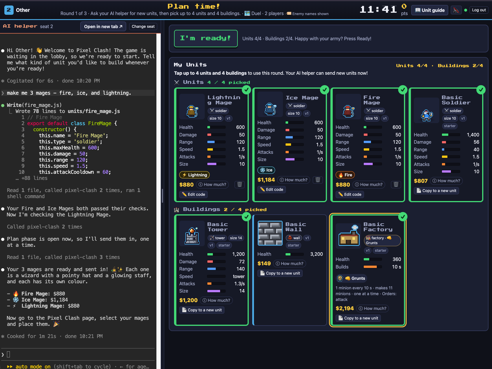<br><b>Plan</b> · /play: the AI helper terminal next to My Units</td>
  </tr>
  <tr>
    <td valign="top">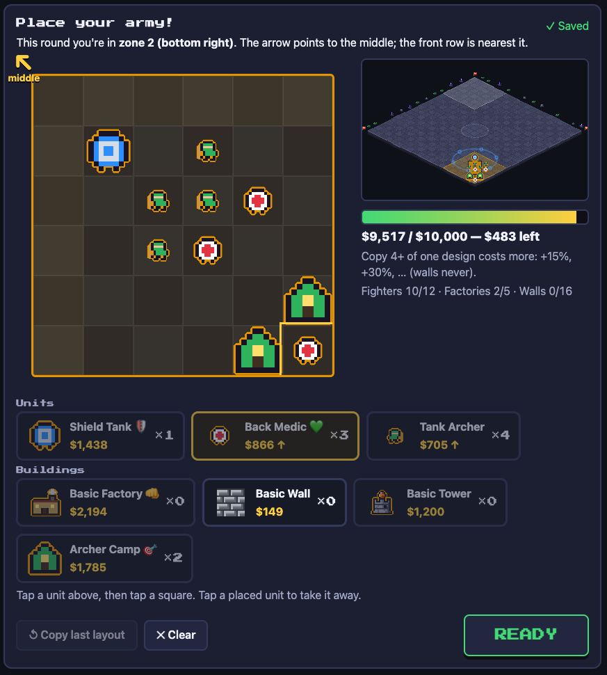<br><b>Placement</b> · placing the army in your zone</td>
    <td valign="top">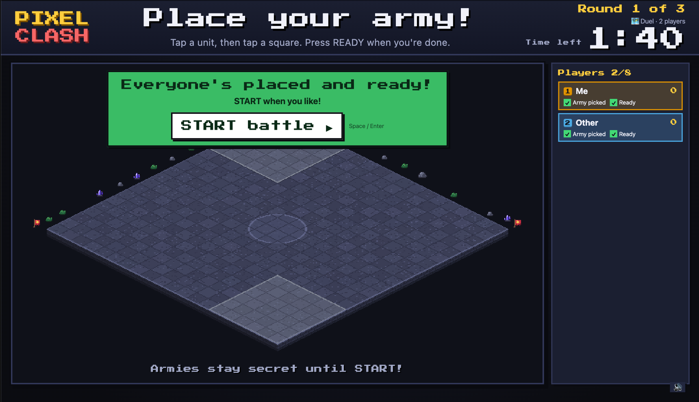<br><b>Placement</b> · everyone ready, START battle</td>
  </tr>
  <tr>
    <td valign="top">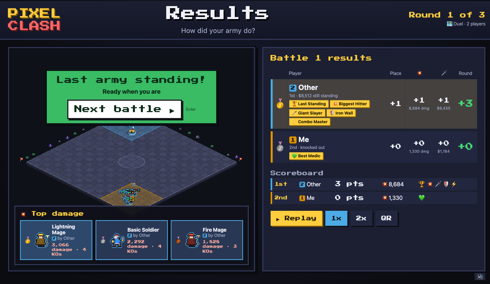<br><b>Results</b> · ranking and points on the projector</td>
    <td valign="top">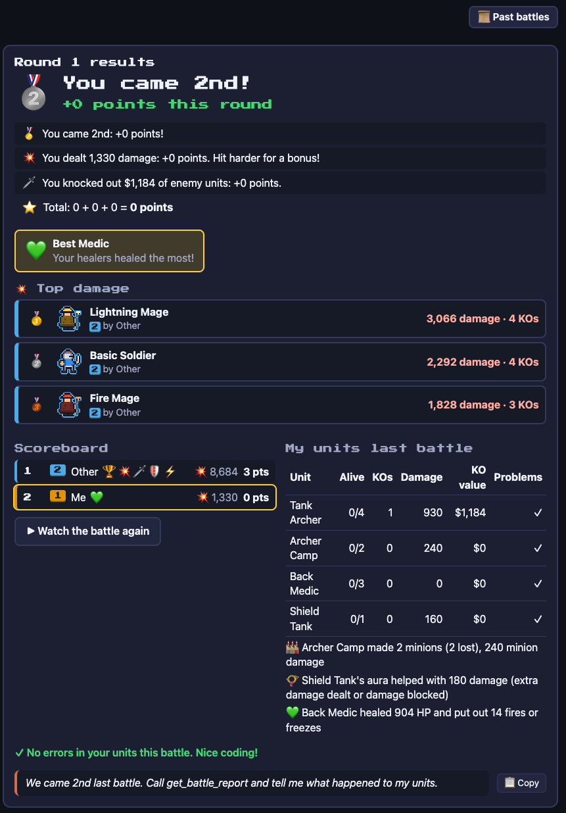<br><b>Results</b> · each player's round report in /play</td>
  </tr>
</table>

Player and facilitator tools:

<table>
  <tr>
    <td width="50%" valign="top">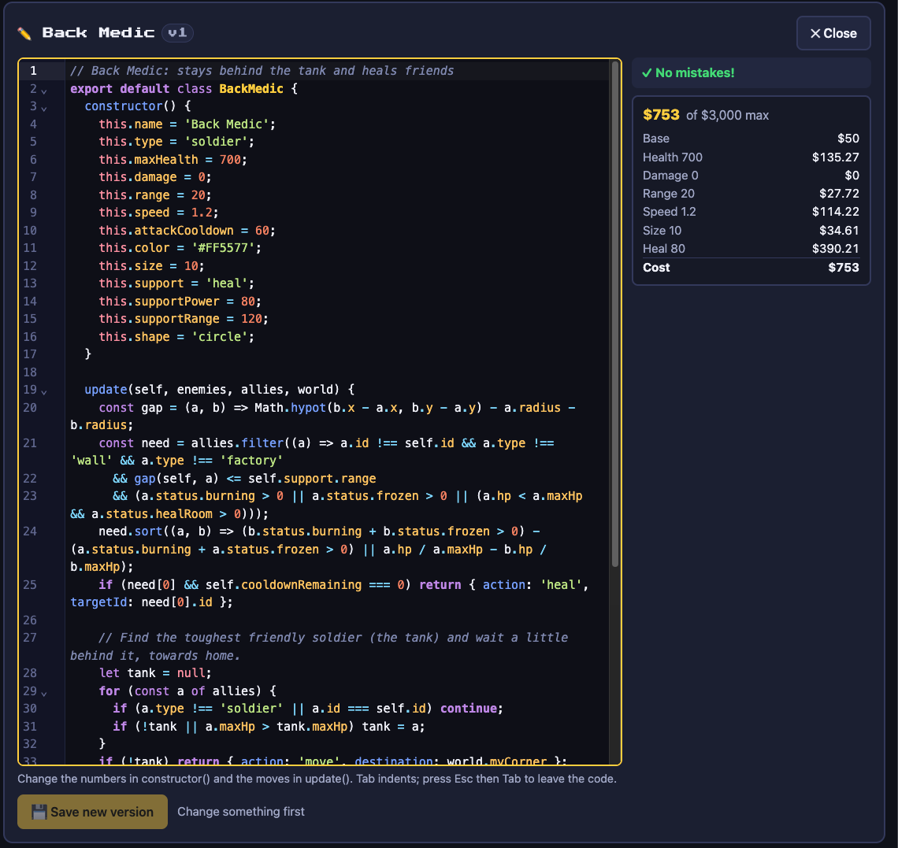<br><b>Code editor</b> · a unit's code, opened from My Units</td>
    <td width="50%" valign="top">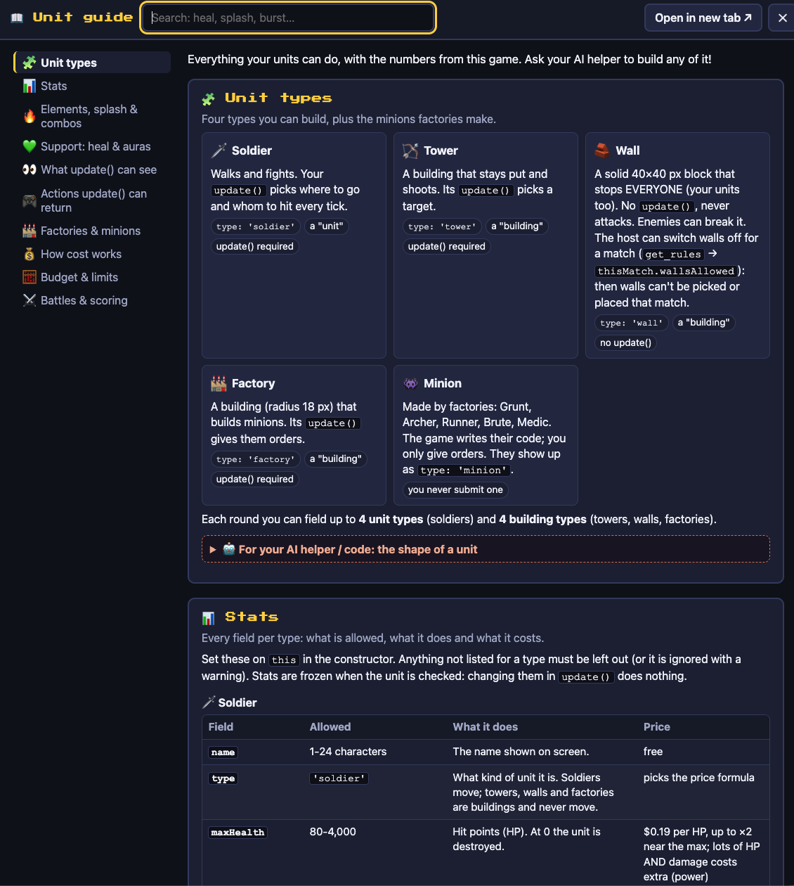<br><b>Unit guide</b> · /guide, built from the live config</td>
  </tr>
  <tr>
    <td valign="top">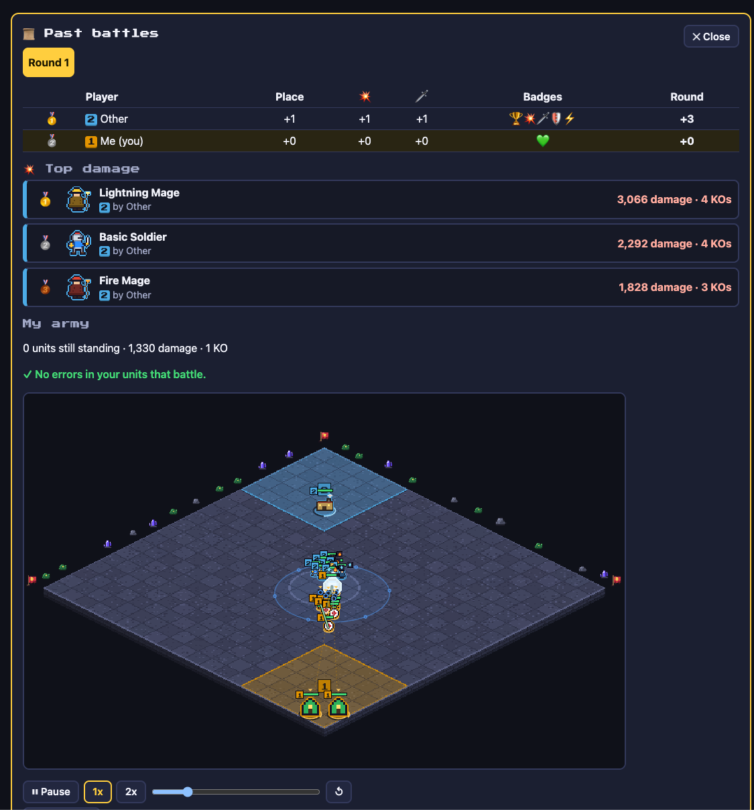<br><b>Past battles</b> · replay earlier rounds</td>
    <td valign="top">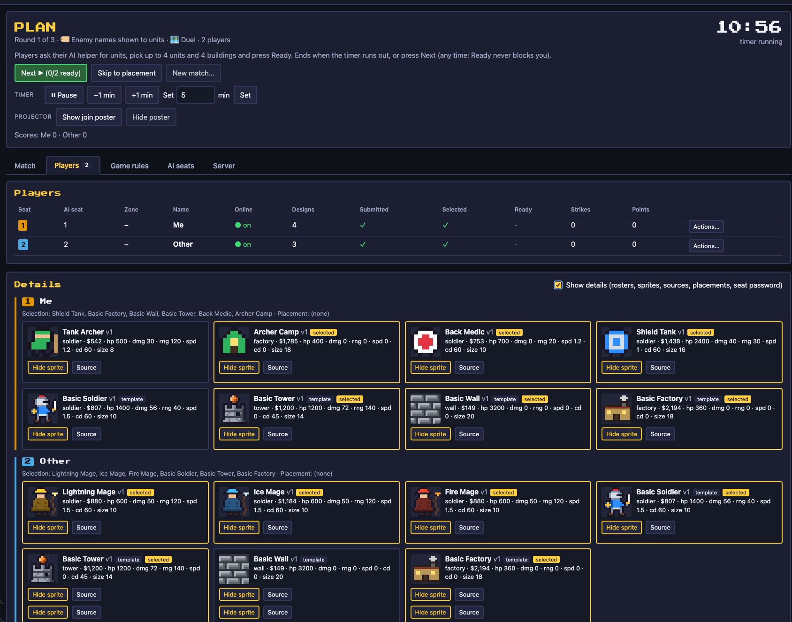<br><b>/admin</b> · players, match setup and phase controls</td>
  </tr>
</table>

## How a round plays

A match is several rounds (free-for-all or teams, on a map that fits the player
count). Each round goes through four phases, run by a facilitator from /admin:

1. **PLAN**: players talk to their AI helper to design new units or improve old
   ones, then pick which unit and building types to field and press "I'm ready!".
2. **PLACEMENT**: each player places copies of their picks in their zone of the
   arena, within a budget.
3. **BATTLE**: the units fight on their own, running the code the AI helper
   wrote. The battle is shown live on the projector (/screen) and on each /play.
4. **RESULTS**: ranking, points and a per-unit report (including errors to hand
   back to the AI helper). Then the next PLAN starts.

After the last round comes an awards ceremony on the projector.

## Architecture at a glance

```
  Player laptops (2-8, browser only)          Projector / facilitator
  ┌──────────────────────────────┐            ┌──────────────────────┐
  │ /play: game + AI helper pane │            │ /screen     /admin   │
  └──────────────┬───────────────┘            └──────────┬───────────┘
                 │  HTTP + WebSocket (LAN)               │
                 ▼                                       ▼
  ┌─────────────────────────────────────────────────────────────────┐
  │ Game server (facilitator's laptop, Node, 0.0.0.0:8080)          │
  │ web pages, REST /api, MCP /mcp, WebSocket /ws, battle sim,      │
  │ isolated-vm sandbox, data/ on disk,                             │
  │ seat proxy /terminal/N/ (adds the seat password itself)         │
  └──────────────┬──────────────────────────────────▲──────────────┘
                 │ terminal traffic (ttyd, :778N)    │ MCP tools (submit_unit, ...)
                 ▼                                   │
  ┌─────────────────────────────────────────────────────────────────┐
  │ AI session host (Docker): one container per seat 1-8            │
  │ ttyd -> Claude Code or Codex in that seat's kit folder /kit     │
  └──────────────┬──────────────────────────────────────────────────┘
                 ▼ internet
          Anthropic / OpenAI API
```

- Player laptops only need a browser and the LAN. The AI helper's terminal is
  shown inside /play through the game server's proxy, so players never see a
  seat password.
- The game server needs no internet. Only the AI session host does.
- The server, the AI session host and the player laptops are usually separate
  machines on a router you bring. For a try-out everything can run on one.

How it all fits together (components, game flow, sandbox, sim, API): [docs/architecture.md](docs/architecture.md).

## Repo layout

| Path | What it is |
|---|---|
| `packages/shared/` | Types, config schema, unit cost formula, maps and teams, shared by server and client |
| `packages/server/` | Game server: Express, REST + MCP + WebSocket, validator, sandbox (isolated-vm), battle sim, seat proxy |
| `packages/client/` | Web pages (Vite + Preact, Canvas 2D arena): `play`, `screen`, `admin`, `setup`, `guide` |
| `packages/starter-kit/` | Templates for each seat's kit folder: the AI helper's instructions, MCP config, starter units, first prompt |
| `sessions/` | The AI session host: Dockerfile, `docker-compose.yml` (seats 1-8), `entrypoint.sh` |
| `config/default.json` | All game tunables (costs, caps, budget, timers, points); also editable live in /admin |
| `scripts/` | Dev/start launchers, bots, balance tools |
| `tests/` | Vitest suites, fixtures, load test |
| `docs/` | [architecture.md](docs/architecture.md), [decisions.md](docs/decisions.md) and the README screenshots |
| `data/` | Runtime state (gitignored): players, units, replays |

## Prerequisites

- **Game server:** Node **24 LTS** (22.13+ also works; other versions are
  refused by `engines` and a preflight check, e.g. Node 26 has no isolated-vm build). A C++ toolchain (Xcode
  Command Line Tools / VS Build Tools) is good insurance for isolated-vm. Run it
  on the host OS, not in a dev container (its ports only forward to localhost).
- **AI session host:** Docker with Compose v2 and BuildKit. About 1 core and 2 GB RAM
  per seat (8 cores / 16 GB for all 8). Internet access, plus a Claude account
  for the event (and/or an OpenAI login for Codex seats).
- **Player laptops:** a browser.
- `make` (GNU make 3.81+, as shipped with macOS) for the shortcuts below. Every
  target is a thin wrapper, so the npm or `docker compose` command works too.

Run `make` to list every target.

## Quick start: try it on one machine

```sh
make install        # npm ci
make build
make start          # prints the LAN URLs, a /play QR and the admin password
```

Open `http://localhost:8080/admin` (password from the start output, or set
`ADMIN_PASSWORD`), `/screen` in another window and `/play` in a third. Without
the AI session host, /play still works (join, pick, place, battle) with the starter
units and the built-in code editor; `make bots PLAYERS=3` adds bot players so
you can start a match alone.

To add AI seats on the same machine, follow the event-day steps below with
`PIXEL_CLASH_URL` set to the machine's **LAN IP** (containers can't reach the
server through `localhost`) and the AI session host address `127.0.0.1` in /admin.

For development, `make dev` runs the server under `tsx watch` with the Vite dev
server (hot reload).

## Event-day setup (two machines)

Full details, sizing, firewall rules and troubleshooting:
[sessions/README.md](sessions/README.md).

**Game server laptop:**

```sh
make install && make build
make start          # note the LAN URL and the admin password
```

Allow Node through the OS firewall (TCP 8080) and turn off sleep.

**AI session host (the day before):**

```sh
# Copy the command from the game server's /admin -> AI seats -> AI session host setup:
make seats PIXEL_CLASH_URL=http://<game-server-LAN-IP>:8080 SEAT_SECRET=<from /admin>
#   writes both into sessions/.env and starts all 8 seats (add N=4 for seats 1-4);
#   later runs need only: make seats
make seats-ps                 # all "running (healthy)" after ~30 s
# Optional: only if you did NOT paste a shared agent login into
# /admin -> AI seats -> Agent login. Logs one seat in by hand:
# make seat-login SEAT=1      # /login with the event account, trust /kit, /exit
#                             # repeat per seat (Codex: make seat-login-codex SEAT=n)
# make seats-restart          # then restart so every terminal starts logged in
make seat-check SEAT=1        # versions, login, game server + API reachable
```

**Connect them:** in /admin → AI seats enter the AI session host's address (IP only).
The seat password is already shared (the game server made it up and the setup
command carried it). Every running seat should turn green.

**Player laptops:** open `/play` (the join QR on /setup or the projector). Players
join with a name and a 4-digit PIN and get a free AI seat automatically (the
laptop's seat from last time if it is free); their AI helper is ready and already
logged in as them. No seat cards and no kit download: everything is in the browser.

**During the event:** `make new-player SEAT=n` clears a seat for a different
player; `make seats-restart SEAT=n` unsticks a terminal; `make seats-logs SEAT=n`
shows what a seat is doing.

**After the event:** `make wipe` on the game server (or Wipe in /admin) and
`make seats-wipe` on the AI session host (deletes all seat volumes, including the
logins). Then sign the event account out of all sessions (and revoke any OpenAI
key): any seat could read its own login.

## Pages and who uses them

| Page | Who | What |
|---|---|---|
| `/play` | Players | Join, the AI helper terminal side by side with the game: roster, picks, placement, live battle, results, unit guide, code editor |
| `/screen` | Projector | Arena, timers, join QR, ready ticks, battles, scoreboard, awards ceremony |
| `/admin` | Facilitator | Run the match and manage players and AI seats (password protected) |
| `/setup` | Facilitator | LAN URLs, join QR, setup checklist |
| `/guide` | Anyone | The unit guide: the rules for units, built from the live config |

## Admin features (brief)

- **Match setup:** rounds, map style (with a preview), team mode, per-team
  budgets, drag players between teams, and options such as Open Armory, showing
  enemy names to units and whether walls are allowed.
- **Phase controls:** Next, Skip, START / Force start, pause, 1x/2x, timer
  changes, replay, New match.
- **Players:** kick, reset PIN, validate or submit a unit on a player's behalf
  (the fallback when the AI helper is down).
- **AI seats:** AI session host address and seat password, live status per seat,
  turn seats on/off, reassign players, open a seat's terminal to help out.
- **Config editor** for costs, caps, budget, timers and points (units are
  re-priced on save), server info with LAN URLs and QR codes, and Wipe.

More in [docs/architecture.md](docs/architecture.md) (client pages).

## Testing and balance tooling

| Command | Does |
|---|---|
| `make test` (`npm test`) | Vitest suites plus a performance check |
| `make typecheck` | TypeScript checks for all packages |
| `make balance` (`npm run balance`) | Fast round-robin balance report; `ARGS="--config patch.json"` to try a config change |
| `npm run balance:exploit` | Search for overly strong legal armies (pre-event check after a retune) |
| `npm run balance:sweep` | Compare several values of one config setting |
| `npm run loadtest` | Drive a full 8-player match against a running server |
| `make bots PLAYERS=n` | Fake players for rehearsals |

How the test passes and the balance tools work:
[docs/architecture.md](docs/architecture.md) (testing and balance tooling).

## More reading

- [docs/architecture.md](docs/architecture.md): how the game is built (machines,
  repo layout, game flow, auth, unit contract, economy, validation, sandbox,
  simulation, API and MCP, AI seats, config, testing, conventions).
- [docs/decisions.md](docs/decisions.md): the design decisions and why.
- [sessions/README.md](sessions/README.md): the AI session host in depth.
- [packages/starter-kit/](packages/starter-kit/): what the AI helpers read
  (`CLAUDE.md.tmpl`) and the prompt ideas for players (`PROMPTS.md`).

<a href="https://buymeacoffee.com/redging.very.well"></a>
