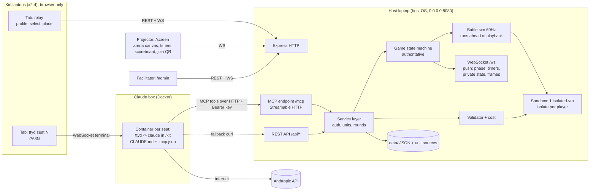
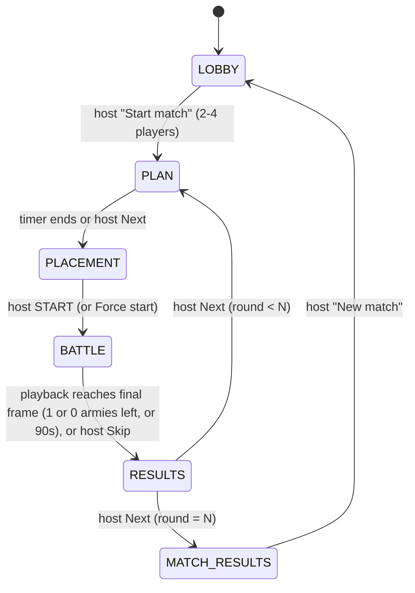

# Pixel Clash: Build Plan

A LAN auto-battler for up to 4 players. Kids design units by talking to Claude Code on their own laptops. Claude submits the unit code to the game server over MCP. The server checks each unit, prices it, and runs it in a sandbox. Kids pick and place their units on a web page, and the battle plays on the projector.

Status: implementation-ready spec. Written 2026-10-20. The event is a few days away.

---

## 1. Overview, goals, non-goals

### Event context
- Kids coding day, ages about 9-13. Each game has 2-4 kids. Kid laptops need **only a browser**, with two tabs: `/play` on the game server and their seat's **ttyd** web terminal. Kids **only prompt Claude**. They never write or paste code by hand.
- **Two machines** on a router or hotspot that we bring:
  - **Game server**: runs Pixel Clash on its host OS (not in the devcontainer). A projector shows the arena, and a facilitator runs the game from an admin panel.
  - **Claude box**: runs one Docker container per seat. Each container runs ttyd, which starts `claude` directly in that seat's kit folder (no shell). The facilitator logs Claude Code in beforehand.

### Goals
1. Kids learn the loop "describe → Claude writes code → the server checks it → watch it fight → improve it" over several rounds.
2. Zero hand-editing. The MCP tools and the error messages are written so Claude can fix problems by itself.
3. Running untrusted code can never crash the game or freeze the projector, and it can never reach the host's files or network.
4. A playable vertical slice exists early (milestone M3). Polish (sound, animations, replay, retro style) is in scope and comes last.

### Non-goals
- Internet hosting, accounts, analytics, or any external calls from the server.
- Pathfinding or obstacles. Movement is straight-line.
- Uploading files or hand-pasting code as the main path. A paste box exists only in the facilitator rescue path.
- More than 4 players in a match, or more than one match at a time.
- Anti-cheat beyond the sandbox, the engine's authority over actions, and the stat snapshot.

---

## 2. Architecture



Key points:
- **One process, one port** (default 8080) serves the static client build, REST, MCP, and WebSocket.
- **The server is authoritative.** Clients never compute game results. The sim runs on the server and streams frames.
- **One service layer.** REST and MCP handlers are thin adapters over `services/*` and return the same result and error objects.
- **Network paths:** kid laptops need only the LAN (to the game server and the Claude box). The **Claude box** needs the LAN (to the game server's `/mcp`) **and** internet (to Anthropic). The game server needs no internet. The router must provide both (see §15).
- **Seat isolation.** Claude Code can run shell commands, so each seat's Claude runs in its own container with only its own kit folder mounted. A kid can't reach another seat's folder or key, or the game server's `data/` (§11.1).
- **Battle results are held on the server until the projector shows them.** The sim runs ahead of playback, but nothing about the outcome (phase change, ranking, points, scoreboard, battle reports, `battle:end`) is sent to anyone until playback reaches the final frame (§9).

---

## 3. Game flow state machine



The BATTLE → RESULTS transition follows the **playback clock**, not the sim clock. The sim may finish early. Its result is held server-side and released only when playback shows the final frame, or when the host presses Skip (§9 End).

Default timers (all in config, and the host can change them live):

| State | Timer | When the timer ends |
|---|---|---|
| LOBBY | none | waits for the host |
| PLAN | round 1: 15 min, later rounds: 8 min | auto-advance to PLACEMENT |
| PLACEMENT | 3 min | stays in PLACEMENT and shows "Waiting for host START". There is **no auto-start**. |
| BATTLE | 90 s of sim time, with a visible countdown | ends and is ranked (§9) |
| RESULTS | none (the host presses Next) | n/a |

### What each actor can do in each state

| State | Kid via Claude (MCP/REST) | Kid via /play page | Projector /screen | Facilitator /admin |
|---|---|---|---|---|
| LOBBY | `login`, `get_rules`, `get_unit_contract`, `validate_unit`, `get_game_state`, `list_my_units`, `get_unit_source`. **No submit.** | create player or log in, download kit, view own roster | title, LAN URL + QR, joined player names | start match, set N rounds, kick/reset PIN, config, validate on behalf |
| PLAN | everything above + **`submit_unit`** (new or revised) | view own roster and costs, **select ≤3 types** | phase, timer, per-player status icons only (✓ submitted, ✓ selected) | next/skip, timer ±, pause timer, **submit on behalf**, kick/reset PIN |
| PLACEMENT | read-only tools + `validate_unit` | see own zone for this round, place copies on it, live budget, Ready toggle, "Copy last layout" | timer, Ready ticks only | START, Force start, timer ±, kick, validate on behalf |
| BATTLE | read-only tools + `validate_unit` | watch the live battle, see own unit health and errors | **reveal**, then the live battle canvas, 90 s countdown | pause/resume, 1x/2x, skip to results, kick (takes effect after the battle, §4) |
| RESULTS | read-only tools + `validate_unit` + `get_battle_report` | place, points, own unit report with "Ask Claude to fix" prompts | round ranking, scoreboard, Replay button | Next, Replay, validate on behalf |
| MATCH_RESULTS | read-only tools + `validate_unit` + `get_battle_report` | final standings | podium + final scoreboard | New match, wipe |

"Read-only tools" means `get_rules`, `get_unit_contract`, `get_game_state`, `list_my_units`, `get_unit_source`, `get_battle_report`, plus `login`.

Selections lock when PLAN ends. A selection references `unitId`s and resolves to each unit's **latest valid version** at lock time. Units with `status: invalid` (§6 re-pricing) are dropped from the selection. If a player's selection is then empty, the server uses their previous round's selection if all those units are still valid. Otherwise it uses their 3 most recently submitted valid units, falling back to the templates. Invalid units are always skipped.

### Privacy: what is hidden from whom

Nothing about other players is visible before the host presses START.

| Data | Owner | Other players | Projector | Facilitator |
|---|---|---|---|---|
| Unit source code | yes | **never** | never | yes (rescue view) |
| Roster (names, stats, costs) | yes | after START: only the types fielded in this battle | after START: fielded types only | yes, behind a "show details" toggle (off by default, since the panel may be on screen) |
| Selection (≤3 types) | yes | after START | after START | toggle |
| Placement | yes | after START | after START | toggle |
| Status flags (submitted/selected/ready) | yes | yes | yes | yes |
| Scores, standings | yes | yes | yes | yes |

Enforcement is on the server. Every response and WS message is built per recipient by `services/visibility.ts`. The projector and other players get no placement or roster data until `battle.revealed = true`. It is never filtered on the client.

---

## 4. Player identity and auth

| Thing | Spec |
|---|---|
| Create player | `name` (1-16 chars, letters/digits/space/-/_, case-insensitive unique) + `pin` (exactly 4 digits). The PIN is stored as an scrypt hash. |
| Seats | max 4 players in the match. Joining in LOBBY or PLAN takes a seat. Joining later gets "you're in from the next round". When all seats are full: `GAME_FULL`. A seat is a player slot (0-3) that fixes the player's colour and instance-id prefix. **A seat is not a zone.** Zones are assigned per round (§9 Zones). |
| Web session | `POST /api/login` sets an httpOnly cookie `pc_session` (random 32 bytes, server-side map). It lasts until logout, kick, or PIN reset. |
| API key (for Claude) | each player gets one `pc_<24 random base32>` key. It is shown on /play under "My Claude kit" and embedded in the personal kit zip. REST and MCP accept `Authorization: Bearer pc_…`. MCP tools also accept an optional `apiKey` argument, which is used when no header is present. |
| MCP without a key (generic kit, the **primary path**) | each seat container on the Claude box gets the generic kit (§11.1). The MCP transport is **stateless**: nothing is bound to a session. Claude calls `login({name, pin})`, which returns `{player, apiKey}`. CLAUDE.md tells Claude to save that to `.pixel-clash/player.json` and pass `apiKey` on every later tool call. This survives server restarts and Claude Code restarts with no PIN re-entry. |
| Facilitator | admin password from env `ADMIN_PASSWORD`. If unset, the server generates 3 words and prints them at startup. `POST /api/admin/login` sets an `pc_admin` cookie. Admin endpoints take only the admin cookie. |
| Reset PIN | admin sets a new 4-digit PIN. This kills the player's web sessions but **keeps the API key**, so the kid's Claude kit keeps working. A separate "Rotate key" action (deferrable, §16) exists if a key leaks. |
| Kick | removes the player from the match and frees the seat. Sessions and key are revoked. Data stays until wipe unless "kick + delete" is chosen. **During BATTLE, a kick takes effect after the battle**: the sim may already be computed, so the player's units keep fighting in this battle. The player is then removed from the ranking (the others are ranked among themselves), gets no points for the round, and takes no part in later rounds. In any other phase a kick is immediate. |
| Rate limits (per player) | login 5/min, validate 1/s, submit 1 per 3 s. Over the limit: `RATE_LIMITED` with `retryAfterMs`. |

---

## 5. Unit contract

Kids' units are one JS module (TS syntax is tolerated) with a default-exported class. The contract below is served verbatim by `get_unit_contract` and copied into the kit's CLAUDE.md.

```ts
// packages/shared/src/contract.ts
export type UnitType = 'soldier' | 'tower';
export type Shape = 'circle' | 'square' | 'triangle' | 'diamond';

/** Fields the constructor MUST set as plain data properties on `this`. */
export interface UnitStats {
  name: string;          // 1-24 chars, shown on screen
  type: UnitType;        // towers never move
  maxHealth: number;     // see bounds table
  damage: number;
  range: number;         // pixels, EDGE to edge (gap between the two bodies)
  speed: number;         // pixels per tick (60 ticks = 1 s); towers: 0
  attackCooldown: number;// integer ticks between attacks
  color: string;         // "#RRGGBB": projectiles, particles, fallback sprite
  size?: number;         // body radius in px = hitbox AND drawn size. 6-20. Default soldier 10, tower 14. Costs $0.5 per px above 6 (more near the max).
  shape?: Shape;         // optional; only used by the fallback sprite when sprite() is missing
}

/** Pixel-art look, returned by the optional sprite() method (§5.1). */
export type SpriteFrame = string[];       // `grid` rows, each exactly `grid` chars; '.' = transparent
export interface SpriteSpec {
  grid: 8 | 12 | 16 | 24 | 32;            // square pixel grid per frame
  palette: Record<string, string>;        // 1-16 entries, single-char keys (not '.'), "#RRGGBB" values
  frames: {
    idle: SpriteFrame[];                  // required, 1-4 frames
    walk?: SpriteFrame[];                 // 1-4 (falls back to idle)
    attack?: SpriteFrame[];               // 1-4 (falls back to idle)
    hit?: SpriteFrame[];                  // 1 (falls back to a white flash of idle)
    death?: SpriteFrame[];                // 1-4 (falls back to a fade-out)
  };
}

export interface SelfView {
  id: string;            // instanceId of this copy, e.g. "2-0-3"
  unitId: string;        // the design this copy was made from
  ownerId: string; type: UnitType; name: string;
  x: number; y: number; radius: number; hp: number; maxHp: number;
  damage: number; range: number; speed: number;
  attackCooldown: number; cooldownRemaining: number; // 0 = can attack this tick
}
export interface OtherView {
  id: string; ownerId: string; type: UnitType; name: string;
  x: number; y: number; radius: number; hp: number; maxHp: number; range: number;
}
export interface WorldView {
  width: 800; height: 800; tick: number; ticksLeft: number;
  myCorner: { x: number; y: number };   // centre of my start zone (this round)
  center: { x: 400; y: 400 };
  safeZone: { x: 400; y: 400; radius: number }; // shrinks from tick 3600 (sudden death, §9)
}
// Helper semantics (also documented in CLAUDE.md):
// inRange(self, other) === Math.hypot(other.x - self.x, other.y - self.y) - self.radius - other.radius <= self.range

export type Action =
  | { action: 'idle' }
  | { action: 'move'; destination: { x: number; y: number } }
  | { action: 'attack'; targetId: string };

export interface Unit extends UnitStats {
  update(self: SelfView, enemies: OtherView[], allies: OtherView[], world: WorldView): Action | undefined;
  sprite?(): SpriteSpec; // called ONCE at validation, never in battle (§5.1)
}
```

`SelfView.radius` and `OtherView.radius` are the unit's `size`.

Rules (enforced by the engine, and written into CLAUDE.md):
1. **Stats are snapshotted at validation.** The server constructs the unit twice inside the sandbox, checks the stats, and stores a frozen `StatsSnapshot`. Combat reads only the snapshot. Changing `this.damage` inside `update()` has no effect.
2. **Extra state is allowed.** Any other fields on `this` (memory, targets, modes) persist between ticks for that unit instance. Module-level variables are shared between all of one player's units of the same type. Units of different types from the same player share `globalThis` inside that player's isolate. No state is ever shared with other players.
3. **`update()` is called once per tick** with fresh plain copies. Mutating the inputs does nothing.
4. **The returned action is a request, and the engine validates it:**
   - `attack`: the target must be a living enemy, `distance − self.radius − target.radius ≤ range + 0.5` (edge to edge, with 0.5 px float tolerance), and `cooldownRemaining = 0`. Otherwise the unit idles. An attack never auto-moves. Bodies that touch are always in range, so any legal range can hit any unit type.
   - **Cooldown timing:** `cooldownRemaining` is 0 at spawn, so every unit can fire on tick 0 if in range. It drops by 1 (not below 0) at the start of each tick, before views are built. Firing sets it to `attackCooldown`. So a unit with cooldown 60 fires on ticks t, t+60, t+120, ….
   - `move`: soldiers only. The destination must be finite numbers. It is clamped to the arena, and the unit moves at most `speed` px toward it. Towers idle on move.
   - `idle`, `undefined`, an unknown action, a malformed object, a Promise, or a thrown error all mean idle. A throw also counts a strike (§8).
5. No `import`, `require`, network, timers, or `async update`. None of them exist in the sandbox.

### Stat bounds (config: `stats.bounds`)

| Field | Rule | Notes |
|---|---|---|
| name | string, 1-24 chars after trim, no control chars | rendered only via `textContent`/`fillText` |
| type | `'soldier'` or `'tower'` | |
| maxHealth | finite number, 10-500 | tightened from 1000 so concentrating everything in 1-2 units doesn't pay (§6) |
| damage | finite number, 0-60 | tightened from 200 for the same reason. 0 is allowed (gives a warning) |
| range | finite number, 20-300 | edge to edge |
| speed | soldier: 0.5-5. tower: exactly 0 | a tower with speed > 0 gets `TOWER_CANNOT_MOVE` |
| attackCooldown | integer, 10-600 | 60 = one attack per second. Above 60 gets `W_SLOW_NO_DISCOUNT` (§6) |
| color | `/^#[0-9a-fA-F]{6}$/` | the owner is shown by an outline colour and ground ring, so kid colours never clash with ownership |
| size | optional, finite number, **6-20** (min and max unit size). Default soldier 10, tower 14 | body radius: hitbox, separation, edge-to-edge range, and drawn width (2 × size). Max 20 means one unit exactly fills a 40 px placement cell |
| shape | optional, one of 4 values | fallback sprite only |

### 5.1 Unit rendering: `sprite()`

Units draw themselves with pixel art. The renderer never runs kid code: `sprite()` is called **once in the validation isolate** (50 ms), and its JSON-copied result is checked and stored with the unit (`sprite` in the unit record). Clients receive the stored sprite at reveal and draw it.

- **Optional.** Without `sprite()`, the client generates a fallback sprite from `color` + `shape` and gives the warning `W_NO_SPRITE` ("Ask Claude to draw a pixel-art sprite for your unit!"). Both templates include a sprite, so Claude learns the format from them.
- **Display size follows `size`, not `grid`.** The sprite is a billboard (upright, facing the camera) anchored at the unit's feet, drawn `2 × size` logical px wide (times the iso zoom), with height = width. So `grid` only sets the pixel detail, and every unit's drawn size stays between the min and max unit size. Nearest-neighbour scaling keeps the pixels crisp.
- **Animation** (client-side, 8 fps): `walk` while the unit moved this frame, `attack` for 250 ms after it fires, `hit` for 100 ms after taking damage, `death` once, then fade. The sprite is mirrored horizontally to face its movement or target direction, so sprites should be drawn facing right.
- **Ownership** is drawn by the engine, not the sprite: a 1 px outline in the seat colour around opaque pixels, a seat-coloured ground ring (ellipse), and the HP bar above. Disabled units get a 💤 bubble.
- **Validation rules:** `grid` is one of the allowed values; palette has 1-16 single-char keys (not `.`) with `#RRGGBB` values; every frame has exactly `grid` rows of exactly `grid` chars, using only palette keys or `.`; frame counts are within limits; at least 10% of the idle frame's pixels are opaque; and the spec is deterministic (it is called twice and must match). Errors: `SPRITE_THREW`, `SPRITE_BAD_GRID`, `SPRITE_BAD_PALETTE`, `SPRITE_BAD_FRAME` (with `state`, `frame`, `row`, `col`), `SPRITE_TOO_MANY_FRAMES`, `SPRITE_EMPTY`, `SPRITE_NOT_STABLE`. Each comes with a `fix`.
- **Moderation:** the facilitator can press **Hide sprite** on any unit in /admin. That unit then uses the fallback sprite everywhere (a kid could draw something inappropriate).
- **Privacy:** a sprite is part of the roster, so it is hidden until START and sent in `battle:reveal` only for fielded types.

---

## 6. Cost formula and economy

```
term_i = c_i × x_i × (1 + k × r_i²)          r_i = x_i / max_i   ("the curve", k = cost.curveK = 2)
raw    = (Base + Σ term_i) × max(1, 60 / attackCooldown)
cost   = ceil(raw - 1e-9)                    // whole credits; the epsilon guards float noise

x_i / max_i:  HP / 500,  Damage / 60,  Range / 300,  Speed / 5,  (Size - 6) / 14
```

- **The curve.** Each stat term is its linear price `c_i × x_i` times `1 + k·r²`, where `r` is how far the stat is towards its §5 max. With k = 2 a stat at **half** its max costs **1.5×** its linear price and a **maxed** stat costs **3×**. Every term is convex, so one unit with doubled stats costs more than two normal units (once a stat reaches about half its max; the per-unit Base is the only thing that favours fewer units). This is what discourages pouring the whole budget into one expensive unit. The curve maxima are the default §5 bounds (fixed in code, so a live bounds retune doesn't move the curve). `curveK` is in config: 0 gives the old linear formula, the schema allows 0-5 (a negative k would make cost fall as a stat rises, so it is refused).
- **Explained in the output.** The breakdown returned by validate/submit has, per stat, the linear part and the curve surcharge, e.g. "maxHealth 500 costs $375: $125 base + $250 for being near the max (100% of max)". Any stat at ≥ 80% of its max gives the non-fatal warning `W_STAT_NEAR_MAX` ("maxHealth is at 96% of max and costs 2.84× its normal price; two medium units usually beat one maxed one"), with a `fix` that names a lower value and the saving. `UNIT_TOO_EXPENSIVE` names the most expensive stat and the saving of a concrete lower value ("Lowering maxHealth from 500 to 300 saves $246").
- The cooldown factor scales the **whole** stat sum. It is **clamped at 1**, so slow attackers (cooldown > 60) get no discount. That makes any cooldown above 60 strictly worse (same price, less damage per second), so the validator warns with `W_SLOW_NO_DISCOUNT`: "Attacking slower than once per second doesn't make it cheaper. Set attackCooldown to 60 for free extra damage." The same tip is in CLAUDE.md §5 and in the `get_unit_contract` strategy tips.
- Coefficients (`curveK` included) and bounds live in config and can be retuned live in LOBBY, PLAN, or RESULTS. A change re-prices every stored unit.
- **After a re-price or bounds change**, any unit that now breaks the $500 cap or a bound gets `status: "invalid"` with the new error object (`UNIT_TOO_EXPENSIVE` or `STAT_OUT_OF_RANGE`, with its `fix`). An invalid unit can't be selected or placed, is dropped from current and carried-over selections (with a toast to the owner), is skipped by the selection fallback, and shows up in `list_my_units` and `GET /units` so Claude can revise it. The config editor refuses a retune that would make either template invalid.

Retuned defaults. With the curve on the previous linear coefficients the templates came out at soldier $113 and tower $261, so the linear part was lowered (mostly Base, range, speed and size) to bring the templates back to about $90-200:

| Coefficient | Original | Linear (before the curve) | **Default with the curve** |
|---|---|---|---|
| Base | 50 | 20 | **10** |
| cHP (per HP) | 0.5 | 0.25 | **0.25** |
| cDmg (per damage) | 3.0 | 1.5 | **1.5** |
| cRange (per px) | 1.5 | 0.3 | **0.2** |
| cSpeed (per px/tick) | 20 | 15 | **12** |
| cSize (per px of size above 6) | n/a | 1 | **0.5** |
| k (`curveK`) | n/a | n/a | **2** (maxed stat = 3×) |

Size defaults (soldier 10, tower 14) apply when `size` is omitted, and they are priced.

### Reference units (curve k = 2)

"Linear" is Base + Σ c_i·x_i (the old shape), "Curve" is Σ c_i·x_i·k·r_i², Sum = Linear + Curve. The last column is what the unit would cost without the curve (k = 0), for comparison.

| Unit | Type | HP | Dmg | Range | Speed | Size | CD | Linear | Curve | Sum | Factor max(1,60/CD) | Raw | **Cost** | Without curve |
|---|---|---|---|---|---|---|---|---|---|---|---|---|---|---|
| Basic Soldier (template) | soldier | 120 | 10 | 40 | 1.5 | 10 | 60 | 83 | +8.14 | 91.14 | 1 | 91.14 | **$92** | $83 |
| Basic Tower (template) | tower | 150 | 15 | 180 | 0 | 14 | 45 | 110 | +38.09 | 148.09 | 1.333… | 197.46 | **$198** | $147 |
| Big Tank | soldier | 500 | 20 | 40 | 0.8 | 20 | 60 | 189.6 | +271.44 | 461.04 | 1 | 461.04 | **$462** | $190 |
| Half Tank (maxHealth 250) | soldier | 250 | 20 | 40 | 0.8 | 20 | 60 | 127.1 | +52.69 | 179.79 | 1 | 179.79 | **$180** | $128 |
| Sniper Tower | tower | 80 | 40 | 280 | 0 | 14 | 60 | 150 | +154.53 | 304.53 | 1 | 304.53 | **$305** | $150 |
| Slow Sniper (the trap) | tower | 80 | 40 | 280 | 0 | 14 | 90 | 150 | +154.53 | 304.53 | 1 (clamped from 0.667) | 304.53 | **$305**, same price, ⅔ the DPS, `W_SLOW_NO_DISCOUNT` | $150 |
| Speedy Scout | soldier | 60 | 6 | 30 | 4 | 6 | 20 | 88 | +62.17 | 150.17 | 3 | 450.52 | **$451** | $264 |
| Scout with cooldown 10 | soldier | 60 | 6 | 30 | 4 | 6 | 10 | 88 | +62.17 | 150.17 | 6 | 901.03 | **$902, rejected** (> $500) | $528 |
| Old plan's "Laser Sniper" (as soldier) | soldier | 100 | 20 | 150 | 2 | 10 | 30 | 121 | +31.67 | 152.67 | 2 | 305.35 | **$306** | $242 |
| Half stats at CD 60 | soldier | 250 | 30 | 150 | 2.5 | 13 | 60 | 181 | +85.5 | 266.5 | 1 | 266.5 | **$267** | $181 |
| Max stats at CD 60 | soldier | 500 | 60 | 300 | 5 | 20 | 60 | 352 | +684 | 1036 | 1 | 1036 | **$1036, rejected** (> $500) | $352 |
| Everything maxed | soldier | 500 | 60 | 300 | 5 | 20 | 10 | 352 | +684 | 1036 | 6 | 6216 | **$6216, rejected** (> $500) | $2112 |
| Cheapest legal | tower | 10 | 0 | 20 | 0 | 6 | 600 | 16.5 | +0.04 | 16.54 | 1 | 16.54 | **$17** | $17 |

Example armies within $1,000: 4 Basic Soldiers + 3 Basic Towers = $962 (7 units). 1 Sniper Tower + 3 Basic Soldiers + 2 Basic Towers = $977 (6 units). 1 Big Tank + 5 Basic Soldiers = $922 (6 units). 1 Speedy Scout + 5 Basic Soldiers = $911 (6 units). Two Big Tanks ($924) leave no room for a third template-sized unit, and one maxed unit ($1036) can't even be built, while two "Half stats" units cost $534. These hit the 4-8 unit target.

**Size trade-off.** A bigger body reaches targets sooner (range is edge to edge, so +10 size is +10 effective reach for both sides of a fight), wins shoving matches in separation, and looks impressive, but it is easier to block in and is reachable from further away. The $0.5/px term (3× at size 20) keeps "max size everything" from being free.

**Why the curve (and why the bounds were tightened).** With linear pricing every unit pays a fixed overhead (Base, plus the minimum stats), so concentrating stats into a few big units was efficient: with the original bounds (HP 1000, damage 200) two ~$490 "bricks" beat most armies, and even after tightening the bounds (HP ≤ 500, damage ≤ 60) a once-per-second unit with every stat maxed cost only $414. The k = 2 curve makes each stat's price convex: the first half of a stat is cheap, the last part costs up to 3×. A maxed-out unit at CD 60 now costs $1036 and is rejected, a 500-HP tank costs $462 instead of $190, and a 280-range sniper $305 instead of $150, while the templates stay at $92 and $198 (they sit at 13-60% of each max, where the curve adds little). Base was lowered to $10 so the per-unit overhead is small next to the curve: once any of HP, damage, range or speed reaches half its max, one unit with doubled stats always costs at least as much as two normal units (`tests/cost-curve.test.ts` checks this, together with monotonicity and convexity of every stat). A balance test (§14) checks that no single archetype dominates. If it fails, retune the coefficients, `curveK` or the bounds in config; the $500 cap stays.

### Caps and rules

| Rule | Default (config) | Error code |
|---|---|---|
| Single unit cost | ≤ $500 (checked on the rounded cost) | `UNIT_TOO_EXPENSIVE` |
| Budget per round | $1,000. Resets every round. Unspent credits don't carry over. | `OVER_BUDGET` |
| Designs | free to register. Max 8 active designs per player. Revisions replace a design and don't count. The 2 templates don't count. | `TOO_MANY_DESIGNS` |
| Types fielded per round | ≤ 3 | `TOO_MANY_TYPES` |
| Copies placed per player | ≤ 12 (performance guard; 4-8 is typical) | `TOO_MANY_COPIES` |

Every player starts with the two templates pre-registered, so nobody is ever unarmed. The cost breakdown (each term with its linear part and curve surcharge, the sum, the factor, the total) is returned by validate/submit and shown on unit cards.

---

## 7. Validation pipeline

`services/validator.ts` runs the same steps for `validate_unit` (dry-run, nothing stored) and `submit_unit` (stores on success).

| # | Step | Failure codes |
|---|---|---|
| 1 | **Normalize.** Max source size 64 KB (sprites take room). Strip markdown fences and any prose outside them. CRLF→LF. | `SOURCE_TOO_LARGE`, `EMPTY_SOURCE` |
| 2 | **Transpile** with esbuild `transform` (loader `ts`, **format `cjs`**, target `es2022`). Syntax errors come back with line and column. CJS avoids isolated-vm module linking entirely. | `SYNTAX_ERROR` |
| 3 | **Import check.** esbuild turns any `import … from` into `require(…)`, and keeps `import(`. Reject if the transpiled output contains `require(` or `import(` (regex on the output). As a backstop, no `require` exists in the isolate, so anything missed throws at evaluation. | `IMPORT_NOT_ALLOWED` |
| 4 | **Evaluate** in the validation isolate (32 MB, 1000 ms total wall budget) by wrapping the output as `(function(module, exports){ … })` and reading `module.exports.default`. It must be a class or function. | `NO_DEFAULT_EXPORT`, `NOT_A_CLASS`, `EVAL_THREW`, `TIMEOUT` |
| 5 | **Construct twice** (50 ms each). The harness reads each stat with `Object.getOwnPropertyDescriptor`. It must be an own **data** property, with no getters or setters and no inheritance. The values are JSON-copied out. | `CONSTRUCTOR_THREW`, `STAT_MISSING`, `STAT_IS_GETTER` |
| 6 | **Hard guards** per the bounds table: `typeof` checks (no coercion of `"100"`), `Number.isFinite`, ranges, integer cooldown, color regex, name rules, tower speed 0. | `STAT_WRONG_TYPE`, `STAT_NOT_FINITE`, `STAT_OUT_OF_RANGE`, `COOLDOWN_NOT_INTEGER`, `BAD_COLOR`, `BAD_NAME`, `TOWER_CANNOT_MOVE` |
| 7 | **Determinism.** Both constructions must give identical stats. | `STATS_NOT_STABLE` |
| 8 | **Cost.** It must be finite and ≤ cap. The error names the most expensive term. | `UNIT_TOO_EXPENSIVE` |
| 8b | **Sprite.** If `sprite` exists, call it twice (50 ms each), JSON-copy the results (max 200 KB) and check them per §5.1. Store the normalized spec. If it is missing, warn. | `SPRITE_*` (§5.1), `W_NO_SPRITE` |
| 9 | **Dry-run `update()`.** 3 synthetic worlds (no enemies / one enemy in range, measured edge to edge like the engine / 3 enemies far away), 5 ticks each, 20 ms per call. It must not throw, and each return must be a valid Action or undefined. | `UPDATE_MISSING`, `UPDATE_THREW`, `UPDATE_TIMEOUT`, `BAD_ACTION` |
| 10 | **Warnings** (non-fatal): never attacks when an enemy is in range, soldier never moves, damage 0, returns undefined, update is slower than 2 ms, cooldown above 60. | `W_NEVER_ATTACKS`, `W_NEVER_MOVES`, `W_ZERO_DAMAGE`, `W_RETURNS_NOTHING`, `W_SLOW`, `W_SLOW_NO_DISCOUNT` |

Steps 1-8 ship in M1. Steps 9-10 and the full malicious fixture set ship in M6 (§16).

A stored unit is `{ unitId, ownerId, version, status: "valid"|"invalid", source, compiledJs, stats: StatsSnapshot (Object.freeze, includes the resolved size), sprite: SpriteSpec | null, spriteHidden: boolean, cost, breakdown, sha256, createdAt }`.

**Unit identity and revisions.** `validate_unit` and `submit_unit` take an optional `unitId`.
- With `unitId`: this is a revision of that design. It creates a new version and may change the name. `NOT_FOUND` if the player doesn't own it.
- Without `unitId`: if the name's slug matches one of the player's designs, that design is revised. Otherwise a new design is created with `unitId` = slug of the name (suffixed `-2`, `-3`, … on collision with a retired design).
- CLAUDE.md tells Claude to always pass `unitId` (from `list_my_units`) when the kid asks to change an existing unit, so renaming "Swift Ninja" to "Swift Ninja II" doesn't silently use a new design slot or orphan the selection.
- Older versions are kept for the facilitator view. Selections follow the design to its latest valid version (§3).

### Error format (written for Claude first, the kid second)

```json
{
  "ok": false,
  "errors": [
    {
      "code": "STAT_OUT_OF_RANGE",
      "field": "damage",
      "value": 999,
      "allowed": { "min": 0, "max": 60 },
      "message": "damage is 999 but must be between 0 and 60.",
      "fix": "In the constructor set this.damage to a number from 0 to 60, e.g. this.damage = 40."
    }
  ],
  "warnings": [],
  "cost": null,
  "kidHint": "Whoa, that unit hits WAY too hard! Ask Claude to lower its damage."
}
```

- `SYNTAX_ERROR`, `*_THREW` and `BAD_ACTION` include `line`, `column`, the `excerpt` (3 lines of source), and the thrown `errorMessage`.
- `UNIT_TOO_EXPENSIVE` includes `breakdown` and a `fix` that names the biggest lever. Example (Scout with cooldown 10, $902): `"Cost is $902 but the max is $500. The ×6 cooldown factor is the biggest cost: raising attackCooldown from 10 to 20 makes it ×3 ($451). The most expensive stat is speed: 4 costs $109.44 before the factor ..."`.
- A success returns `{ ok: true, unit: {unitId, version, stats, cost, breakdown}, warnings, kidHint }`.

---

## 8. Sandbox and execution

**Threat model.** The code is Claude-generated for kids on a closed LAN. Accidents (infinite loops, huge arrays, throws) are near-certain, and malice is unlikely. The sandbox must still be a real boundary, because whatever runs there runs on the facilitator's laptop.

**Not security boundaries:** `node:vm` (the docs say so explicitly; prototype escapes reach `process`) and plain `worker_threads` (they get full Node APIs). Neither is used alone for untrusted code.

### Choice: `isolated-vm` (V8 isolates)
- Each isolate is a separate V8 heap with **no Node APIs**: no `require`, `process`, `fs`, `fetch`, timers, or network. Only what we inject exists.
- It has a hard **memory limit** (`new ivm.Isolate({ memoryLimit: 32 })`, in MB) and a **per-call timeout** (`ref.apply(…, { timeout })`). A timeout terminates the running script, and the host gets an error.
- Async `apply` runs on the libuv thread pool, so the 4 players' ticks run **in parallel** and the Express event loop stays responsive. The pool is shared with validation calls and fs, so the start script sets `UV_THREADPOOL_SIZE=8`.
- Requirements: a native addon. Use **Node 24 LTS** (or 22.13+). isolated-vm 6.1.2 ships prebuilds only for Node 22 (ABI 127) and 24 (ABI 137) on darwin-arm64, linux-arm64/x64 and win32-x64; **Node 26 is not supported** (no prebuild, confirmed on the macOS arm64 host). Keep the isolated-vm version matched to the Node version, and start Node with `--no-node-snapshot` (required on Node ≥ 20). If no prebuild matches, `npm ci` falls back to node-gyp, which needs Python and a C++ toolchain. **Verify the install on the host OS in M0 (§16). This is the go/no-go for the fallback.**

### Layout
- **Validation**: a fresh isolate per validate/submit call, disposed afterwards.
- **Battle**: **one isolate per player per battle**, created at START. Each of that player's ≤3 unit types is evaluated with the same CJS wrapper as validation. The harness (`sandbox/harness.ts` exports its source as a string constant, so the build needs no stray `.js` asset) exposes:
  - `__spawn(instanceId, unitId)` constructs an instance of design `unitId` and keeps it in a Map inside the isolate.
  - `__tick(inputJson) → outputJson` loops over that player's living instances. Before each `update()` call it writes the instance id to the isolate global `__current`. It calls `update` in a per-unit `try/catch`, then returns `[{instanceId, action} | {instanceId, error: {message, line}}]`.
- **Identifiers:** `unitId` always means a **design** (§7, selection, placement, MCP). `instanceId` means one placed **copy** in a battle (= `SelfView.id`), defined as `${seat}-${row}-${col}` and assigned at lock time from the zone-local cell (§9).
- I/O crosses the boundary as JSON strings (one copy each way per tick per player).
- `Math.random` is replaced with a seeded PRNG (seed = battleSeed + playerSeat), and `Date.now` returns the sim time. Both are **pure JS inside the harness**. This keeps replays and re-sims reproducible.

### Isolate hardening rules
- **No host References or Callbacks** are ever placed in a battle or validation isolate (no logger, no helpers). All I/O is JSON strings passed as `apply` arguments, and results come back with `{ result: { copy: true } }`.
- Kid code shares `globalThis` with the harness, so the harness captures `JSON.parse`, `JSON.stringify`, `Map`, `Function.prototype.call` and the instances' `update` references in a closure **before** any kid code is evaluated. `__tick` and `__spawn` are defined as non-writable, non-configurable properties, and the host calls them through `ivm.Reference`s taken before kid code runs, so reassigning `globalThis.__tick` changes nothing.
- The host parses `__tick` output defensively: non-JSON or a non-array means the whole tick idles plus a strike. It accepts **at most one action per instanceId**, and only for living instances **owned by that player**. Anything else (enemy ids, duplicates, unknown ids) is dropped and counts a strike.
- Microtask loops (`Promise.resolve().then(f)` recursing) and returned Promises are covered by fixtures. The tick must still return within timeout + 10 ms, or the isolate is disposed and the player disabled.

### Deadlines, strikes, disable

| Event | Effect | Default |
|---|---|---|
| A unit throws in `update()` | that unit idles this tick, and the unit gets +1 strike | |
| A unit reaches its strike limit | the unit is disabled for this battle (stands still, can still be hit). Friendly message: "Zappy got confused too many times and is taking a nap 💤" | 30 throws |
| A player's `__tick` exceeds the hard timeout | all that player's units idle this tick. The host then reads `__current` with a separate short call (`compileScriptSync('__current').runSync(ctx, {timeout: 5})`) to name the culprit unit. Its **first** timeout in the battle only gives it +1 strike and a report entry ("Zappy took too long once"), because one stall can be the host (GC, scheduler), not the kid's code. Its **second** timeout in the battle **disables that one culprit unit**, so a real infinite loop is napping by its second tick. The player's other units keep running. | 12 ms; disable on the 2nd timeout (`sandbox.battle.timeoutsToDisable`, default 2) |
| Timeouts continue after the culprit is disabled | all of the player's units are disabled for the rest of the battle. Only timeouts with no culprit left to blame count (none named, or it already naps); a culprit's own forgiven and disabling timeouts don't, so several copies of one looping design each nap and the rest of the army keeps fighting | 3 in a row or 5 total |
| `__tick` takes longer than the soft limit | +1 slow strike for the player. The harness keeps per-unit time (using the real `Date.now`, captured before kid code runs and never exposed) so the report can name the slowest unit. | 6 ms |
| Slow strikes reach the limit | disable the slowest unit first; if slow strikes continue, disable the player. This stops a 15-20 ms unit from stretching a 90 s battle and stalling playback. | 30 slow strikes |
| The isolate runs out of memory or crashes | dispose it and disable all of the player's units | |

Every strike and error is recorded in the player's **battle report** (§10) with the culprit `unitId`, `instanceId`, unit name, messages and line numbers, so Claude can read it and fix the unit. Disabled status lasts one battle only. Fresh isolates start each battle.

### Fallback (`config.sandbox = 'process'`): built only if M0 fails
If isolated-vm won't install on the host, each player runs in a `child_process.fork` started with `--max-old-space-size=64` and Node's permission model (`--permission`, which needs Node ≥ 22.13; earlier 22.x needs `--experimental-permission`). It grants no fs-write, no child processes, no workers, and fs-read only for the child runner, which is **bundled into a single file** so `--allow-fs-read` can name just that file. The child starts with an **empty env** (`env: {}`) so it doesn't inherit `ADMIN_PASSWORD` or other secrets. Inside it, the code runs in a `node:vm` context with frozen minimal globals and the `timeout` option. The host SIGKILLs the child when a reply misses `2 × hard timeout`, then disables that player.

**Residual risk (document for staff):** the permission model has no network control on Node 22. A `node:vm` escape in the child grants network access to the LAN **and the internet** (the router has an uplink, §15), plus read access to the allowed path. The process boundary and the vm layer make this unlikely for Claude-written kid code, but it is not a real sandbox.

A third mode, `'inproc-unsafe'` (vm only), exists for dev and tests only, and startup refuses it unless `--unsafe` is passed.

The `Runner` interface is shared by all modes: `create(player, units) → { spawn, tick(inputs): Promise<outputs>, dispose }`. Only `ivmRunner` and `inprocRunner` (tests) are built by default.

---

## 9. Simulation

| Item | Spec |
|---|---|
| Timestep | fixed **60 ticks/s** (`dt` = 1 tick; speeds and cooldowns are per tick). Max 5400 ticks (90 s). |
| Decoupling | the sim **runs ahead** as fast as the sandbox allows and writes frames to a buffer. Playback streams the buffer at 60 ticks/s × speed (1x/2x). Pause stops playback, not the sim. If the sim falls behind playback, playback waits and shows "thinking…". Clients interpolate between frames at their own render rate. |
| Result release | the sim's result is **held server-side**. The BATTLE → RESULTS transition, ranking, points, scoreboard, `battle:end`, `GET /battles/:round/report` and MCP `get_battle_report`/`get_game_state` results are released only when **playback** reaches the final frame. Until then `/state` reports phase BATTLE with the playback countdown. |
| Arena | 800×800 logical px, scaled to the canvas. |
| Zones | 4 corner zones, 240×240 each (6×6 grid of 40 px cells). **2 players use TL and BR, and 3 players use TL, TR, BR** (TR is the "middle" seat, next to both others). The middle is neutral. **Zones are assigned at the start of each PLACEMENT**, not at join: active players in join order get `zoneSet[(i + round) % n]`, so with 3 players each kid gets the middle seat once over 3 rounds. The player's own zone is sent in their `private` state; other zones stay hidden until START. |
| Placement | units snap to cell centres, one unit per cell, own zone only. `col`/`row` are **zone-local and mirrored so (0,0) is the cell nearest the arena centre**. That keeps "Copy last layout" meaningful when the zone rotates. The /play grid draws the zone in its true orientation. |
| Auto-place | at lock (START or Force start), any player with zero placements gets an automatic layout: "Copy last layout" if it is still valid and within budget, otherwise their selected types are placed greedily (cheapest first, round-robin across types) in the front cells up to the budget. Toast: "Auto-placed for X". Nobody gets an empty corner. |
| Instance ids | `${seat}-${row}-${col}` (zone-local cell), assigned at lock time. |
| Radii | each unit's `size` stat (6-20; default soldier 10, tower 14). Sent in the views as `radius`. Used for range, separation, clamping to the arena, and projectile hits. |
| Tick order | 1) decrement every `cooldownRemaining` (not below 0), then build views from the start-of-tick state; 2) call all players' `__tick` **in parallel** (`Promise.all`), then **apply the results in seat order, then instanceId order**, never in resolve order; 3) validate the actions; 4) apply moves for all soldiers; 5) separation; 6) fire attacks (firing sets `cooldownRemaining = attackCooldown`); 7) advance projectiles and apply hits; 8) apply sudden-death damage; 9) remove the dead (hp ≤ 0); 10) check elimination. All players' decisions use the same snapshot, so resolution is simultaneous. |
| Movement | straight line toward the destination, ≤ speed px/tick, clamped to the arena. |
| Separation | 2 relaxation passes. Overlapping pairs are pushed apart along the centre line. Towers never move: the soldier takes the full push. |
| Attacks | range is **edge to edge**: in range when `distance − rA − rB ≤ range + 0.5`. A range stat ≤ 50 counts as melee: instant hit with a swipe animation. Otherwise the attack spawns a **homing projectile** (10 px/tick) that always hits if the target is alive and vanishes if it dies. Range is checked when firing. `cooldownRemaining` starts at 0 at spawn. |
| Sudden death | from tick 3600 (60 s) a **safe circle** centred on (400,400) shrinks linearly from radius 570 (covers everything) to 60 at tick 5400. Units outside it lose 4% of maxHP per second. The ring is drawn on the projector and sent in `world.safeZone`, so units can react. This forces contact: towers are capped at range 300 and adjacent zones' nearest cells are 360 px apart (diagonal 509), so without it two all-tower armies could never touch each other and a max-HP tower turtle would win by sitting still. Ranking at 90 s is still by living cost (user rule). Radius, start tick and damage rate are config and get tuned in M6 against the balance tests (§14). |
| Friendly fire | none. Attacking an ally or a dead unit means idle. |
| Elimination | a player with zero living units is eliminated. With auto-place, nobody starts empty. |
| End | when ≤ 1 player has living units, or at tick 5400 (sim clock). The **visible** end is when playback reaches that frame. |
| Skip | `POST /admin/phase/skip` in BATTLE ends the battle at the **current playback tick**. Ranking uses the unit state from the recorded frame at that tick (as a timeout), never the sim's lead tick. The sim is stopped and the result is released at once. |
| Ranking | survivors rank above the eliminated. On timeout, survivors are ranked by the **total cost of their living units** (full unit cost, not scaled by HP). Eliminated players are ranked by elimination tick (later is better). Players kicked during this battle are removed before ranking (§4). |
| Ties | equal value or the same elimination tick share a place. Tied players get the points of the better place, and the next place is skipped. |
| Points | **round points = place points + damage bonus + value bonus** (all config, `scoring.*`). **Place:** 1st 3, 2nd 2, 3rd 1, 4th 0; the same table applies with 2-3 players. **Damage bonus:** `round(2 × myDamage / topDamage)` (0-2). **Value bonus:** `round(1 × myValueDestroyed / topValueDestroyed)` (0-1). Rounding is half-up. A bonus is 0 when the top value is 0. The bonuses (max 3) weigh about the same as 1st place, so an aggressive army that dies 2nd can outscore a turtle that survives. |
| Damage metric | **effective** damage dealt to enemy units: `min(hit, targetHpBeforeHit)` (no overkill). It is credited to the attacker's owner when the hit lands (projectiles on impact). Sudden-death damage is credited to nobody. |
| Value destroyed | when a unit's hit takes an enemy to hp ≤ 0, the attacker's owner is credited the victim's **full unit cost** and a kill. Hits in the same tick resolve in seat order, then instanceId order (deterministic), so exactly one owner gets each kill. Deaths from sudden death credit nobody. |
| Badges | titles only, **no points**, shown on RESULTS (projector, /play) and in reports: 🏆 **Last Standing** (1st place), 💥 **Biggest Hitter** (most damage), 🗡️ **Giant Slayer** (most value destroyed), 🛡️ **Iron Wall** (most living army value at the end). Ties share a badge. A badge needs a value > 0. |
| Skip / kick | on Skip, metrics are taken from the recorded counters at the playback tick (same as the ranking). Players kicked during the battle get no points or badges, but damage dealt **to** them still counts for others. |
| Match standings | total points, then total damage across the match as a tie-break, then a shared place. |
| Determinism | instance ids are deterministic (above) and units iterate sorted by instance id; there's a seeded PRNG and no `Math.random` in the engine. Placement order (debounced autosave) doesn't matter. Given identical sandbox results, the sim is bit-identical. Wall-clock timeouts can differ between runs, so **replay plays back recorded frames** rather than re-simulating. |
| Frames | every 2nd tick, `{t, units:[[instanceId,x,y,hp,flags]], projectiles, safeZoneRadius, events:[spawn,hit,death,disable,fire]}`. `flags` include moved, fired and facing-left bits, which drive the sprite animation and mirroring (§5.1). Sim coordinates stay top-down; isometric is purely a rendering projection (§12). | The last battle is kept in memory and in `data/replays/round-N.json`. |

---

### 9.1 Open Armory (optional mechanic)

Units that fought become available to **every** player in later rounds. Copying an overpowered unit lets other players counter it, and inventing something good gets you noticed.

| Item | Spec |
|---|---|
| Toggle | `armory.enabled` (default **off**). The facilitator sets it with an "Open Armory" checkbox in **Start match**. It is locked for the whole match and shown on /play, /screen and in `get_rules`/`get_game_state`. |
| What enters | when a battle's result is released (playback end or Skip), **every unit type fielded in that battle** gets a **frozen armory entry**. Fielded types were already revealed at START, so nothing secret leaks; designs that were never fielded stay private. This includes the units of players kicked during that battle. Templates never enter. |
| Entry | `{armoryId, sourceUnitId, version, creatorId, creatorName, name, stats, sprite, spriteHidden, compiledJs, cost, breakdown, roundAdded, status}`. It is an immutable copy of the version that fought. |
| Versions | **frozen copy**. The creator's later revisions stay private. When the creator fields a newer version of the same design, the new version replaces the older entry for future rounds (one entry per design, the latest **fielded** version). |
| Availability | from the **next** PLAN onwards, to all players **except the creator**, who uses their own design. |
| Display name | `"<unit name> (<creator name>)"`, e.g. **"Ogre (Ninja Sam)"**, everywhere a borrowed type appears: the armory list, the selection, the placement palette, reveal, battle labels, results and reports. The engine's `name` field in `OtherView` stays the raw unit name. |
| Selection | `PUT /round/selection` accepts own `unitId`s and `armory:<armoryId>` ids, **≤3 types in total**. Borrowing has no extra limit, and a player may mirror the creator's own unit in the same battle. |
| Cost | the same cost as for the creator, re-priced under the current config. An entry that a retune makes invalid gets `status: invalid` and can't be selected (§6 rules apply). |
| Execution | a borrowed unit runs in the **borrower's** battle under the same sandbox rules, in a **sandbox of its own** (one per borrowed design), so the borrower's code never shares globals or prototypes with the frozen copy. It sees the ids it saw in its creator's battles: `self.unitId` is the creator's unitId (never `armory:…`), and the borrower's and creator's ids are swapped in every `ownerId`. (It could still notice a different seat or zone, e.g. from instance ids or `myCorner`.) Its strikes, errors and disables are recorded in the borrower's report, marked "borrowed from Ninja Sam". Damage, kills, value destroyed and points go to the **borrower**. |
| Source | **never shared.** `get_unit_source` on an armory id returns `NOT_FOUND`, and the borrower's Claude can't revise it. CLAUDE.md says: "Borrowed units can't be changed. Build your own counter or improved version instead." |
| Moderation | **Hide sprite** applies to armory entries too. A hidden-sprite design also hides its armory entry's sprite. It works for retired designs (and entries whose design is gone) as well, and the admin overview lists every entry with its real sprite. |
| Reward | 💡 **Inventor** badge (no points) in a round's results for each creator whose armory unit was fielded by at least one other player in that battle, with "used by N players". |
| Lifecycle | the armory is kept across rounds and persisted (the frozen code as `data/armory/<armoryId>.v<version>.compiled.cjs`, so metadata and code always match). It is cleared by **New match** and wipe. A kicked creator's entries stay, with their name. **Kick + delete data** removes them, but during PLACEMENT only at the next PLAN, so borrowers' locked armies and budgets don't change mid-round. |

## 10. API and MCP

### 10.1 Shared service layer (`packages/server/src/services`)
`auth`, `players`, `units` (validate/submit/list/get), `round` (selection/placement/ready), `match` (state machine and admin actions), `battle` (sim, runner, reports), `visibility` (per-viewer projection), and `kit` (zip builder). Each service returns `Result<T> = {ok:true,data} | {ok:false,error:{code,message,hint?,details?}}`.

### 10.2 Phase gates

| Operation | LOBBY | PLAN | PLACEMENT | BATTLE | RESULTS | MATCH_RESULTS |
|---|---|---|---|---|---|---|
| validate unit | ✓ | ✓ | ✓ | ✓ | ✓ | ✓ |
| **submit unit** | ✗ | **✓** | ✗ | ✗ | ✗ | ✗ |
| retire unit | ✗ | ✓ | ✗ | ✗ | ✗ | ✗ |
| set selection | ✗ | ✓ | ✗ | ✗ | ✗ | ✗ |
| set placement / ready | ✗ | ✗ | ✓ | ✗ | ✗ | ✗ |
| admin submit on behalf | ✗ | ✓ | ✗ | ✗ | ✗ | ✗ |
| admin validate on behalf | ✓ | ✓ | ✓ | ✓ | ✓ | ✓ |

A closed gate returns `PHASE_CLOSED` with `details: {phase, opensIn: "PLAN", secondsLeft?}`. Submissions of any kind, including the facilitator's, happen only in PLAN, so unit costs never change under a live selection or placement. For a late rescue, the facilitator validates on behalf outside PLAN, then submits when PLAN opens, or adds PLAN time with the timer controls.

### 10.3 REST (JSON, `/api`)

Errors use HTTP 400/401/403/404/409/422/429 with the body `{error:{code,message,hint,details}}`. Validation failures are **422** with the §7 body.

| Method & path | Auth | Request | Response |
|---|---|---|---|
| GET `/health` | none | | `{ok, version, phase}` |
| POST `/players` | none | `{name, pin}` | `{player:{id,name,seat}, apiKey}` + session cookie. `NAME_TAKEN`, `GAME_FULL`, `BAD_PIN_FORMAT` |
| POST `/login` | none | `{name, pin}` | `{player, apiKey}` + cookie. `BAD_LOGIN` |
| POST `/logout` | session | | `{ok}` |
| GET `/me` | player | | `{player, apiKey, seat, connected}` |
| GET `/rules` | none | | rules JSON (phases, timers, budget, caps, coefficients, bounds, points) |
| GET `/contract` | none | | `{typescript, templates:{basic_soldier, basic_tower}, notes}` |
| POST `/units/validate` | player | `{source, unitId?}` | §7 result (dry-run) |
| POST `/units` | player | `{source, unitId?}` | §7 result plus stored `{unitId, version}`. `PHASE_CLOSED`, `TOO_MANY_DESIGNS`, `NOT_FOUND` |
| GET `/units` | player | | `[{unitId,name,version,stats,cost,breakdown,status,lastBattle}]` |
| GET `/units/:id` | player (owner) | | the above + `source` |
| DELETE `/units/:id` | player | | `{ok}` (PLAN only; templates can't be deleted) |
| GET `/state` | player / none | | phase, round, N, timers, scoreboard, and the visibility-filtered `me` block: `{budget, selection, placement, myZone, ready, submissionsOpen}` |
| PUT `/round/selection` | player | `{unitIds: string[]}` (≤3) | `{selection}`. `TOO_MANY_TYPES`, `NOT_FOUND`, `UNIT_INVALID` |
| PUT `/round/placement` | player | `{placements:[{unitId,col,row}]}` (zone-local col/row 0-5, §9) | `{placements, spent, remaining}`. `OVER_BUDGET`, `CELL_TAKEN`, `CELL_OUT_OF_ZONE`, `NOT_SELECTED`, `TOO_MANY_COPIES` |
| POST `/round/ready` | player | `{ready:boolean}` | `{ready}` |
| GET `/battles/:round/report` | player | | own units (available once playback ends): `{survived, damageDealt, kills, strikes, disabled, errors:[{unitId, instanceId, unitName, tick, message, line}]}` |
| GET `/battles/:round/replay` | any (after battle) | | frames JSON |
| GET `/kit.zip` | player | | personal starter kit (key pre-filled) |
| GET `/setup/kit.zip` | none | | generic kit (address pre-filled, no key) |

Both kit zips build the MCP URL from the **`Host` header of the download request**, which is the address the laptop actually reached. They never use a guessed LAN IP.

| Method & path | Auth | Request | Response |
|---|---|---|---|
| POST `/admin/login` | none | `{password}` | cookie |
| POST `/admin/match` | admin | `{rounds}` | starts the match: LOBBY→PLAN (needs ≥2 players) |
| POST `/admin/match/new` | admin | | MATCH_RESULTS→LOBBY: resets round and points, keeps players and units |
| POST `/admin/phase/next` | admin | | advance one in-round step. From PLACEMENT it behaves exactly like `/admin/start` **without** force (needs everyone Ready, else `NOT_ALL_READY`). From MATCH_RESULTS it is the same as `/admin/match/new`. |
| POST `/admin/phase/skip` | admin | | ends the current phase now. BATTLE: ends at the current playback tick and ranks from that frame as a timeout (§9 Skip). |
| POST `/admin/timer` | admin | `{setSeconds?, addSeconds?, paused?}` | timer state |
| POST `/admin/start` | admin | `{force?:boolean}` | without force, needs all players Ready. Force locks the current placements. Either way, auto-place runs for empty players (§9). |
| POST `/admin/battle` | admin | `{paused?, speed?: 1\|2}` | playback state |
| POST `/admin/players/:id/kick` | admin | `{deleteData?}` | `{ok, effective: "now" \| "after-battle"}` |
| POST `/admin/players/:id/pin` | admin | `{pin}` | `{ok}` |
| POST `/admin/players/:id/rotate-key` | admin | | `{apiKey}` (deferrable, §16) |
| POST `/admin/players/:id/units` | admin | `{source, unitId?, dryRun?}` | §7 result. Without `dryRun` it is an on-behalf submit (PLAN only, else `PHASE_CLOSED`). With `dryRun: true` it validates in any phase. |
| GET/PUT `/admin/config` | admin | partial config | `{config, repriced:[…], invalidated:[…]}` (PUT allowed in LOBBY/PLAN/RESULTS; refused if a template would become invalid) |
| GET `/admin/overview` | admin | | everything, including sources (for the "show details" toggle) |
| POST `/admin/wipe` | admin | `{confirm:"WIPE"}` | deletes `data/` and resets |

**WebSocket `/ws`**: the client sends `{hello, role:'player'|'screen'|'admin'}` and auth comes from the cookie. The server pushes `state` (on change plus timer ticks at 1 Hz), `private` (own data: roster, selection, placement, zone), `battle:reveal`, `battle:frames` (batched every 50 ms), `battle:end` (only when playback reaches the final frame), `toast`. **`services/units` emits `private` to all of the owner's sockets after every submit, retire, re-price and invalidation**, so a unit Claude submits appears on the kid's open /play page within a second.

### 10.4 MCP server

- The transport is **Streamable HTTP** at `POST /mcp`, using `@modelcontextprotocol/sdk`'s `StreamableHTTPServerTransport` in **stateless mode** (`sessionIdGenerator: undefined`, a fresh server/transport per request). There is no `Mcp-Session-Id` to go stale, so a server restart is invisible to connected Claude Code clients. `GET`/`DELETE /mcp` return 405.
- Auth, per request: identity comes from the `Authorization: Bearer pc_…` header first, then from the tool's optional `apiKey` argument. **`/mcp` never returns HTTP 401 or 403**: Claude Code treats those as "needs OAuth" and shows the server as broken. Every connection is accepted and `tools/list` always works. Without a valid identity, `get_rules`, `get_unit_contract` and `login` work, and every other tool returns a tool result with `isError: true`: `AUTH_REQUIRED` (fix: "Ask the kid for their player name and 4-digit PIN and call login, then pass the apiKey it returns.") or `KEY_INVALID` for a revoked/unknown key (fix: "Call login again with the kid's name and PIN. If that fails, ask a grown-up.").
- **Origin check** (DNS-rebinding protection required by the Streamable HTTP spec): a small middleware on `/mcp` rejects requests whose `Origin` header is present and not in the allowlist (`http://<each LAN IPv4 from util/lan.ts>:<port>`, `http://localhost:<port>`, `http://127.0.0.1:<port>`). Requests with no `Origin` (Claude Code sends none) are allowed. The SDK's `enableDnsRebindingProtection` is not used, since a wrong `allowedHosts` would block every laptop.
- The server name is `pixel-clash`. Each tool returns `structuredContent` (JSON matching `outputSchema`) **and** a `content` text block with the same JSON plus a one-line summary. A failure sets `isError: true` and uses the §7 error format.
- Server `instructions` (shown to Claude) are a 10-line summary: the kid only prompts; if you have no key, `login` and save the apiKey; validate before submit; submit only in PLAN; pass `unitId` when revising; read `fix` fields; explain to the kid simply.

Every tool except `get_rules`, `get_unit_contract` and `login` also accepts an optional `apiKey: string`.

| Tool | Input | Output |
|---|---|---|
| `login` | `{name, pin}` | `{player:{id,name}, apiKey}`. Text: "Save this to .pixel-clash/player.json and pass apiKey on every pixel-clash call." |
| `get_rules` | `{}` | phases, timers, budget, caps, cost formula + coefficients, bounds table, points, arena geometry, sudden death |
| `get_unit_contract` | `{}` | TS contract text, both template sources, engine rules (§5 1-5), strategy tips (incl. "cooldown 60 is free; slower gives no discount", "range is edge to edge") |
| `validate_unit` | `{source, unitId?}` | §7 result. Nothing stored. |
| `submit_unit` | `{source, unitId?}` | §7 result + `{unitId, version}`. `PHASE_CLOSED` outside PLAN. |
| `list_my_units` | `{}` | units with unitId, stats, cost, breakdown, version, status (valid/invalid + error), selected?, last-battle summary |
| `get_unit_source` | `{unitId}` | `{source, version}` (lets Claude revise even if the local file is lost) |
| `get_game_state` | `{}` | `{phase, round, rounds, secondsLeft, submissionsOpen, mySelection, myBudget, scoreboard}` (visibility-filtered) |
| `list_armory` | `{}` | `{enabled, entries:[{armoryId, displayName, creatorName, stats, cost, breakdown, roundAdded, status}]}`. Empty when the toggle is off. Lets Claude suggest counters or improved designs. |
| `get_battle_report` | `{round?}` (default: latest finished) | §10.3 report for own units, with culprit unitId/instanceId, error messages and lines. Not available for a battle still playing back. |

Selection and placement are **not** MCP tools. Kids do those on the web page.

---

## 11. Kid starter kit

Built by `services/kit.ts` from `starter-kit/` with placeholders filled in. It is served as a zip. The address placeholders are filled from the download request's `Host` header (§10.3), so the kit points at the address the laptop actually reached, even when the host has several interfaces (Docker bridge, VPN, Wi-Fi + Ethernet).

**Primary path: the generic kit is rendered into each seat container on the Claude box** (§11.1). On the day the kid opens their seat's ttyd tab and tells Claude their name and PIN. The zips (generic and personal) remain for debugging and as a fallback on a laptop that has Claude Code installed.

### 11.1 Claude box: one container per seat (`sessions/`)

```
sessions/
├── Dockerfile            # node:22-slim + pinned Claude Code + pinned ttyd + curl; non-root user "kid"
├── entrypoint.sh         # renders /kit from the starter-kit templates using $PIXEL_CLASH_URL, then execs ttyd
├── docker-compose.yml    # services seat1..seat4
├── .env.example          # PIXEL_CLASH_URL=http://192.168.8.10:8080, TTYD_PASS_1..4
└── README.md             # pre-event login, reset and wipe steps
```

| Item | Spec |
|---|---|
| Container | one per seat (`seat1`…`seat4`), runs as non-root `kid`. The only mounts are named volumes: `kitN:/kit` (the kit folder) and `claudeN:/home/kid/.claude` (+ `.claude.json`) for Claude Code login and trust state. No host paths, no Docker socket, no privileged mode, `cap_drop: [ALL]`, `no-new-privileges`, memory 2 GB and CPU 1.5 per container. |
| ttyd | `ttyd -W -p 7681 -c kid:${TTYD_PASS_N} -t fontSize=18 -t titleFixed="Pixel Clash seat N" bash -c 'cd /kit && while true; do claude; sleep 1; done'`. `-W` makes it writable. Claude is restarted if it exits, and the kid never gets a shell prompt. The host port is `768N` (7681-7684). Basic auth is a short word printed on the seat card, so a kid can't drive another seat's terminal. |
| Kit render | `entrypoint.sh` copies `starter-kit/` into `/kit` on first start (it never overwrites `.pixel-clash/player.json` or `units/`), fills `{{HOST}}` from `PIXEL_CLASH_URL` and renames the `*.tmpl` files. The generic kit has no key: the kid gives their name and PIN once, and Claude saves the apiKey to `/kit/.pixel-clash/player.json`, which persists in the volume. |
| Login (adults, beforehand) | `docker compose run --rm seatN claude` → `/login` with the event account, then accept the folder-trust dialog for `/kit`. The state persists in `claudeN`. Do this for all 4 seats, then check each with "Are you connected to Pixel Clash?" (Claude calls `get_game_state`). |
| Permissions | the kit's `.claude/settings.json` allowlist (below). Because the container is the boundary, the M0 spike also tries `--permission-mode acceptEdits`, and the facilitator decides whether kids may see any approval prompt. `bypassPermissions` is not used. |
| Network | default bridge network. Egress is needed to the game server (LAN) and to Anthropic. Optional hardening: a host firewall rule that allows container egress only to the game server IP and `api.anthropic.com`/`claude.ai` (documented in README, not required). |
| Reset a seat | `docker compose restart seatN` (keeps login, kit and key). New kid on the same seat: `docker compose run --rm seatN rm -f /kit/.pixel-clash/player.json` then restart. |
| Wipe after the event | `docker compose down -v` removes all kit folders, keys, chat history and Claude logins. |

```
pixel-clash-kit/
├── CLAUDE.md                 # Claude's instructions (below)
├── .mcp.json                 # MCP server address (+ key in the personal kit)
├── .claude/settings.json     # auto-approve this project's MCP server + its tools
├── .pixel-clash/             # player.json (apiKey) is written here by Claude after login
├── units/
│   ├── basic_soldier.js      # template (also pre-registered on the server)
│   └── basic_tower.js
└── PROMPTS.md                # example prompts for the kid (also printed on cards)
```

`.mcp.json` (personal kit):
```json
{ "mcpServers": { "pixel-clash": {
    "type": "http",
    "url": "http://{{HOST}}/mcp",
    "headers": { "Authorization": "Bearer {{API_KEY}}" } } } }
```
The generic kit omits `headers`. Claude then calls `login` and passes `apiKey` as a tool argument.

`.claude/settings.json` (starting point; the exact syntax that works is verified in the M0 MCP spike and frozen into the kit):
```json
{ "enableAllProjectMcpServers": true,
  "enabledMcpjsonServers": ["pixel-clash"],
  "permissions": { "allow": [
    "mcp__pixel-clash",
    "Read(./units/**)", "Edit(./units/**)",
    "Read(./.pixel-clash/**)", "Edit(./.pixel-clash/**)",
    "Bash(curl:*)" ] } }
```
Kids should never see an approval prompt. Adults accept the one-time folder-trust dialog during the pre-event login of each seat (§11.1), and it is on the setup checklist.

`CLAUDE.md` sections:
1. **Who you're helping.** A kid (about 9-13) is playing Pixel Clash. They only talk to you, so never ask them to type or edit code. Use short, cheerful explanations.
2. **Player.** `{{PLAYER_NAME}}` (personal kit). Generic kit: "First read `.pixel-clash/player.json`. If it is missing, or a tool says AUTH_REQUIRED or KEY_INVALID, ask the kid for their player name and 4-digit PIN, call `login`, save `{name, apiKey}` to `.pixel-clash/player.json`, and pass `apiKey` on every pixel-clash tool call."
3. **Workflow.** Call `get_game_state` → write or edit `units/<name>.js` → `validate_unit` with the file's text → fix using each error's `fix` → `submit_unit` (only when `submissionsOpen`; otherwise tell the kid "we'll send it when the Plan phase starts" and keep it validated) → tell the kid the cost and remind them to select and place it on the web page. **When changing an existing unit, always pass its `unitId` (from `list_my_units`)**, even if you rename it.
4. **The contract.** The full §5 TS types, the bounds table, and engine rules 1-5. Range is **edge to edge**; bodies have a `radius` equal to `size`.
4b. **Drawing the unit.** The `sprite()` format (§5.1) with a worked 16×16 example, the tips "draw it facing right", "keep a dark outline so it pops on the floor", "use 2 walk frames and 1 attack frame", and "the kid can ask for any look: describe it back to them before drawing". Claude should always include a sprite.
5. **Cost formula** with coefficients and two worked examples. Tips: "Cooldown below 60 multiplies the whole cost." "Cooldown above 60 gives **no** discount, so use 60 instead of slower." "Two or three medium units usually beat one giant one."
6. **Budget rules:** $1,000 per round, ≤3 types, ≤$500 per unit, and 4-8 units is a good army. After 60 s a safe circle shrinks toward the centre; units outside it lose health.
7. **After a battle:** call `get_battle_report` and fix units that threw errors, timed out, or got disabled (the report names the unit and line).
8. **Don'ts:** no imports, network, timers, async, or `Math.random` in the constructor. Don't change stats in `update()`. Don't call anything except the pixel-clash tools for the game.
9. **Fallback** if the MCP tools are missing: the exact `curl` commands for `POST /api/units/validate` and `POST /api/units` with the Bearer key and a JSON body built from the file (works on macOS/Linux, and as `curl.exe` on Windows 10+).

`PROMPTS.md` examples:
- "Make me a fast ninja soldier that runs at the closest enemy and slashes it. Make it green."
- "Make a tower that shoots really far but slowly. Purple, please."
- "Draw my ninja with a red headband and make it bigger."
- "Make a tiny robot that's hard to block."
- "My unit costs too much. Make it cheaper but still strong."
- "Make a healer… wait, can units heal? Find out and make the best support unit you can." (Answer: no healing. Claude explains and suggests a tank instead.)
- "Why did my units stand still last battle? Fix them."
- "Make my soldiers wait near my towers until enemies come close."

**/setup page** (open, for facilitators):
- Big LAN URL + QR code (`http://<ip>:<port>/play`). If several interfaces are found, the admin picks the preferred one for the QR in /admin.
- "Download Claude kit" (generic zip, address from the Host header).
- **Seat terminal links**: the admin enters the Claude box address once in /admin. /setup and the projector then show `http://<claude-box>:7681` … `:7684` as "Seat 1-4 terminal" links/QRs, and `/play` shows "Open my Claude terminal" with a seat picker (a link only; the server never talks to ttyd).
- A setup checklist for the Claude box (§11.1): `docker compose up -d` → log in and trust each seat → ask "Are you connected to Pixel Clash?". Claude should call `get_game_state` with no further prompts.
- Each logged-in kid's /play page also has **"Download my Claude kit"** (personal zip with the key) as a fallback.

---

## 12. UI

**Isometric 2D pixel art.** The battle is drawn as a 2:1 isometric view of the top-down sim: `screenX = (x − y) · k`, `screenY = (x + y) · k / 2`, so the 800×800 arena becomes a diamond. Units are billboard sprites from `sprite()` (§5.1), depth-sorted by `x + y` every frame. Projectiles fly in a small arc (visual height only). The sudden-death circle is drawn as an ellipse on the ground plane. The floor is pixel-art iso tiles (one tile per 40 px cell), with the 4 corner bases tinted in seat colours and cosmetic props (rocks, crystals, banners) outside the arena edge. There are no gameplay obstacles. All art is generated in code or bundled, with no external assets. `src/common/render/iso.ts` holds the projection, depth sort and tile drawing, and it is shared by /screen, the /play battle view and the replay.

Retro arcade look: dark background, a pixel font (bundled "Press Start 2P", OFL) for headings only, and a readable sans for body text. Player text is ≥ 16 px. Projector text is large. Seat colours are a colourblind-safe 4-colour set used for **outlines and zone tints** only. Language is kid-friendly throughout (§12.4).

### 12.1 Player page `/play` (laptop-first, also usable on tablets)
- **Join:** name + 4-digit PIN keypad, with tabs for "New player" and "I'm back".
- **Header (always visible):** name, seat colour, phase banner + countdown, points.
- **My Units (roster):** cards with the unit's animated sprite (idle loop, walk on hover), name, size, stat bars, cost (breakdown on tap), version, "new!" badge, and a warning icon with warnings. A "Get my Claude kit" panel has the download button and an "API key" reveal.
- **PLAN:** tap cards to select (max 3, a 4th tap shakes the card). With Open Armory on, a second tab **"Armory"** lists borrowable units as cards named "Ogre (Ninja Sam)", with sprite, stats, cost and the round added. They are selectable in the same ≤3 pool. Status shows "Waiting for the Plan phase to submit…" outside PLAN.
- **PLACEMENT:** "This round you're in the top-right corner" plus an enlarged **top-down** 6×6 grid of that zone (placement is not isometric), drawn in its true orientation with an arrow toward the centre. Each placed unit shows its sprite at its true size (a size-20 unit fills its cell). A small iso mini-map beside the grid shows where the zone sits in the arena. A palette of the 3 selected types shows cost and copies. **Tap palette → tap cell** (primary, touch-friendly). Drag-drop on desktop is deferrable (§16). Tap a placed unit to remove it. There's a live budget bar ("$937 / $1,000 — 63 left") and invalid moves shake and explain why. Buttons: "Copy last layout", "Clear", and a big **READY** toggle. Changes autosave via `PUT /round/placement` (debounced 300 ms).
- **BATTLE:** live arena mini-view (same renderer) with own units highlighted, and a list of own units with HP and status (napping 💤 or disabled).
- **RESULTS:** place, points gained, scoreboard, own unit stats (kills, damage). For units with errors: "Ask Claude: *My unit X had an error at line N: '…'. Please fix it.*", with a Copy button. (A clipboard *write* from a normal page is fine.)

### 12.2 Projector `/screen` (1920×1080 target, scales)
- **LOBBY/PLAN/PLACEMENT:** title, round "2 of 3", a big timer, the join QR + URL (LOBBY/PLAN), and player tiles with **only** status ticks. The arena shows empty tinted zones. **No unit data at all before START.**
- **START:** a "3-2-1 CLASH!" reveal animation, then units drop into their zones.
- **BATTLE:** an isometric canvas arena with interpolated 60 fps rendering, kid-drawn animated sprites, seat-coloured outlines and ground rings, HP bars, projectile arcs and trails, hit flashes, death animations, and floating damage numbers. A 90 s countdown (turns red at 10 s). At 60 s a "SUDDEN DEATH!" banner and the shrinking safe circle. Per-player army value bars. Speed and paused indicators. A "💤 X is napping" toast when a unit is disabled.
- **RESULTS:** a ranking with placement medals, points animation, and a "Replay" button (also triggerable from admin) with 1x/2x (scrub is deferrable).
- **MATCH_RESULTS:** a podium, confetti, and the final scoreboard.

### 12.3 Facilitator `/admin`
- Phase controls: Start match (rounds 1-10, **Open Armory** checkbox), Next, Skip, START, **Force start**, Pause/Resume (timer and battle), 1x/2x, timer +1 min / −1 min / set, New match.
- Players table: seat, zone this round, name, connected, designs, submitted this PLAN, selected, ready, strikes. Actions: Kick (shows "after this battle" during BATTLE), Reset PIN, Rotate key (deferrable), and a paste box with **Validate** (any phase) and **Submit on behalf** (enabled in PLAN only), result inline.
- "Show details" toggle (default off): rosters, sources, placements, and sprites with a **Hide sprite** button per unit (§5.1).
- Config editor: coefficients, caps, budget, bounds, timers, points, sudden death, sandbox limits. Saving shows which units were re-priced or invalidated. A live re-price preview is deferrable.
- Server info: LAN URLs + QR (pick the preferred interface if there are several), sandbox mode (red banner if not isolated-vm), CPU per tick (p50/p99), and a wipe button (type WIPE).

### 12.4 Polish (in scope, built in M7)
- **Sound** (WebAudio-synthesized, no assets): placement blip, ready chime, countdown beeps, shoot (pitch by unit type), hit, death, victory jingle. A mute toggle on the projector. Player pages are muted by default.
- **Animations:** reveal, unit bob/idle, muzzle flash, screen shake on big hits, results count-up, confetti.
- **Replay** of the last battle from stored frames, at 1x/2x.
- **Kid language:** "Your unit costs too much! ($612, the max is $500)", "Zappy is taking a nap 💤 (too many errors)", "Plan time! Ask Claude for new units", "Place your army!", "CLASH!".

---

## 13. Tech stack and repo layout

- **Node 24 LTS** (22.13+ also works; Node 23/25/26 are refused by `engines` + `engine-strict` and by the `scripts/check-node.mjs` preflight), and TypeScript 5 (strict), with npm workspaces.
- Server: Express, `ws`, `@modelcontextprotocol/sdk`, `isolated-vm`, `esbuild` (transform only), `qrcode` + `qrcode-terminal`, `archiver` (zip), and `zod` (request and tool schemas).
- Client: Vite multi-page (`play`, `screen`, `admin`, `setup`). Preact for panels, and raw Canvas 2D for the arena.
- Tests: Vitest. Pin all dependency versions exactly, and choose releases at least 2 weeks old.
- No runtime CDNs. Fonts and everything else are bundled. The server makes no outbound calls.

```
pixel-clash/
├── package.json                  # workspaces + root scripts
├── tsconfig.base.json
├── config/default.json           # all tunables (§6, §5 bounds, timers, limits, points)
├── packages/
│   ├── shared/src/
│   │   ├── contract.ts           # §5 types
│   │   ├── config.ts             # config schema (zod) + defaults
│   │   ├── cost.ts               # computeCost(stats, coeffs) -> {raw,cost,breakdown}
│   │   ├── bounds.ts             # stat guard checks -> error objects
│   │   ├── errors.ts             # error codes, messages, fix + kidHint templates
│   │   ├── protocol.ts           # REST/WS/MCP DTOs
│   │   ├── geometry.ts           # arena, zones, zone-local cells, per-round zone assignment, safe circle
│   │   └── sprite.ts             # SpriteSpec validation + fallback sprite generator (shared by server and client)
│   ├── server/src/
│   │   ├── index.ts              # boot: bind 0.0.0.0, print LAN URLs + QR + admin pw
│   │   ├── http.ts               # express app, static client, cookies
│   │   ├── ws.ts
│   │   ├── mcp.ts                # stateless MCP server + tools -> services, Origin check
│   │   ├── routes/{public,player,admin}.ts
│   │   ├── services/{auth,players,units,round,match,battle,visibility,kit,store}.ts
│   │   ├── validator/{normalize,transpile,validate,dryrun}.ts
│   │   ├── sandbox/{runner,ivmRunner,inprocRunner,harness}.ts   # harness.ts exports the isolate source as a string
│   │   ├── sandbox/{processRunner,processChild}.ts              # only if M0's isolated-vm check fails
│   │   ├── sim/{engine,actions,movement,projectiles,suddenDeath,ranking,frames,prng}.ts
│   │   └── util/{lan,ratelimit,log}.ts       # lan.ts: startup printout, /screen QR, Origin allowlist
│   ├── client/
│   │   ├── vite.config.ts
│   │   ├── play.html  screen.html  admin.html  setup.html
│   │   └── src/{play,screen,admin,setup}/…  src/common/{api,ws,render/iso,render/sprites,render/arena,render/fx,sound,ui}/…
│   └── starter-kit/              # kit template files with {{placeholders}}
│       ├── CLAUDE.md.tmpl  PROMPTS.md  .mcp.json.tmpl  .claude/settings.json.tmpl
│       └── units/{basic_soldier,basic_tower}.js
│       # *.tmpl so this repo's Claude Code never loads the kid-facing CLAUDE.md
│       # or settings while building; renamed when the zip is built
├── tests/
│   ├── fixtures/units/{good,bad,malicious}/*.js
│   ├── cost.test.ts  validator.test.ts  sandbox.test.ts  sim.test.ts  balance.test.ts
│   ├── api.test.ts  mcp.e2e.test.ts  privacy.test.ts
│   └── load/loadtest.ts
├── sessions/                     # Claude box: Dockerfile, entrypoint.sh, docker-compose.yml (§11.1)
├── scripts/{wipe.ts,bots.ts}     # bots: fake players for rehearsal/load only (not offered in real games)
└── data/                         # runtime state (gitignored)
```

Scripts (root `package.json`):

| Script | Does |
|---|---|
| `dev` | `tsx watch` server (with `--no-node-snapshot`) + Vite dev server proxying `/api`, `/mcp`, `/ws` |
| `build` | builds shared → server (tsc) → client (vite build to `packages/server/dist/public`) |
| `start` | `UV_THREADPOOL_SIZE=8 node --no-node-snapshot packages/server/dist/index.js` (set cross-platform via a tiny launcher). Binds `0.0.0.0:${PORT:-8080}` and prints every non-internal IPv4 URL, a terminal QR for `/play`, the `/setup` and `/admin` URLs, the admin password, and the sandbox mode |
| `test` | vitest run |
| `loadtest` | §14 load test against a running server |
| `bots` | `npm run bots -- --players 3` joins template bots (for rehearsals or empty seats) |
| `wipe` | deletes `data/` |

Persistence: `data/state.json` (players, PIN hashes, keys, match state; debounced writes, atomic rename), `data/units/<player>/<unit>@v<n>.js`, and `data/replays/`. On restart the server reloads, and a running battle is reset to PLACEMENT. MCP holds no session state (stateless transport, identity per request), so connected Claude Code clients keep working after a restart.

---

## 14. Testing

| Test | What it checks |
|---|---|
| `cost.test.ts` | every row of the §6 table exactly (92, 198, 462, 180, 305, 305 slow, 451, 902→reject, 306, 267, 1036→reject, 6216→reject, 17); size defaults (soldier 10, tower 14) are priced when `size` is omitted; the clamp at CD 90 and 600; ceil with float noise (103.5→104, exactly 189.333…→190); re-pricing after a config change, including a unit becoming `invalid` and being dropped from a selection; a retune that would invalidate a template is refused |
| `validator.test.ts` | **sprites**: each `SPRITE_*` code has a fixture (wrong row length, unknown palette char, 9 frames, random sprite → `SPRITE_NOT_STABLE`, empty idle, 300 KB sprite), missing sprite → `W_NO_SPRITE`; size 5 and 21 → `STAT_OUT_OF_RANGE`. **good** (templates, reference units, TS-syntax unit, fenced markdown); **bad** (each error code in §7 has a fixture and an asserted `code`/`field`/`fix`; `W_SLOW_NO_DISCOUNT` at CD 90); revision by `unitId` with a rename keeps the design count; **malicious**: `while(true)` in the constructor, in `update`, and at top level; 500 MB array; getter stats; `Infinity`/`NaN`/`-5`/`"100"`; random stats; `import('fs')`, `import x from 'fs'`, `require`, `process.exit`, `fetch`, `globalThis.constructor.constructor('return process')()`; deep recursion; `Object.prototype` pollution; throwing non-Errors; `async update`; returning a getter-laden object; an infinite microtask chain; returning a Promise. Each must yield a clean error, and the server must stay healthy. (Core fixtures in M1, the full set in M6.) |
| `sandbox.test.ts` | the timeout kills the loop within the deadline + 10 ms; a `while(true)` in one unit's `update` disables **only that unit** (via `__current`) and the player's other units keep acting; a 15 ms-per-tick unit collects slow strikes and is disabled within a few seconds; the memory limit disposes the isolate; strikes → disable; `this.damage = 9999` in update doesn't change damage; isolates are independent per player; a fixture that reassigns `globalThis.__tick`, patches `JSON.stringify`, and outputs enemy instanceIds and duplicates: the forged actions are dropped and strikes recorded |
| `armory.test.ts` | toggle off → nothing enters; on → only fielded types enter after release (not at START, not unfielded designs); frozen version (the creator's later submit doesn't change the entry; fielding v2 replaces it); the creator can't see their own entry as borrowable; display name "Ogre (Ninja Sam)" in the selection, reveal, results and report; ≤3 types including borrowed; a borrowed unit runs in the borrower's isolate and its damage/points go to the borrower; `get_unit_source` on an armory id → `NOT_FOUND`; Inventor badge; re-price invalidation; New match clears; persistence across restart; privacy (no armory entry exists before its battle is released) |
| `sim.test.ts` (headless) | two templates face off and a winner is produced; two identical mirrored units die on the same tick → shared place (checks first-strike timing); a range-20 soldier damages a tower (edge-to-edge range); timeout ranking by living cost; out-of-range attack → idle; teleport move clamped to speed; no friendly fire; tower move ignored; sudden-death damage outside the circle; points with 2, 3, 4 players and ties; zone rotation over 3 rounds gives each of 3 players the middle seat once; auto-place for an empty player at force start; skip ranks from the playback-tick frame; a player kicked mid-battle is excluded from ranking and points; shuffled placement order + the same seed + fake runner gives identical frames |
| `balance.test.ts` | bots with simple "chase nearest" logic, $1,000 each: two max-cost bricks vs 7 templates vs 5 Big Tanks vs an all-tower turtle, over several seeds and zone rotations. Asserts no archetype wins every matchup, two all-tower armies interact before 90 s (sudden death bites), and tower turtle vs soldier rush has a stated expected outcome (tuned in M6) |
| `api.test.ts` / `privacy.test.ts` | phase gates table (§10.2), including admin submit-on-behalf rejected outside PLAN; auth; rate limits; **before START, no response or WS message to another player or the screen contains another player's unit names, stats, selection, placement, or zone** (assert on serialized payloads); **during BATTLE, no `/state`, WS or MCP payload contains the ranking, points or report before playback reaches the final frame** |
| `mcp.e2e.test.ts` | the SDK `Client` + `StreamableHTTPClientTransport` against a booted server: list tools; unauthenticated → `AUTH_REQUIRED` as a tool error; **a bad Bearer key → `tools/list` still succeeds (HTTP 200, never 401) and tools return `KEY_INVALID`**; `login` returns an apiKey and the `apiKey` argument path works; `validate_unit` (bad) → structured errors; `submit_unit` in LOBBY → `PHASE_CLOSED`; admin → PLAN; submit succeeds; **a WS client logged in as the same player receives the new unit card in `private` within 1 s**; `list_my_units` shows it; Bearer-header auth path; **restart the server mid-test and the same client keeps working**; a request with a foreign `Origin` is rejected |
| `loadtest.ts` | 4 bot players × 3 types × 8 units each (32 units), with update logic that loops over all enemies. Measure sim ms/tick (p50/p99), the WS frame rate on 6 connected clients, and server RSS. **Pass:** sim p99 < 8 ms/tick, playback never stalls at 1x or 2x, RSS < 500 MB. Also 1 player with a deliberately slow (15 ms/tick) unit: that unit is disabled within a few seconds, playback doesn't stall, and the others are unaffected. |
| Real-Claude dry run | starting in M3 (submit path) and fully in M4: one laptop with Claude Code + the kit. Run the 6 example prompts and record how many tool calls it takes to reach a valid submit. Tune `fix` texts and CLAUDE.md until each prompt submits in ≤ 3 validate attempts. Include "make it cheaper" on an existing unit and check Claude passes `unitId`. |

### Dress-rehearsal checklist (on the event hardware, ≥ 1 day before)
- [ ] Host OS: `npm ci && npm run build && npm start` works offline. isolated-vm loads (banner says `sandbox: isolated-vm`).
- [ ] Router up. Both the game server and the Claude box have reserved IPs. Firewalls allow inbound TCP 8080 (game server) and 7681-7684 (Claude box). Kid laptops reach `/play` and all 4 ttyd ports. Containers on the Claude box reach the game server's `/mcp` **and** Anthropic.
- [ ] Claude box: `docker compose up -d`, all 4 seats logged in and trusted. From 4 kid laptops: open ttyd seat N (basic auth from the seat card) → kid gives name + PIN → MCP connected with **no approval prompts** → submit → unit appears on /play → select → place → START → battle → results, run for 3 full rounds.
- [ ] Isolation check: in a seat terminal, ask Claude to list `/`, read another seat's files, and read the game server's `data/`. It must find nothing beyond its own `/kit`.
- [ ] Projector at its real resolution: readability from the back of the room, and sound level.
- [ ] Every admin control works once: pause, 2x, skip, force start with an un-ready player (and one with no placements: auto-place), kick during BATTLE, reset PIN, validate on behalf outside PLAN, submit on behalf in PLAN, config retune, replay, New match.
- [ ] Failure drills: kill and restart the server mid-PLAN (state survives, and connected Claude Code sessions keep working without re-login); a seat with MCP removed submits via the `curl` fallback in CLAUDE.md; an infinite-loop unit in battle (that unit disabled, the rest of the army and the game continue).
- [ ] Record the exact Node, isolated-vm and Claude Code versions that passed.
- [ ] Print: prompt cards, the URL/QR poster, and a facilitator cheat sheet.

---

## 15. Ops and event day

- **Network.** Bring a travel router (or a phone hotspot that allows client-to-client traffic) **with an internet uplink**. The Claude box needs Anthropic. Don't rely on the venue Wi-Fi, which often has client isolation. Give the game server and the Claude box DHCP reservations. If the game server's IP changes, update `PIXEL_CLASH_URL` in `sessions/.env` and run `docker compose up -d` (the entrypoint re-renders `.mcp.json`).
- **Claude box.** Docker (or Docker Desktop) with `sessions/` built and all 4 seats logged in the day before. Allow inbound 7681-7684. Disable sleep. Sizing: 4 Claude Code processes need about 4 cores and 8 GB RAM.
- **Host.** Run on the host OS (not the devcontainer, whose ports forward to localhost). Use **Node 24 LTS** (not 26: isolated-vm has no build for it) and `npm start`. The game server is a **macOS arm64** laptop. Install Python + a C++ toolchain (Xcode CLT / VS Build Tools) beforehand as insurance for isolated-vm. Allow Node through the OS firewall (macOS prompt / Windows Defender private-network rule / `ufw allow 8080/tcp`). Disable sleep.
- **Prereqs per kid laptop.** A browser only. A printed **seat card** per laptop: the `/play` URL/QR, the ttyd seat URL (`http://<claude-box>:768N`) and its basic-auth word.
- **Run of show.** Kids join `/play` from the QR (name + PIN) → open their seat's terminal tab (Claude is already running) → tell Claude their name and PIN → facilitator starts the match (round 1 PLAN = 15 min) → … → MATCH_RESULTS.
- **Fallbacks:**

  | Problem | Fallback |
  |---|---|
  | MCP won't connect in a seat | Claude uses the `curl` commands in CLAUDE.md (REST with the Bearer key). The REST API works without MCP. `Bash(curl:*)` is pre-allowed, so no prompt. |
  | A seat's terminal is stuck | `docker compose restart seatN` (login, kit and key survive). Or move the kid to a spare seat. |
  | The Claude box or Anthropic is down | the kid dictates; the facilitator validates the code in /admin any time and presses **Submit on behalf** during PLAN (add PLAN time if needed) |
  | Kid forgot their PIN | admin Reset PIN (the key and kit keep working) |
  | A kid is absent or stalls | force start; 2-3 player games are supported; optional `npm run bots` |
  | isolated-vm broken on the day | `sandbox: process` (red banner), only if it was built (§16 M0). Mention the residual risk to staff (§8). |
  | Server crash | `npm start` again; state reloads from `data/` |
  | Projector issues | the battle is also visible on each `/play` page |

- **After the event:** run `npm run wipe` (or admin Wipe) on the game server. This deletes players, PIN hashes, keys, unit sources, and replays. On the Claude box, run `docker compose down -v` to remove kit folders, keys, chat history and logins. Kid laptops hold nothing. Only the Claude box talks to the internet (Anthropic); game data never leaves the LAN.

---

## 16. Milestones

Order: de-risk first (isolated-vm and the MCP path), then a vertical slice that already includes the real kid path (Claude → MCP → /play), then control and hardening, then polish. Assumed calendar: Day 1 = M0-M3, Day 2 = M4-M6, Day 3 = M7-M8, then the event.

| # | Milestone | Acceptance criteria |
|---|---|---|
| M0 | Scaffold + two go/no-go spikes | Workspaces build. `shared/cost.ts`, `bounds.ts`, `config`, both templates exist. `cost.test.ts` is green. **(a) isolated-vm:** on the actual host OS, `node --version` ≥ 22.13; `npm ci` succeeds with the network cable unplugged after a cache warm-up; `node --no-node-snapshot -e "new (require('isolated-vm').Isolate)({memoryLimit:32})"` works and a 1-line isolate times out correctly. If not: build `processRunner` (§8 fallback) first. Record the passing Node and isolated-vm versions in the rehearsal checklist. **(b) MCP + Claude box spike:** a stub stateless `/mcp` with one `ping` tool on 0.0.0.0 on the game server, plus a first cut of `sessions/` (Dockerfile, entrypoint, compose with one seat) on the **Claude box**. Open the seat via ttyd from a third device's browser, log in and trust once, then ask Claude to ping. Pass: `ping` is called with no approval prompt, the kid never sees a shell (exiting Claude restarts it), and the container can't see host files. Record the exact `settings.json` syntax that works (e.g. `mcp__pixel-clash` vs `mcp__pixel-clash__*`, `enabledMcpjsonServers`) and whether `acceptEdits` is needed, then freeze it into `starter-kit/`. |
| M1 | Validator core + sandbox | Validator steps 1-8 (normalize, CJS transpile, import check, evaluate, construct, bounds, determinism, cost). The ivm runner with per-player isolates, hardened harness, timeout, memory limit, culprit-unit attribution, and strikes. A handful of core good/bad/malicious fixtures (infinite loop, huge array, getter stats, import). Errors carry `code/field/fix`. Core `validator.test.ts` and `sandbox.test.ts` are green. |
| M2 | Headless sim | `sim.test.ts` core cases green (incl. edge-to-edge range, first-strike timing, determinism with shuffled placements). A template vs template battle runs 5400 ticks in < 2 s via the real ivm runner. Frames are recorded. |
| M2.5 | Size + sprites (contract update) | `size` stat in contract, bounds, cost (new §6 table green), sim radii and frame flags; validator step 8b with all `SPRITE_*` codes and fixtures; `shared/sprite.ts` with the fallback generator; both templates get sprites. |
| M3 | **Playable vertical slice with the real kid path** | Server state machine + REST + WS + a minimal `/play` (join, roster with sprites, select, top-down tap-to-place, ready) + a `/screen` **isometric** canvas (iso floor, sprites, depth sort, HP bars; effects come in M7) + minimal `/admin` (start match, next, START). **`/mcp` (stateless) with `login`, `get_unit_contract`, `validate_unit`, `submit_unit`** (thin over services) and the `private` push on submit. **A real Claude Code in a Claude-box seat (via ttyd) submits a unit and it appears on that kid's /play page; two browsers play a full 2-round match to MATCH_RESULTS on the LAN, with nothing leaked before START.** Error-text tuning starts here. |
| M4 | Full MCP + starter kit + Claude box | All MCP tools, Origin check, never-401 auth. `sessions/` complete for 4 seats (§11.1) with the isolation check passing. Generic and personal kit zips with Host-header addresses (fallback), `/setup` page with QR and seat terminal links. `mcp.e2e.test.ts` green, including the restart case. **Real-Claude dry run (§14) with the 6 prompts.** |
| M5 | Full game control | All §12.3 controls, timers, 2x/pause playback, result release at playback end, skip, force start + auto-place, zone rotation, kick (after-battle rule)/reset PIN, validate/submit on behalf, config editor with re-pricing and invalidation, persistence and restart recovery, privacy tests green, battle reports via REST and MCP. |
| M6 | Hardening | Validator steps 9-10 (dry-run worlds, warnings incl. `W_SLOW_NO_DISCOUNT`) and the full malicious fixture set. Slow strikes. Load test passes. **Balance test passes; sudden-death and bounds tuned.** Rate limits work. Error texts tuned from the real-Claude dry run. Bots script done. Kid-friendly copy pass on all errors. |
| M7 | Polish | Retro theme, synthesized sounds, reveal/hit/death/sudden-death/results animations, replay at 1x/2x, podium and confetti, projector QR poster view. No regressions in tests. |
| M8 | Dress rehearsal | The full §14 checklist is ticked on the event hardware. Printed materials are ready. |

**Explicitly deferrable** ("if time" at the end of M7, cut first): replay scrubbing, drag-drop placement (tap-to-place stays), the live re-price preview UI (`PUT /admin/config` stays), Rotate key, and the `processRunner` fallback unless M0 failed.

If time runs short, keep the order and cut only from inside M7 and the deferrable list. M0-M6 are required for the event.

---

## 17. Decisions log

### Resolved (user's final answers)

| Topic | Decision |
|---|---|
| Topology | LAN web server. Kids join by name + PIN on their own laptops to manage their profile, select units, and place them. |
| Unit submission | Kids only prompt Claude Code. Claude submits through **MCP** (and REST). No file upload. |
| Audience | Kids prompt; they don't hand-write code. |
| Cost formula | `(Base + Σ c_i·x_i·(1 + k·(x_i/max_i)²)) × max(1, 60/Cooldown)`: each stat term is convex with **k = 2** (`cost.curveK`), so a maxed stat costs 3× its linear price and one big unit costs more than two halves. Coefficients are tunable and retuned for the curve to Base 10 / HP 0.25 / Dmg 1.5 / Range 0.2 / Speed 12 / Size 0.5 (stat bounds tightened alongside, §5/§6). |
| Budget | $1,000 per round. Designs are free. Each copy costs its unit cost. ≤3 types per round. ≤$500 per unit. 4-8 units is the target. |
| Rounds | PLAN (only submission window) → PLACEMENT → BATTLE → RESULTS, × N (default 3). Points 3/2/1/0 by place, **plus** damage (0-2) and value-destroyed (0-1) bonuses (§9), and badges. |
| Battle | 90 s visible countdown. On timeout, rank by the total cost of living units. |
| Privacy | Everything hidden until the host presses START. |
| Sandbox | Server-side, one isolate per player, per-tick deadline, throw → idle, strikes → disable with a friendly message. |
| Scope | Everything, including polish. Polish is scheduled last. |
| Network | Own router or hotspot, host OS, bind 0.0.0.0, LAN URL + QR. |
| Stack | Node + TypeScript, Vite client. |
| Facilitator | next/skip, timers, pause, 1x/2x, kick/reset PIN, force start. 2-4 players. |
| Old plan | Stray `ß` removed. The browser-Web-Worker sandbox, file:// notes, and the paste-primary upload were dropped and replaced by the server sandbox and MCP. |

### Defaults chosen here (change in config if wanted)
Max 8 designs (templates don't count) and 12 placed copies per player. 4-digit PINs. Templates pre-registered for every player. Selection carries over when a player doesn't choose. PLACEMENT never auto-starts; an empty player is auto-placed at lock. Reveal at START to everyone (projector and players): fielded unit names/stats and placements. Source code is never shown. Melee is range ≤ 50 with instant hit. Range is edge to edge. Stat bounds tightened to HP ≤ 500 and damage ≤ 60. Sudden-death safe circle from 60 s. Zones rotate each round. Battle results are released when playback ends; Skip ranks at the current playback tick. A kick during BATTLE takes effect after the battle. Submit on behalf is PLAN-only (validate on behalf any time). MCP is stateless with the generic kit pre-installed as the primary path. No healing or abilities beyond move and attack.

### Resolved in the follow-up interview (2026-10-20)

| Topic | Decision |
|---|---|
| Claude accounts | The facilitator logs every seat in beforehand on the event account. |
| Kid laptops | Browser only. Kids use Claude Code through **ttyd** on a separate **Claude box**. |
| Seat isolation | One Docker container per seat with only its own kit folder (§11.1). |
| ttyd entry | Straight into `claude` with no shell; it restarts if it exits. |
| Seat linking | Fixed seat → fixed ttyd port (7681-7684), on a printed seat card. |
| Age range | 9-13. |
| Bots | Not offered in real games (rehearsal/load tests only). |
| Sudden death | Wanted. Strength is tuned in M6. |
| Graphics | **Isometric 2D** pixel art. The sim stays top-down; iso is a rendering projection. Flat iso tiles with tinted corner bases and cosmetic edge props. |
| Unit rendering | Delegated to the unit file via `sprite()` returning pixel-art frames, run once in the server sandbox at validation (§5.1). |
| Unit size | `size` stat = hitbox radius and drawn size, **min 6, max 20**; bigger costs $0.5/px above 6 (more near the max). |
| Placement view | Top-down grid on /play (not isometric). |
| Open Armory | Optional (off by default, per match): unit types fielded in a battle become borrowable by all other players from the next round, frozen at the fought version, shown as "Ogre (Ninja Sam)". The creator gets a 💡 Inventor badge (no points) when others field it. No borrowing limit; mirroring is allowed. Source is never shared. |
| Scoring metrics | Reward damage as well as survival: proportional bonuses for effective damage (0-2) and value destroyed (0-1) on top of 3/2/1/0, about equal weight; badges as fun titles (no points). |

### Open items
1. **isolated-vm on the game server's host OS**: confirmed only by the M0 check. (It already works in the devcontainer on Node 24 / arm64 with isolated-vm 6.1.2.) Otherwise the process fallback is built and used, with its documented residual risk.
2. **Claude box OS and Docker setup**, and whether kids may ever see an approval prompt (`acceptEdits` decision in the M0 spike).
