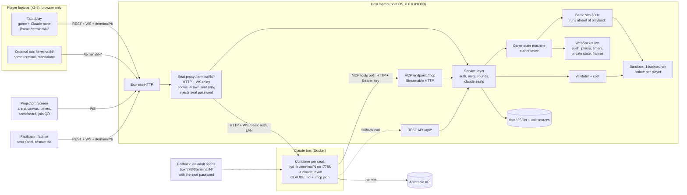
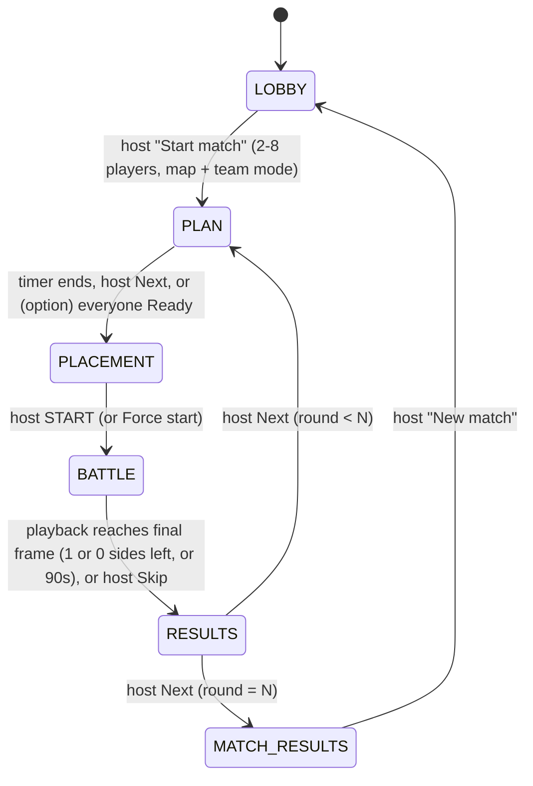

# Pixel Clash: Build Plan

A LAN auto-battler for 2-8 players, free-for-all or in teams, on a map chosen for the player count (§9.2). Players design units by talking to Claude Code on their own laptops. Claude submits the unit code to the game server over MCP. The server checks each unit, prices it, and runs it in a sandbox. Players pick and place their units on a web page, and the battle plays on the projector.

Status: implementation-ready spec. Written 2026-10-20. The event is a few days away.

---

## 1. Overview, goals, non-goals

### Event context
- Kids coding day, players aged about 9-13. Each game has 2-8 players (free-for-all, or teams such as 2v2, 2v2v2 or 4v4, §9.2). Player laptops need **only a browser** and one tab: `/play` on the game server, which embeds the laptop's Claude seat terminal (**ttyd**) through a proxy on the game server (§11.2). The same terminal can also be opened as its own browser tab. Players **only prompt Claude**. They never write or paste code by hand.
- **Two machines** on a router or hotspot that we bring:
  - **Game server**: runs Pixel Clash on its host OS (not in the devcontainer). A projector shows the arena, and a facilitator runs the game from an admin panel.
  - **Claude box**: runs one Docker container per seat. Each container runs ttyd, which starts `claude` directly in that seat's kit folder (no shell). The facilitator logs Claude Code in beforehand.

### Goals
1. Players learn the loop "describe → Claude writes code → the server checks it → watch it fight → improve it" over several rounds.
2. Zero hand-editing. The MCP tools and the error messages are written so Claude can fix problems by itself.
3. Running untrusted code can never crash the game or freeze the projector, and it can never reach the host's files or network.
4. A playable vertical slice exists early (milestone M3). Polish (sound, animations, replay, retro style) is in scope and comes last.

### Non-goals
- Internet hosting, accounts, analytics, or any external calls from the server.
- Pathfinding. Movement is straight-line. The only obstacles are player-built **walls** (§5.2), and units get around them with a simple deterministic slide (§9), not a path search.
- Uploading files or hand-pasting code as the main path. A paste box exists only in the facilitator rescue path.
- More than 8 players in a match, or more than one match at a time. Teams that change during a match.
- Anti-cheat beyond the sandbox, the engine's authority over actions, and the stat snapshot.

---

## 2. Architecture



Key points:
- **One process, one port** (default 8080) serves the static client build, REST, MCP, WebSocket, and the seat terminal proxy (`/terminal/<N>/`, §11.2).
- **The server is authoritative.** Clients never compute game results. The sim runs on the server and streams frames.
- **One service layer.** REST and MCP handlers are thin adapters over `services/*` and return the same result and error objects.
- **Network paths:** player laptops need only the LAN, and only the game server: their terminal reaches the Claude box through the game server's seat proxy (§11.2). The **Claude box** needs the LAN (to the game server's `/mcp`, and inbound 7781-7788 from the game server) **and** internet (to Anthropic). The game server needs no internet; its only outbound connections are to the Claude box's seat ports on the LAN. The router must provide both (see §15).
- **Players never see a seat password.** The proxy lets a logged-in player reach only the Claude seat assigned to them (admin: any seat), and adds the ttyd basic auth itself. Direct access to `http://<claude-box>:778N/terminal/N/` with the seat password stays as an adults-only fallback, and an optional Claude-box firewall can limit 7781-7788 to the game server's IP (§11.2, §15).
- **Seat isolation.** Claude Code can run shell commands, so each seat's Claude runs in its own container with only its own kit folder mounted. A player can't reach another seat's folder or key, or the game server's `data/` (§11.1).
- **Battle results are held on the server until the projector shows them.** The sim runs ahead of playback, but nothing about the outcome (phase change, ranking, points, scoreboard, battle reports, `battle:end`) is sent to anyone until playback reaches the final frame (§9).

---

## 3. Game flow state machine



The BATTLE → RESULTS transition follows the **playback clock**, not the sim clock. The sim may finish early. Its result is held server-side and released only when playback shows the final frame, or when the host presses Skip (§9 End).

Default timers (all in config, and the host can change them live):

| State | Timer | When the timer ends |
|---|---|---|
| LOBBY | none | waits for the host |
| PLAN | round 1: 15 min, later rounds: 8 min | auto-advance to PLACEMENT. With `timers.autoAdvanceWhenAllReady` (default off) it also advances ~3 s after every active player is Ready |
| PLACEMENT | 3 min | stays in PLACEMENT and shows "Waiting for host START". There is **no auto-start**. |
| BATTLE | 90 s of sim time, with a visible countdown | ends and is ranked (§9) |
| RESULTS | none (the host presses Next) | n/a |

### What each actor can do in each state

| State | Player via Claude (MCP/REST) | Player via /play page | Projector /screen | Facilitator /admin |
|---|---|---|---|---|
| LOBBY | `login`, `get_rules`, `get_unit_contract`, `validate_unit`, `get_game_state`, `list_my_units`, `get_unit_source`. **No submit.** | create player or log in, download kit, view own roster | title, LAN URL + QR, joined player names (grouped by team once a team mode is set) | set up the match (rounds, Open Armory, map style, team mode, §9.2) with a map preview, swap players between teams, start match, kick/reset PIN, config, validate on behalf |
| PLAN | everything above + **`submit_unit`** (new or revised) | view own roster and costs, **select ≤4 unit types + ≤4 building types** (§5.2), then an **"I'm ready!"** toggle (needs ≥1 fighter type, i.e. not only walls; cleared when the army changes). Team mode: also sees teammates' selected types live | phase, timer, per-player status icons only (✓ submitted, ✓ selected, ✓ ready), an "Everyone's ready!" banner (with the auto-advance countdown), team table (names only) in team mode | next/skip (never blocked by Ready; Next is highlighted when everyone is ready), timer ±, pause timer, **submit on behalf**, kick/reset PIN |
| PLACEMENT | read-only tools + `validate_unit` | see own zone for this round, place copies on it, live budget, Ready toggle, "Copy last layout". Team mode: also sees teammates' zones and placements live (read-only) | timer, Ready ticks only, "Everyone's placed and ready" banner | START (highlighted when everyone is ready), Force start, timer ±, kick, validate on behalf |
| BATTLE | read-only tools + `validate_unit` | watch the live battle, see own unit health and errors | **reveal**, then the live battle canvas, 90 s countdown | pause/resume, 1x/2x, skip to results, kick (takes effect after the battle, §4) |
| RESULTS | read-only tools + `validate_unit` + `get_battle_report` | place, points, own unit report with "Ask Claude to fix" prompts | round ranking, scoreboard, Replay button | Next, Replay, validate on behalf |
| MATCH_RESULTS | read-only tools + `validate_unit` + `get_battle_report` | final standings | podium + final scoreboard | New match, wipe |

"Read-only tools" means `get_rules`, `get_unit_contract`, `get_game_state`, `list_my_units`, `get_unit_source`, `get_battle_report`, plus `login`.

**Ready, per phase.** In PLAN, Ready means "my army is picked": it needs a non-empty selection (`NOTHING_SELECTED` otherwise) with at least one fighter type: a soldier, tower or factory (`NO_FIGHTERS` when only walls are picked, §5.2) and the server clears it whenever that player's army changes (a different selection, a new or revised unit of theirs submitted, or a selected unit retired or invalidated). In PLACEMENT, Ready means "my army is placed". It is one flag that is reset on every phase change, so PLAN Ready never carries into PLACEMENT. Only active players count (benched and next-round players can't be Ready); the public `allReady` is true when there is at least one active player and all of them are Ready. Ready never blocks the host in PLAN, and the battle is never started automatically.

**Pending advance (cancellable countdown).** Once everyone is Ready the host can press "Start placement ▶" (PLAN) or "START battle ▶" (PLACEMENT, needs everyone Ready) on /admin, or on /screen when that browser also holds the admin cookie (Space/Enter). The server then runs one 3 s countdown that every page shows (`state.pendingAdvance = {to, by, secondsLeft}`); Cancel (/admin, or /screen button / Esc) stops it at any time. At zero it does exactly what Next (PLAN) or START without force (PLACEMENT) does, so a PLACEMENT countdown during which someone un-readied ends with `NOT_ALL_READY` (admin toast) instead of a battle. A host countdown keeps running when someone un-readies; any other phase change drops it. The `timers.autoAdvanceWhenAllReady` option uses the same countdown (`by: 'auto'`, PLAN only), which stops by itself when someone un-readies; a cancelled auto countdown re-arms only after someone un-readies and everyone is ready again. Countdowns are in memory (a restart drops them).

Selections lock when PLAN ends. A selection references `unitId`s and resolves to each unit's **latest valid version** at lock time. Units with `status: invalid` (§6 re-pricing) are dropped from the selection. If a player's selection is then empty, the server uses their previous round's selection if all those units are still valid. Otherwise it uses their 3 most recently submitted valid units (if none of them is a fighter, the Basic Soldier template is added), falling back to the Basic Soldier and Basic Tower templates (walls and factories are never picked automatically). Invalid units are always skipped.

### Privacy: what is hidden from whom

Nothing about other players is visible before the host presses START, except to **teammates** in team mode (§9.2), who coordinate live.

| Data | Owner | Teammates (team mode only) | Other players (opponents) | Projector | Facilitator |
|---|---|---|---|---|---|
| Unit source code | yes | **never** | **never** | never | yes (rescue view) |
| Roster (names, stats, costs) | yes | live, but **only the selected types** (cards with name, stats, cost, sprite) | after START: only the types fielded in this battle | after START: fielded types only | yes, behind a "show details" toggle (off by default, since the panel may be on screen) |
| Selection (≤4 unit + ≤4 building types) | yes | live | after START | after START | toggle |
| Zone this round | yes | live | after START | after START (the empty zone outlines of the map are public) | yes |
| Placement | yes (editable) | live (read-only) | after START | after START | toggle |
| Team membership | yes | yes | yes | yes | yes |
| Status flags (submitted/selected/ready) | yes | yes | yes | yes | yes |
| Scores, standings, team table | yes | yes | yes | yes | yes |

Enforcement is on the server. Every response and WS message is built per recipient by `services/visibility.ts`, which treats "same team" as a visibility relation only in team mode (in free-for-all nobody is a teammate). The projector and opponents get no placement or roster data until `battle.revealed = true`. It is never filtered on the client.

---

## 4. Player identity and auth

| Thing | Spec |
|---|---|
| Create player | `name` (1-16 chars, letters/digits/space/-/_, case-insensitive unique) + `pin` (exactly 4 digits). The PIN is stored as an scrypt hash. |
| Seats | max **8** players in the match. Joining in LOBBY or PLAN takes a seat. Joining later gets "you're in from the next round". When all seats are full: `GAME_FULL`. A seat is a player slot (0-7) that fixes the player's colour, seat-number badge (1-8) and instance-id prefix. **A seat is not a zone.** Zones are assigned per round (§9.2). **Team mode** (§9.2): teams are fixed at Start match, so a player who joins after Start match gets a seat if one is free but is **benched** until New match (`me.benched = true`, /play says "Teams are set for this match. You'll play in the next match!"; they can still log in and work with Claude, and `submit_unit` stays allowed in PLAN). |
| Web session | `POST /api/login` sets an httpOnly cookie `pc_session` (random 32 bytes, server-side map). It lasts until logout, kick, or PIN reset. |
| Claude seat | **Separate from the game seat.** The Claude seat is the laptop's terminal container on the Claude box: 1-8 = service `seatN` = host port `778N` = proxy path `/terminal/N/`, the number on the laptop's seat card (always 1-based, unlike the internal game seat 0-7). A player picks it once on /play (dropdown, or `?seat=N` from the seat card QR). One player per Claude seat (`CLAUDE_SEAT_TAKEN`); the admin can reassign or unassign. Stored as `claudeSeat: 1-8 \| null` on the player record in `data/state.json`. Logout, Reset PIN and New match keep it; kick and wipe free it. Rules and DTOs: §11.2. |
| Terminal access | every request to `/terminal/N/*` (page, assets, token, WebSocket) needs either the `pc_session` cookie of the player whose `claudeSeat` is N, or the `pc_admin` cookie (any seat, for rescue). The seat password is a facilitator setting (§11.2); it is injected by the proxy and never sent to a player's browser. |
| API key (for Claude) | each player gets one `pc_<24 random base32>` key. It is embedded in the personal kit zip (`GET /api/kit.zip`); /play no longer shows it (the seat containers use the generic kit and `login`). REST and MCP accept `Authorization: Bearer pc_…`. MCP tools also accept an optional `apiKey` argument, which is used when no header is present. |
| MCP without a key (generic kit, the **primary path**) | each seat container on the Claude box gets the generic kit (§11.1). The MCP transport is **stateless**: nothing is bound to a session. Claude calls `login({name, pin})`, which returns `{player, apiKey}`. CLAUDE.md tells Claude to save that to `.pixel-clash/player.json` and pass `apiKey` on every later tool call. This survives server restarts and Claude Code restarts with no PIN re-entry. |
| Facilitator | admin password from env `ADMIN_PASSWORD`. If unset, the server generates 3 words and prints them at startup. `POST /api/admin/login` sets an `pc_admin` cookie. Admin endpoints take only the admin cookie. |
| Reset PIN | admin sets a new 4-digit PIN. This kills the player's web sessions but **keeps the API key**, so the player's Claude kit keeps working. A separate "Rotate key" action (deferrable, §16) exists if a key leaks. |
| Kick | removes the player from the match and frees the seat. In team mode the team plays on short-handed (teams are never re-balanced mid-match) and the kicked player's zone stays empty (§9.2). Sessions and key are revoked, the Claude seat is freed and its live terminal (if any) is closed. Data stays until wipe unless "kick + delete" is chosen. **During BATTLE, a kick takes effect after the battle**: the sim may already be computed, so the player's units keep fighting in this battle. The player is then removed from the ranking (the others are ranked among themselves), gets no points for the round, and takes no part in later rounds. In any other phase a kick is immediate. |
| Rate limits (per player) | login 5/min, validate 1/s, submit 1 per 3 s. Over the limit: `RATE_LIMITED` with `retryAfterMs`. |

---

## 5. Unit contract

Players' units are one JS module (TS syntax is tolerated) with a default-exported class. The contract below is served verbatim by `get_unit_contract` and copied into the kit's CLAUDE.md.

```ts
// packages/shared/src/contract.ts
export type UnitType = 'soldier' | 'tower' | 'wall' | 'factory';   // §5.2
export type BodyType = UnitType | 'minion'; // minions are made by factories: you see them, you never submit one
export type MinionKind = 'grunt' | 'archer' | 'runner' | 'brute';  // what a factory builds (§5.3)
export type MinionOrder = 'attack' | 'defend' | 'swarm' | 'guard'; // what a factory's minions do (§5.3)
export type MapStyle = 'duel' | 'triangle' | 'corners' | 'ring' | 'lanes' | 'islands'; // §9.2
export type Shape = 'circle' | 'square' | 'triangle' | 'diamond';

/** Fields the constructor MUST set as plain data properties on `this` (which ones depends on `type`, §5.2 table). */
export interface UnitStats {
  name: string;          // 1-24 chars, shown on screen
  type: UnitType;        // soldiers move; towers, walls and factories are buildings and never move
  maxHealth: number;     // soldier/tower 10-500, wall 50-1500, factory 100-1000
  damage?: number;       // soldier/tower: required, 0-60. wall/factory: leave it out (they can't attack)
  range?: number;        // soldier/tower: required, 20-300 px, EDGE to edge (gap between the two bodies). wall/factory: leave it out
  speed?: number;        // soldier: required, 0.5-5 px per tick (60 ticks = 1 s). tower/wall/factory: 0 or leave it out
  attackCooldown?: number;// soldier/tower: required, integer ticks between attacks. wall/factory: leave it out
  productionInterval?: number; // factory only, required: integer ticks between two minions, 600-1800 (10-30 s)
  produces?: MinionKind; // factory only, optional (default 'grunt'): the minion it builds; the price follows (§6)
  burst?: number;        // factory only, optional (default 1): integer 1-4; minions wait inside until this many are ready, then leave together
  color: string;         // "#RRGGBB": projectiles, particles, fallback sprite; a wall's block colour; a factory's minion colour
  size?: number;         // soldier/tower: body radius in px = hitbox AND drawn size, 6-20 (default 10 / 14), $0.5 per px above 6. Walls always fill their 40 px cell, factories are always 18: size is ignored for them.
  shape?: Shape;         // optional; only used by the fallback sprite when sprite() is missing
}

/** Pixel-art look, returned by the optional sprite() method (§5.1). */
export type SpriteFrame = string[];       // `grid` rows, each exactly `grid` chars; '.' = transparent
export interface SpriteSpec {
  grid: 8 | 12 | 16 | 24 | 32;            // square pixel grid per frame
  palette: Record<string, string>;        // 1-16 entries, single-char keys (not '.'), "#RRGGBB" values
  frames: {
    idle: SpriteFrame[];                  // required, 1-4 frames
    walk?: SpriteFrame[];                 // 1-4 (falls back to idle)
    attack?: SpriteFrame[];               // 1-4 (falls back to idle)
    hit?: SpriteFrame[];                  // 1 (falls back to a white flash of idle)
    death?: SpriteFrame[];                // 1-4 (falls back to a fade-out)
  };
}

export interface FactoryView {
  productionInterval: number;
  nextMinionIn: number;  // ticks until the next minion (it waits while you hold, or while the factory is full)
  minionsLeft: number;   // minions this factory can still make this battle
  minionsAlive: number; maxAlive: number; // minionsAlive = out on the field; maxAlive caps minionsAlive + stored
  stored: number;        // built minions waiting inside: safe from attacks, but LOST if the factory is destroyed
  burst: number;         // stored minions leave together when stored reaches burst (or on { action: 'release' })
  produces: MinionKind;
  order: MinionOrder;    // starts 'attack'; a swarm whose target died becomes 'attack', a guard whose ally died 'defend'
  orderTargetId: string | null; // swarm: the enemy, guard: the ally, else null
  rally: { x: number; y: number }; // where 'attack' minions go; starts at world.center
}
export interface SelfView {
  id: string;            // instanceId of this copy, e.g. "2-0-3"
  unitId: string;        // the design this copy was made from
  ownerId: string; teamId: number; type: UnitType; name: string;
  x: number; y: number; radius: number; hp: number; maxHp: number;
  damage: number; range: number; speed: number;
  attackCooldown: number; cooldownRemaining: number; // 0 = can attack this tick
  blockedBy: string | null; // id of the wall that stopped my last move, else null
  blockedTicks: number;     // ticks in a row a wall has stopped me (no progress; 0 = free)
  pathing: 'direct' | 'detour' | 'no-route'; // my last move: straight there, round walls by a route the game found, or walled off (smash self.blockedBy)
  factory: FactoryView | null; // factories only
}
export interface OtherView {
  id: string; ownerId: string; teamId: number; type: BodyType; name: string;
  x: number; y: number; radius: number; hp: number; maxHp: number; range: number;
}
// A wall has radius 20: for range it counts as a circle of radius 20 (so inRange works unchanged),
// but its body blocks the whole 40×40 square. Walls and factories have range 0.
// A minion's name is its kind: 'Grunt', 'Archer', 'Runner' or 'Brute'. Stored minions are invisible.
export interface WorldView {
  width: number; height: number;        // arena size this battle: 800 (2-4 players), 1040 (5-6), 1200 (7-8), §9.2
  tick: number; ticksLeft: number;
  mapStyle: MapStyle;                   // §9.2
  myCorner: { x: number; y: number };   // centre of my start zone this round (name kept from the 4-corner map; a zone need not be a corner)
  center: { x: number; y: number };     // = { x: width / 2, y: height / 2 }
  safeZone: { x: number; y: number; radius: number }; // centred on `center`; shrinks from tick 3000 (sudden death, §9)
}
// teamId: free-for-all = the owner's seat (0-7), so every player is their own team.
// Team mode = the team index (0-3). Same teamId = friend, different = enemy.
// Helper semantics (also documented in CLAUDE.md):
// inRange(self, other) === Math.hypot(other.x - self.x, other.y - self.y) - self.radius - other.radius <= self.range

export type Action =
  | { action: 'idle' }
  | { action: 'move'; destination: { x: number; y: number } }   // soldiers
  | { action: 'attack'; targetId: string }                     // soldiers and towers
  | { action: 'rally'; destination: { x: number; y: number } }  // factories: order 'attack' and send my minions here
  | { action: 'command'; order: MinionOrder; targetId?: string; destination?: { x: number; y: number } } // factories: squad order; swarm/guard need targetId
  | { action: 'release' }                                       // factories: send the stored minions out now
  | { action: 'hold' };                                         // factories: don't build this tick

export interface Unit extends UnitStats {
  update?(self: SelfView, enemies: OtherView[], allies: OtherView[], world: WorldView): Action | undefined; // soldier, tower, factory: required. wall: none
  sprite?(): SpriteSpec; // called ONCE at validation, never in battle (§5.1)
}
```

`SelfView.radius` and `OtherView.radius` are the unit's `size`. `enemies` holds every living unit with a different `teamId`; `allies` holds every other living unit with the same `teamId`: your own units **and, in team mode, all your teammates' units** (§9.2). Player code should compare `teamId`, not `ownerId`, to tell friend from foe.

Rules (enforced by the engine, and written into CLAUDE.md):
1. **Stats are snapshotted at validation.** The server constructs the unit twice inside the sandbox, checks the stats, and stores a frozen `StatsSnapshot`. Combat reads only the snapshot. Changing `this.damage` inside `update()` has no effect.
2. **Extra state is allowed.** Any other fields on `this` (memory, targets, modes) persist between ticks for that unit instance. Module-level variables are shared between all of one player's units of the same type. Units of different types from the same player share `globalThis` inside that player's isolate. No state is ever shared with other players.
3. **`update()` is called once per tick** with fresh plain copies. Mutating the inputs does nothing.
4. **The returned action is a request, and the engine validates it:**
   - `attack`: the target must be a living enemy (a unit with a different `teamId`), `distance − self.radius − target.radius ≤ range + 0.5` (edge to edge, with 0.5 px float tolerance), and `cooldownRemaining = 0`. Otherwise the unit idles. Attacking your own or a **teammate's** unit is an idle (no friendly fire, §9). An attack never auto-moves. Bodies that touch are always in range, so any legal range can hit any unit type.
   - **Cooldown timing:** `cooldownRemaining` is 0 at spawn, so every unit can fire on tick 0 if in range. It drops by 1 (not below 0) at the start of each tick, before views are built. Firing sets it to `attackCooldown`. So a unit with cooldown 60 fires on ticks t, t+60, t+120, ….
   - `move`: soldiers only. The destination must be finite numbers. It is clamped to the arena (`0..world.width`, `0..world.height`), and the unit moves at most `speed` px toward it. Towers idle on move. **M8.7:** when walls stand between the unit and its destination, the engine walks it round them by the shortest open route (§9.3 Routing round walls); player code still just returns the destination.
   - `idle`, `undefined`, an unknown action, a malformed object, a Promise, or a thrown error all mean idle. A throw also counts a strike (§8).
5. No `import`, `require`, network, timers, or `async update`. None of them exist in the sandbox.

**Walls and factories (M8.5).** The block above is the M8.5 contract (`tests/config.test.ts` keeps it identical to `shared/contract.ts`, `tests/starterkit.test.ts` to the kit's CLAUDE.md): it adds the two building types `wall` and `factory`, engine-made minions (`BodyType`), `SelfView.blockedBy/blockedTicks/factory` and the factory actions `rally` / `hold`. §5.2 has the per-type rules. Rule 4 for the new actions: `rally` (factories only; a finite destination, clamped to the arena, kept until changed) and `hold` (factories only; pauses production for the tick); `move`/`attack` from a factory and `rally`/`hold` from a soldier or tower are an idle without a strike.

**Minion kinds, squad orders and burst (M8.6).** The block also carries M8.6 (§5.3): `MinionKind`, `MinionOrder`, the optional factory stats `produces` and `burst`, `FactoryView.stored/burst/produces/order/orderTargetId`, and the factory actions `command` and `release`. Rule 4 for them: `command` (factories only) needs `order` to be one of the four orders; `swarm` and `guard` also need a string `targetId`, and `attack` may carry a finite `destination` (the new rally point, clamped like `rally`); anything else is malformed (an idle that keeps the previous order, no strike). `release` (factories only) asks the factory to send its stored minions out. `command`/`release` from a soldier or tower are an idle without a strike. `rally` now also sets the order to `attack`.

**Routing round walls (M8.7).** The block also carries `SelfView.pathing` (§9.3 Routing round walls): `'direct'` (the last move went straight at the destination), `'detour'` (the engine walked it round walls on an open route) or `'no-route'` (walls close the destination off for a body this size: the unit walks to the wall the route has to break and presses on it, so `blockedBy`/`blockedTicks` name that wall). `blockedBy`/`blockedTicks` now count only ticks a wall **stopped** the move (no progress), not ticks it merely turned a move that kept going. Units that never moved say `'direct'`.

### Stat bounds (config: `stats.bounds`)

Soldier and tower bounds below. Walls and factories have their own rows in §5.2 (walls up to 1500 HP, factories 100-1000 HP plus `productionInterval`).

| Field | Rule | Notes |
|---|---|---|
| name | string, 1-24 chars after trim, no control chars | rendered only via `textContent`/`fillText` |
| type | `'soldier'` or `'tower'` (M8.5: also `'wall'`, `'factory'`, §5.2) | |
| maxHealth | finite number, 10-500 | tightened from 1000 so concentrating everything in 1-2 units doesn't pay (§6) |
| damage | finite number, 0-60 | tightened from 200 for the same reason. 0 is allowed (gives a warning) |
| range | finite number, 20-300 | edge to edge |
| speed | soldier: 0.5-5. tower: exactly 0 | a tower with speed > 0 gets `TOWER_CANNOT_MOVE` |
| attackCooldown | integer, 10-600 | 60 = one attack per second. Above 60 gets `W_SLOW_NO_DISCOUNT` (§6) |
| color | `/^#[0-9a-fA-F]{6}$/` | the owner is shown by an outline colour and ground ring, so player colours never clash with ownership |
| size | optional, finite number, **6-20** (min and max unit size). Default soldier 10, tower 14 | body radius: hitbox, separation, edge-to-edge range, and drawn width (2 × size). Max 20 means one unit exactly fills a 40 px placement cell |
| shape | optional, one of 4 values | fallback sprite only |

### 5.1 Unit rendering: `sprite()`

Units draw themselves with pixel art. The renderer never runs player code: `sprite()` is called **once in the validation isolate** (50 ms), and its JSON-copied result is checked and stored with the unit (`sprite` in the unit record). Clients receive the stored sprite at reveal and draw it.

- **Optional.** Without `sprite()`, the client generates a fallback sprite from `color` + `shape` and gives the warning `W_NO_SPRITE` ("Ask Claude to draw a pixel-art sprite for your unit!"). Both templates include a sprite, so Claude learns the format from them.
- **Display size follows `size`, not `grid`.** The sprite is a billboard (upright, facing the camera) anchored at the unit's feet, drawn `2 × size` logical px wide (times the iso zoom), with height = width. So `grid` only sets the pixel detail, and every unit's drawn size stays between the min and max unit size. Nearest-neighbour scaling keeps the pixels crisp.
- **Animation** (client-side, 8 fps): `walk` while the unit moved this frame, `attack` for 250 ms after it fires, `hit` for 100 ms after taking damage, `death` once, then fade. The sprite is mirrored horizontally to face its movement or target direction, so sprites should be drawn facing right.
- **Ownership** is drawn by the engine, not the sprite: a 1 px outline in the seat colour around opaque pixels, a seat-coloured ground ring (ellipse), and the HP bar above. Disabled units get a 💤 bubble.
- **Validation rules:** `grid` is one of the allowed values; palette has 1-16 single-char keys (not `.`) with `#RRGGBB` values; every frame has exactly `grid` rows of exactly `grid` chars, using only palette keys or `.`; frame counts are within limits; at least 10% of the idle frame's pixels are opaque; and the spec is deterministic (it is called twice and must match). Errors: `SPRITE_THREW`, `SPRITE_BAD_GRID`, `SPRITE_BAD_PALETTE`, `SPRITE_BAD_FRAME` (with `state`, `frame`, `row`, `col`), `SPRITE_TOO_MANY_FRAMES`, `SPRITE_EMPTY`, `SPRITE_NOT_STABLE`. Each comes with a `fix`.
- **Moderation:** the facilitator can press **Hide sprite** on any unit in /admin. That unit then uses the fallback sprite everywhere (a player could draw something inappropriate).
- **Privacy:** a sprite is part of the roster, so it is hidden until START and sent in `battle:reveal` only for fielded types.

### 5.2 Unit types: soldier, tower, wall, factory (M8.5)

Two building types join soldiers and towers. **Walls** are solid blocks with lots of HP that block movement and never fight. **Factories** make small built-in **minions** during the battle; the factory's code only picks where the minions go (the rally point) and when to pause production. Minions are engine-made and run built-in logic, never player code.

| Type | Group | Moves | Attacks | Code that runs in battle | Body | Job |
|---|---|---|---|---|---|---|
| soldier | **unit** | yes | yes | `update()` every tick | circle, `size` 6-20 | fight, chase, guard |
| tower | **building** | no | yes | `update()` every tick | circle, `size` 6-20 | shoot from home |
| wall | **building** | no | no | **none** (no `update()`) | 40×40 square filling its cell | block paths, soak hits |
| factory | **building** | no | no | `update()` every tick: `rally` / `hold` / idle | circle, radius 18 | make minions |
| minion (engine-made) | none | yes | yes (melee) | built-in AI (`sim/minion.ts`) | circle, radius 8 | swarm |

- **Groups and selection.** Per round a player fields **≤ 4 unit types (soldiers) and ≤ 4 building types (towers, walls, factories)** (`caps.maxUnitTypes: 4`, `caps.maxBuildingTypes: 4`, replacing `caps.maxTypes: 3`). Over the limit: `TOO_MANY_TYPES` with `details: {group: 'units' | 'buildings', max: 4, count}`. Open Armory types count in the group of their type. A picked design that is later revised into the other group (e.g. a soldier resubmitted as a tower) can leave the stored selection over a cap: the submit toasts the owner ("You picked 5 buildings; 4 max. Tap one to un-pick it."), the /play roster flags the group, PLAN Ready is refused with that `TOO_MANY_TYPES` until one is un-picked (un-picking is always allowed), and if the lock comes first the later picks of the full group are left out with a toast naming them.
- **Fighters.** Soldiers, towers, factories that can still make a minion before time runs out (`canMake` > 0, §9.3), and minions are **fighters**. Walls never are. PLAN Ready and PLACEMENT Ready need at least one fighter type selected / one fighter placed (`NO_FIGHTERS`: "Walls can't win on their own. Pick a soldier, tower or factory too."). A side with no fighters left is eliminated (§9).
- **Copies.** ≤ 12 fighter copies (soldiers + towers + factories: everything that runs code, the existing isolate performance guard `caps.maxCopies`), **of which ≤ 2 factories** (`caps.maxFactoryCopies: 2`), plus **≤ 12 walls** (`caps.maxWallCopies: 12`, walls run no code). So a zone holds at most 24 of its 36 cells. Errors: `TOO_MANY_COPIES` with `details: {group: 'fighters' | 'factories' | 'walls', max}`.

**Contract (replaces the §5 block when M8.5 lands).** Unchanged parts (`MapStyle`, `Shape`, `SpriteFrame`, `SpriteSpec`, `WorldView`, the `teamId` and `inRange` comments) are written out in full in the real block; they are elided here.

```ts
// M8.5 replacement for the §5 block (packages/shared/src/contract.ts)
export type UnitType = 'soldier' | 'tower' | 'wall' | 'factory';   // §5.2
export type BodyType = UnitType | 'minion'; // minions are made by factories: you see them, you never submit one

/** Fields the constructor MUST set as plain data properties on `this` (which ones depends on `type`, §5.2 table). */
export interface UnitStats {
  name: string;          // 1-24 chars, shown on screen
  type: UnitType;        // soldiers move; towers, walls and factories are buildings and never move
  maxHealth: number;     // soldier/tower 10-500, wall 50-1500, factory 100-1000
  damage?: number;       // soldier/tower: required, 0-60. wall/factory: leave it out (they can't attack)
  range?: number;        // soldier/tower: required, 20-300 px, EDGE to edge (gap between the two bodies). wall/factory: leave it out
  speed?: number;        // soldier: required, 0.5-5 px per tick (60 ticks = 1 s). tower/wall/factory: 0 or leave it out
  attackCooldown?: number;// soldier/tower: required, integer ticks between attacks. wall/factory: leave it out
  productionInterval?: number; // factory only, required: integer ticks between two minions, 600-1800 (10-30 s)
  color: string;         // "#RRGGBB": projectiles, particles, fallback sprite; a wall's block colour; a factory's minion colour
  size?: number;         // soldier/tower: body radius in px = hitbox AND drawn size, 6-20 (default 10 / 14), $0.5 per px above 6. Walls always fill their 40 px cell, factories are always 18: size is ignored for them.
  shape?: Shape;         // optional; only used by the fallback sprite when sprite() is missing
}

export interface FactoryView {
  productionInterval: number;
  nextMinionIn: number;  // ticks until the next minion (it waits while you hold, or while the factory is full)
  minionsLeft: number;   // minions this factory can still make this battle
  minionsAlive: number; maxAlive: number;
  rally: { x: number; y: number }; // where its minions go; starts at world.center
}
export interface SelfView {
  id: string;            // instanceId of this copy, e.g. "2-0-3"
  unitId: string;        // the design this copy was made from
  ownerId: string; teamId: number; type: UnitType; name: string;
  x: number; y: number; radius: number; hp: number; maxHp: number;
  damage: number; range: number; speed: number;
  attackCooldown: number; cooldownRemaining: number; // 0 = can attack this tick
  blockedBy: string | null; // id of the wall that stopped or turned my last move, else null
  blockedTicks: number;     // ticks in a row a wall has been in my way (0 = free)
  factory: FactoryView | null; // factories only
}
export interface OtherView {
  id: string; ownerId: string; teamId: number; type: BodyType; name: string;
  x: number; y: number; radius: number; hp: number; maxHp: number; range: number;
}
// A wall has radius 20: for range it counts as a circle of radius 20 (so inRange works unchanged),
// but its body blocks the whole 40×40 square. Walls and factories have range 0.

export type Action =
  | { action: 'idle' }
  | { action: 'move'; destination: { x: number; y: number } }   // soldiers
  | { action: 'attack'; targetId: string }                     // soldiers and towers
  | { action: 'rally'; destination: { x: number; y: number } }  // factories: send my minions here
  | { action: 'hold' };                                         // factories: don't build this tick

export interface Unit extends UnitStats {
  update?(self: SelfView, enemies: OtherView[], allies: OtherView[], world: WorldView): Action | undefined; // soldier, tower, factory: required. wall: none
  sprite?(): SpriteSpec; // called ONCE at validation, never in battle (§5.1)
}
```

**Stats per type** (config `stats.bounds`; the soldier/tower rows of §5 are unchanged):

| Field | soldier | tower | wall | factory |
|---|---|---|---|---|
| maxHealth | 10-500 | 10-500 | **50-1500** (`wallHealth`) | **100-1000** (`factoryHealth`) |
| damage | 0-60 | 0-60 | absent or 0, else `BUILDING_CANNOT_ATTACK` | absent or 0, else `BUILDING_CANNOT_ATTACK` |
| range | 20-300 | 20-300 | absent; a value is ignored with `W_STAT_IGNORED` | as wall |
| speed | 0.5-5 | exactly 0 (`TOWER_CANNOT_MOVE`) | absent or 0, else `BUILDING_CANNOT_MOVE` | as wall |
| attackCooldown | integer 10-600 | integer 10-600 | absent; ignored (`W_STAT_IGNORED`) | as wall |
| productionInterval | ignored (`W_STAT_IGNORED`) | ignored | ignored | **required**, integer 600-1800 (`STAT_MISSING`, `STAT_OUT_OF_RANGE`, `INTERVAL_NOT_INTEGER`) |
| size | 6-20, default 10 | 6-20, default 14 | always 20 (half the 40 px block); a value is ignored (`W_STAT_IGNORED`) | always 18; ignored |
| `update()` | required | required | none; one that exists is ignored with `W_UPDATE_IGNORED` | required |
| `sprite()` | optional | optional | optional: textures the block's sides | optional |
| snapshot fills in | | | damage 0, range 0, speed 0, attackCooldown 0, size 20 | damage 0, range 0, speed 0, attackCooldown 0, size 18 |

**Walls.**
- **Body:** an axis-aligned **40×40 square exactly covering its placement cell** (cells are 40 px and zones are cell-aligned, §9.2). Walls in neighbouring cells, side by side **or diagonal**, leave no gap: their squares share an edge or a corner and every body has a radius ≥ 6, so a line of walls one cell apart is solid. Circles were rejected: two radius-20 circles in neighbouring cells leave triangular gaps at the corners and a diagonal line leaves a 16 px slot a size-6 soldier walks through.
- **Solid for everyone:** enemy, own and teammates' soldiers and minions can't pass. A player builds a gate by leaving a cell empty; /play warns `W_TRAPPED` when a fighter is boxed in (§9 Placement). Towers and factories never touch walls (separate cells).
- **No code.** Walls are not loaded into the battle isolate, never get strikes and never act.
- **Attackable by every enemy fighter, towers and minions included:** a wall is in `enemies` with `type: 'wall'`. Range uses the 20 px radius: a body touching any side is at gap 0, and one touching a corner is 20·√2 − 20 ≈ 8.3 px from the circle, below the minimum range 20, so every legal range can hit a wall it touches. Templates and minions skip walls as targets unless a wall is in their way (`blockedTicks` ≥ 120).
- **Projectiles fly over walls** (homing shots arc above them, §9). Walls stop bodies, not shots. This keeps the homing projectile code unchanged and makes "towers behind walls" a readable combo whose answers are range, going round, or smashing through. Line of sight would need a ray test per shot and make homing shots vanish in confusing ways.
- **Sudden death** damages walls like any body (7% of max HP per second outside the circle), so a wall outside the circle crumbles in about 14 s whatever its HP.
- **Worth $0 at timeout** and never a fighter (§9 Elimination, Ranking), so walls can't turtle a win. Breaking an enemy wall still credits its full price as value destroyed.

**Factories.**
- Body: circle, radius 18, never moves (like a tower). Can't attack. `update()` runs every tick in the owner's isolate like any unit. `{action:'rally', destination}` sets the rally point (clamped into the arena), kept until changed; every living minion of that factory follows the newest one. `{action:'hold'}` pauses production for this tick. `idle`/`undefined` keeps producing. `move` and `attack` from a factory are an idle (no strike; the dry run warns `W_ACTION_NOT_FOR_TYPE`). The default rally point is `world.center`.
- **Production.** A timer starts at 0 at battle start and goes up by 1 each tick unless the factory holds. When it reaches `productionInterval` the factory makes one minion if (a) `minionsLeft > 0`, (b) fewer than `factory.maxAlivePerFactory` (**4**) of its minions are alive, (c) its owner has fewer than **min(`factory.maxAlivePerPlayer` 6, floor(`factory.maxAlivePerBattle` 40 / players in the battle))** minions alive (6 with 2-6 players, 5 with 7-8), and (d) a spawn spot is free. Otherwise it waits with a full timer (`nextMinionIn = 0`) and tries again every tick. After a spawn the timer restarts at 0.
- **Output.** `minionsLeft` starts at **E = min(`factory.maxMinionsPerFactory` 8, floor((battleTicks − 1) / productionInterval))**: interval 600 → 8, 720 → 7, 900 → 5, 1200 → 4, 1800 → 2. An unhindered factory makes minions at ticks I, 2I, 3I, … (every 10 s at 600). E is what the factory pays for (§6).
- **Spawn spot:** 8 candidates 28 px (18 + 8 + 2) from the factory centre, at angles θ, θ+45°, θ−45°, θ+90°, θ−90°, θ+135°, θ−135°, θ+180° in that order, where θ points at the rally point (or along the zone's facing when the rally point is the factory itself: out of the front edge on a N/S/E/W zone, diagonally towards the corner nearest the centre on a corner zone, the /play grid's arrow; `zoneFacingDir`). The first candidate inside the arena that overlaps no wall square, tower or factory wins. Overlapping soldiers and minions is allowed; separation sorts it out.
- **Destroying the factory stops production.** Its living minions keep going with the last rally point. A factory with `canMake = 0` (§9.3: no minions left, or no time left to build one, e.g. because it holds or every spawn spot is covered) stays on the field as a building but is no longer a fighter.

**Minions** (built in, config `factory.minion`, the same for everyone):
- Stats: maxHealth **40**, damage **5**, range **20** (melee: instant hit), speed **1.5**, attackCooldown **60**, size **8**; `type: 'minion'`, `name: 'Minion'`, the factory's `ownerId` and `teamId`. Instance id `${factoryInstanceId}-m${n}` (n = 1-8, the factory's n-th minion, e.g. `2-5-3-m1`): unique, deterministic, sorted right after its factory.
- Look: a built-in 12×12 sprite (`shared/sprite.ts` `MINION_SPRITE`: idle, 2 walk frames, 1 attack frame) whose body pixels are recoloured with the factory's `color`, plus the usual seat outline and ground ring.
- **AI** (`sim/minion.ts`, decided from the same start-of-tick snapshot as player units, applied with everyone else in seat, then instanceId order):
  1. Rally R = its factory's rally point (the last one if the factory is gone). If R is outside the safe circle, R = the circle's centre.
  2. Target = the nearest living enemy that is **not a wall** and is within **120 px** edge to edge of the minion (`factory.minion.aggroRange`) or within **200 px** of R (`factory.rallyGuardRadius`); ties by instanceId.
  3. Target in range → attack it.
  4. If `blockedTicks ≥ 120` (`factory.minion.impatientTicks`, 2 s) and the blocking wall is an enemy's → attack it (move to it if out of range). This applies with or without a target out of range, so minions break into a walled-in enemy.
  5. Target out of range → move toward it. No target: if more than 24 px from R → move to R; else idle (guard the rally point).
- Every minion move goes round towers and factories: a minion touching one (of any side) whose centre lies within 15% of their radii of its straight line ahead steps 90° sideways instead (away from the building, or +90° from its heading when exactly in line), so separation can slide it round rather than pushing it straight back (`sidestep` in `sim/minion.ts`).
- Minions are fighters, use the same wall steering and separation as soldiers, are hit by sudden death, never get strikes and cost no isolate time.
- **Value:** `minionCost` = the soldier price formula (§6) applied to the minion stats with the current soldier coefficients = **$55** (raw 54.05). `minionValue = ceil(minionCost × cost.factory.minionDiscount)` = ceil(55 × 0.5) = **$28**. It is used for factory prices, timeout value and value destroyed.
- **M8.6:** this built-in minion is now the **grunt**, one of four minion kinds a factory can pick (§5.3). Everything above stays true for grunts (the default), so existing factories play and cost exactly as before.

### 5.3 Minion kinds, squad orders and burst (M8.6)

Factories felt limited: every factory made the same minion and could only move a rally point. M8.6 gives the factory three choices, all optional and backward compatible (a factory without them is exactly an M8.5 factory: grunts, order `attack`, burst 1, same price).

**1. Minion kinds: `this.produces`.** A factory builds one of four preset kinds (config `factory.minions.<kind>`, the same for everyone, each kept inside the soldier bounds by the config schema). Default `'grunt'` when omitted.

| Kind (`produces`) | name in views | HP | Damage | Range | Speed | Cooldown | Size | Aggro | Impatient | Wall damage | Role |
|---|---|---|---|---|---|---|---|---|---|---|---|
| `grunt` (default) | Grunt | 40 | 5 | 20 (melee) | 1.5 | 60 | 8 | 120 | 120 ticks | ×1 | today's minion: cheap all-rounder |
| `archer` | Archer | 24 | 5 | **110 (ranged: homing projectile)** | 1.2 | 60 | 7 | 150 | 120 | ×1 | fragile, shoots from behind walls and soldiers |
| `runner` | Runner | 28 | 4 | 20 (melee) | **2.6** | 60 | 6 | 120 | 120 | ×1 | fast scout: reaches far targets first |
| `brute` | Brute | **100** | 8 | 20 (melee) | **0.9** | 60 | 11 | 120 | **30** | **×3** | slow tank that breaks walls |

- **Ranged archers** use the existing projectile system unchanged: their range 110 is above `sim.meleeMaxRange` (50), so their attacks spawn homing projectiles (10 px/tick) that fly over walls (§9).
- **Brutes break walls:** every brute hit on a **wall** deals `damage × wallDamageMultiplier` (8 × 3 = 24, so one brute takes a 400-HP Basic Wall down with 17 hits in 16 s, four brutes in about 4 s); other targets take the plain 8. They also lose patience with a blocking enemy wall after 30 ticks instead of 120 (`impatientTicks`). The multiplier is engine-side: it is not in the soldier formula, so the brute's price doesn't see it; its slow speed (0.9, the slowest kind) is the trade-off, and the balance test checks brute factories don't dominate (§14).
- **Look:** each kind has its own built-in sprite (`shared/buildings.ts` `MINION_SPRITES`: grunt 12×12 as today, archer 12×12 with a bow, runner 12×12 lean with a headband, brute 12×12 bulky with a club), drawn at its own size and tinted with the factory colour like the grunt.
- **Names and ids:** a minion's `name` in views is its kind's name (Grunt, Archer, Runner, Brute; `type` stays `'minion'`), its id stays `${factoryId}-mN`.
- **Price** (§6): the factory pays `minionValue(kind) × E`, minionValue(kind) = ceil(minionCost(kind) × 0.5), minionCost(kind) = the soldier formula on that kind's stats: grunt $55 → $28, archer $69 → $35, runner $76 → $38, brute $69 → $35.

**2. Squad orders: `{ action: 'command', order, targetId?, destination? }`.** The factory's `update()` can give its minions one of four orders instead of only a rally point. The order belongs to the factory, applies to all its minions (out now and made later) and is kept until changed, like the rally point. It starts as `attack`.

| Order | Return | What the minions do |
|---|---|---|
| `attack` (default) | `{ action: 'command', order: 'attack' }` or `{ action: 'rally', destination }` (= attack + new rally point; `command` may carry `destination` too) | the M8.5 behaviour: hunt the nearest enemy fighter (not a wall) within their aggro range or within 200 px of the rally point, else walk to the rally point and wait there |
| `defend` | `{ action: 'command', order: 'defend' }` | stay near the factory: fight the nearest non-wall enemy within **160 px** of the factory's centre (`factory.defendRadius`), else go back and wait within 48 px of it (`factory.defendArriveRadius`) |
| `swarm` | `{ action: 'command', order: 'swarm', targetId: enemy.id }` | every minion goes for that one enemy, wherever it is (walls and buildings included: a brute swarm on a wall is a battering ram), ignoring everything else except an enemy wall that blocks them (impatience). When the target dies (or isn't a living enemy) the order falls back to `attack` |
| `guard` | `{ action: 'command', order: 'guard', targetId: ally.id }` | stay near that ally (any of my or my teammates' living bodies, the factory itself included) and fight the nearest non-wall enemy within **120 px** of it (`factory.guardRadius`), else follow it and wait within 16 px of its edge (`factory.guardArriveGap`). When the ally dies (or isn't a living ally) the order falls back to `defend` |

- The fallback happens in the engine at the start of the next tick and is visible: `self.factory.order` becomes `'attack'` / `'defend'` and `orderTargetId` null. Player code can then pick a new target.
- `rally` and `hold` keep working: `rally` = `command attack` with a destination; `hold` pauses production as before (and can be combined over ticks with any order).
- **Why `command` and not more fields on `rally`:** one action per idea reads best for players and Claude (`rally` = "go there", `command` = "do this", `release` = "go now"), the old two actions keep their exact meaning, and the dry run can tell exactly which field is wrong.
- Every order keeps the M8.5 rules that are not about choosing targets: an enemy in range is hit first (for `swarm`: only the swarm target), the impatience rule (smash an enemy wall that blocked the minion for `impatientTicks`), the sidestep round towers and factories, and the safe circle (an `attack` rally point or a `defend` factory outside the circle is replaced by the circle's centre; `swarm` and `guard` follow their target wherever it is).

**3. Burst: `this.burst` (integer 1-4, default 1).** How many minions leave the factory at once.
- **Stored inside.** A finished minion goes into the factory's store unless it completes a burst: with `burst` B, the first B − 1 minions wait inside (`self.factory.stored` counts them) and the B-th one leaves **together with them**, all at once (B spawn events in one tick and one `release` event, §9.3). Burst 1 = release each as it is made (M8.5 behaviour, bit for bit).
- **Stored minions are safe but at risk:** they are not bodies (not in any `enemies`/`allies` list, can't be hit, take no sudden-death damage), but **they are lost if the factory is destroyed** (counted in `minionsLost`, and the killer's value destroyed includes them, §9.3). Saving up is a real gamble.
- **They count toward the alive caps:** per factory `minionsAlive + stored ≤ maxAlivePerFactory` (4, so burst 4 just fits; the cap is not raised) and per player alive + stored ≤ min(6, floor(40 / players)). So the per-battle 40-minion cap is unchanged.
- **Early release:** `{ action: 'release' }` sends the stored minions out at once (it is remembered until it happens, e.g. when no spawn spot is free this tick). `release` with nothing stored does nothing.
- **Automatic release** (no deadlocks): a factory also releases what it has stored when its store can't grow any more: no minions left to make, no time left to build another (`canMake` = 0), or an alive cap is full (e.g. two burst-4 factories sharing the per-player cap of 6).
- `hold` pauses production but doesn't release; stored minions stay inside.
- **Price: burst is free.** Saving up doesn't add minions (E is the same) and costs time (the first minions sit idle inside) and risk (they die with the factory), so it is a tactic, not a stat. A burst never changes the factory's price.

**FactoryView (§5 block):** `stored`, `burst`, `produces`, `order`, `orderTargetId` join the M8.5 fields. `minionsAlive` counts only minions out on the field; `maxAlive` caps `minionsAlive + stored`.

**Choosing well (CLAUDE.md tips, §11):** archers behind walls or towers (`defend`/`guard` a tower); runners with `swarm` on the weakest or most valuable far target (a burst of 4 runners arrives together); brutes with `swarm` on the wall that blocks your soldiers (or `attack`: they smash any wall that blocks them after 0.5 s); grunts for a cheap steady stream.

---

## 6. Cost formula and economy

```
term_i = c_i × x_i × (1 + k × r_i²)          r_i = x_i / max_i   ("the curve", k = cost.curveK = 2)
raw    = (Base + Σ term_i) × max(1, 60 / attackCooldown)
cost   = ceil(raw - 1e-9)                    // whole credits; the epsilon guards float noise

x_i / max_i:  HP / 500,  Damage / 60,  Range / 300,  Speed / 5,  (Size - 6) / 14
```

- **The curve.** Each stat term is its linear price `c_i × x_i` times `1 + k·r²`, where `r` is how far the stat is towards its §5 max. With k = 2 a stat at **half** its max costs **1.5×** its linear price and a **maxed** stat costs **3×**. Every term is convex, so one unit with doubled stats costs more than two normal units (once a stat reaches about half its max; the per-unit Base is the only thing that favours fewer units). This is what discourages pouring the whole budget into one expensive unit. The curve maxima are the default §5 bounds (fixed in code, so a live bounds retune doesn't move the curve). `curveK` is in config: 0 gives the old linear formula, the schema allows 0-5 (a negative k would make cost fall as a stat rises, so it is refused).
- **Explained in the output.** The breakdown returned by validate/submit has, per stat, the linear part and the curve surcharge, e.g. "maxHealth 500 costs $375: $125 base + $250 for being near the max (100% of max)". Any stat at ≥ 80% of its max gives the non-fatal warning `W_STAT_NEAR_MAX` ("maxHealth is at 96% of max and costs 2.84× its normal price; two medium units usually beat one maxed one"), with a `fix` that names a lower value and the saving. `UNIT_TOO_EXPENSIVE` names the most expensive stat and the saving of a concrete lower value ("Lowering maxHealth from 500 to 300 saves $246").
- The cooldown factor scales the **whole** stat sum. It is **clamped at 1**, so slow attackers (cooldown > 60) get no discount. That makes any cooldown above 60 strictly worse (same price, less damage per second), so the validator warns with `W_SLOW_NO_DISCOUNT`: "Attacking slower than once per second doesn't make it cheaper. Set attackCooldown to 60 for free extra damage." The same tip is in CLAUDE.md §5 and in the `get_unit_contract` strategy tips.
- Coefficients (`curveK` included) and bounds live in config and can be retuned live in LOBBY, PLAN, or RESULTS. A change re-prices every stored unit.
- **After a re-price or bounds change**, any unit that now breaks the $500 cap or a bound gets `status: "invalid"` with the new error object (`UNIT_TOO_EXPENSIVE` or `STAT_OUT_OF_RANGE`, with its `fix`). An invalid unit can't be selected or placed, is dropped from current and carried-over selections (with a toast to the owner), is skipped by the selection fallback, and shows up in `list_my_units` and `GET /units` so Claude can revise it. The config editor refuses a retune that would make either template invalid.

Retuned defaults. With the curve on the previous linear coefficients the templates came out at soldier $113 and tower $261, so the linear part was lowered (mostly Base, range, speed and size) to bring the templates back to about $90-200:

| Coefficient | Original | Linear (before the curve) | **Default with the curve** |
|---|---|---|---|
| Base | 50 | 20 | **10** |
| cHP (per HP) | 0.5 | 0.25 | **0.25** |
| cDmg (per damage) | 3.0 | 1.5 | **1.5** |
| cRange (per px) | 1.5 | 0.3 | **0.2** |
| cSpeed (per px/tick) | 20 | 15 | **12** |
| cSize (per px of size above 6) | n/a | 1 | **0.5** |
| k (`curveK`) | n/a | n/a | **2** (maxed stat = 3×) |

Size defaults (soldier 10, tower 14) apply when `size` is omitted, and they are priced.

### Reference units (curve k = 2)

"Linear" is Base + Σ c_i·x_i (the old shape), "Curve" is Σ c_i·x_i·k·r_i², Sum = Linear + Curve. The last column is what the unit would cost without the curve (k = 0), for comparison.

| Unit | Type | HP | Dmg | Range | Speed | Size | CD | Linear | Curve | Sum | Factor max(1,60/CD) | Raw | **Cost** | Without curve |
|---|---|---|---|---|---|---|---|---|---|---|---|---|---|---|
| Basic Soldier (template) | soldier | 120 | 10 | 40 | 1.5 | 10 | 60 | 83 | +8.14 | 91.14 | 1 | 91.14 | **$92** | $83 |
| Basic Tower (template) | tower | 150 | 15 | 180 | 0 | 14 | 45 | 110 | +38.09 | 148.09 | 1.333… | 197.46 | **$198** | $147 |
| Big Tank | soldier | 500 | 20 | 40 | 0.8 | 20 | 60 | 189.6 | +271.44 | 461.04 | 1 | 461.04 | **$462** | $190 |
| Half Tank (maxHealth 250) | soldier | 250 | 20 | 40 | 0.8 | 20 | 60 | 127.1 | +52.69 | 179.79 | 1 | 179.79 | **$180** | $128 |
| Sniper Tower | tower | 80 | 40 | 280 | 0 | 14 | 60 | 150 | +154.53 | 304.53 | 1 | 304.53 | **$305** | $150 |
| Slow Sniper (the trap) | tower | 80 | 40 | 280 | 0 | 14 | 90 | 150 | +154.53 | 304.53 | 1 (clamped from 0.667) | 304.53 | **$305**, same price, ⅔ the DPS, `W_SLOW_NO_DISCOUNT` | $150 |
| Speedy Scout | soldier | 60 | 6 | 30 | 4 | 6 | 20 | 88 | +62.17 | 150.17 | 3 | 450.52 | **$451** | $264 |
| Scout with cooldown 10 | soldier | 60 | 6 | 30 | 4 | 6 | 10 | 88 | +62.17 | 150.17 | 6 | 901.03 | **$902, rejected** (> $500) | $528 |
| Old plan's "Laser Sniper" (as soldier) | soldier | 100 | 20 | 150 | 2 | 10 | 30 | 121 | +31.67 | 152.67 | 2 | 305.35 | **$306** | $242 |
| Half stats at CD 60 | soldier | 250 | 30 | 150 | 2.5 | 13 | 60 | 181 | +85.5 | 266.5 | 1 | 266.5 | **$267** | $181 |
| Max stats at CD 60 | soldier | 500 | 60 | 300 | 5 | 20 | 60 | 352 | +684 | 1036 | 1 | 1036 | **$1036, rejected** (> $500) | $352 |
| Everything maxed | soldier | 500 | 60 | 300 | 5 | 20 | 10 | 352 | +684 | 1036 | 6 | 6216 | **$6216, rejected** (> $500) | $2112 |
| Cheapest legal | tower | 10 | 0 | 20 | 0 | 6 | 600 | 16.5 | +0.04 | 16.54 | 1 | 16.54 | **$17** | $17 |

Example armies within $1,000: 4 Basic Soldiers + 3 Basic Towers = $962 (7 units). 1 Sniper Tower + 3 Basic Soldiers + 2 Basic Towers = $977 (6 units). 1 Big Tank + 5 Basic Soldiers = $922 (6 units). 1 Speedy Scout + 5 Basic Soldiers = $911 (6 units). Two Big Tanks ($924) leave no room for a third template-sized unit, and one maxed unit ($1036) can't even be built, while two "Half stats" units cost $534. These hit the 4-8 unit target. They are unaffected by the player count, the map and team mode (§9.2): every player always has their own $1,000, the type limits (≤3 types today; ≤4 unit + ≤4 building types from M8.5) and the copy caps, and teammates never pool or share budget.

**Size trade-off.** A bigger body reaches targets sooner (range is edge to edge, so +10 size is +10 effective reach for both sides of a fight), wins shoving matches in separation, and looks impressive, but it is easier to block in and is reachable from further away. The $0.5/px term (3× at size 20) keeps "max size everything" from being free.

**Why the curve (and why the bounds were tightened).** With linear pricing every unit pays a fixed overhead (Base, plus the minimum stats), so concentrating stats into a few big units was efficient: with the original bounds (HP 1000, damage 200) two ~$490 "bricks" beat most armies, and even after tightening the bounds (HP ≤ 500, damage ≤ 60) a once-per-second unit with every stat maxed cost only $414. The k = 2 curve makes each stat's price convex: the first half of a stat is cheap, the last part costs up to 3×. A maxed-out unit at CD 60 now costs $1036 and is rejected, a 500-HP tank costs $462 instead of $190, and a 280-range sniper $305 instead of $150, while the templates stay at $92 and $198 (they sit at 13-60% of each max, where the curve adds little). Base was lowered to $10 so the per-unit overhead is small next to the curve: once any of HP, damage, range or speed reaches half its max, one unit with doubled stats always costs at least as much as two normal units (`tests/cost-curve.test.ts` checks this, together with monotonicity and convexity of every stat). A balance test (§14) checks that no single archetype dominates. If it fails, retune the coefficients, `curveK` or the bounds in config; the $500 cap stays.

### Walls and factories (M8.5)

Same shape as the unit formula, with per-type coefficients (config `cost.wall`, `cost.factory`) and the same curve k. Neither type attacks, so there is no cooldown factor (factor 1).

```
wall:     raw     = BaseW + cW × HP × (1 + k × (HP / 1500)²)
          cost    = ceil(raw − 1e-9)
factory:  bodyRaw = BaseF + cF × HP × (1 + k × (HP / 1000)²)
          cost    = ceil(bodyRaw − 1e-9) + minionValue × E           // body cost + production cost
          E           = min(factory.maxMinionsPerFactory (8), floor((battleTicks − 1) / productionInterval))
          minionValue = ceil(minionCost × minionDiscount − 1e-9)     // minionCost = the unit formula on the §5.2 minion stats
```

| Coefficient | Default |
|---|---|
| BaseW (`cost.wall.base`) | **4** |
| cW per wall HP (`cost.wall.hp`) | **0.06** |
| BaseF (`cost.factory.base`) | **10** |
| cF per factory HP (`cost.factory.hp`) | **0.12** |
| `cost.factory.minionDiscount` | **0.5** |
| minionCost / minionValue (derived) | **$55** / **$28** |

- **Curve semantics kept.** Every HP term has the k = 2 curve with its maximum at the type's default HP max (wall 1500, factory 1000; fixed in code like the §5 maxima), so a maxed wall costs 3× its linear price and the near-max warning, `W_STAT_NEAR_MAX`, and the "biggest lever" fix work unchanged. Two 750-HP walls ($72 each, $144) cost about half of one 1500-HP wall ($274).
- **Why wall HP is cheap** (0.06 vs 0.25 per HP for units): a wall can't move or fight, is worth $0 at timeout and loses 7% of its max HP per second in sudden death whatever its HP. The Basic Wall (400 HP, $32) holds a Basic Soldier for 40 s, four of them for 10 s.
- **Factory pricing = pay up front for the expected output.** E is the number of minions the factory can make in a 90 s battle, and each costs half of its price (`minionDiscount` 0.5) because it arrives during the battle (the first after 10-30 s; with interval 600 the average minion arrives at 45 s) and the alive caps throttle them. Production is linear in E (no curve): the per-factory alive cap (4) already makes one fast factory worse than two slow ones, and factories are capped at 2 copies. The cap of $500 applies to the whole factory price.
- **Re-pricing.** A factory's price follows the soldier coefficients and `curveK` (through minionCost), the minion stats, `minionDiscount`, `maxMinionsPerFactory` and `timers.battleTicks`. Changing any of them re-prices every factory (§6 re-pricing and invalidation rules apply; the config editor refuses a retune that would make any of the four templates invalid).
- **Breakdown.** Walls: base + HP, as for units. Factories: base, HP and a production line: "Production: 5 minions × $28 (half of a $55 minion, because they arrive during the battle) = $140". `UNIT_TOO_EXPENSIVE` on a factory names the bigger of HP and production as the lever ("Raising productionInterval from 600 to 900 makes 5 minions instead of 8 and saves $84").

### Reference buildings (curve k = 2)

Walls ("Linear" = BaseW + cW·HP; "Without curve" = k = 0):

| Wall | HP | Linear | Curve | Sum = raw | **Cost** | Without curve |
|---|---|---|---|---|---|---|
| Cheapest legal wall | 50 | 7 | +0.01 | 7.01 | **$8** | $7 |
| Fence | 150 | 13 | +0.18 | 13.18 | **$14** | $13 |
| Stone wall | 300 | 22 | +1.44 | 23.44 | **$24** | $22 |
| Basic Wall (template) | 400 | 28 | +3.41 | 31.41 | **$32** | $28 |
| Thick wall | 600 | 40 | +11.52 | 51.52 | **$52** | $40 |
| Rampart | 800 | 52 | +27.31 | 79.31 | **$80** | $52 |
| Castle wall | 1000 | 64 | +53.33 | 117.33 | **$118** | $64 |
| Maxed wall | 1500 | 94 | +180 | 274 | **$274** | $94 |

Factories (minionValue $28; "Body" = BaseF + cF·HP with its curve):

| Factory | HP | Interval (ticks) | E | Body linear | Body curve | Body raw | Body cost | Production E × $28 | **Cost** |
|---|---|---|---|---|---|---|---|---|---|
| Cheapest legal factory | 100 | 1800 | 2 | 22 | +0.24 | 22.24 | $23 | $56 | **$79** |
| Slow Factory | 300 | 1200 | 4 | 46 | +6.48 | 52.48 | $53 | $112 | **$165** |
| Basic Factory (template) | 300 | 900 | 5 | 46 | +6.48 | 52.48 | $53 | $140 | **$193** |
| Swarm Factory | 300 | 600 | 8 | 46 | +6.48 | 52.48 | $53 | $224 | **$277** |
| Armoured Factory | 600 | 600 | 8 | 82 | +51.84 | 133.84 | $134 | $224 | **$358** |
| Fortress Factory | 1000 | 1800 | 2 | 130 | +240 | 370 | $370 | $56 | **$426** |
| Maxed factory | 1000 | 600 | 8 | 130 | +240 | 370 | $370 | $224 | **$594, rejected** (> $500) |

The built-in minion priced as a soldier: HP 40, damage 5, range 20, speed 1.5, size 8, cooldown 60 → linear 50.5, curve +3.55, sum 54.05 → **minionCost $55**, **minionValue $28**.

### Minion kinds and factory prices (M8.6)

The factory formula keeps its shape; only minionValue now follows the factory's `produces` (§5.3):

```
factory:  cost        = ceil(bodyRaw − 1e-9) + minionValue(kind) × E
          minionValue(kind) = ceil(minionCost(kind) × minionDiscount − 1e-9)
          minionCost(kind)  = the unit formula on factory.minions.<kind> (a soldier, current coefficients and curve)
          kind        = this.produces, default 'grunt'; burst never changes the price
```

Each kind priced as a soldier (CD 60 for all, so the factor is 1; "Linear" = Base + Σ c·x):

| Kind | HP | Dmg | Range | Speed | Size | Linear | Curve | Sum = raw | **minionCost** | **minionValue** (× 0.5) |
|---|---|---|---|---|---|---|---|---|---|---|
| grunt | 40 | 5 | 20 | 1.5 | 8 | 50.5 | +3.55 | 54.05 | **$55** | **$28** |
| archer | 24 | 5 | 110 | 1.2 | 7 | 60.4 | +7.71 | 68.11 | **$69** | **$35** |
| runner | 28 | 4 | 20 | 2.6 | 6 | 58.2 | +17.01 | 75.21 | **$76** | **$38** |
| brute | 100 | 8 | 20 | 0.9 | 11 | 64.3 | +3.8 | 68.1 | **$69** | **$35** |

The brute's ×3 wall damage and the kinds' aggro / impatience are behaviour, not priced stats (§5.3).

Reference factories per kind (body as in the table above: HP 300 → $53, HP 600 → $134):

| Factory | produces | HP | Interval | E | Body | Production | **Cost** |
|---|---|---|---|---|---|---|---|
| Basic Factory (template, `produces` omitted) | grunt | 300 | 900 | 5 | $53 | 5 × $28 = $140 | **$193** (unchanged) |
| Archer Factory | archer | 300 | 900 | 5 | $53 | 5 × $35 = $175 | **$228** |
| Runner Factory | runner | 300 | 900 | 5 | $53 | 5 × $38 = $190 | **$243** |
| Brute Factory | brute | 300 | 900 | 5 | $53 | 5 × $35 = $175 | **$228** |
| Swarm Factory | grunt | 300 | 600 | 8 | $53 | 8 × $28 = $224 | **$277** (unchanged) |
| Archer Nest | archer | 300 | 600 | 8 | $53 | 8 × $35 = $280 | **$333** |
| Runner Rush | runner | 300 | 600 | 8 | $53 | 8 × $38 = $304 | **$357** |
| Brute Forge | brute | 300 | 600 | 8 | $53 | 8 × $35 = $280 | **$333** |
| Slow Brutes | brute | 300 | 1200 | 4 | $53 | 4 × $35 = $140 | **$193** |
| Armoured Runner Rush | runner | 600 | 600 | 8 | $134 | 8 × $38 = $304 | **$438** |
| Maxed runner factory | runner | 1000 | 600 | 8 | $370 | 8 × $38 = $304 | **$674, rejected** (> $500) |

`burst` (1-4) never changes these prices. Why: burst adds no minions (E is unchanged), it delays the first ones (they wait inside instead of fighting) and risks them (they die with the factory), so it trades time and risk for a stronger arrival. Pricing it would charge twice for a choice that already costs something.

Breakdown text per kind: "Production: 5 archers × $35 (half of a $69 archer, because they arrive during the battle) = $175". `UNIT_TOO_EXPENSIVE` on a factory whose production is the bigger cost also names a cheaper kind when one fits ("Making grunts instead of runners saves $50").

Example armies with buildings (all within $1,000 and the §5.2 caps): **Wall fortress** 10 Basic Walls + 3 Basic Towers = $914 (13 bodies, 3 fighters). **Factory swarm** 2 Swarm Factories + 4 Basic Soldiers = $922 (up to 8 + 4 minions alive). **Mixed** 4 Basic Soldiers + 2 Basic Towers + 6 Basic Walls = $956. **All four templates** 1 Basic Factory + 5 Basic Soldiers + 1 Basic Tower + 4 Basic Walls = $979.

### Caps and rules

| Rule | Default (config) | Error code |
|---|---|---|
| Single unit cost | ≤ $500 (checked on the rounded cost) | `UNIT_TOO_EXPENSIVE` |
| Budget per round | $1,000. Resets every round. Unspent credits don't carry over. | `OVER_BUDGET` |
| Designs | free to register. Max 8 active designs per player. Revisions replace a design and don't count. The templates (2; 4 from M8.5: soldier, tower, wall, factory) don't count. | `TOO_MANY_DESIGNS` |
| Types fielded per round | ≤ 3 (`caps.maxTypes`). **M8.5:** ≤ 4 unit types (soldiers, `caps.maxUnitTypes`) **and** ≤ 4 building types (towers, walls, factories, `caps.maxBuildingTypes`), §5.2; `caps.maxTypes` is removed | `TOO_MANY_TYPES` (M8.5: `details: {group, max, count}`) |
| Copies placed per player | ≤ 12 (performance guard; 4-8 is typical). **M8.5:** ≤ 12 fighters (soldiers + towers + factories, everything that runs code) of which ≤ 2 factories (`caps.maxFactoryCopies`), plus ≤ 12 walls (`caps.maxWallCopies`, no code, so outside the isolate guard). 12 walls cover a full front row and both flanks (6 + 2 × 3), or an L of 11 that seals a corner zone (its other two sides are the arena edge); the answers to a sealed fortress are smashing a wall (templates and minions do it after 2 s blocked), range, and sudden death, which reaches every corner zone | `TOO_MANY_COPIES` (M8.5: `details: {group: 'fighters' \| 'factories' \| 'walls', max}`) |
| Minions (M8.5, engine-side, no error) | ≤ 8 made per factory, ≤ 4 alive per factory, alive per player ≤ min(6, floor(40 / players)): 6 with 2-6 players, 5 with 7-8, so ≤ 40 minions in any battle (`factory.*`) | the factory waits |
| Fighters | PLAN Ready needs a fighter type selected, PLACEMENT Ready a fighter placed (M8.5) | `NO_FIGHTERS` |

Every player starts with the two templates (M8.5: four, adding Basic Wall and Basic Factory) pre-registered, so nobody is ever unarmed. The cost breakdown (each term with its linear part and curve surcharge, the sum, the factor, the total) is returned by validate/submit and shown on unit cards.

---

## 7. Validation pipeline

`services/validator.ts` runs the same steps for `validate_unit` (dry-run, nothing stored) and `submit_unit` (stores on success).

| # | Step | Failure codes |
|---|---|---|
| 1 | **Normalize.** Max source size 64 KB (sprites take room). Strip markdown fences and any prose outside them. CRLF→LF. | `SOURCE_TOO_LARGE`, `EMPTY_SOURCE` |
| 2 | **Transpile** with esbuild `transform` (loader `ts`, **format `cjs`**, target `es2022`). Syntax errors come back with line and column. CJS avoids isolated-vm module linking entirely. | `SYNTAX_ERROR` |
| 3 | **Import check.** esbuild turns any `import … from` into `require(…)`, and keeps `import(`. Reject if the transpiled output contains `require(` or `import(` (regex on the output). As a backstop, no `require` exists in the isolate, so anything missed throws at evaluation. | `IMPORT_NOT_ALLOWED` |
| 4 | **Evaluate** in the validation isolate (32 MB, 1000 ms total wall budget) by wrapping the output as `(function(module, exports){ … })` and reading `module.exports.default`. It must be a class or function. | `NO_DEFAULT_EXPORT`, `NOT_A_CLASS`, `EVAL_THREW`, `TIMEOUT` |
| 5 | **Construct twice** (50 ms each). The harness reads each stat with `Object.getOwnPropertyDescriptor`. It must be an own **data** property, with no getters or setters and no inheritance. The values are JSON-copied out. | `CONSTRUCTOR_THREW`, `STAT_MISSING`, `STAT_IS_GETTER` |
| 6 | **Hard guards** per the bounds table: `typeof` checks (no coercion of `"100"`), `Number.isFinite`, ranges, integer cooldown, color regex, name rules, tower speed 0. | `STAT_WRONG_TYPE`, `STAT_NOT_FINITE`, `STAT_OUT_OF_RANGE`, `COOLDOWN_NOT_INTEGER`, `BAD_COLOR`, `BAD_NAME`, `TOWER_CANNOT_MOVE` |
| 7 | **Determinism.** Both constructions must give identical stats. | `STATS_NOT_STABLE` |
| 8 | **Cost.** It must be finite and ≤ cap. The error names the most expensive term. | `UNIT_TOO_EXPENSIVE` |
| 8b | **Sprite.** If `sprite` exists, call it twice (50 ms each), JSON-copy the results (max 200 KB) and check them per §5.1. Store the normalized spec. If it is missing, warn. | `SPRITE_*` (§5.1), `W_NO_SPRITE` |
| 9 | **Dry-run `update()`.** 3 synthetic worlds (no enemies / one enemy in range, measured edge to edge like the engine / 3 enemies far away), 5 ticks each. The worlds use an 800×800 arena for the first two and a 1200×1200 one for the third, and the first one includes a teammate's unit (other `ownerId`, same `teamId`) in `allies`, so code that hard-codes 800 or `ownerId` still runs (§9.2). 20 ms per call. It must not throw, and each return must be a valid Action or undefined. | `UPDATE_MISSING`, `UPDATE_THREW`, `UPDATE_TIMEOUT`, `BAD_ACTION` |
| 10 | **Warnings** (non-fatal): never attacks when an enemy is in range, soldier never moves, damage 0, returns undefined, update is slower than 2 ms, cooldown above 60. | `W_NEVER_ATTACKS`, `W_NEVER_MOVES`, `W_ZERO_DAMAGE`, `W_RETURNS_NOTHING`, `W_SLOW`, `W_SLOW_NO_DISCOUNT` |

Steps 1-8 ship in M1. Steps 9-10 and the full malicious fixture set ship in M6 (§16).

**Per type (M8.5, §5.2).** The steps are the same for every type; what they check depends on `type`, which step 5 reads first (an unknown type is `STAT_OUT_OF_RANGE` on `type` with the four allowed values).
- **Step 5 (construct):** soldiers and towers need every §5 stat as today. Walls need `name`, `type`, `maxHealth`, `color`. Factories need those plus `productionInterval`. Missing → `STAT_MISSING` with a type-specific `fix` ("A factory needs this.productionInterval: ticks between two minions, 600-1800. Try 900 (one every 15 s).").
- **Step 6 (guards):** the §5.2 per-type table. New codes: `BUILDING_CANNOT_ATTACK` (`damage` > 0 on a wall or factory: "Walls and factories can't attack. Remove this.damage. Want something that shoots? Make a tower."), `BUILDING_CANNOT_MOVE` (`speed` > 0 on a wall or factory), `INTERVAL_NOT_INTEGER`. Ignored fields give `W_STAT_IGNORED` (field named) and are not stored.
- **Step 8 (cost):** per-type formula (§6 Walls and factories); the factory breakdown has `body`, `production: {minionCost, minionValue, expected, total}`.
- **Step 8b (sprite):** unchanged for every type (a wall's sprite textures its block, §12.5).
- **Step 9 (dry run):** walls are **skipped** (they have no code; an `update` on a wall gives `W_UPDATE_IGNORED` and is never called, in validation or battle). Factories run the same 3 worlds with `self.factory` filled in (`minionsLeft` 5, `rally` = centre); valid returns are `rally` (finite destination) / `hold` / `idle` / undefined; `move` or `attack` from a factory, or `rally`/`hold` from a soldier or tower, gives `W_ACTION_NOT_FOR_TYPE` (non-fatal: the engine idles). The worlds include one enemy wall and one enemy minion, so code that assumes every enemy has `damage` or a `size` stat still runs. Missing `update()` on a soldier, tower or factory stays `UPDATE_MISSING`.
- **Step 10 (warnings):** `W_NEVER_ATTACKS`, `W_NEVER_MOVES` and `W_ZERO_DAMAGE` apply to soldiers and towers only. A factory that never rallies gets no warning (the default rally point, the arena centre, is a fine plan).
- **Stored unit:** `stats` includes `productionInterval` for factories; the snapshot fills the §5.2 defaults (walls: damage/range/speed/attackCooldown 0, size 20; factories: the same with size 18).

**Minion kinds, orders and burst (M8.6, §5.3).**
- **Step 5/6 (stats):** `produces` and `burst` are optional factory stats, read like the others (own data properties). `produces` must be a string (`STAT_WRONG_TYPE`) and one of `grunt`, `archer`, `runner`, `brute` (`STAT_OUT_OF_RANGE` with `allowed: {oneOf}`; the fix names the four kinds and, for a near miss such as `'archers'`, `'Archer'` or `'knight'`, the closest one: "Set this.produces = 'archer' (one of 'grunt', 'archer', 'runner', 'brute'), or leave it out for grunts."). `burst` must be a number (`STAT_WRONG_TYPE`), finite, 1-4 (`STAT_OUT_OF_RANGE`, "Set this.burst to a whole number from 1 to 4, e.g. this.burst = 3 (1 = send each minion out as soon as it is made).") and whole (`BURST_NOT_INTEGER`). On a soldier, tower or wall either field gives `W_STAT_IGNORED` ("only factories build minions"). The snapshot of a factory always has both (`produces: 'grunt'`, `burst: 1` when omitted).
- **Step 8 (cost):** the production line uses the kind's minionValue (§6 Minion kinds); `production` gains `kind`.
- **Step 9 (dry run):** `self.factory` has `stored: 0`, `burst`, `produces`, `order: 'attack'`, `orderTargetId: null`; the worlds' `allies` include a friendly tower to guard. Valid factory returns add `command` and `release`. `command` with an `order` that isn't one of the four, or `swarm`/`guard` without a string `targetId`, or a non-finite `destination`, is **`BAD_ACTION`** with a fix that shows the right shape ("swarm needs targetId: the id of an ENEMY, e.g. { action: 'command', order: 'swarm', targetId: target.id }. When there is no enemy, return { action: 'command', order: 'attack' } instead."). A `swarm` whose `targetId` is not an enemy in that world, or a `guard` whose `targetId` is not an ally, gives the non-fatal **`W_ORDER_TARGET`** ("swarm targets must come from `enemies`, guard targets from `allies` (or self.id)"); the engine would fall back to attack / defend. `command`/`release` from a soldier or tower give `W_ACTION_NOT_FOR_TYPE` like `rally`.
- **Step 10 (warnings):** **`W_BURST_NEVER_FULL`** when `burst` > E ("This factory makes only 2 minions per battle, so a burst of 4 never fills up: they leave when it runs out. Lower burst to 2 or make minions faster.").
- **Stored unit:** `stats.produces` and `stats.burst` for factories (older stored factories without them are read as grunt / 1). The dry run records which orders `update()` gave (`dryRunOrders`, e.g. `['swarm', 'attack']`) so the /play card can show them (§12.5).

A stored unit is `{ unitId, ownerId, version, status: "valid"|"invalid", source, compiledJs, stats: StatsSnapshot (Object.freeze, includes the resolved size), sprite: SpriteSpec | null, spriteHidden: boolean, cost, breakdown, sha256, createdAt }`.

**Unit identity and revisions.** `validate_unit` and `submit_unit` take an optional `unitId`.
- With `unitId`: this is a revision of that design. It creates a new version and may change the name. `NOT_FOUND` if the player doesn't own it.
- Without `unitId`: if the name's slug matches one of the player's designs, that design is revised. Otherwise a new design is created with `unitId` = slug of the name (suffixed `-2`, `-3`, … on collision with a retired design).
- CLAUDE.md tells Claude to always pass `unitId` (from `list_my_units`) when the player asks to change an existing unit, so renaming "Swift Ninja" to "Swift Ninja II" doesn't silently use a new design slot or orphan the selection.
- **Optimistic concurrency (`baseVersion`).** Players can also edit a unit in the /play code editor (§12.1), so Claude and the player may change the same design. `validate_unit` / `submit_unit` (REST, MCP and the admin on-behalf route) take an optional `baseVersion` (needs `unitId`): the version the edit started from. If the design's latest version differs, the call fails with **409 `UNIT_CHANGED`** ("This unit changed since you opened it (now v5). Reload to see the new code.", `details: {unitId, baseVersion, version}`); submit checks again after the sandbox run, so a submit that lands meanwhile can't be overwritten. Without `baseVersion` there is no check (older Claude sessions keep working). The editor always sends it; CLAUDE.md tells Claude to always call `get_unit_source` first and pass its `version`, and on `UNIT_CHANGED` to fetch again and re-apply the requested change.
- Older versions are kept for the facilitator view. Selections follow the design to its latest valid version (§3).

### Error format (written for Claude first, the player second)

```json
{
  "ok": false,
  "errors": [
    {
      "code": "STAT_OUT_OF_RANGE",
      "field": "damage",
      "value": 999,
      "allowed": { "min": 0, "max": 60 },
      "message": "damage is 999 but must be between 0 and 60.",
      "fix": "In the constructor set this.damage to a number from 0 to 60, e.g. this.damage = 40."
    }
  ],
  "warnings": [],
  "cost": null,
  "playerHint": "Whoa, that unit hits WAY too hard! Ask Claude to lower its damage."
}
```

- `SYNTAX_ERROR`, `*_THREW` and `BAD_ACTION` include `line`, `column`, the `excerpt` (3 lines of source), and the thrown `errorMessage`.
- `UNIT_TOO_EXPENSIVE` includes `breakdown` and a `fix` that names the biggest lever. Example (Scout with cooldown 10, $902): `"Cost is $902 but the max is $500. The ×6 cooldown factor is the biggest cost: raising attackCooldown from 10 to 20 makes it ×3 ($451). The most expensive stat is speed: 4 costs $109.44 before the factor ..."`.
- A success returns `{ ok: true, unit: {unitId, version, stats, cost, breakdown}, warnings, playerHint }`.

---

## 8. Sandbox and execution

**Threat model.** The code is Claude-generated for young players (aged about 9-13) on a closed LAN. Accidents (infinite loops, huge arrays, throws) are near-certain, and malice is unlikely. The sandbox must still be a real boundary, because whatever runs there runs on the facilitator's laptop.

**Not security boundaries:** `node:vm` (the docs say so explicitly; prototype escapes reach `process`) and plain `worker_threads` (they get full Node APIs). Neither is used alone for untrusted code.

### Choice: `isolated-vm` (V8 isolates)
- Each isolate is a separate V8 heap with **no Node APIs**: no `require`, `process`, `fs`, `fetch`, timers, or network. Only what we inject exists.
- It has a hard **memory limit** (`new ivm.Isolate({ memoryLimit: 32 })`, in MB) and a **per-call timeout** (`ref.apply(…, { timeout })`). A timeout terminates the running script, and the host gets an error.
- Async `apply` runs on the libuv thread pool, so the players' ticks (up to 8, §9.2) run **in parallel** and the Express event loop stays responsive. The pool is shared with validation calls and fs, so the start script sets `UV_THREADPOOL_SIZE=8`.
- Requirements: a native addon. Use **Node 24 LTS** (or 22.13+). isolated-vm 6.1.2 ships prebuilds only for Node 22 (ABI 127) and 24 (ABI 137) on darwin-arm64, linux-arm64/x64 and win32-x64; **Node 26 is not supported** (no prebuild, confirmed on the macOS arm64 host). Keep the isolated-vm version matched to the Node version, and start Node with `--no-node-snapshot` (required on Node ≥ 20). If no prebuild matches, `npm ci` falls back to node-gyp, which needs Python and a C++ toolchain. **Verify the install on the host OS in M0 (§16). This is the go/no-go for the fallback.**

### Layout
- **Validation**: a fresh isolate per validate/submit call, disposed afterwards.
- **Battle**: **one isolate per player per battle**, created at START. Each of that player's ≤3 unit types (M8.5: up to 4 + 4) is evaluated with the same CJS wrapper as validation. **Walls are never loaded** (no code runs for them, §5.2); factories are spawned and ticked like any unit, and minions run in the engine, not in an isolate. The harness (`sandbox/harness.ts` exports its source as a string constant, so the build needs no stray `.js` asset) exposes:
  - `__spawn(instanceId, unitId)` constructs an instance of design `unitId` and keeps it in a Map inside the isolate.
  - `__tick(inputJson) → outputJson` loops over that player's living instances. Before each `update()` call it writes the instance id to the isolate global `__current`. It calls `update` in a per-unit `try/catch`, then returns `[{instanceId, action} | {instanceId, error: {message, line}}]`.
- **Identifiers:** `unitId` always means a **design** (§7, selection, placement, MCP). `instanceId` means one placed **copy** in a battle (= `SelfView.id`), defined as `${seat}-${row}-${col}` and assigned at lock time from the zone-local cell (§9).
- I/O crosses the boundary as JSON strings (one copy each way per tick per player).
- `Math.random` is replaced with a seeded PRNG (seed = battleSeed + playerSeat), and `Date.now` returns the sim time. Both are **pure JS inside the harness**. This keeps replays and re-sims reproducible.

### Isolate hardening rules
- **No host References or Callbacks** are ever placed in a battle or validation isolate (no logger, no helpers). All I/O is JSON strings passed as `apply` arguments, and results come back with `{ result: { copy: true } }`.
- Player code shares `globalThis` with the harness, so the harness captures `JSON.parse`, `JSON.stringify`, `Map`, `Function.prototype.call` and the instances' `update` references in a closure **before** any player code is evaluated. `__tick` and `__spawn` are defined as non-writable, non-configurable properties, and the host calls them through `ivm.Reference`s taken before player code runs, so reassigning `globalThis.__tick` changes nothing.
- The host parses `__tick` output defensively: non-JSON or a non-array means the whole tick idles plus a strike. It accepts **at most one action per instanceId**, and only for living instances **owned by that player**. Anything else (enemy ids, duplicates, unknown ids) is dropped and counts a strike.
- Microtask loops (`Promise.resolve().then(f)` recursing) and returned Promises are covered by fixtures. The tick must still return within timeout + 10 ms, or the isolate is disposed and the player disabled.

### Deadlines, strikes, disable

| Event | Effect | Default |
|---|---|---|
| A unit throws in `update()` | that unit idles this tick, and the unit gets +1 strike | |
| A unit reaches its strike limit | the unit is disabled for this battle (stands still, can still be hit). Friendly message: "Zappy got confused too many times and is taking a nap 💤" | 30 throws |
| A player's `__tick` exceeds the hard timeout | all that player's units idle this tick. The host then reads `__current` with a separate short call (`compileScriptSync('__current').runSync(ctx, {timeout: 5})`) to name the culprit unit. Its **first** timeout in the battle only gives it +1 strike and a report entry ("Zappy took too long once"), because one stall can be the host (GC, scheduler), not the player's code. Its **second** timeout in the battle **disables that one culprit unit**, so a real infinite loop is napping by its second tick. The player's other units keep running. | 12 ms; disable on the 2nd timeout (`sandbox.battle.timeoutsToDisable`, default 2) |
| Timeouts continue after the culprit is disabled | all of the player's units are disabled for the rest of the battle. Only timeouts with no culprit left to blame count (none named, or it already naps); a culprit's own forgiven and disabling timeouts don't, so several copies of one looping design each nap and the rest of the army keeps fighting | 3 in a row or 5 total |
| `__tick` takes longer than the soft limit | +1 slow strike for the player. The harness keeps per-unit time (using the real `Date.now`, captured before player code runs and never exposed) so the report can name the slowest unit. | 6 ms |
| Slow strikes reach the limit | disable the slowest unit first; if slow strikes continue, disable the player. This stops a 15-20 ms unit from stretching a 90 s battle and stalling playback. | 30 slow strikes |
| The isolate runs out of memory or crashes | dispose it and disable all of the player's units | |

Every strike and error is recorded in the player's **battle report** (§10) with the culprit `unitId`, `instanceId`, unit name, messages and line numbers, so Claude can read it and fix the unit. Disabled status lasts one battle only. Fresh isolates start each battle.

### Fallback (`config.sandbox = 'process'`): built only if M0 fails
If isolated-vm won't install on the host, each player runs in a `child_process.fork` started with `--max-old-space-size=64` and Node's permission model (`--permission`, which needs Node ≥ 22.13; earlier 22.x needs `--experimental-permission`). It grants no fs-write, no child processes, no workers, and fs-read only for the child runner, which is **bundled into a single file** so `--allow-fs-read` can name just that file. The child starts with an **empty env** (`env: {}`) so it doesn't inherit `ADMIN_PASSWORD` or other secrets. Inside it, the code runs in a `node:vm` context with frozen minimal globals and the `timeout` option. The host SIGKILLs the child when a reply misses `2 × hard timeout`, then disables that player.

**Residual risk (document for staff):** the permission model has no network control on Node 22. A `node:vm` escape in the child grants network access to the LAN **and the internet** (the router has an uplink, §15), plus read access to the allowed path. The process boundary and the vm layer make this unlikely for Claude-written player code, but it is not a real sandbox.

A third mode, `'inproc-unsafe'` (vm only), exists for dev and tests only, and startup refuses it unless `--unsafe` is passed.

The `Runner` interface is shared by all modes: `create(player, units) → { spawn, tick(inputs): Promise<outputs>, dispose }`. Only `ivmRunner` and `inprocRunner` (tests) are built by default.

---

## 9. Simulation

| Item | Spec |
|---|---|
| Timestep | fixed **60 ticks/s** (`dt` = 1 tick; speeds and cooldowns are per tick). Max 5400 ticks (90 s). |
| Decoupling | the sim **runs ahead** as fast as the sandbox allows and writes frames to a buffer. Playback streams the buffer at 60 ticks/s × speed (1x/2x). Pause stops playback, not the sim. If the sim falls behind playback, playback waits and shows "thinking…". Clients interpolate between frames at their own render rate. |
| Result release | the sim's result is **held server-side**. The BATTLE → RESULTS transition, ranking, points, scoreboard, `battle:end`, `GET /battles/:round/report` and MCP `get_battle_report`/`get_game_state` results are released only when **playback** reaches the final frame. Until then `/state` reports phase BATTLE with the playback countdown. |
| Arena | square, **S×S logical px by player count**: S = 800 for 2-4 players, 1040 for 5-6, 1200 for 7-8 (always whole 40 px cells: 20, 26, 30 cells per side), scaled to the canvas. Ranges, speeds and sizes are unchanged; the projector zooms out to fit (§12). S is fixed for a battle and sent as `world.width/height` (§9.2). |
| Zones | one zone per player, 240×240 each (6×6 grid of 40 px cells), axis-aligned, laid out by the **map style** (Duel, Triangle, Corners, Ring, Lanes, Islands; positions in §9.2). The default style follows the player count (2 Duel, 3 Triangle, 4 Corners, 5-8 Ring) and the host can override it at Start match. The middle is neutral. **Zones are assigned at the start of each PLACEMENT**, not at join: free-for-all, active players in join order get `zoneSet[(i + round) % n]`; team mode rotates whole teams as blocks of adjacent zones (§9.2). The player's own zone (and in team mode the teammates' zones) is sent in their `private` state; other zones' owners stay hidden until START. |
| Placement | units snap to cell centres, one unit per cell, own zone only (walls, towers and factories too; M8.5 `W_TRAPPED`, §9.3). `col`/`row` are **zone-local and oriented so row 0 is the front edge (facing the centre or, on Lanes, the other row) and (0,0) is the front cell nearest the centre** (exact rule per zone facing in §9.2). That keeps "Copy last layout" meaningful when the zone rotates or the map changes. The /play grid draws the zone in its true orientation. |
| Auto-place | at lock (START or Force start), any player with zero placements gets an automatic layout: "Copy last layout" if it is still valid and within budget, otherwise their selected types are placed greedily (cheapest first, round-robin across types) in the front cells up to the budget. Toast: "X's army was placed for them." Nobody gets an empty zone. **M8.5:** walls are never auto-placed, factories are placed after the other types, and a player whose placement has walls but no fighter gets fighters auto-placed in the free cells (the walls stay). |
| Instance ids | `${seat}-${row}-${col}` (zone-local cell), assigned at lock time. |
| Radii | each unit's `size` stat (6-20; default soldier 10, tower 14). Sent in the views as `radius`. Used for range, separation, clamping to the arena, and projectile hits. M8.5: walls 20 (range only; the body is the 40×40 square), factories 18, minions 8 (§5.2). |
| Tick order | 1) decrement every `cooldownRemaining` (not below 0), then build views from the start-of-tick state; 2) call all players' `__tick` **in parallel** (`Promise.all`), then **apply the results in seat order, then instanceId order**, never in resolve order; 3) validate the actions; 4) apply moves for all soldiers; 5) separation; 6) fire attacks (firing sets `cooldownRemaining = attackCooldown`); 7) advance projectiles and apply hits; 8) apply sudden-death damage; 9) remove the dead (hp ≤ 0); 10) check elimination. All players' decisions use the same snapshot, so resolution is simultaneous. **M8.5** (§9.3): step 2 also computes the minion AI from the same snapshot; step 3 accepts `rally`/`hold` from factories; step 4 moves soldiers and minions with wall steering; step 5 ends with the wall push; a new step 9b runs factory production (new minions appear at the end of the tick and act from the next); step 10 counts fighters and crumbles an eliminated side's walls and spent factories. |
| Movement | straight line toward the destination, ≤ speed px/tick, clamped to the arena. M8.5: walls in the way are slid along (§9.3 Wall steering). M8.7: when walls block the straight line, the engine routes the body round them over the 40 px cell grid and steers it to the next waypoint instead (§9.3 Routing round walls). |
| Separation | 2 relaxation passes. Overlapping pairs are pushed apart along the centre line. Towers never move: the soldier takes the full push. M8.5: factories are fixed like towers, and each pass ends by pushing soldiers and minions out of wall squares (§9.3). |
| Attacks | range is **edge to edge**: in range when `distance − rA − rB ≤ range + 0.5`. A range stat ≤ 50 counts as melee: instant hit with a swipe animation. Otherwise the attack spawns a **homing projectile** (10 px/tick) that always hits if the target is alive and vanishes if it dies. Range is checked when firing. `cooldownRemaining` starts at 0 at spawn. M8.5: walls, factories and minions are valid targets; projectiles fly over walls. |
| Sudden death | from tick 3000 (50 s) a **safe circle** centred on the arena centre (S/2, S/2) shrinks linearly from radius 570 (covers everything) to 60 at tick 5400. Both radii are given for the 800 arena and **scaled by S/800** (rounded): 570→60 at 800, 741→78 at 1040, 855→90 at 1200 (§9.2). Units outside it lose 7% of maxHP per second (M8.5: every body, walls, factories and minions included). The ring is drawn on the projector and sent in `world.safeZone`, so units can react. This forces contact: towers are capped at range 300 and on Corners adjacent zones' nearest cells are 360 px apart (diagonal 509; other maps in §9.2), so without it two all-tower armies could never touch each other and a max-HP tower turtle would win by sitting still. Ranking at 90 s is still by living cost (user rule). Radius, start tick and damage rate are config. **Tuned in M6** against `tests/balance.test.ts` (matrix in `docs/balance.md`): the original 60 s / 4%/s let all-tower armies on Duel, Corners 4 and Ring 8 reach 90 s without losing a single tower (a pure tie); 50 s / 7%/s kills at least one tower in every all-tower battle on every map style. |
| Friendly fire | none. Attacking an ally (your own unit, or in team mode any teammate's unit) or a dead unit means idle. Projectiles only ever hit their (enemy) target. Separation pushes every pair of bodies, friend or foe. |
| Elimination | a **side** (free-for-all: a player; team mode: a team) with zero living units is eliminated (M8.5: zero living **fighters**, §9.3). A team is eliminated on the tick its last member's last unit dies; a member whose units are all dead just watches. With auto-place, nobody starts empty. |
| End | when ≤ 1 side (player or team) has living units (M8.5: fighters), or at tick 5400 (sim clock). The **visible** end is when playback reaches that frame. |
| Skip | `POST /admin/phase/skip` in BATTLE ends the battle at the **current playback tick**. Ranking uses the unit state from the recorded frame at that tick (as a timeout), never the sim's lead tick. The sim is stopped and the result is released at once. |
| Ranking | sides are ranked: survivors rank above the eliminated. On timeout, surviving sides are ranked by the **total cost of their living units** (full unit cost, not scaled by HP; M8.5: the living value per type of §9.3, walls $0; for a team, the sum over all its members' living units = "team living cost"). Eliminated sides are ranked by elimination tick (later is better). Players kicked during this battle are removed before ranking (§4); in team mode their units don't count towards the team's living cost, and a team whose remaining members were all kicked is removed. |
| Ties | equal value or the same elimination tick share a place. Tied sides get the points of the better place, and the next place is skipped (for a team, every member gets them). |
| Points | **round points = place points + damage bonus + value bonus** (config `scoring.*`). With P = players ranked this round and T = sides (T = P free-for-all): **Place:** a player whose side is in place k gets `round((P − 1) × (T − k) / (T − 1))`. Free-for-all that is P − k: 1st gets P − 1 down to 0 for last (2p 1/0, 3p 2/1/0, 4p 3/2/1/0, 8p 7..0). In team mode every member gets the team's place points (§9.2). **Damage bonus:** `round(Dmax × myDamage / topDamage)` with `Dmax = scoring.damageBonusMax (2) × P / 4`. **Value bonus:** `round(Vmax × myValueDestroyed / topValueDestroyed)` with `Vmax = scoring.valueBonusMax (1) × P / 4`. Bonuses are always individual, and top values are taken over all players in the battle. Rounding is half-up (so the top earner gets `round(Dmax)` and `round(Vmax)`, e.g. 2p 1 + 1, 4p 2 + 1, 8p 4 + 2). A bonus is 0 when the top value is 0 or P = 1. The bonus maxima scale with P so they keep about the same weight as 1st place, so an aggressive army that dies 2nd can outscore a turtle that survives. |
| Damage metric | **effective** damage dealt to enemy units: `min(hit, targetHpBeforeHit)` (no overkill). It is credited to the attacker's owner when the hit lands (projectiles on impact). Sudden-death damage is credited to nobody. M8.5: hits on walls, factories and minions count; a minion's hits go to its factory's owner and, in `topUnits`, to the factory's type ("Basic Factory + minions"). |
| Value destroyed | when a unit's hit takes an enemy to hp ≤ 0, the attacker's owner is credited the victim's **full unit cost** and a kill (M8.5: walls their full price, factories their living value at death, minions $28, §9.3). Hits in the same tick resolve in seat order, then instanceId order (deterministic), so exactly one owner gets each kill. Deaths from sudden death credit nobody. |
| Badges | titles only, **no points**, shown on RESULTS (projector, /play) and in reports: 🏆 **Last Standing** (1st place; in team mode **every member of the 1st-place team**, even one whose units died), 💥 **Biggest Hitter** (most damage), 🗡️ **Giant Slayer** (most value destroyed), 🛡️ **Iron Wall** (most living army value at the end). Ties share a badge. A badge needs a value > 0. The other three badges are always individual. |
| Skip / kick | on Skip, metrics are taken from the recorded counters at the playback tick (same as the ranking). Players kicked during the battle get no points or badges, but damage dealt **to** them still counts for others. |
| Match standings | individual: total points, then total damage across the match as a tie-break, then a shared place. Team mode adds a **team table** (§9.2): team points = the average of its current members' match totals, then the sum of the team's place points, then a shared place. |
| Determinism | instance ids are deterministic (above) and units iterate sorted by instance id; there's a seeded PRNG and no `Math.random` in the engine. Placement order (debounced autosave) doesn't matter. Given identical sandbox results, the sim is bit-identical. Wall-clock timeouts can differ between runs, so **replay plays back recorded frames** rather than re-simulating. |
| Frames | every 2nd tick, `{t, units:[[instanceId,x,y,hp,flags]], projectiles, safeZoneRadius, events:[spawn,hit,death,disable,fire]}`. `flags` include moved, fired and facing-left bits, which drive the sprite animation and mirroring (§5.1). Sim coordinates stay top-down; isometric is purely a rendering projection (§12). M8.5 additions in §9.3 Frames. | The last battle is kept in memory and in `data/replays/round-N.json`. |

---

**Top damage units.** With every released result (playback end, or Skip using the counters at the shown tick) the server also computes the round's `topUnits`: per fielded unit type per player (all copies of that design summed) the effective damage, KOs and value destroyed, ranked by damage (whole numbers; equal damage shares a place), the top `scoring.topUnitsShown` places (default 3, ties included), units with 0 damage left out. Each entry names the player who fielded it (name, seat, team), the name it fought under ("Ogre (Ninja Sam)" for a borrowed unit) and its sprite (fielded types were revealed at START; never source). A player kicked during the battle keeps their entries, marked `left`. It travels in `battle:end` / `lastBattle`, `GET /battles/:round/results`, the replay's `end`, the player's report and MCP `get_battle_report` (without sprites, with `mine`). Per round only (no match-wide list).

### 9.1 Open Armory (optional mechanic)

Units that fought become available to **every** player in later rounds. Copying an overpowered unit lets other players counter it, and inventing something good gets you noticed.

| Item | Spec |
|---|---|
| Toggle | `armory.enabled` (default **off**). The facilitator sets it with an "Open Armory" checkbox in **Start match**. It is locked for the whole match and shown on /play, /screen and in `get_rules`/`get_game_state`. |
| What enters | when a battle's result is released (playback end or Skip), **every unit type fielded in that battle** gets a **frozen armory entry**. Fielded types were already revealed at START, so nothing secret leaks; designs that were never fielded stay private. This includes the units of players kicked during that battle. Templates never enter. |
| Entry | `{armoryId, sourceUnitId, version, creatorId, creatorName, name, stats, sprite, spriteHidden, compiledJs, cost, breakdown, roundAdded, status}`. It is an immutable copy of the version that fought. |
| Versions | **frozen copy**. The creator's later revisions stay private. When the creator fields a newer version of the same design, the new version replaces the older entry for future rounds (one entry per design, the latest **fielded** version). |
| Availability | from the **next** PLAN onwards, to all players **except the creator**, who uses their own design. |
| Display name | `"<unit name> (<creator name>)"`, e.g. **"Ogre (Ninja Sam)"**, everywhere a borrowed type appears: the armory list, the selection, the placement palette, reveal, battle labels, results and reports. The engine's `name` field in `OtherView` stays the raw unit name. |
| Selection | `PUT /round/selection` accepts own `unitId`s and `armory:<armoryId>` ids, **≤3 types in total** (M8.5: ≤4 unit + ≤4 building types; walls and factories enter the armory like any type, and a borrowed factory makes minions for the borrower). Borrowing has no extra limit, and a player may mirror the creator's own unit in the same battle. |
| Cost | the same cost as for the creator, re-priced under the current config. An entry that a retune makes invalid gets `status: invalid` and can't be selected (§6 rules apply). |
| Execution | a borrowed unit runs in the **borrower's** battle under the same sandbox rules, in a **sandbox of its own** (one per borrowed design), so the borrower's code never shares globals or prototypes with the frozen copy. It sees the ids it saw in its creator's battles: `self.unitId` is the creator's unitId (never `armory:…`), and the borrower's and creator's ids are swapped in every `ownerId`. (It could still notice a different seat or zone, e.g. from instance ids or `myCorner`.) Its strikes, errors and disables are recorded in the borrower's report, marked "borrowed from Ninja Sam". Damage, kills, value destroyed and points go to the **borrower**. |
| Source | **never shared.** `get_unit_source` on an armory id returns `NOT_FOUND`, and the borrower's Claude can't revise it. CLAUDE.md says: "Borrowed units can't be changed. Build your own counter or improved version instead." |
| Moderation | **Hide sprite** applies to armory entries too. A hidden-sprite design also hides its armory entry's sprite. It works for retired designs (and entries whose design is gone) as well, and the admin overview lists every entry with its real sprite. |
| Reward | 💡 **Inventor** badge (no points) in a round's results for each creator whose armory unit was fielded by at least one other player in that battle, with "used by N players". |
| Lifecycle | the armory is kept across rounds and persisted (the frozen code as `data/armory/<armoryId>.v<version>.compiled.cjs`, so metadata and code always match). It is cleared by **New match** and wipe. A kicked creator's entries stay, with their name. **Kick + delete data** removes them, but during PLACEMENT only at the next PLAN, so borrowers' locked armies and budgets don't change mid-round. |

### 9.2 Maps, player counts and teams

A match takes **2-8 players**, free-for-all or in fixed teams. The map style sets where the zones are, and the arena grows with the player count. Ranges, speeds, sizes, budget and caps never change (§5, §6). All geometry lives in `shared/maps.ts` (pure data + functions, shared by server and client), so /admin can draw map previews without a round trip.

**Map resolution.**
- **Free-for-all:** resolved at the start of **every PLACEMENT** from P = the active players this round. The style is the host's override if it is valid for P, otherwise the default for P (with an admin toast "Map changed to Ring for 5 players"). A late joiner or a kick can change the map between rounds.
- **Team mode:** resolved **once at Start match** from P = the players at Start, and fixed for the whole match (teams are fixed too, and late joiners are benched, §4). A kicked member's zone stays **empty** for the rest of the match, so every team keeps its block shape.
- **1 active player** (everyone else kicked, free-for-all): Duel zone 0 only. The battle ends at once, and the player is 1st with 0 points (P − 1 = 0, and the bonuses are 0).

**Arena size** S (logical px, always whole 40 px cells): **800** for 2-4 players (20 cells), **1040** for 5-6 (26 cells), **1200** for 7-8 (30 cells). The centre is (S/2, S/2). In team mode S comes from P at Start.

**Styles and when they are valid.** Defaults: 2 Duel, 3 Triangle, 4 Corners, 5-8 Ring. /admin lists only the styles valid for the current player count, marks the default, and shows a preview.

| Style | Players | Idea | Suited to |
|---|---|---|---|
| **Duel** | 2 (default) | opposite corners (= the old 2-player Corners map) | 1v1 |
| **Triangle** | 3 (default) | 3 bases around the centre, one at the top and two lower down | free-for-all |
| **Corners** | 4 (default), 3 | today's map. 3 players use TL, TR, BR as before | free-for-all, 2v2 |
| **Ring** | 5-8 (default) | bases evenly spaced on a ring around the centre (8 players: a 3×3 ring without its middle) | free-for-all, any team mode |
| **Lanes** | 4, 6, 8 | two rows of bases facing each other across a no-man's-land 320 px deep | 2 teams (one team per row) |
| **Islands** | 6, 8 | pairs of bases in clusters (80 px apart inside a cluster, 160-400 px between clusters) | teams of 2 |

**Zone positions.** Every zone is 240×240 (6×6 cells), axis-aligned, cell-aligned (its top-left corner is a multiple of 40), fully inside the arena, and at least one cell away from every other zone. Each entry is the zone's **top-left corner (x, y)** and its **facing** (where its front edge points, see below). Zones are listed in **index order**, which walks clockwise round the arena starting at the top or top-left. Index order drives rotation and team blocks. Every layout except Duel, Corners (3p) and Islands (8p) is mirror-symmetric about x = S/2; Islands (8p) is 4-fold rotationally symmetric.

| Style, players | S | Zones `index:(x,y) facing` | Nearest enemy cells (free-for-all) |
|---|---|---|---|
| Duel 2 | 800 | 0:(0,0) diag · 1:(560,560) diag | 509 px |
| Triangle 3 | 800 | 0:(280,0) S · 1:(520,440) W · 2:(40,440) E | 243 px |
| Corners 3 | 800 | 0:(0,0) diag · 1:(560,0) diag · 2:(560,560) diag | 360 px |
| Corners 4 | 800 | 0:(0,0) diag · 1:(560,0) diag · 2:(560,560) diag · 3:(0,560) diag | 360 px |
| Ring 5 | 1040 | 0:(400,0) S · 1:(800,280) W · 2:(640,720) N · 3:(160,720) N · 4:(0,280) E | 215 px |
| Ring 6 | 1040 | 0:(400,0) S · 1:(800,160) W · 2:(800,640) W · 3:(400,800) N · 4:(0,640) E · 5:(0,160) E | 200 px |
| Ring 7 | 1200 | 0:(480,0) S · 1:(880,160) W · 2:(960,600) W · 3:(720,960) N · 4:(240,960) N · 5:(0,600) E · 6:(80,160) E | 165 px |
| Ring 8 | 1200 | 0:(480,0) S · 1:(960,0) diag · 2:(960,480) W · 3:(960,960) diag · 4:(480,960) N · 5:(0,960) diag · 6:(0,480) E · 7:(0,0) diag | 280 px |
| Lanes 4 | 800 | top row 0:(80,0) S · 1:(480,0) S; bottom row 2:(480,560) N · 3:(80,560) N | 200 px (in a row), 360 px across |
| Lanes 6 | 1040 | top 0:(0,120) S · 1:(400,120) S · 2:(800,120) S; bottom 3:(800,680) N · 4:(400,680) N · 5:(0,680) N | 200 px (in a row), 360 px across |
| Lanes 8 | 1200 | top 0:(0,200) S · 1:(320,200) S · 2:(640,200) S · 3:(960,200) S; bottom 4:(960,760) N · 5:(640,760) N · 6:(320,760) N · 7:(0,760) N | 120 px (in a row), 360 px across |
| Islands 6 | 1040 | clusters {0:(240,0) S · 1:(560,0) S} {2:(800,400) W · 3:(800,720) W} {4:(0,720) E · 5:(0,400) E} | 120 px in a cluster, 204 px between clusters |
| Islands 8 | 1200 | clusters {0:(0,0) diag · 1:(320,0) S} {2:(960,0) diag · 3:(960,320) W} {4:(960,960) diag · 5:(640,960) N} {6:(0,960) diag · 7:(0,640) E} | 120 px in a cluster, 440 px between clusters |

"Nearest enemy cells" is the centre-to-centre distance between the closest cells of two different zones (Corners: 360, as in §9 Sudden death). On Ring, the zone centres sit 400-537 px from the arena centre (Ring 8: 480 for edge zones, 679 for corner zones); rotation evens this out over the rounds. Lanes and Islands put neighbours close together on purpose (they are meant for teams). In free-for-all they are allowed, and the preview says "close neighbours". `tests/maps.test.ts` checks every row of this table.

**Facing and zone-local cells.** A zone's facing is derived from d = (arena centre − zone centre): |dx| = |dy| → **diag**; |dy| > |dx| → **S** (front edge at the bottom, centre below) if dy > 0, else **N**; |dx| > |dy| → **E** if dx > 0, else **W**. **Lanes overrides this**: the top row faces S and the bottom row N (across the no-man's-land). `col`/`row` stay 0-5, and the rule keeps "row 0 = the front, (0,0) = the front cell nearest the centre":
- **diag** (every Corners/Duel zone, and the Ring 8 / Islands 8 corner zones): `col` runs along x and `row` along y, and each grows **away from the centre**. This is exactly today's rule, so existing layouts and tests keep their meaning.
- **N / S:** `row` runs along y and grows away from the front edge (row 0 = the front row). `col` runs along x and grows away from the vertical centre line x = S/2 (col 0 = the column nearest it). A zone centred on that line (e.g. Ring 0, Lanes 6 zone 1) grows col towards +x.
- **E / W:** transposed. `row` runs along x and grows away from the front edge, and `col` runs along y and grows away from the horizontal centre line y = S/2 (towards +y when centred).

So a layout always means "row 0 is my front line, high rows are my back line", and **Copy last layout** works unchanged across rounds, zone rotations and map changes. Placement validation, `CELL_OUT_OF_ZONE`, instance ids (`${seat}-${row}-${col}`) and auto-place ("front cells first" = lowest row, then lowest col) are unchanged. `shared/maps.ts` exports `mapFor(style, players) → {style, width, height, zones:[{index, x, y, width, height, facing}]}`, `cellCenter(zone, col, row)`, `cellAt(zone, x, y)` (inverses of each other) and `assignZones(…)`. `geometry.ts` keeps the per-zone helpers.

**Zone rotation per round** (assigned at the start of each PLACEMENT, `round` as today):
- **Free-for-all:** active players in join order get `zones[(i + round) % P]`, as before.
- **Team mode: whole teams rotate as blocks.** At Start, the zone list is cut into T **blocks of consecutive indices**, one per team, sized by team size (all equal at Start). Block b is zones `b·n … b·n + n − 1` with n = P/T. In round r, team t takes block `(t + r) % T`. Inside the block, the team's members in join order (kicked members keep their slot as a hole, and their zone stays empty) take block zone `(m + r) % n`. Over T rounds each team plays from every block, and teammates are always neighbours. Examples: Corners 2v2 = {TL, TR} vs {BR, BL}. Lanes 4v4 = top row vs bottom row. Islands teams of 2 = one cluster per team. Ring 2v2v2 = three arcs of two.

**Team modes.** Set at Start match as `teamMode`: `"ffa"` (default) or `"teams2"`, `"teams3"`, `"teams4"` (T = number of teams). A mode is valid when **P is divisible by T and every team has ≥ 2 players**:

| Players | Valid team modes (UI label) |
|---|---|
| 2, 3, 5, 7 | free-for-all only |
| 4 | free-for-all, `teams2` "2 teams (2v2)" |
| 6 | free-for-all, `teams2` "2 teams (3v3)", `teams3` "3 teams / teams of 2 (2v2v2)" |
| 8 | free-for-all, `teams2` "2 teams (4v4)", `teams4` "4 teams / teams of 2 (2v2v2v2)" |

Any valid style can be combined with any valid team mode. The preview suggests Lanes for 2 teams and Islands for teams of 2. Teams are `{teamId: 0..T−1, name: "Team 1".."Team 4", color, pattern, members}`. **Team colours** (ground ring) are gold `#FFC93C` (solid ring), cyan `#3CD6FF` (dashed), magenta `#FF5AC8` (double), lime `#9BEA3C` (dotted). The pattern keeps teams apart without relying on colour.

**Auto-balance** (deterministic). Players in join order p0, p1, … are dealt into teams with a **snake**: player i goes to `pos = i % T` on even passes (`floor(i / T)` even) and to `T − 1 − pos` on odd passes. Examples: 4p 2 teams = A B B A; 6p 3 teams = A B C C B A; 8p 2 teams = A B B A A B B A. While in LOBBY the server keeps a **draft** setup (`PUT /admin/match/setup`) and **re-runs the snake whenever the roster or the draft team mode changes** (join, kick, delete). That discards manual swaps, and /admin shows "Teams re-balanced". **Swap:** the facilitator can swap two players on different teams (`POST /admin/teams/swap`), **in LOBBY only**. Start match uses the draft teams exactly as shown, swaps included. From Start match to New match teams never change: no re-balancing on kicks, and late joiners are benched (§4).

**Engine rules in team mode** (free-for-all is the special case "every player is their own team", with `teamId = seat`):
- `SelfView.teamId` / `OtherView.teamId` (§5): `allies` = every other living unit of the same team (your own **and all teammates'** units), `enemies` = every unit of other teams. Attacking a teammate's unit = idle, with no friendly fire (§9). An Open Armory unit sees the borrower's `teamId` (teamIds are never swapped).
- Elimination, End, Ranking and Ties work on **sides** (§9). A team's timeout value is its **team living cost**, the sum of all its members' living unit costs. A team's elimination tick is when its last unit dies. Kicked members' units are left out.
- Damage dealt and value destroyed count only hits on **enemy** units and stay **individual** (credited to the attacker's owner).

**Team scoring.** With P players ranked this round and T teams, every member of the team in place k gets **`round((P − 1) × (T − k) / (T − 1))`** place points (half-up). Tied teams share the better place. With T = P this is `(P − 1)(P − k)/(P − 1) = P − k`, exactly the free-for-all rule (1st gets P − 1 down to 0 for last). Team mode examples: 4p 2v2 → 3 / 0; 6p 3v3 → 5 / 0; 6p 2v2v2 → 5 / 3 / 0 (2.5 rounds up); 8p 4v4 → 7 / 0; 8p 2v2v2v2 → 7 / 5 / 2 / 0. The damage and value bonuses (maxima × P/4, §9 Points) are added **per player**. Badges: 🏆 Last Standing goes to every member of the 1st-place team, and the other badges stay individual.
- **Individual totals** (the scoreboard) are each player's own round points summed, ranked as in §9 Match standings.
- **Team table:** team points = the **average** of its current members' match totals (one decimal; averaging keeps a short-handed team comparable), tie-break the sum of the team's place points, then a shared place. RESULTS shows the round's team ranking and the team table next to the individual scoreboard. MATCH_RESULTS shows a **team podium**, then the individual standings.

**Team privacy** (§3 table). Teammates see each other's **selected types** (unit cards: display name, type, stats, size, cost, breakdown, sprite; never source, versions or unselected designs), **zones** and **placements live** in PLAN and PLACEMENT, so they can coordinate. They see each other's placements but can't edit them. The server pushes it in each member's `private` message as `team: {teamId, name, color, members:[{playerId, name, seat, ready, zone?, selection:[card], placement:[{unitId, col, row}], spent}]}`, debounced 300 ms after any member's change. Opponents and the projector still see nothing until START. `privacy.test.ts` asserts both directions.

**Sudden death scaling.** The config radii are for the 800 arena and are scaled by S/800 (rounded) at battle start: start radius 570 / 741 / 855 and end radius 60 / 78 / 90 for S = 800 / 1040 / 1200. That still covers every corner (S·√2/2 = 566 / 735 / 849). Start tick (3000, i.e. 50 s), end tick (5400) and damage (7% of max HP per second) are the same on every arena. `world.safeZone` is centred on `world.center`. Retuned in M6 with the balance test on every map style at its largest arena (§14, `docs/balance.md`).

**Performance.** 8 players × 12 copies = **96 units** (M8.5: still ≤ 96 code-running units, up to 232 bodies with walls and minions, §9.3). Each tick, **8 isolates** (one per player, plus one per borrowed armory design) run `__tick` in parallel, and results are still applied in seat order. To keep the host cheap, `enemiesJson`/`alliesJson` are serialised **once per side per tick** and shared by that side's players, not once per player. Hard and soft timeouts per player tick are unchanged (12 / 6 ms). **Target: sim p99 < 8 ms/tick with 8 players × 12 copies** whose update loops over all enemies, with no playback stall at 1x or 2x, frames for 96 units every 2nd tick to ≥ 12 WS clients, server RSS < 500 MB, and each sandbox child < 100 MB. `scripts/start.mjs` raises the `UV_THREADPOOL_SIZE` default from 8 to **16**, so 8 Claudes validating in parallel don't queue behind battle I/O.

**Config / DTO additions.** `match.maxPlayers: 8`. `scoring.placePoints` (the fixed 3/2/1/0 table) is **removed** and replaced by the formula above. `scoring.damageBonusMax: 2` and `scoring.valueBonusMax: 1` are now the values **at 4 players** and are scaled × P/4. `suddenDeath.startRadius/endRadius` are the 800-arena values. Arena sizes, zone tables and team colours are code (`shared/maps.ts`, `shared/teams.ts`), not config, so geometry and tests can't drift apart. DTOs (`shared/protocol.ts`): `MapDTO = {style, players, width, height, zones:[{index, x, y, width, height, facing}]}` (public, no owners before START) and `TeamDTO = {teamId, name, color, pattern, members:[playerId]}` (public).

### 9.3 Walls, steering, factories and minions in the sim (M8.5)

Code: `sim/walls.ts` (wall grid and wall push), `sim/steering.ts`, `sim/factory.ts` (production and spawn spots), `sim/minion.ts` (built-in AI). Types and stats: §5.2.

| Item | Spec |
|---|---|
| Wall geometry | A wall's body is the axis-aligned square `[cx − 20, cx + 20] × [cy − 20, cy + 20]` of its cell. The engine keeps a **wall grid** `wallAt[cellIndex]` over the S/40 × S/40 arena cells (20, 26 or 30 per side), so any position looks up at most the 3×3 (steering: 4×4) cells around it. Walls never move, so the grid only changes when a wall dies. For range and in the views a wall is a circle of radius 20 at its cell centre (§5.2). |
| Wall steering | For soldiers and minions (`sim/steering.ts`), replacing the plain straight step. A body of radius r at p moves toward dest with step L = min(speed, |dest − p|). **(1) Cast** the segment p → p + L·dir against every nearby wall square **inflated by r** (half-side 20 + r; slab method) and take the earliest entry (ties: lower wall instanceId). A wall whose inflated square already contains p (possible near its corners, where the inflated square is bigger than the true rounded shape) counts as a hit at t = 0 on its nearest face, and only if the move goes deeper. **No hit:** move, set `blockedBy = null`, `blockedTicks = 0`. **(2) Hit:** move to the contact point (minus 0.01 px), then spend the rest of L **sliding** along the hit face (its tangent: ±x for a horizontal face, ±y for a vertical one). The slide is cast too and stops at the next wall it would enter (an inner corner), then the body is clamped to the arena. **(3) Side:** the slide memory's side if a memory is active; else the side whose tangent points toward dest (positive dot product with dest − p); exactly head-on (|dot| < 1e-9): the side that goes toward `world.center`; still tied: +x / +y. **(4) No progress** (the slide moves < 0.01 px because of an inner corner or the arena edge): flip the side **once** per memory and slide again; still nothing → stay this tick. **(5) Memory** `{side, axis, origin, quiet, flipped}` starts at the first hit and is kept while the body keeps hitting faces of the same axis; every tick without a hit adds 1 to `quiet`, and the memory is dropped when `quiet` > 45 (`sim.slideMemoryTicks`) or dest moves more than 80 px from `origin`. This stops the flip-flop when dest is straight behind the middle of a wall line: the body keeps sliding one way to the end of the line, and a line that runs into the arena edge makes it turn back once and go round the other end. **(6) Reporting:** each tick a wall stopped or turned the move, `blockedBy` = that wall's id and `blockedTicks += 1`; a tick in which the body doesn't try to move (idle, attack) leaves both unchanged, so a unit that stops to smash the blocking wall keeps seeing it. (M8.7: in battle the routing layer narrows this to ticks a wall **stopped** the move, see Routing round walls; `steerToward` on its own keeps rule 6.) No randomness: identical inputs give identical paths. **M8.7:** the steering is now the low-level mover under the routing layer below, which hands it the next waypoint instead of the far destination. A fully enclosed body stays put while `blockedTicks` grows; the templates and minions then attack an enemy wall in the way (after 120 ticks). **Gates:** a one-cell gap leaves 40 − 2·size px, so bodies up to size 18 slip through it when sliding past it toward a destination beyond; size 19-20 bodies need a two-cell gap (CLAUDE.md tip). |
| Wall push | Every separation pass ends with a wall push: each soldier and minion whose centre c is closer than r to a wall square (closest point q = c clamped into the square) is pushed out along c − q by r − |c − q| (the full push, walls never move); a centre inside the square leaves through the nearest face (ties: −x, +x, −y, +y). Then it is clamped to the arena. Because the last pass ends with the wall push, no body overlaps a wall after step 5. Towers, factories and walls never overlap each other (separate cells). Circle pairs use a 40 px spatial hash once more than 64 bodies are alive (pairs are only checked in the 3×3 neighbouring hash cells, since radii are ≤ 20). |
| Placement check | `shared/geometry.ts` `trappedCells(zone, placements)`: a 4-neighbour flood fill over the zone's 6×6 cells, walls blocking, starting from every wall-free cell on the zone's border whose outside neighbour is inside the arena (the arena edge is not an exit). Every soldier or factory cell it doesn't reach gets the non-fatal warning `W_TRAPPED` `{col, row}` in the `PUT /round/placement` result ("Your Ninja is walled in! Leave a gap so it can get out."). Towers don't move and are never warned. |
| Factory production (tick order step 9b) | After the dead are removed: each living factory in instanceId order: unless it returned `hold` this tick, `timer = min(timer + 1, productionInterval)`; when the timer is full and §5.2's conditions hold (minions left, ≤ 4 alive for this factory, below the owner's alive cap counting minions spawned earlier in this step, a free spawn spot) it spawns one minion (cooldownRemaining 0, `blockedTicks` 0, first decision next tick), `minionsLeft −= 1`, `timer = 0`. Then every living factory's **`canMake`** = min(`minionsLeft`, floor((timer + ticksLeft − 1) / productionInterval)), ticksLeft = battleTicks − t: the minions it can still build before time runs out (a factory whose last try found every spawn spot covered counts timer 0). It starts at E, stays steady while the factory builds unhindered, shrinks while it holds or is walled in, and is 0 at the time limit. A **disabled** factory (strikes, timeouts, §8) keeps producing toward its last rally point: production is engine-side, only its `update()` naps. |
| Minion AI | §5.2. Runs in the engine during step 2, from the same views as players get, at no isolate cost; its actions are validated and applied exactly like player actions. |
| Fighters and elimination | **Fighters:** soldiers, towers, minions, and factories with `canMake > 0`. A side with **no living fighters** is eliminated, even with walls or spent factories standing; those then **crumble** at once (removed with a `crumble` event, credited to nobody), so they don't block the remaining sides. The battle ends when ≤ 1 side has fighters. So walls alone can never keep a player in the game, and a factory keeps its side alive only while it can still make minions in time (or while its minions live): a factory that holds forever or is walled in drops out once less than one interval is left. |
| Living value and value destroyed | Per body: **soldier, tower:** timeout value = unit cost, value destroyed = unit cost. **Wall:** timeout value **$0**, value destroyed = its full price (breaking through is rewarded, standing behind bricks isn't). **Factory:** living value = body cost + minionValue × `canMake` (the unbuilt part of what it paid for that it can still build; it never grows by producing, the value moves into the minions), value destroyed = that same amount at the moment it dies. At the time limit `canMake` = 0, so a factory counts its **body only**: unbuilt minions never win a timeout. **Minion:** both minionValue ($28). Ranking ties, team living value, army value bars (§12.2) and the 🛡️ Iron Wall badge all use this living value, so walls never decide a timeout. |
| Sudden death | Damages every body outside the circle, walls, factories and minions included (7% of max HP per second). |
| Frames | `units` include minions (first appearing on their `spawn` event `{id, factoryId, x, y}`) and walls. To keep frames small, a wall is listed only in the first frame (t = 0) and in frames where its HP changed or it died; clients keep the last state (replay seeking rebuilds wall HP by scanning from t = 0). `flags` gain a `blocked` bit (a wall turned the move). New per-frame `fac: [[factoryId, progress 0-100, minionsLeft, rallyX, rallyY, holding 0\|1, canMake]]` for living factories (the army bars and Skip ranking use canMake). New event `crumble {ids}`. `battle:reveal` adds `productionInterval` and `bodyCost` (the body price under the battle's config) to factory types and `minion: {stats, value}` (the built-in sprite ships with the client). |
| Performance | Worst case per battle: 8 players × (12 fighters + 12 walls + 5 minions) = **232 bodies**, of which still ≤ 96 run player code (one isolate per player as before). Walls cost a grid lookup, minions a loop over the enemies (≤ 40 × 232 distance checks per tick), separation uses the spatial hash, and views are still serialised once per side per tick. **Target unchanged: sim p99 < 8 ms/tick** for that worst case on Ring 8, checked by `npm run test:perf` and `npm run loadtest` (§14). Knobs if the event laptop can't make it: `caps.maxWallCopies`, `factory.maxAlivePerBattle`, `caps.maxCopies` (§15). |
| Determinism | Walls and minions iterate in instanceId order like everything else; steering and spawn spots use no PRNG. Shuffled placement order + same seed + fake runner still gives identical frames. |

**Config additions (M8.5, `config/default.json`, zod schema):** `cost.wall {base: 4, hp: 0.06}`, `cost.factory {base: 10, hp: 0.12, minionDiscount: 0.5}`, `stats.bounds.wallHealth {min: 50, max: 1500}`, `stats.bounds.factoryHealth {min: 100, max: 1000}`, `stats.bounds.productionInterval {min: 600, max: 1800}`, `caps.maxUnitTypes: 4`, `caps.maxBuildingTypes: 4` (`caps.maxTypes` removed), `caps.maxWallCopies: 12`, `caps.maxFactoryCopies: 2` (`caps.maxCopies: 12` now counts fighters), `factory {maxMinionsPerFactory: 8, maxAlivePerFactory: 4, maxAlivePerPlayer: 6, maxAlivePerBattle: 40, rallyGuardRadius: 200, rallyArriveRadius: 24, minion: {maxHealth: 40, damage: 5, range: 20, speed: 1.5, attackCooldown: 60, size: 8, aggroRange: 120, impatientTicks: 120}}`, `sim.slideMemoryTicks: 45`. Wall size (40 px block) and factory radius (18) are code constants. The schema keeps the minion stats inside the soldier bounds and refuses a config where the Basic Wall or Basic Factory template would become invalid.

**Minion kinds, orders and burst in the sim (M8.6, §5.3).** Code: `sim/factory.ts` (store and release), `sim/minion.ts` (per-kind stats and the order AI), `sim/engine.ts` (order bookkeeping, wall damage).

| Item | Spec |
|---|---|
| Factory state | `FactoryState` gains `kind`, `burst`, `stored`, `released` (ids handed out), `order`, `orderTargetId`, `releaseRequested`, `storedLost`. Minions carry `kind`; their stats are `minionStats(config, color, kind)` (name = the kind's name) and their `cost` = minionValue(kind). |
| Orders (tick step 3) | `rally` → order `attack` + rally point. `command`: `attack` (+ optional destination → rally point), `defend`, `swarm` + targetId, `guard` + targetId. A `swarm` target that is not a living enemy, or a `guard` target that is not a living ally (same `teamId`), falls back at once (`attack` / `defend`, targetId null). `release` sets `releaseRequested`. Actions are applied in seat, then instanceId order like all others; the minions decided in step 2 from the start-of-tick order. |
| Order fallback (tick step 1) | Before the views are built, every factory whose `swarm` target is dead becomes `attack`, every `guard` whose ally is dead becomes `defend` (targetId null). So `self.factory.order` always names an order that works, and the minions read the same order the player code sees. A dead factory's minions keep its last order (the fallback still runs on it). |
| Minion AI per order (step 2) | **attack:** M8.5 rules 1-5 unchanged (rally point, safe-circle fallback, aggro or 200 px of the rally point). **defend:** anchor F = the factory's centre (the circle's centre if F is outside the safe circle); target = nearest non-wall enemy within `defendRadius` (160) of F; in range → attack; impatience; out of range → move to it; no target → move to F until within `defendArriveRadius` (48), then idle. **swarm:** target T = the order's target; in range → attack T; impatience (an enemy wall that is not T); else move to T. **guard:** anchor A = the ally; target = nearest non-wall enemy within `guardRadius` (120) of A; in range → attack; impatience; move to it; no target → follow A until within A.radius + own radius + `guardArriveGap` (16), then idle. Ties by instanceId; no PRNG. The sidestep round towers and factories applies to every move. Each kind uses its own `aggroRange` (attack) and `impatientTicks`. |
| Wall damage (step 6) | A minion hit on a wall deals `damage × wallDamageMultiplier` of its kind (brute 3, others 1), for melee and projectiles alike; the effective-damage metric, kills and value destroyed use the multiplied hit. |
| Store and release (step 9b) | Per living factory, in instanceId order, after the timer step: caps count **alive + stored** (`full` = per-factory or per-player cap reached). (1) **Build:** timer full, minions left, not `full`: if `stored + 1 < burst` and no release is requested, the minion goes into the store (`stored += 1`, `minionsLeft −= 1`, timer 0; no spawn spot needed); otherwise it completes a burst: it needs a free spawn spot (else `noSpot`, wait with a full timer as in M8.5), then `stored + 1` minions leave at once. (2) **Release without building:** `stored > 0` and (a release was requested, or the store can't grow: `minionsLeft = 0`, `full`, or no time to build another, i.e. `canMakeOf` = 0) → the stored minions leave (needs a free spawn spot, else they wait and it retries every tick). Leaving minions take the free spawn candidates in the M8.5 order (θ toward the order's focus: rally point / factory facing / target / ally), cycling when fewer spots than minions are free (separation spreads them), get ids `${factory}-m${released + 1…}` and act from the next tick. `releaseRequested` clears when the store is empty. |
| Factory death | Its stored minions are lost at once: `minionsLost += stored`, `storedLost = stored`, `stored = 0`; a `lost {factoryId, count}` event is recorded for the screen. Value destroyed for the killer = the factory's living value at death, which includes them (below). |
| Fighters and living value | A factory is a fighter while `canMake > 0` **or `stored > 0`**. Living value = body + minionValue × (`canMake` + `stored`): stored minions are built and paid for, so they count (the auto-release empties the store when `canMake` hits 0, so at the time limit they are normally out on the field anyway). Stored minions are no bodies: not in views, not hit, no sudden-death damage, not separated. |
| Frames | `fac` gains three entries: `[factoryId, progress, minionsLeft, focusX, focusY, holding, canMake, stored, burst, order]` with `order` 0 attack, 1 defend, 2 swarm, 3 guard, and (focusX, focusY) the order's focus (attack: the rally point as before; defend: the factory; swarm: the target; guard: the ally), so the rally flag on screen follows the order. Events: `release {factoryId, count}` when 2+ minions leave together, `lost {factoryId, count}` when a factory dies with minions inside. `spawn` events of minions gain `kind`. `battle:reveal`: factory stats carry `produces` and `burst`; `minions: {[kind]: {stats, value}}` for every kind fielded (`minion` stays = grunt, for older clients). |
| Determinism | Orders, fallbacks, store and release use instanceId order and no PRNG; identical inputs give identical frames (`tests/minion-kinds.test.ts`). |
| Performance | Unchanged worst case: stored minions are not bodies, so the 40-minion and 232-body ceilings hold. Orders cost one lookup per minion; archers add projectiles (≤ 40 in flight from minions). The timing pass (8 players, max factories) runs one archer, one runner, one brute and one grunt factory mix with burst and must stay under p99 8 ms/tick. |

**Config additions (M8.6):** `factory.minion` becomes `factory.minions {grunt, archer, runner, brute}`, each `{maxHealth, damage, range, speed, attackCooldown, size, aggroRange, impatientTicks, wallDamageMultiplier}` (§5.3 table; an old `factory.minion` patch is migrated to `factory.minions.grunt`), plus `factory.defendRadius: 160`, `factory.defendArriveRadius: 48`, `factory.guardRadius: 120`, `factory.guardArriveGap: 16` and `stats.bounds.burst {min: 1, max: 4}` (the schema refuses `burst.max > factory.maxAlivePerFactory`). Every kind must stay inside the soldier bounds, `wallDamageMultiplier` 1-5.

**Routing round walls (M8.7, `sim/pathing.ts`).** Requested because units got stuck in L and U corners when an open way round existed. Automatic and engine-side: player code still returns `{ action: 'move', destination }` (minions, templates and bots too); when walls block the straight line the engine walks the body round them. The wall steering above stays as the low-level mover.

| Item | Spec |
|---|---|
| Grid | The 40 px arena cells (20, 26 or 30 per side). **Only walls block cells.** Towers and factories are circles (radius ≤ 20) that never move, but they are left out on purpose: a row of default towers leaves 12 px gaps that small bodies use, so blocking whole cells would be wrong; the existing separation (and the minion sidestep) already slides bodies round them. The grid only changes when a wall dies: `WallGrid.version` goes up by 1 on every add/remove. |
| Size classes | A body with radius ≤ 18 (`ONE_CELL_MAX_RADIUS`, the plan's "bodies up to size 18 slip through a one-cell gap") routes on **cell nodes**: node (c, r) at the cell centre, open when the cell has no wall. A body with radius 19-20 routes on **2×2 nodes**: node (c, r) at the corner point ((c + 1)·40, (r + 1)·40), open when all four cells c..c+1 × r..r+1 are wall-free; so it needs a two-cell gap (exactly the §5.2 / CLAUDE.md gate rule). Moves go to the 8 neighbours; a **diagonal step is legal only when both orthogonal neighbours are open** (no cutting a wall corner). |
| Algorithm: shared flow fields | Chosen over per-unit A*: most units head for the same few places (a target many units chase, a rally point, a factory to defend), so one field serves them all, and a field answers "which way from here" for every body without per-unit searches. A **flow field** for (size class, destination node) is a Dijkstra from the destination node over all nodes with integer costs 10 (straight) / 14 (diagonal); **entering a wall node** (any blocked node except the destination itself) costs **+100,000** (`WALL_STEP`), so every node gets a finite distance, an open route always beats breaking a wall, and a walled-off destination still has a "cheapest wall to break" route. The binary heap orders by (distance, node index), so fields are deterministic. ≤ 900 nodes: one field is ~0.05 ms. |
| Cache | Fields are kept in an LRU map (64 fields, `PATH_CACHE_SIZE`) keyed by size class + destination node and stamped with the grid version; a hit with an older version is rebuilt. The cache only saves time: a field is a pure function of (walls, key), so evictions can never change a battle. Counters (fields built, hits) are exposed for tests. |
| Planning per body | A plan picks the body's **pathing mode** and **waypoint**: (1) no walls in the arena, or the body's node is the destination node, or the **straight segment to the destination is clear** (cast against the walls inflated by radius + 0.5 px): `direct`, steer straight at the destination. (2) Else take the field; the body's node is its cell (cell nodes) or the nearest 2×2 corner point (2×2 nodes). Distance ≥ `WALL_STEP` → `no-route`, else `detour`. (3) Follow the field downhill from the body's node (lowest distance + step; ties in a fixed neighbour order N, E, S, W, NE, SE, SW, NW) for up to 8 nodes, stopping at the destination node or at the first wall node. (4) **Path smoothing:** the waypoint is the furthest of those open nodes the body can see (clear segment, radius + 0.5 px), so it walks straight lines, not cell-by-cell zig-zags; if it sees none, the first one (the steering slides it there). (5) The next node is the destination itself (a wall the unit wants to smash, or the destination cell): aim straight at the destination (`direct`). (6) `no-route` and the next node is the wall node to break: aim at that wall's centre. |
| Re-planning | A body re-plans when it has no plan, when it comes within `speed` px of its waypoint, and otherwise at most every `sim.replanTicks` (**10**) ticks: that slot also picks up a destination that moved to another cell and a wall that died (version change), so a unit takes the shorter way through a fresh gap within 10 ticks. The first slot after the opening plan is spread by instanceId (1 + (hash of the id) mod 10 ticks later), so 232 bodies don't all re-plan on the same tick. A body that doesn't move keeps its plan. |
| No route | The field leads to the **cheapest wall to break**: the wall on the shortest way to the destination (counting walls first, then distance), so units go to the right wall, e.g. the ring wall nearest the target inside a sealed ring, not the one they first bump into. When the body touches that wall (≤ radius + 0.5 px from its square; for 2×2 nodes any wall of the block, nearest first, ties lower id) it **stops and presses**: it doesn't slide along the ring. |
| Blocked reporting | `blockedBy`/`blockedTicks` (§5) now mean **a wall stopped the body**: a tick counts when the body presses on its no-route wall, or when a wall hit left it less than a quarter of its step (`progress < 0.25 · min(speed, distance)`: an inner corner, the arena edge, a crowd at a gate). A detour that slides along a wall at full speed resets both to null/0, so the templates and minions (impatience 120 / 30 ticks) only smash walls that really stop them. The frame `blocked` flag and `blockedTicksMax` (report hint) follow the same rule. `SelfView.pathing` is the mode of the last move (`'direct'` before the first move). |
| Cost | Per plan: one straight-line cast to the destination (wall-grid lookups in its bounding box), at most one field build (usually a cache hit) and ≤ 8 short casts. With ≤ 232 bodies and plans every ≤ 10 ticks that is ~25 plans per tick. Arenas without walls skip all of it. |
| Determinism | No PRNG, no wall clock: plans depend only on positions, destinations, the wall grid and the tick; ties are broken by node index and neighbour order; the cache never changes results. Same seed → identical frames (`tests/pathing.test.ts`). |

**Config additions (M8.7):** `sim.replanTicks: 10` (positive integer). `ONE_CELL_MAX_RADIUS` (18), `WALL_STEP` (100,000), the 8-node look-ahead, the 0.5 px clearance and the 64-field cache are code constants in `sim/pathing.ts`.

---

## 10. API and MCP

### 10.1 Shared service layer (`packages/server/src/services`)
`auth`, `players`, `units` (validate/submit/list/get), `round` (selection/placement/ready), `match` (state machine and admin actions), `battle` (sim, runner, reports), `visibility` (per-viewer projection), and `kit` (zip builder). Each service returns `Result<T> = {ok:true,data} | {ok:false,error:{code,message,hint?,details?}}`.

### 10.2 Phase gates

| Operation | LOBBY | PLAN | PLACEMENT | BATTLE | RESULTS | MATCH_RESULTS |
|---|---|---|---|---|---|---|
| validate unit | ✓ | ✓ | ✓ | ✓ | ✓ | ✓ |
| **submit unit** | ✗ | **✓** | ✗ | ✗ | ✗ | ✗ |
| retire unit | ✗ | ✓ | ✗ | ✗ | ✗ | ✗ |
| set selection | ✗ | ✓ | ✗ | ✗ | ✗ | ✗ |
| set placement | ✗ | ✗ | ✓ | ✗ | ✗ | ✗ |
| set ready (§3: PLAN = army picked, PLACEMENT = army placed) | ✗ | ✓ | ✓ | ✗ | ✗ | ✗ |
| admin submit on behalf | ✗ | ✓ | ✗ | ✗ | ✗ | ✗ |
| admin validate on behalf | ✓ | ✓ | ✓ | ✓ | ✓ | ✓ |
| admin match setup draft / team swap (§9.2) | ✓ | ✗ | ✗ | ✗ | ✗ | ✗ |

A closed gate returns `PHASE_CLOSED` with `details: {phase, opensIn: "PLAN", secondsLeft?}`. Submissions of any kind, including the facilitator's, happen only in PLAN, so unit costs never change under a live selection or placement. For a late rescue, the facilitator validates on behalf outside PLAN, then submits when PLAN opens, or adds PLAN time with the timer controls.

### 10.3 REST (JSON, `/api`)

Errors use HTTP 400/401/403/404/409/422/429 with the body `{error:{code,message,hint,details}}`. Validation failures are **422** with the §7 body.

| Method & path | Auth | Request | Response |
|---|---|---|---|
| GET `/health` | none | | `{ok, version, phase}` |
| POST `/players` | none | `{name, pin}` | `{player:{id,name,seat,benched}, apiKey}` + session cookie. `NAME_TAKEN`, `GAME_FULL` (8 seats taken), `BAD_PIN_FORMAT` |
| POST `/login` | none | `{name, pin}` | `{player, apiKey}` + cookie. `BAD_LOGIN` |
| POST `/logout` | session | | `{ok}` |
| GET `/me` | player | | `{player, apiKey, seat, teamId, benched, connected, claudeSeat}` (`claudeSeat` 1-8 or null, §11.2) |
| GET `/setup` | none | | `SetupInfoDTO`: LAN URLs, join URL + QR, and `seatCards: [{seat: 1-8, playUrl: "<base>/play?seat=N", qrSvg}]` (§11, §15). Never contains the seat password |
| GET `/claude-seats` | player | | `ClaudeSeatsDTO` (§11.2): `{mySeat, boxReady, seats:[{seat, takenBy: name \| null, mine, status}]}` |
| PUT `/me/claude-seat` | player | `{seat: 1-8 \| null}` | `{claudeSeat}`. Any phase, 1 per second. `BAD_CLAUDE_SEAT` (400), `CLAUDE_SEAT_TAKEN` (409, `details: {seat, takenBy}`). Changing seat closes the player's live terminal on the old seat |
| GET `/rules` | none | | rules JSON (phases, timers, budget, caps, coefficients, bounds, points incl. the place formula and bonus scaling, map styles with valid player counts and arena sizes, team modes, §9.2) |
| GET `/contract` | none | | `{typescript, templates:{basic_soldier, basic_tower}, notes}` (M8.5: also `basic_wall`, `basic_factory`) |
| POST `/units/validate` | player | `{source, unitId?, baseVersion?}` | §7 result (dry-run). A stale `baseVersion` → `UNIT_CHANGED` (409, §7) |
| POST `/units` | player | `{source, unitId?, baseVersion?}` | §7 result plus stored `{unitId, version}`. `PHASE_CLOSED`, `TOO_MANY_DESIGNS`, `NOT_FOUND`, `UNIT_CHANGED` (409, `details: {unitId, baseVersion, version}`; `baseVersion` without `unitId` is `BAD_REQUEST`) |
| GET `/units` | player | | `[{unitId,name,version,stats,cost,breakdown,status,lastBattle}]` |
| GET `/units/:id` | player (owner) | | the above + `source` |
| DELETE `/units/:id` | player | | `{ok}` (PLAN only; templates can't be deleted) |
| GET `/state` | player / none | | phase, round, N, timers, scoreboard (rows carry `teamId`), `match: {mapStyle, teamMode, map: MapDTO, teams: TeamDTO[] \| null, teamTable \| null}` (§9.2; `map` has no zone owners before START), `allReady` (PLAN/PLACEMENT: every active player is Ready, at least one), `pendingAdvance: {to: 'PLACEMENT'|'BATTLE', by: 'host'|'auto', secondsLeft}` (only while a countdown runs), and the visibility-filtered `me` block: `{budget, selection, placement, myZone: {index, x, y, width, height, facing}, ready, submissionsOpen, teamId, benched, team}` (`team` = teammates' live selection/zone/placement, team mode only) |
| PUT `/round/selection` | player | `{unitIds: string[]}` (≤3; M8.5: ≤4 unit + ≤4 building types, §10.5) | `{selection}`. `TOO_MANY_TYPES`, `NOT_FOUND`, `UNIT_INVALID` |
| PUT `/round/placement` | player | `{placements:[{unitId,col,row}]}` (zone-local col/row 0-5, §9) | `{placements, spent, remaining}`. `OVER_BUDGET`, `CELL_TAKEN`, `CELL_OUT_OF_ZONE`, `NOT_SELECTED`, `TOO_MANY_COPIES` |
| POST `/round/ready` | player | `{ready:boolean}` | `{ready}`. PLAN and PLACEMENT (separate per phase, reset on phase change). In PLAN `ready:true` needs a selection: `NOTHING_SELECTED` (409, hint "Tap up to 3 units in My Units first, then press Ready."). Inactive (benched / next-round) players get `PHASE_CLOSED` |
| GET `/battles/:round/report` | player | | own units (available once playback ends): `{survived, damageDealt, kills, strikes, disabled, errors:[{unitId, instanceId, unitName, tick, message, line}], topUnits}` (`topUnits` is the public list, §9) |
| GET `/battles/:round/results` | any (after release) | | the round's public result (`BattleEndDTO`: ranking with the points breakdown and badges, scoreboard at that time, team ranking/table, inventors, `topUnits`). Every released round of the current match, persisted in `data/state.json` (survives restarts); `PHASE_CLOSED` while that battle plays, `NOT_FOUND` otherwise. New match clears them |
| GET `/battles/:round/replay` | any (after battle) | | frames JSON. Only rounds released in the current match (an older `data/replays/round-N.json` from a previous match is not served) |
| GET `/kit.zip` | player | | personal starter kit (key pre-filled) |
| GET `/setup/kit.zip` | none | | generic kit (address pre-filled, no key) |

Both kit zips build the MCP URL from the **`Host` header of the download request**, which is the address the laptop actually reached. They never use a guessed LAN IP.

| Method & path | Auth | Request | Response |
|---|---|---|---|
| POST `/admin/login` | none | `{password}` | cookie |
| PUT `/admin/match/setup` | admin | `{mapStyle?, teamMode}` | LOBBY only. Stores the draft setup and auto-balances teams (§9.2). Returns `{map: MapDTO, teams, validStyles, validTeamModes}` for the preview. `BAD_MAP_STYLE` / `BAD_TEAM_MODE` with `details: {players, valid}` |
| POST `/admin/teams/swap` | admin | `{playerA, playerB}` | LOBBY only, team mode draft only. Swaps two players on different teams → `{teams}`. `SAME_TEAM`, `NO_TEAMS`, `PHASE_CLOSED` |
| POST `/admin/match` | admin | `{rounds, armory, mapStyle?, teamMode}` | starts the match: LOBBY→PLAN (needs 2-8 players). `mapStyle` omitted = default for the player count. In team mode it uses the draft teams (with swaps) when the mode matches the draft, otherwise it auto-balances. Returns `{map, teams}`. `BAD_MAP_STYLE`, `BAD_TEAM_MODE` (P not divisible by T, or teams of 1) |
| POST `/admin/match/new` | admin | | MATCH_RESULTS→LOBBY: resets round and points, keeps players and units |
| POST `/admin/phase/next` | admin | | advance one in-round step. From PLAN it always works (Ready is informative there, no `NOT_ALL_READY`). From PLACEMENT it behaves exactly like `/admin/start` **without** force (needs everyone Ready, else `NOT_ALL_READY`). From MATCH_RESULTS it is the same as `/admin/match/new`. |
| POST `/admin/phase/skip` | admin | | ends the current phase now. BATTLE: ends at the current playback tick and ranks from that frame as a timeout (§9 Skip). |
| POST `/admin/timer` | admin | `{setSeconds?, addSeconds?, paused?}` | timer state |
| POST `/admin/phase/advance` | admin | `{delaySec?}` (0-10, default 3) | starts the cancellable countdown (§3 pending advance) → state with `pendingAdvance`. PLAN → PLACEMENT any time; PLACEMENT → BATTLE needs everyone Ready (`NOT_ALL_READY`); RESULTS → the next round's PLAN (`to: 'PLAN'`) or, after the last round, MATCH_RESULTS (`to: 'MATCH_RESULTS'`), any time — /screen shows the facilitator a **Next battle ▶ / Final standings ▶** button on the results (Enter; Space stays replay pause) with the same 3 s cancellable countdown; other phases `PHASE_CLOSED` |
| POST `/admin/phase/advance/cancel` | admin | | cancels a host or auto countdown (idempotent) → state |
| POST `/admin/start` | admin | `{force?:boolean}` | without force, needs all players Ready. Force locks the current placements. Either way, auto-place runs for empty players (§9). |
| POST `/admin/battle` | admin | `{paused?, speed?: 1\|2}` | playback state |
| POST `/admin/players/:id/kick` | admin | `{deleteData?}` | `{ok, effective: "now" \| "after-battle"}` |
| POST `/admin/players/:id/pin` | admin | `{pin}` | `{ok}` |
| POST `/admin/players/:id/rotate-key` | admin | | `{apiKey}` (deferrable, §16) |
| POST `/admin/players/:id/units` | admin | `{source, unitId?, baseVersion?, dryRun?}` | §7 result. Without `dryRun` it is an on-behalf submit (PLAN only, else `PHASE_CLOSED`). With `dryRun: true` it validates in any phase. A stale `baseVersion` → `UNIT_CHANGED` (409). |
| GET/PUT `/admin/config` | admin | partial config | `{config, repriced:[…], invalidated:[…]}` (PUT allowed in LOBBY/PLAN/RESULTS; refused if a template would become invalid) |
| GET `/admin/overview` | admin | | everything, including sources (for the "show details" toggle), teams, and zone owners for this round |
| GET `/admin/metrics` | admin | | diagnostics (M6): `{pid, phase, round, rssMb, heapUsedMb, heapTotalMb, externalMb, wsClients, battle: {round, players, units, simDone, ticks, tickMs: {p50, p99, p99Warm, max, mean, over8}, simWallMs, playback: {tick, speed, paused, stalls, stalledMs}} \| null}` for the running battle, else the last one. Used by `npm run loadtest` |
| POST `/admin/wipe` | admin | `{confirm:"WIPE"}` | deletes `data/` and resets (players and so all Claude seat assignments go; the setup settings, incl. the seat password, stay) |
| PUT `/admin/setup` | admin | `{claudeBoxHost?, preferredUrl?, seatSecret?}` (`null`/`""` clears) | `SetupInfoDTO` + `{seatSecretSet}`. `seatSecret` must match `^[A-Za-z0-9._~-]{12,64}$` (no spaces or `:`, which ttyd's `-c` can't take), else `BAD_SEAT_SECRET` (400). Saving triggers a probe of every seat |
| GET `/admin/claude-seats` | admin | `?details=1` | `AdminClaudeSeatsDTO` (§11.2): box host, `seatSecretSet`, per seat `{seat, playerId, playerName, status, checkedAt, live}`; with `details=1` also `seatSecret` and each seat's `directUrl` (the "Show details" toggle) |
| PUT `/admin/claude-seats/:seat` | admin | `{playerId \| null}` | assigns seat 1-8 to a player (moving them off their old seat and unassigning the seat's previous holder) or clears it → `AdminClaudeSeatsDTO`. Closes the live terminal of anyone who lost access. `BAD_CLAUDE_SEAT`, `NOT_FOUND` |
| POST `/admin/claude-seats/check` | admin | | probes every seat now → `AdminClaudeSeatsDTO` |

**WebSocket `/ws`**: the client sends `{hello, role:'player'|'screen'|'admin'}` and auth comes from the cookie. The server pushes `state` (on change plus timer ticks at 1 Hz; carries `match.map`, `teams` and `teamTable`), `private` (own data: roster, selection, placement, zone, and in team mode the `team` block with teammates' live selections, zones and placements, re-sent to every member when any member changes, §9.2), `battle:reveal` (now also every zone's owner and the teams), `battle:frames` (batched every 50 ms), `battle:end` (only when playback reaches the final frame; includes the side ranking and, in team mode, the team table), `toast`, and `terminal` (§11.2: `{seat, status, live: {pane, by, since} \| null}` for the player's own Claude seat, sent to that player's sockets on every change; admins get the same for all seats as `terminals`). **`services/units` emits `private` to all of the owner's sockets after every submit, retire, re-price and invalidation**, so a unit Claude submits appears on the player's open /play page within a second.

**Seat terminal proxy (not under `/api`, details §11.2).** Same origin as `/play`, so the page can embed it and the session cookie reaches it.

| Method & path | Auth | Behaviour |
|---|---|---|
| GET `/terminal/<N>` | as below | 301 to `/terminal/<N>/` |
| GET/HEAD `/terminal/<N>/` (and `/terminal/<N>/index.html`) | player assigned to N, or admin | proxied to `http://<claudeBoxHost>:778N/terminal/<N>/` with the seat's basic auth injected. Other methods → 405. Every other path under `/terminal/<N>/` → 404, never forwarded (libwebsockets percent-decodes and collapses `//`, `/../` before ttyd matches, so `/%74oken` or `//token` would reach ttyd's `/token`) |
| GET `/terminal/<N>/token` | same | answered by the proxy itself with `{"token":"pixel-clash"}` and **never forwarded** (ttyd's `/token` returns the base64 `user:password`) |
| WS `/terminal/<N>/ws[?pane=<id>]` | same, plus same-origin `Origin` | relayed message by message to ttyd's `/terminal/<N>/ws` (subprotocol `tty`); the client's first message has its `AuthToken` replaced with the real one. One live terminal per seat: newest wins |

Errors on these paths are friendly HTML pages (the iframe and the new tab show them) when the request accepts `text/html`, else the usual JSON error body. They never carry `WWW-Authenticate`, so the browser never shows a password dialog.

| Code | HTTP | When | Page says (and offers) |
|---|---|---|---|
| `TERMINAL_LOGIN_REQUIRED` | 401 | no valid `pc_session` / `pc_admin` (expired, kicked, other browser) | "Log in on the game page first." Link to `/play?seat=N` |
| `CLAUDE_SEAT_NOT_YOURS` | 403 | logged in, but `claudeSeat` ≠ N (or null) | "This is Claude seat N. Yours is seat M." Link to `/terminal/M/`, or "Pick your seat on the game page" |
| `BAD_CLAUDE_SEAT` | 404 | N not 1-8 | "There is no Claude seat N." |
| `TERMINAL_BAD_ORIGIN` | 403 | WebSocket upgrade whose `Origin` is missing or not this server's own origin (cross-site WebSocket hijacking) | JSON only |
| `CLAUDE_BOX_NOT_SET` | 503 | no Claude box address or no seat password in /admin | "The grown-ups haven't connected the Claude computer yet." Retries every 5 s |
| `CLAUDE_BOX_DOWN` | 502 | connect refused, 3 s connect timeout, 15 s response timeout, or reset | "Your Claude computer isn't answering yet. Trying again…" Retries every 5 s, then reloads into the terminal |
| `SEAT_PASSWORD_WRONG` | 502 | ttyd answered 401 (the password in /admin doesn't match `SEAT_SECRET` on the Claude box) | "Claude's computer needs a grown-up (password check)." Retries every 10 s |
| `TERMINAL_BUSY` | 503 | flap guard: > 4 takeovers of one seat in 10 s | "This terminal is open in several tabs. Close the extra ones." |

### 10.4 MCP server

- The transport is **Streamable HTTP** at `POST /mcp`, using `@modelcontextprotocol/sdk`'s `StreamableHTTPServerTransport` in **stateless mode** (`sessionIdGenerator: undefined`, a fresh server/transport per request). There is no `Mcp-Session-Id` to go stale, so a server restart is invisible to connected Claude Code clients. `GET`/`DELETE /mcp` return 405.
- Auth, per request: identity comes from the `Authorization: Bearer pc_…` header first, then from the tool's optional `apiKey` argument. **`/mcp` never returns HTTP 401 or 403**: Claude Code treats those as "needs OAuth" and shows the server as broken. Every connection is accepted and `tools/list` always works. Without a valid identity, `get_rules`, `get_unit_contract` and `login` work, and every other tool returns a tool result with `isError: true`: `AUTH_REQUIRED` (fix: "Ask the player for their name and 4-digit PIN and call login, then pass the apiKey it returns.") or `KEY_INVALID` for a revoked/unknown key (fix: "Call login again with the player's name and PIN. If that fails, ask a grown-up.").
- **Origin check** (DNS-rebinding protection required by the Streamable HTTP spec): a small middleware on `/mcp` rejects requests whose `Origin` header is present and not in the allowlist (`http://<each LAN IPv4 from util/lan.ts>:<port>`, `http://localhost:<port>`, `http://127.0.0.1:<port>`). Requests with no `Origin` (Claude Code sends none) are allowed. The SDK's `enableDnsRebindingProtection` is not used, since a wrong `allowedHosts` would block every laptop.
- The server name is `pixel-clash`. Each tool returns `structuredContent` (JSON matching `outputSchema`) **and** a `content` text block with the same JSON plus a one-line summary. A failure sets `isError: true` and uses the §7 error format.
- Server `instructions` (shown to Claude) are a short summary: the player prompts (they may also tweak units in the web page's code editor); if you have no key, `login` and save the apiKey; validate before submit; submit only in PLAN; before revising ALWAYS `get_unit_source` and pass `unitId` + `baseVersion`, and on `UNIT_CHANGED` fetch again and re-apply the change; read `fix` fields; explain to the player simply.

Every tool except `get_rules`, `get_unit_contract` and `login` also accepts an optional `apiKey: string`.

| Tool | Input | Output |
|---|---|---|
| `login` | `{name, pin}` | `{player:{id,name}, apiKey}`. Text: "Save this to .pixel-clash/player.json and pass apiKey on every pixel-clash call." |
| `get_rules` | `{}` | phases, timers, budget, caps, cost formula + coefficients, bounds table, points (place formula, bonus scaling), map styles + arena sizes, team modes and team rules (§9.2), sudden death |
| `get_unit_contract` | `{}` | TS contract text, both template sources, engine rules (§5 1-5), strategy tips (incl. "cooldown 60 is free; slower gives no discount", "range is edge to edge", "use `world.width/height/center`, never 800/400", "tell friend from foe by `teamId`; `allies` include teammates' units") |
| `validate_unit` | `{source, unitId?, baseVersion?}` | §7 result. Nothing stored. `UNIT_CHANGED` when `baseVersion` is stale (§7). |
| `submit_unit` | `{source, unitId?, baseVersion?}` | §7 result + `{unitId, version}`. `PHASE_CLOSED` outside PLAN, `UNIT_CHANGED` when `baseVersion` is stale. |
| `list_my_units` | `{}` | units with unitId, stats, cost, breakdown, version, status (valid/invalid + error), selected?, last-battle summary |
| `get_unit_source` | `{unitId}` | `{source, version}`. Claude calls it before every revision (the player may have edited the unit on /play, so the local file can be stale) and passes `version` as `baseVersion` |
| `get_game_state` | `{}` | `{phase, round, rounds, secondsLeft, submissionsOpen, mySelection, myBudget, scoreboard, mapStyle, arena:{width,height}, players, teamMode, myTeam: {teamId, name, members:[names]} \| null, teammates: [{name, selectedTypes:[{displayName, type, stats, cost}]}], teamTable}` (visibility-filtered; `teammates` only in team mode, so Claude can suggest units that combo with the team) |
| `list_armory` | `{}` | `{enabled, entries:[{armoryId, displayName, creatorName, stats, cost, breakdown, roundAdded, status}]}`. Empty when the toggle is off. Lets Claude suggest counters or improved designs. |
| `get_battle_report` | `{round?}` (default: latest finished) | §10.3 report for own units, with culprit unitId/instanceId, error messages and lines. Not available for a battle still playing back. |

Selection and placement are **not** MCP tools. Players do those on the web page.

### 10.5 Walls, factories and minions in the API (M8.5)

| Where | Change |
|---|---|
| Shared types (`shared/protocol.ts`) | `UnitType` gains `'wall' \| 'factory'`; views and frames use `BodyType` (adds `'minion'`). Unit cards and `list_my_units` rows gain `group: 'unit' \| 'building'` and, for factories, `productionInterval` and the production part of the breakdown. `StatsSnapshot` gains optional `productionInterval`. |
| `GET /rules`, MCP `get_rules` | per-type bounds (§5.2 table), `cost.wall`, `cost.factory`, minionCost / minionValue, the `factory` block (caps, minion stats), the new caps (`maxUnitTypes`, `maxBuildingTypes`, `maxCopies` = fighters, `maxFactoryCopies`, `maxWallCopies`), the fighter and living-value rules (§9.3). |
| `GET /contract`, MCP `get_unit_contract` | the §5.2 contract block; `templates: {basic_soldier, basic_tower, basic_wall, basic_factory}`; strategy tips: "walls block everyone, your own units too: leave a gap", "walls can't attack and are worth $0 at the end", "skip walls when picking targets unless one blocks you (`self.blockedBy`, `self.blockedTicks`)", "a factory pays up front for its minions; rally them where they help". |
| `PUT /round/selection` | ≤ 4 unit + ≤ 4 building types; `TOO_MANY_TYPES` `details: {group, max, count}`. |
| `POST /round/ready` | PLAN: `NO_FIGHTERS` (409) when only walls are selected; PLACEMENT: `NO_FIGHTERS` when no fighter is placed. |
| `PUT /round/placement` | `TOO_MANY_COPIES` `details: {group: 'fighters' \| 'factories' \| 'walls', max}`; the result gains `warnings: [{code: 'W_TRAPPED', unitId, col, row}]` and `counts: {fighters, factories, walls}`. |
| `GET /state` `me` block and `private` | `selection` stays a flat list of unit ids; every roster and team-strip card carries `type` and `group`, so the client groups them; `me.copyCaps: {fighters, factories, walls}`. |
| `battle:reveal`, frames, replay | §9.3 Frames: `minion: {stats, value}`, factory `productionInterval`, walls listed only when changed, `fac` array, `spawn`/`crumble` events, the `blocked` flag. |
| Battle report (`GET /battles/:round/report`, MCP `get_battle_report`) | per factory type: `minionsMade`, `minionsLost`, minion damage and KOs (credited to the factory type); per soldier type: `blockedTicksMax` and a hint when a type spent > 30% of the battle blocked ("Your Ninjas got stuck behind walls a lot. Ask Claude to make them break through or go round."). Walls: `hpLost`, `survived`. `topUnits` names factories "Basic Factory + minions". |
| Validation errors | new codes `BUILDING_CANNOT_ATTACK`, `BUILDING_CANNOT_MOVE`, `INTERVAL_NOT_INTEGER`, `NO_FIGHTERS`; warnings `W_STAT_IGNORED`, `W_UPDATE_IGNORED`, `W_ACTION_NOT_FOR_TYPE`, `W_TRAPPED`. Each has a `fix` and a `playerHint` (§7 format). |
| MCP descriptions and server `instructions` | mention the four types in one line ("soldier, tower, wall, factory; see get_unit_contract"); no new tools. Selection and placement stay on the web page. |
| `GET/PUT /admin/config` | the §9.3 config keys; the "refuse if a template becomes invalid" check covers all four templates. |

**M8.6 (minion kinds, orders, burst, §5.3):**

| Where | Change |
|---|---|
| Shared types | `MinionKind`, `MinionOrder`; `StatsSnapshot` gains optional `produces`, `burst` (always set for factories validated from M8.6); `FactoryView` gains `stored`, `burst`, `produces`, `order`, `orderTargetId`; `Action` gains `command` and `release`; `FrameFactory` gains `stored`, `burst`, `order`; events `release`, `lost`; `CostProduction.kind`; `UnitCardDTO.orders?` (from the dry run). |
| `GET /rules`, MCP `get_rules` | `factories.minionKinds`: per kind its stats, `wallDamageMultiplier`, `minionCost`, `minionValue` and a one-line role; `factories.orders` (the four orders with their radii and one line each); `factories.burst {min, max, default: 1, note}`; `minionCost`/`minionValue`/`minion` stay (= grunt) for older readers. |
| `GET /contract`, MCP `get_unit_contract` | the §5 block (with kinds, orders, burst); the strategy tips gain "pick `produces` for the job: archers behind walls, runners to swarm far targets, brutes to smash walls", "`swarm` focuses every minion on one enemy; `guard` sticks to an ally; `defend` stays home", "burst saves minions inside and sends them together, but they die with the factory". |
| Unit cards, `list_my_units` | factories show `produces` and `burst` (in `stats`), the kind's minionValue in the breakdown, and `orders` (the orders the dry run saw). |
| Visibility | `produces`, `burst` and `orders` are part of a design: hidden from other players until START like every stat; the reveal carries `produces`/`burst` in the stats of fielded factories and `minions` for fielded kinds only. Orders and stored counts exist only in battle frames (after START). |
| Battle report | per factory type `storedLost` (minions lost inside) and a hint when it is > 0 ("Your Runner Rush was destroyed with 3 runners inside. Release earlier, or guard the factory."). |
| Validation errors | `BURST_NOT_INTEGER` (error), `W_ORDER_TARGET`, `W_BURST_NEVER_FULL` (warnings); `produces`/`burst` reuse `STAT_WRONG_TYPE`, `STAT_OUT_OF_RANGE`, `W_STAT_IGNORED`; `BAD_ACTION` texts for `command`. Each with `fix` and `playerHint`. |
| `GET/PUT /admin/config` | `factory.minions.*`, the order radii, `stats.bounds.burst`; the template check is unchanged (the Basic Factory makes grunts). Admin quick settings gain per-kind HP, damage and speed, plus the brute's wall multiplier. |


---

## 11. Player starter kit

Built by `services/kit.ts` from `starter-kit/` with placeholders filled in. It is served as a zip. The address placeholders are filled from the download request's `Host` header (§10.3), so the kit points at the address the laptop actually reached, even when the host has several interfaces (Docker bridge, VPN, Wi-Fi + Ethernet).

**Primary path: the generic kit is rendered into each seat container on the Claude box** (§11.1). On the day the player opens `/play`, which shows their Claude seat's terminal in its Claude pane (§11.2, §12.1), and tells Claude their name and PIN. The zips (generic and personal) remain for debugging and as a fallback on a laptop that has Claude Code installed.

### 11.1 Claude box: one container per seat (`sessions/`)

```
sessions/
├── Dockerfile            # node:22-slim + pinned Claude Code + pinned ttyd + curl; non-root user "player"
├── entrypoint.sh         # renders /kit from the starter-kit templates using $PIXEL_CLASH_URL, then execs ttyd -b /terminal/$SEAT
├── docker-compose.yml    # services seat1..seat8
├── .env.example          # PIXEL_CLASH_URL=http://192.168.8.10:8080, SEAT_SECRET=<one shared seat password>
└── README.md             # pre-event login, reset and wipe steps
```

| Item | Spec |
|---|---|
| Container | one per seat (`seat1`…`seat8`, matching game seats 1-8), runs as non-root `player`. The only mounts are named volumes: `kitN:/kit` (the kit folder) and `claudeN:/home/player/.claude` (+ `.claude.json`) for Claude Code login and trust state. No host paths, no Docker socket, no privileged mode, `cap_drop: [ALL]`, `no-new-privileges`, memory limit 1.5 GB and CPU 1.0 per container (limits, not reservations: a seat typically uses well under 1 GB and under 1 core, and 8 × 1.5 GB still leaves ~4 GB for the host, so the box needs **~8 cores / 16 GB**, §15). For smaller games start only the seats in use (`docker compose up -d seat1 seat2 seat3`); the rest are never created. Compose requires `SEAT_SECRET` (one value for all seats, §11.2). |
| ttyd | `ttyd -W -O -p 7781 -b /terminal/${SEAT} -w /kit -c player:${TTYD_PASS} -t fontSize=18 -t "titleFixed=Pixel Clash · Claude · seat ${SEAT}" -t disableLeaveAlert=true pixel-clash-seat claude-loop`. `-W` makes it writable, `-O` accepts only same-origin WebSockets (the proxy rewrites `Origin`/`Host` to satisfy it), `-b` is the base path so every ttyd URL (page, `token`, `ws`) lives under `/terminal/N/`, both behind the game server's proxy and directly. Claude is restarted if it exits, and the player never gets a shell prompt. The host port is `778N` (7781-7788); ttyd listens on 7781 inside every container. `titleFixed` is also the standalone tab's title. Basic auth uses one shared seat password (`TTYD_PASS` = `SEAT_SECRET` from `sessions/.env`, user `player`) that only adults and the game server know (§11.2). `-m` (max clients) is **not** set: the proxy enforces one live terminal per seat with newest-wins (§11.2). |
| Seat password | `SEAT_SECRET` in `sessions/.env`, the same value entered once in /admin → Claude seats (§11.2). Replaces the old per-seat `TTYD_PASS_1..8`. |
| Kit render | `entrypoint.sh` copies `starter-kit/` into `/kit` on first start (it never overwrites `.pixel-clash/player.json` or `units/`), fills `{{HOST}}` from `PIXEL_CLASH_URL` and renames the `*.tmpl` files. The generic kit has no key: the player gives their name and PIN once, and Claude saves the apiKey to `/kit/.pixel-clash/player.json`, which persists in the volume. |
| Login (adults, beforehand) | `docker compose run --rm seatN claude` → `/login` with the event account, then accept the folder-trust dialog for `/kit`. The state persists in `claudeN`. Do this for all 8 seats, then check each with "Are you connected to Pixel Clash?" (Claude calls `get_game_state`). |
| Permissions | the kit's `.claude/settings.json` allowlist (below). Because the container is the boundary, the M0 spike also tries `--permission-mode acceptEdits`, and the facilitator decides whether players may see any approval prompt. `bypassPermissions` is not used. |
| Network | default bridge network. Egress is needed to the game server (LAN) and to Anthropic. Inbound 7781-7788 is needed from the game server (the proxy). Optional hardening (README, not required): container egress only to the game server IP and HTTPS; and **inbound 7781-7788 only from the game server's IP**, which makes the proxy the only way in (§11.2, §15). |
| Reset a seat | `docker compose restart seatN` (keeps login, kit and key). New player on the same seat: `docker compose run --rm seatN rm -f /kit/.pixel-clash/player.json` then restart. |
| Wipe after the event | `docker compose down -v` removes all kit folders, keys, chat history and Claude logins. |

```
pixel-clash-kit/
├── CLAUDE.md                 # Claude's instructions (below)
├── .mcp.json                 # MCP server address (+ key in the personal kit)
├── .claude/settings.json     # auto-approve this project's MCP server + its tools
├── .pixel-clash/             # player.json (apiKey) is written here by Claude after login
├── units/
│   ├── basic_soldier.js      # template (also pre-registered on the server)
│   ├── basic_tower.js
│   ├── basic_wall.js         # M8.5 (§11 New templates)
│   └── basic_factory.js      # M8.5
└── PROMPTS.md                # example prompts for the player (also printed on cards)
```

`.mcp.json` (personal kit):
```json
{ "mcpServers": { "pixel-clash": {
    "type": "http",
    "url": "http://{{HOST}}/mcp",
    "headers": { "Authorization": "Bearer {{API_KEY}}" } } } }
```
The generic kit omits `headers`. Claude then calls `login` and passes `apiKey` as a tool argument.

`.claude/settings.json` (frozen after the M4 real-Claude dry run with Claude Code 2.1.304, `docs/dryrun-report.md`: `mcp__pixel-clash` approves every tool of the server, `Edit(./units/**)` also covers `Write`, and `enableAllProjectMcpServers` connects the server with no prompt. The allow rules are **ignored until the folder is trusted**, so the per-seat trust step in §11.1 is required; a headless run in an untrusted copy needs `--settings .claude/settings.json`):
```json
{ "enableAllProjectMcpServers": true,
  "enabledMcpjsonServers": ["pixel-clash"],
  "permissions": { "allow": [
    "mcp__pixel-clash",
    "Read(./units/**)", "Edit(./units/**)",
    "Read(./.pixel-clash/**)", "Edit(./.pixel-clash/**)" ] } }
```
There is deliberately **no** `Bash(curl …)` rule: Claude Code Bash rules are prefix rules, so even `Bash(curl -sS http://HOST/api/:*)` would approve anything appended after the URL (a second URL to any host, `-T`/`--data-binary @<any file>`, `-o <path>`). The curl fallback (CLAUDE.md §9) is only for a seat whose MCP connection failed, so each curl call shows a permission prompt and CLAUDE.md tells Claude to ask the player to fetch an adult first; the adult checks the command is one of the §9 commands toward the game server.
Players should never see an approval prompt on the normal (MCP) path; only the curl fallback prompts, and then an adult answers it. Adults accept the one-time folder-trust dialog during the pre-event login of each seat (§11.1), and it is on the setup checklist.

`CLAUDE.md` sections:
1. **Who you're helping.** A player (aged about 9-13) is playing Pixel Clash. They only talk to you, so never ask them to type or edit code. Use short, cheerful explanations.
2. **Player.** `{{PLAYER_NAME}}` (personal kit). Generic kit: "First read `.pixel-clash/player.json`. If it is missing, or a tool says AUTH_REQUIRED or KEY_INVALID, ask the player for their name and 4-digit PIN, call `login`, save `{name, apiKey}` to `.pixel-clash/player.json`, and pass `apiKey` on every pixel-clash tool call."
3. **Workflow.** Call `get_game_state` → write or edit `units/<name>.js` → `validate_unit` with the file's text → fix using each error's `fix` → `submit_unit` (only when `submissionsOpen`; otherwise tell the player "we'll send it when the Plan phase starts" and keep it validated) → tell the player the cost and remind them to select and place it on the web page. **When changing an existing unit, ALWAYS call `get_unit_source` first** (the player may have changed it in the /play code editor, so the local file can be stale): overwrite the local file with that `source`, apply the change, and pass its `unitId` **and `baseVersion`** (= the returned `version`) to `validate_unit` / `submit_unit`, even if you rename it. On `UNIT_CHANGED` (saved meanwhile, e.g. from the editor) fetch it again and re-apply the requested change; never resubmit the old copy. The kit's fallback CLAUDE.md (`services/kit.ts`) says the same in one line.
4. **The contract.** The full §5 TS types, the bounds table, and engine rules 1-5. Range is **edge to edge**; bodies have a `radius` equal to `size`. The arena size changes with the player count, so use `world.width`, `world.height` and `world.center`, never 800 or 400. Tell friend from foe with `teamId`.
4b. **Drawing the unit.** The `sprite()` format (§5.1) with a worked 16×16 example, the tips "draw it facing right", "keep a dark outline so it pops on the floor", "use 2 walk frames and 1 attack frame", and "the player can ask for any look: describe it back to them before drawing". Claude should always include a sprite.
5. **Cost formula** with coefficients and two worked examples. Tips: "Cooldown below 60 multiplies the whole cost." "Cooldown above 60 gives **no** discount, so use 60 instead of slower." "Two or three medium units usually beat one giant one."
6. **Budget rules:** $1,000 per round, ≤3 types, ≤$500 per unit, and 4-8 units is a good army (M8.5 wording below). After 50 s a safe circle shrinks toward the centre; units outside it lose health.
6b. **Teams** (when `get_game_state` shows `myTeam`): your `allies` include your teammates' units, and you can't hurt them. Every teammate gets the team's place points. `teammates` lists what they selected, so suggest units that fill a gap (e.g. towers behind a teammate's tanks). Teammates' code and budgets are their own.
7. **After a battle:** call `get_battle_report` and fix units that threw errors, timed out, or got disabled (the report names the unit and line).
8. **Don'ts:** no imports, network, timers, async, or `Math.random` in the constructor. Don't change stats in `update()`. Don't call anything except the pixel-clash tools for the game.
9. **Fallback** if the MCP tools are missing: the exact `curl` commands for `POST /api/units/validate`, `POST /api/units` and `GET /api/units/<id>` (latest source + version for `baseVersion`) with the Bearer key and a JSON body built from the file (works on macOS/Linux, and as `curl.exe` on Windows 10+). They are not pre-approved: each asks for permission, so Claude tells the player to fetch an adult first.

`PROMPTS.md` examples:
- "Make me a fast ninja soldier that runs at the closest enemy and slashes it. Make it green."
- "Make a tower that shoots really far but slowly. Purple, please."
- "Draw my ninja with a red headband and make it bigger."
- "Make a tiny robot that's hard to block."
- "My unit costs too much. Make it cheaper but still strong."
- "Make a healer… wait, can units heal? Find out and make the best support unit you can." (Answer: no healing. Claude explains and suggests a tank instead.)
- "Why did my units stand still last battle? Fix them."
- "Make my soldiers wait near my towers until enemies come close."

**New templates (M8.5): `units/basic_wall.js` and `units/basic_factory.js`.** Pre-registered for every player like the other two (§6), shipped in the kit and served by `get_unit_contract` / `GET /contract`. Both have sprites, so Claude learns the building art style from them. The Basic Soldier and Basic Tower keep their stats and costs ($92, $198); their `update()` learns about walls: they skip walls when picking a target, and the soldier attacks an enemy wall that has blocked it for 120 ticks (`self.blockedTicks`).

```js
// Basic Wall: the starter wall template (Pixel Clash).
//
// A wall is a solid 40x40 block that fills its cell. It can't move or attack and runs no code,
// it just stops everybody (your own units too, so leave a gap!) until it is smashed.
// Walls don't count as survivors at the end: you still need fighters.
//
// Cost = 4 + maxHealth*0.06 * (1 + 2*(maxHealth/1500)^2)
//      = 4 + 24 * 1.1422 = 31.41  ->  $32
//
// No imports, no timers, no network, no async.

export default class BasicWall {
  constructor() {
    this.name = 'Basic Wall';
    this.type = 'wall';         // a building: never moves, never attacks
    this.maxHealth = 400;       // 50-1500
    this.color = '#8A8F98';     // "#RRGGBB": the block's colour
  }

  // No update(): walls don't think. The sprite textures the sides of the block.
  sprite() {
    return {
      grid: 16,
      palette: { o: '#3A3D44', l: '#B4BAC4', g: '#8A8F98', d: '#666B74' },
      frames: {
        idle: [[
          'oooooooooooooooo',
          'lllllldolllllldo',
          'lgggggdolgggggdo',
          'lddddddolddddddo',
          'oooooooooooooooo',
          'lldolllllldollll',
          'ggdolgggggdolggg',
          'dddolddddddolddd',
          'oooooooooooooooo',
          'lllllldolllllldo',
          'lgggggdolgggggdo',
          'lddddddolddddddo',
          'oooooooooooooooo',
          'lldolllllldollll',
          'ggdolgggggdolggg',
          'dddolddddddolddd',
        ]],
      },
    };
  }
}
```

```js
// Basic Factory: the starter factory template (Pixel Clash).
//
// A factory never moves or attacks. Every productionInterval ticks it builds a Minion
// (40 HP, 5 damage, fast little melee fighter), at most 4 alive per factory.
// update() only decides WHERE the minions go: return { action: 'rally', destination }.
// ({ action: 'hold' } pauses building for a tick.)
//
// Cost = body + production
//   body       = 10 + maxHealth*0.12 * (1 + 2*(maxHealth/1000)^2) = 10 + 42.48 = 52.48  ->  $53
//   production = 5 minions (one every 15 s in a 90 s battle) x $28 (half price: they arrive late) = $140
//   total      = $193
//
// No imports, no timers, no network, no async.

export default class BasicFactory {
  constructor() {
    this.name = 'Basic Factory';
    this.type = 'factory';           // a building: never moves, never attacks
    this.maxHealth = 300;            // 100-1000
    this.productionInterval = 900;   // 600-1800 ticks between minions (900 = 15 s); faster costs more
    this.color = '#C0A060';          // "#RRGGBB": also the colour of its minions
  }

  // Called once per tick. Send the minions at the nearest enemy that isn't a wall.
  update(self, enemies, allies, world) {
    let target = null;
    let best = Infinity;
    for (const enemy of enemies) {
      if (enemy.type === 'wall') continue;   // walls can't hurt anyone: go for real fighters
      const d = Math.hypot(enemy.x - self.x, enemy.y - self.y);
      if (d < best) { best = d; target = enemy; }
    }
    const spot = target ? { x: target.x, y: target.y } : world.center;
    return { action: 'rally', destination: spot };
  }

  sprite() {
    const body = [
      '..........oooo..',
      '..........occo..',
      '..oooooooooccoo.',
      '.orrrrrrrrrrrrro',
      '.owwwwwwwwwwwwwo',
      '.owyywwwwwwyywwo',
      '.owyywwwwwwyywwo',
      '.owwwwoddowwwwwo',
      '.owwwwoddowwwwwo',
      '.owwwwoddowwwwwo',
      '.ooooooooooooooo',
      '................',
    ];
    const smokeLow = ['................', '...........ss...', '..........ssss..', '...........ss...'];
    const smokeHigh = ['............ss..', '...........ssss.', '............ss..', '................'];
    const doorOpen = body.map((row) => row.replace('dd', 'yy'));  // the door lights up when a minion pops out
    return {
      grid: 16,
      palette: { o: '#2B2118', w: '#C0A060', r: '#8E3B2E', d: '#4A3426', y: '#FFE27A', s: '#D8D8D8', c: '#6B6B6B' },
      frames: {
        idle: [smokeLow.concat(body), smokeHigh.concat(body)],
        attack: [smokeLow.concat(doorOpen)],   // played when a minion is made
      },
    };
  }
}
```

**CLAUDE.md additions (M8.5).**
- **4c. Unit types.** The §5.2 table in kid-friendly words: "soldier (moves and fights), tower (stays and shoots), wall (a big block that stops everyone, can't attack, has no update), factory (stays and builds minions; its update picks where they go)". Which fields each type needs (the §5.2 stats table, with "leave it out" for walls and factories). Tips: "walls block your own units too: leave a gap of one empty cell (two for size 19-20)"; "walls are worth $0 at the end and a player with only walls left is out: walls protect fighters, they don't win"; "when choosing targets, skip `type === 'wall'` unless `self.blockedBy` is an enemy wall and `self.blockedTicks` is high, then smash it"; "minions show up in `enemies` as `type: 'minion'`: weak (40 HP) but many"; "projectiles fly over walls, so towers behind walls still shoot"; "a factory's `productionInterval` sets how many minions it buys (600 = 8 minions, 900 = 5, 1800 = 2) and the price follows"; "rally minions at the nearest enemy to attack, or in front of your towers to defend".
- **5. Cost formula:** the wall and factory formulas with the two template examples.
- **6. Budget rules:** "$1,000 per round, up to 4 unit types (soldiers) and 4 building types (towers, walls, factories), ≤ $500 per unit, ≤ 12 fighters (≤ 2 factories) and ≤ 12 walls per round. 4-8 fighters plus a few walls is a good army."

`PROMPTS.md` gains: "Build me a stone wall to protect my towers." · "Make a factory that sends lots of tiny robots at the strongest enemy." · "My soldiers keep getting stuck behind walls. Make them smash through." · "Make a super-tough castle wall that's still cheap."

**M8.6 kit changes (minion kinds, orders, burst, §5.3).**
- **`units/basic_factory.js`** keeps its stats and price ($193: grunts, burst 1, order attack). Its header comment lists the options, commented out in the constructor (`// this.produces = 'archer';  // 'grunt' (default), 'archer', 'runner' or 'brute': the price follows` and `// this.burst = 3;  // 1-4: save up minions inside and send them out together`), and `update()` shows the order shape in comments (`// return { action: 'command', order: 'swarm', targetId: target.id };` / `'defend'` / `'guard'` with an ally id / `{ action: 'release' }`). It still returns `rally` toward the nearest non-wall enemy, so its behaviour is unchanged.
- **CLAUDE.md 4c** gains a "Factories: minion kinds, orders and burst" part: the kinds table in player words (HP, damage, speed, role, minion price), the four orders with one return line each, the burst rules (stored inside, lost with the factory, count toward the caps, leave together, `release` early, burst is free), and three short examples: an archer factory that guards a tower (`produces = 'archer'`, `guard` the nearest own tower, fall back to `defend`), a runner factory that saves up 4 and rushes the weakest enemy (`burst = 4`, `swarm` the lowest-hp non-wall enemy), and a brute factory that swarms the enemy wall nearest to its own soldiers' path (`produces = 'brute'`, `swarm` a wall, else `attack`). Tips: "swarm/guard need a `targetId`: when there is none, return `{ action: 'command', order: 'attack' }`", "`self.factory.order` tells you when a swarm target died (it becomes 'attack')", "stored minions die with the factory: keep a burst factory at the back or behind walls", "burst 4 needs at least 4 minions per battle (productionInterval ≤ 1200)". **Section 5** gains the per-kind minion prices and the four example factory prices.
- **`PROMPTS.md`** gains: "Make a factory that builds archers to guard my towers." · "Make a runner factory that saves up 4 and then rushes the weakest enemy." · "Make brutes that smash through walls."

**/setup page** (open, for facilitators):
- Big LAN URL + QR code (`http://<ip>:<port>/play`). If several interfaces are found, the admin picks the preferred one for the QR in /admin.
- "Download Claude kit" (generic zip, address from the Host header).
- **Seat cards**: per Claude seat 1-8, the `/play?seat=N` URL + QR (so the laptop's /play page knows its Claude seat, §11.2). There are no terminal URLs or passwords on cards any more; the terminal lives inside /play. The admin enters the Claude box address and seat password once in /admin (§12.3).
- A setup checklist for the Claude box (§11.1): `docker compose up -d` → log in and trust each seat → ask "Are you connected to Pixel Clash?". Claude should call `get_game_state` with no further prompts.
- /play has **no** kit download or API-key reveal (removed: players use the embedded seat terminal, §11.2). The personal zip endpoint stays for adults debugging on their own Claude Code.

### 11.2 Embedded Claude terminal (seat proxy)

Players use **one browser tab**: `/play` shows their Claude seat's ttyd terminal in an iframe next to (or in a tab beside) the game. The game server reverse-proxies each seat's ttyd at the same-origin path `/terminal/<N>/`, so the iframe is same-origin, the session cookie reaches it, and players never see a seat password. The same URL also works as **its own browser tab** ("Open in new tab"). Code: `packages/server/src/terminal/{proxy,relay,registry,probe,pages}.ts`, `services/claudeSeats.ts`. Only Node built-ins (`http`) and the existing `ws` package; no proxy dependency.

**Words.** *Game seat* = the 0-7 player slot (colour, badge, zones; §4). *Claude seat* = 1-8, the laptop's container `seatN` on the Claude box, port `778N`, path `/terminal/N/`, the number on the seat card. They are independent: Sam can be game seat 3 (green) on the laptop with Claude seat 6.

#### (a) Credentials: one shared seat password

| Item | Decision |
|---|---|
| Value | **One random seat password for all 8 seats**, `SEAT_SECRET`, replacing `TTYD_PASS_1..8`. 12-64 chars of `A-Z a-z 0-9 . _ ~ -` (no spaces or `:`). Make it typeable by an adult, e.g. four random words: `otter-lamp-quartz-ninety`. Players never type or see it. |
| Why not per-seat words | They existed so a seat card could carry its own word. Now the proxy does the seat check and cards carry no password, so 8 values would only be 8 chances to mistype one on the day. One value is entered in two places, and a mismatch shows up on every seat at once in /admin. |
| Claude box side | `sessions/.env`: `SEAT_SECRET=…`. Compose passes it to every seat as `TTYD_PASS: ${SEAT_SECRET:?set SEAT_SECRET in sessions/.env}` (the entrypoint keeps reading `TTYD_PASS`, so `docker compose run --rm seatN …` keeps working). |
| Game server side | **/admin → Claude seats → "Seat password"** field, stored as `setup.seatSecret` in `data/state.json` next to `claudeBoxHost` (setup settings survive a wipe, they describe the venue). There is no env var for it: one place to set, one place to look. It is never in any player, screen or public payload. In /admin it is shown only with "Show details" on (the panel may be on the projector). Otherwise it is "Seat password: set ✓" plus a **Change** button. |
| Check | The seat probe (below) uses it. A ttyd `401` → seat status `wrong-password` → a red banner "The seat password here doesn't match SEAT_SECRET on the Claude box". Not set → status `no-password`. |
| Change it | Edit `SEAT_SECRET` in `sessions/.env` → `docker compose up -d` (seats restart, Claude conversations reopen via `--continue`) → enter the same value in /admin → the probe goes green. |
| Migration from today's `.env` | The new compose file requires `SEAT_SECRET` and ignores `TTYD_PASS_N`, so an old `.env` stops with "set SEAT_SECRET in sessions/.env" instead of half-working. Steps: add `SEAT_SECRET=<words>` (delete the 8 `TTYD_PASS_N` lines; leftovers are harmless), `docker compose up -d` (rebuilds: `pull_policy: build`; the new entrypoint adds `-b /terminal/N`), enter the same value in /admin, reprint seat cards (QR only). `.env.example` and the README's table and troubleshooting rows change with it. |

#### (b) Proxy rules

| Rule | Spec |
|---|---|
| Mount | First on the HTTP server, before static files, the SPA fallback and the JSON body parser. Upgrades for `/terminal/<N>/ws` are routed from the existing `server.on('upgrade')` in `ws.ts` (which keeps `/ws`). Any other upgrade path is destroyed with 404. |
| Paths | `/terminal/<N>` → 301 `/terminal/<N>/`. `/terminal/<N>/<rest>` → `http://<claudeBoxHost>:<7780+N>/terminal/<N>/<rest>` (same path; ttyd runs with `-b /terminal/<N>`). N is 1-8, else `BAD_CLAUDE_SEAT`. Only GET and HEAD (ttyd uses nothing else), else 405. Query strings pass through. |
| Auth (every request: page, JS, `token`, `ws`) | Admin cookie `pc_admin` → any seat (rescue). Else player session `pc_session` → allowed only if `player.claudeSeat === N`. Else `TERMINAL_LOGIN_REQUIRED` / `CLAUDE_SEAT_NOT_YOURS` (§10.3 table). The check runs again when a WebSocket opens; kick, unassign, reassign, seat change, logout and PIN reset close live terminals that lost access. |
| Box config | `claudeBoxHost` and `seatSecret` both set, else `CLAUDE_BOX_NOT_SET` (503 page). |
| Request headers (HTTP and WS) | Drop hop-by-hop headers (`Connection` and every header it names, `Keep-Alive`, `Proxy-Authenticate`, `Proxy-Authorization`, `TE`, `Trailer`, `Transfer-Encoding`, `Upgrade`; the WS client sets its own upgrade headers), **`Cookie`**, any client `Authorization`, `Origin`, `Referer` and incoming `X-Forwarded-*`. Set `Host: <box>:<778N>`, `Authorization: Basic base64("player:" + seatSecret)`, and on WS `Origin: http://<box>:<778N>`, so ttyd's `-O` check (Origin host = Host) passes. Add `X-Forwarded-For: <client ip>`, `X-Forwarded-Proto: http`, `X-Forwarded-Host: <original Host>` (informational; ttyd ignores them). `Accept-Encoding` passes through (ttyd serves its gzipped page as is). |
| Response headers | Drop hop-by-hop headers, **`Set-Cookie`** (the box can never set cookies on the game origin), **`WWW-Authenticate`** (no browser password dialog), `X-Frame-Options` and `Content-Security-Policy`. Add `X-Frame-Options: SAMEORIGIN`, `Content-Security-Policy: frame-ancestors 'self'`, `Referrer-Policy: no-referrer`, and `Cache-Control: no-store` on HTML. An upstream 401 becomes `SEAT_PASSWORD_WRONG`; upstream 5xx passes through. |
| `token` | `GET /terminal/<N>/token` is answered by the proxy with `{"token":"pixel-clash"}` and never forwarded, because ttyd's real answer is base64 `player:<secret>`, which the player's browser could read. |
| WebSocket relay | Not a raw socket pipe: the proxy terminates both sides with `ws` (`noServer`, `perMessageDeflate: false`). (1) Check auth and that `Origin` equals this server's own origin (`http://` + request `Host`), else 403. (2) Connect upstream `ws://<box>:<778N>/terminal/<N>/ws` with subprotocol `tty`, the headers above and `handshakeTimeout: 5000`. Upstream failure → answer the upgrade with 502 (`CLAUDE_BOX_DOWN`, or `SEAT_PASSWORD_WRONG` on 401). (3) Only then `handleUpgrade` the browser with subprotocol `tty`. (4) Relay every message both ways, keeping text/binary. The browser's **first** message is ttyd's JSON `{AuthToken, columns, rows}`: decode it as UTF-8 JSON, set `AuthToken` to base64(`player:<secret>`), re-encode with the same frame type. Anything else first → close. (5) Backpressure: when one side's `bufferedAmount` > 1 MB, `pause()` the other until it drains. (6) The proxy pings the browser every 30 s and drops it after 60 s without a pong. There is no idle timeout (a quiet terminal is normal). (7) One side closes → close the other: browser gone → close upstream (ttyd ends that Claude process); upstream gone unexpectedly → close the browser with 1011, so ttyd's page auto-reconnects (a restarted seat comes back by itself). |
| One live terminal per seat (newest wins) | Each ttyd connection spawns its own `claude`, so two tabs on one seat would be two Claudes fighting over `/kit`. `registry.ts` keeps `seat → {pane, by: 'player' \| 'admin', since, browser, upstream}`. When a new relay for seat N is established, the old one gets a ttyd output frame (`'0'` + text) `\r\n\r\n  Your Claude terminal was opened in another tab.\r\n  Press Enter here to use it in this tab instead.\r\n` (or "A grown-up opened your terminal to help. Press Enter to get it back."), then the proxy closes its browser side with **code 1000** (`taken-over`) and its upstream. Code 1000 matters: ttyd's page auto-reconnects only on other codes, so two tabs can't steal it back and forth; it waits for Enter. The new Claude opens the seat's last conversation (`CLAUDE_CONTINUE=1`), so a takeover costs a 2-3 s restart, not the chat. Flap guard: > 4 takeovers of one seat in 10 s → refuse new upgrades for 5 s (`TERMINAL_BUSY`) and log once. Proxy-initiated closes (takeover, kick, unassign) all use 1000 with a reason and an explanatory output line. |
| Pane identity | /play loads `/terminal/N/?pane=<random id>` in its iframe. ttyd's page appends `location.search` to its WebSocket URL, so the relay learns the pane id (absent = a standalone tab or the admin). The `terminal` WS push (§10.3) carries `live: {pane, by, since}`, and /play shows the "open in another tab" state whenever `live.pane` isn't its own id. M7.5 verifies the `location.search` pass-through on ttyd 1.7.7. |
| Box down | HTTP: connect refused, 3 s connect timeout, 15 s response timeout or a reset → `CLAUDE_BOX_DOWN`, a small self-contained HTML page (inline CSS, no game assets) in the iframe or tab that retries every 5 s and reloads into the terminal once `HEAD /terminal/N/` answers 200. WS: see the relay. |
| Seat probe | `probe.ts`, only while `claudeBoxHost` is set: every 10 s for seats with an assigned player or a live terminal, every 60 s for the rest, and at once on setup changes or "Check now": `GET /terminal/N/token` with the injected auth (no Claude is spawned), 3 s timeout. 200 → `up`, 401 → `wrong-password`, refused/timeout → `down`, not configured → `no-box` / `no-password`. Status changes go to admins (`terminals`) and to the seat's player (`terminal`). |
| Logs (one line each, `[terminal]` prefix) | WS open (`seat 3 open by player "Sam" pane a1b2 from 192.168.8.31`, or `by admin`), close (reason, duration), takeover (`seat 3 taken over by player "Sam" (standalone tab)`), access refused (401/403, with player name and seat, at most once a minute per player+seat), probe status **changes** only (`seat 5 down: ECONNREFUSED`, `seat 2 wrong password`), flap guard. Never logged: the seat password, Authorization headers, cookies, terminal content. Plain HTTP asset requests aren't logged. |
| Limits | At most 8 relays (one per seat, by construction). Messages are passed through without parsing except the first; max message 1 MB (`maxPayload`). |
| Fallback | Adults can always open `http://<claude-box>:778N/terminal/N/` directly (user `player`, `SEAT_SECRET`) if the game server is down. Direct tabs don't go through the registry, so one-terminal-per-seat isn't enforced there. With the optional firewall that limits 7781-7788 to the game server's IP, this works only from the game server laptop itself (or after removing the rule). |

#### (c) Claude seat assignment

| Rule | Spec |
|---|---|
| Stored | `players[].claudeSeat: 1-8 \| null` in `data/state.json`. Unique across players (enforced in `services/claudeSeats.ts`). |
| Player picks | `PUT /api/me/claude-seat {seat}` from /play: free seat → assigned (their previous seat is released); their own seat → no-op; taken by someone else → `CLAUDE_SEAT_TAKEN` (409, `details: {seat, takenBy}`) and /play says "Claude seat 3 is Sam's. Check the number on your laptop's card, or ask a grown-up." `null` = "I'm not at a Claude laptop". Any phase, also for benched players. A down seat can still be picked (shown "(off)"). |
| Admin overrides | `PUT /api/admin/claude-seats/:seat {playerId \| null}` always wins: it moves that player and unassigns the seat's previous holder (who then sees the picker again). |
| Freed by | kick (incl. kick + delete), wipe, the player's own change, admin unassign/reassign. **Kept** across logout, Reset PIN, New match and server restarts. |
| How /play learns its seat | `GET /me` and `GET /api/claude-seats` (`mySeat`), and the `terminal` WS push. `ClaudeSeatsDTO = {mySeat: number \| null, boxReady: boolean, seats: [{seat: 1-8, takenBy: string \| null, mine: boolean, status: 'up' \| 'down' \| 'unknown'}]}`. Players see `unknown` instead of `wrong-password` / `no-box` / `no-password` (those are for adults); /play then says "Claude isn't ready yet, a grown-up is on it". Names are already public (player tiles), so `takenBy` leaks nothing new. |
| `?seat=N` (seat card QR) | /play stores N in `localStorage['pc.laptopSeat']` (the laptop remembers its seat for the next player) and removes the parameter from the URL (`history.replaceState`). Not logged in → after join/login it is applied. Logged in with no Claude seat → `PUT` it; on 409 show the conflict message. Logged in with a different seat → ask "This laptop is Claude seat 4, but you're on seat 2. Switch to seat 4?" [Switch] [Keep seat 2]; never switch silently. Same seat → nothing. Without `?seat`, the picker preselects `pc.laptopSeat` but still needs one tap ("Use Claude seat 4"). Bad N → ignored with a toast. |
| Admin DTO | `AdminClaudeSeatsDTO = {boxHost, seatSecretSet, seatSecret?, seats: [{seat, playerId, playerName, status: 'up' \| 'down' \| 'wrong-password' \| 'no-box' \| 'no-password', checkedAt, live: {by, playerName?, pane, since} \| null, directUrl?}]}`; `seatSecret` and `directUrl` only with `?details=1`. |

#### (d) /play layout and behaviour (also §12.1)

| Item | Spec |
|---|---|
| Split view | viewport ≥ 1500 × 760 CSS px: Claude pane left, game right, a draggable divider (`role="separator"`, arrow keys move it 5%, double-click resets). Default Claude 50%; each side at least 560 px. The ratio is kept in `localStorage['pc.split']`. While dragging, a transparent shield covers the iframe so the drag doesn't stall over it. |
| Tabs | narrower or shorter (1366 × 768 and below, tablets): two in-page tabs **Claude** / **Game** under the header. The initial tab is Claude when the player has a Claude seat and the phase is LOBBY or PLAN, else Game; afterwards the player's last choice (`sessionStorage`). |
| Iframe stays mounted | Switching tabs or crossing the breakpoint never unmounts or reloads the iframe (a reload would restart Claude). The hidden pane uses `visibility: hidden; pointer-events: none` at full size in the same box, **not** `display: none`, so xterm's fit never sees 0 × 0 and doesn't resize the pty to a few columns. `allow="clipboard-read; clipboard-write"` so copy/paste work in xterm. No `sandbox` attribute (it must be same-origin). |
| Focus | When the Claude tab is shown, the iframe finishes loading while visible, or the player clicks the pane's header, /play focuses the terminal (`iframe.contentWindow.focus()`, then the `.xterm-helper-textarea`; same-origin makes this allowed). Game events never move focus: toasts are `aria-live`, not focused, and /play's own keyboard shortcuts ignore keys while the iframe has focus. |
| Never auto-switch | The tab only changes when the player clicks it. /play records the last keystroke time in the terminal (a `keydown` listener on the iframe document) and holds back the PLACEMENT nudge while the player typed in the last 3 s. |
| Game tab badges (while Claude is showing) | A dot with a count for new or updated units (the `private` push after a submit: "1 new unit"), and a word badge for phase changes: "Plan!", "**Place!**" (PLACEMENT, with a gentle 2 s pulse repeated every 20 s until the Game tab is opened, off when `prefers-reduced-motion`), "Battle!", "Results", plus a ⚠ for an invalidated unit. Opening the Game tab clears them. In split view the same events flash the game side's phase banner once instead. A thin non-focusable strip at the top of the Claude pane says "Time to place your army → Game" in PLACEMENT. |
| Claude tab badge (while Game is showing) | ⚠ when the seat is down, not assigned, or open in another tab. |
| Claude pane states | No Claude seat → seat picker ("Which number is on your laptop's card?", 1-8 with names and "(off)"). Box not ready → "Claude isn't ready yet, a grown-up is on it" (retries with the probe). Ready → the iframe. Open elsewhere → overlay "Your Claude terminal is open in another tab" with **Use it here instead** (mounts the iframe again, which takes the seat back; the iframe is unmounted under the overlay, so a stray Enter can't reconnect it). On a page load or login /play waits for the first `terminal` push before loading the iframe; when another tab (or the admin) already holds the seat it starts in this state, so a reload never takes the terminal back silently, or "A grown-up is helping on your Claude terminal" when `by: 'admin'`. Kicked/logged out → the join form, as today. |
| Open in new tab | A button in the Claude pane header (and in the Claude tab): `window.open('/terminal/N/', 'pc-claude-N')`. The named target reuses one tab per seat. The new tab takes over at once; the embedded pane switches to "open in another tab". The standalone page is ttyd's own page through the proxy, with the same cookie auth and no password; its title is "Pixel Clash · Claude · seat N" (ttyd `titleFixed`). Back in /play, "Use it here instead" takes it back, and the tab shows the takeover text and waits for Enter. |

---

## 12. UI

**Isometric 2D pixel art.** The battle is drawn as a 2:1 isometric view of the top-down sim: `screenX = (x − y) · k`, `screenY = (x + y) · k / 2`, so the S×S arena (800, 1040 or 1200, §9.2) becomes a diamond. The zoom `k` is chosen per battle so the whole diamond fits the canvas (the projector zooms out for bigger arenas; sprites, rings and HP bars scale with it, and HP bars and seat badges keep a minimum on-screen size). Units are billboard sprites from `sprite()` (§5.1), depth-sorted by `x + y` every frame. Projectiles fly in a small arc (visual height only). The sudden-death circle is drawn as an ellipse on the ground plane. The floor is pixel-art iso tiles (one tile per 40 px cell), with the current map's zone bases tinted (seat colour, or team colour in team mode; Lanes draws its no-man's-land and Islands its clusters with different cosmetic tiles) and cosmetic props (rocks, crystals, banners) outside the arena edge. The only gameplay obstacles are player-built walls (M8.5, §12.5); props stay cosmetic. All art is generated in code or bundled, with no external assets. `src/common/render/iso.ts` holds the projection, depth sort and tile drawing, and it is shared by /screen, the /play battle view and the replay.

Retro arcade look: dark background, a pixel font (bundled "Press Start 2P", OFL) for headings only, and a readable sans for body text. Player text is ≥ 16 px. Projector text is large. **Seat colours** are an 8-colour set based on Okabe-Ito, adjusted for a dark floor: 1 orange `#E69F00`, 2 sky `#56B4E9`, 3 green `#009E73`, 4 yellow `#F0E442`, 5 blue `#4B8DFF`, 6 vermillion `#D55E00`, 7 pink `#CC79A7`, 8 white `#EEEEEE`. They are used for **outlines and zone tints** only. Eight colours can't all be told apart with every colour-vision type, so every unit, zone and player tile also shows its **seat number badge** (1-8, pixel font, on the HP bar's left end and on the zone tint). In team mode the **ground ring uses the team colour and pattern** (§9.2: gold solid, cyan dashed, magenta double, lime dotted) and the 1 px sprite outline keeps the seat colour, so you can read team and seat at a glance. In free-for-all the ring is the seat colour. Language is friendly throughout (§12.4).

### 12.1 Player page `/play` (laptop-first, also usable on tablets)
- **Layout (§11.2 d):** the page holds the game **and** the player's Claude terminal. Wide screens (≥ 1500 × 760): split view, Claude left, game right, draggable divider. 1366 × 768 and narrower: two in-page tabs, **Claude** and **Game**. The terminal iframe stays mounted across tab switches and breakpoints (no Claude restart). Keystrokes go to the terminal when the Claude side is focused; game events never steal focus or switch tabs. While Claude is showing, the Game tab shows badges (new unit, "Plan!", a gently pulsing "Place!", "Battle!", "Results"). The Claude pane has the seat picker (or `?seat=N` from the seat card), the friendly box-down / not-ready states, **Open in new tab** (same terminal as its own tab, titled "Pixel Clash · Claude · seat N"), and "Your Claude terminal is open in another tab" with **Use it here instead**.
- **Join:** name + 4-digit PIN keypad, with tabs for "New player" and "I'm back". A `?seat=N` from the seat card QR is kept and applied after login.
- **Header (always visible):** name, seat colour + number badge, team chip (team mode), phase banner + countdown, points.
- **My Units (roster):** cards with the unit's animated sprite (idle loop, walk on hover), name, size, stat bars, cost as a plain label (tapping anywhere on the card, including the price, picks it) with a separate small "ⓘ How much?" button that opens the breakdown, version, "new!" badge, and a warning icon with warnings. Log out is in the header.
- **✏️ Code editor:** "✏️ Edit code" on the player's own unit cards ("📄 Copy to a new unit" on the two starters: asks for a new name first, writes it into `this.name`, and saving creates a new design; borrowed Armory units have no button) opens an editor panel in the Game pane in place of the game view (the game stays mounted underneath, the Claude terminal is untouched). CodeMirror 6, loaded as a separate chunk on first use: JavaScript highlighting (TypeScript when the source needs it), line numbers, bracket matching and auto-close, auto-indent, Tab indents (Esc then Tab leaves), undo/redo, search, long lines wrap. The whole file shows, but only the constructor (stats) and `update()` are meant for editing: the `sprite()` member is found in the `@lezer/javascript` syntax tree (the default-exported class, or `export default Name`, or the only class), folded ("🎨 pixel art (folded)") and **read-only** (a transaction filter drops any edit touching it; typing right before/after it is fine) with a note "🔒 … Ask Claude to change how it looks". No `sprite()` → nothing protected; if it can't be located (two of them, a broken file) the whole file stays editable with a warning. **Live validation:** 600 ms after typing stops, `POST /units/validate {source, unitId, baseVersion}`; never more than one request in flight and ≥ 1.1 s between starts (the 1/s validate limit, shared with Claude), changes made meanwhile coalesce into one follow-up for the newest text, `RATE_LIMITED` is retried after `retryAfterMs`, and results for outdated text are dropped. Errors become red squiggles at their line/column, or on the stat's value in the constructor for stat errors, or on `sprite` for `SPRITE_*`; warnings (e.g. `W_STAT_NEAR_MAX`) yellow; the hover shows the player hint plus the technical message and fix. Issues without a place (cost cap, `W_NO_SPRITE`, never attacks, …) are listed beside the code, over a **live cost panel** (base, each stat with its near-max surcharge "$90 + $180 near max" at ≥ 80 % of the max, fast-attack factor, total vs the $500 cap, red when over). **Save new version** = a normal submit with `baseVersion` (PLAN only; outside PLAN it is disabled with "You can save during Plan time", validation still works). Then the card updates via the `private` push, a toast "Saved v6 — $142", the selection follows the design and PLAN Ready is cleared by the usual army-change rule. A newer version (from the `private` push, or a 409 `UNIT_CHANGED`) shows "This unit changed since you opened it (now v5). Reload to see the new code." with **Reload latest** (confirms when there are unsaved changes). Unsaved text is kept as a per-unit draft in `localStorage` (restored on reopen; a draft for an older version opens the new code and offers "Open my old changes instead"). Closing with unsaved changes asks (keep editing / close keeping the draft / throw away); when PLAN ends (PLACEMENT, BATTLE) the editor closes, asking first if there are unsaved changes.
- **PLAN:** tap cards to select (max 3, a 4th tap shakes the card; M8.5: up to 4 units + 4 buildings, §12.5). Above the roster a big **"I'm ready!"** toggle: disabled with "Pick up to 3 units first" until one type is picked; when the army changes (another pick, or Claude sends a new or revised unit) the server clears it and a note says "You changed your army: press Ready again". With the auto-advance option it shows "Placement starts in 3…". With Open Armory on, a second tab **"Armory"** lists borrowable units as cards named "Ogre (Ninja Sam)", with sprite, stats, cost and the round added. They are selectable in the same ≤3 pool. Status shows "Claude can send new units at Plan time." outside PLAN. **Team mode:** a "My team" strip shows each teammate's selected types as small cards (live, §9.2) with ✓ submitted/selected ticks.
- **PLACEMENT:** "This round you're in zone 3 (top right)" (the position is described from the map: top, top right, right, …) plus an enlarged **top-down** 6×6 grid of that zone (placement is not isometric), drawn in its true orientation with an arrow toward the centre. Each placed unit shows its sprite at its true size (a size-20 unit fills its cell). A small iso mini-map beside the grid shows the map, where the zone sits in it, and in team mode the teammates' zones with their placed units drawn live as ghosts (read-only). A palette of the 3 selected types (M8.5: grouped units / buildings, §12.5) shows cost and copies. **Tap palette → tap cell** (primary, touch-friendly). Drag-drop on desktop is deferrable (§16). Tap a placed unit to remove it. There's a live budget bar ("$937 / $1,000 — 63 left") and invalid moves shake and explain why. Buttons: "Copy last layout", "Clear", and a big **READY** toggle. Changes autosave via `PUT /round/placement` (debounced 300 ms).
- **📜 Past battles** (any phase once a battle of this match was released): a button at the top of the Game pane opens a panel in that pane (the Claude terminal stays mounted) with a round picker (Round 1 … latest released) and, per round, the ranking with place / 💥 / 🗡️ points and badges, the top damage units, the player's own report (survivors, damage, KOs, strikes/naps) with the "Ask Claude" copy prompts, and **Watch replay** in the shared iso renderer (pause, 1x/2x, scrub, restart; disabled while a battle is live). Data from `GET /battles/:round/results`, `/report` and `/replay`.
- **BATTLE:** live arena mini-view (same renderer) with own units highlighted, and a list of own units with HP and status (napping 💤 or disabled).
- **RESULTS:** place (team place in team mode), points gained (place + own bonuses), the round's **💥 Top damage** units (sprite, name, "by <player>" with seat badge, damage and KOs; the player's own one highlighted: "Your Ninja hit hardest! 💥"), scoreboard, team table (team mode), own unit stats (kills, damage). For units with errors: "Ask Claude: *My unit X had an error at line N: '…'. Please fix it.*", with a Copy button. (A clipboard *write* from a normal page is fine.)

### 12.2 Projector `/screen` (1920×1080 target, scales)
- **Layout:** in PLAN, PLACEMENT and BATTLE the arena takes most of the stage (zoomed to fit the bigger canvas, 8-player 1200 arenas included) and the side is a narrow strip (compact join card, one-column player tiles with name, points and ticks, or the army bars). LOBBY keeps the wide side for the join card; RESULTS and MATCH_RESULTS keep the ranking/podium next to the arena as before.
- **LOBBY/PLAN/PLACEMENT:** title, round "2 of 3", a big timer, the join QR + URL (LOBBY/PLAN), and player tiles with **only** status ticks (PLAN: new unit, army picked, ready; PLACEMENT: army picked, ready; grouped by team in team mode, with the team table). A tile lights up when the player is Ready. When every active player is Ready a banner at the top of the arena says "Everyone's ready! 🎉 Waiting for the host to start placement", in PLACEMENT "Everyone's placed and ready! START when you like!", with a soft chime (muted with the projector's mute). If this browser also holds the admin cookie (checked with `GET /api/admin/session`), the banner carries a big "Start placement ▶" / "START battle ▶" button (Space/Enter) that starts the 3 s countdown; during a countdown the banner shows the number big ("Placement starts in 3") with a Cancel button (Esc). Without the admin cookie /screen shows the banner and countdown only. The arena shows the map's empty zone outlines, zoomed to fit, with no owners. **No unit data at all before START.**
- **START:** a "3-2-1 CLASH!" reveal animation, then units drop into their zones.
- **BATTLE:** an isometric canvas arena with interpolated 60 fps rendering, player-drawn animated sprites, seat-coloured outlines and ground rings, HP bars, projectile arcs and trails, hit flashes, death animations, and floating damage numbers. A 90 s countdown (turns red at 10 s). At `suddenDeath.startTick` (50 s by default) a "SUDDEN DEATH!" banner and the shrinking safe circle. Per-player army value bars (team mode: one bar per team, split by member). Speed and paused indicators. A "💤 X is taking a nap" toast when a unit is disabled.
- **RESULTS:** an end banner over the arena: "Last army standing!", "Time's up!", or for a host Skip the same as a normal end ("Last army standing!" if one army/team still had living units at the skip tick, else "Battle over!"); "No battle this time" only when nothing was fought (skipped at tick 0 or before any damage). A "💥 Top damage" card over the bottom of the arena (hidden while a replay plays): each top unit's animated sprite, name, the player who fielded it (seat colour, number badge, name, team chip in team mode), damage (count-up) and KOs, cards popping in one after another (no animation with reduced motion). Next to it a ranking with placement medals (by team in team mode, then the team table and individual totals), points animation, and a "Replay" button (also triggerable from admin) with 1x/2x (scrub is deferrable).
- **MATCH_RESULTS:** a podium (a team podium in team mode), confetti, and the final individual scoreboard.

### 12.3 Facilitator `/admin`
- Phase controls: Start match (rounds 1-10, **Open Armory** checkbox, **Map style** dropdown with only the styles valid for the current player count and the default marked, **Team mode** dropdown with only the valid modes, §9.2). The dialog shows a **map preview** (top-down thumbnail of every style valid for the count; the chosen one is large, with zone indices, the round-1 zone of each player, team colours and "close neighbours" notes) and the auto-balanced **team lists**: click two players on different teams to swap them (LOBBY only). It saves the draft with `PUT /admin/match/setup` and refreshes the preview when players join or leave. Then: a countdown strip with **Cancel** while a countdown runs, "⏱ 3-2-1, Start placement ▶ / START battle ▶" when everyone is ready, Next (shows "n/m ready"; when everyone is ready in PLAN it is highlighted as "Everyone's ready: start placement ▶", but it works any time), Skip, START (highlighted when everyone is ready in PLACEMENT), **Force start**, Pause/Resume (timer and battle), 1x/2x, timer +1 min / −1 min / set, New match.
- Players table: seat (number badge), Claude seat, team, zone this round, name, connected, designs, submitted this PLAN, selected, ready, strikes. Actions: Kick (shows "after this battle" during BATTLE), Reset PIN, Rotate key (deferrable), and a paste box with **Validate** (any phase) and **Submit on behalf** (enabled in PLAN only), result inline.
- **Claude seats panel** (§11.2): the Claude box address (the existing setting) and the **seat password** (`SEAT_SECRET`: "set ✓" / "not set" with a Change field; the value itself and the direct URLs only with "Show details" on). A table of seats 1-8: live status dot (up / down / wrong password / not configured, last checked), assigned player with a dropdown to reassign or **Unassign**, live terminal ("player, embedded", "player, own tab", "admin" + since), and **Open terminal** (rescue: opens `/terminal/N/` in a new tab, named `pc-admin-seat-N`; a note warns it takes over the player's terminal until they press "Use it here instead"). A **Check now** button, and a red banner when any seat says wrong password.
- "Show details" toggle (default off): rosters, sources, placements, sprites with a **Hide sprite** button per unit (§5.1), and the seat password and direct seat URLs.
- Config editor: coefficients, caps, budget, bounds, timers, points, sudden death, sandbox limits. The quick settings include the checkbox "Start placement automatically when everyone is ready" (`timers.autoAdvanceWhenAllReady`). Saving shows which units were re-priced or invalidated. A live re-price preview is deferrable.
- Server info: LAN URLs + QR (pick the preferred interface if there are several), seat-card QRs (`/play?seat=N`), sandbox mode (red banner if not isolated-vm), CPU per tick (p50/p99), and a wipe button (type WIPE).

### 12.4 Polish (in scope, built in M7)
- **Sound** (WebAudio-synthesized, no assets): placement blip, ready chime, countdown beeps, shoot (pitch by unit type), hit, death, victory jingle. A mute toggle on the projector. Player pages are muted by default.
- **Animations:** reveal, unit bob/idle, muzzle flash, screen shake on big hits, results count-up, confetti.
- **Replay** of the last battle from stored frames, at 1x/2x.
- **Friendly language:** "Your unit costs too much! ($612, the max is $500)", "Zappy is taking a nap 💤 (too many errors)", "Plan time! Ask Claude for new units", "Place your army!", "CLASH!".

### 12.5 Buildings and minions in the UI (M8.5)

- **/play roster (My Units):** two sections, **Units** (soldiers) and **Buildings** (towers, walls, factories), each card with a small type icon (⚔ soldier, 🏹 tower, 🧱 wall, 🏭 factory). In PLAN each section header shows "2 / 4 picked"; a 5th tap in a section shakes the card with "4 buildings max". The Ready button says "Pick a soldier, tower or factory too" while only walls are picked (`NO_FIGHTERS`). Wall cards show HP only (no damage/range/speed bars); factory cards show HP, "1 minion every 15 s", "makes 5 minions" and the minion's mini sprite tinted with the factory colour. The cost breakdown ("ⓘ How much?") shows the production line for factories. The Armory tab and the team strip use the same grouping.
- **Code editor (§12.1):** the live cost panel shows the wall / factory formula; stat squiggles follow the per-type rules (e.g. `damage` on a wall is underlined with `BUILDING_CANNOT_ATTACK`).
- **/play placement:** the palette has two rows, **Units** and **Buildings**, and counters "Fighters 7/12 · Factories 1/2 · Walls 6/12". On the top-down grid walls are drawn as solid filled squares that join with their neighbours (no cell gap), factories show their sprite, and fighters flagged `W_TRAPPED` get a red outline and a note "Walled in! Leave a gap." Tap palette → tap cell as today; with a wall selected, **tap-drag paints walls** along the cells passed over (touch and mouse, stops at the copy cap or the budget; deferrable, tap-per-cell stays). The mini-map draws placed walls.
- **Iso arena (/screen, /play battle view, replay; `render/iso.ts`, `render/arena.ts`):** a wall is an **iso block**: the 40×40 cell footprint extruded 28 logical px high, top face in the wall `color` (lighter), the two visible sides darker and textured with the wall sprite's idle frame (nearest-neighbour, one tile per side), drawn in depth order by its front corner like any body, and pre-rendered once per design into an offscreen bitmap so 96 walls stay cheap. Ownership: a 2 px top-edge outline in the seat colour (team mode: the team colour with its pattern) and the seat badge on the HP bar. Neighbouring blocks touch, so a wall line reads as one rampart. Damage shows as crack overlays at < 66% and < 33% HP (HP bar only while damaged); death and `crumble` play a crumble (falling pixel chunks and a dust puff, a low thud sound). **Factories** are billboard sprites like towers (radius 18) with a production ring on the ground (an arc filling up with `fac.progress`, grey while holding or full), smoke from the sprite's idle frames, and on each `spawn` event the sprite's attack frame (door flash), a "pop" puff and a rising "+1" in the seat colour. The **rally point** is a small flag in the seat colour with a faint dotted line from the factory, on /screen and the /play battle view. **Minions** use the built-in 12×12 sprite tinted with the factory colour, drawn at radius 8 with the seat outline and a small ground ring, an HP bar only while damaged, and a small poof on death. A unit with the `blocked` flag plays its walk animation in place with a tiny dust puff (it is pushing on a wall).
- **/screen extras:** army value bars use the §9.3 living value (walls $0), so a wall-heavy army's bar looks short by design; a caption under the bars in the first battle with walls says "Walls protect, but only fighters count!". The reveal animation drops buildings first (walls slam down), then units.
- **Results and reports:** top-damage cards name factories "Basic Factory + minions"; the /play report shows `minionsMade` / `minionsLost` per factory and the "got stuck behind walls" hint with an Ask-Claude prompt.
- **Sound (§12.4):** wall hit (stone tick), wall crumble (thud), factory spawn (pop). Same mute rules.

**M8.6 (minion kinds, orders, burst, §5.3):**
- **/play factory card:** a minion-kind chip with the kind's mini sprite tinted with the factory colour and its name and icon (👊 Grunts, 🎯 Archers, 💨 Runners, 🔨 Brutes), "Burst 3" (or "one at a time"), and the orders its code gives ("Orders: swarm, attack", from the dry run; none = "attack"). The breakdown's production line names the kind. The code editor's cost panel follows `produces`; `produces`/`burst` squiggles use the §7 codes.
- **Placement palette and the roster:** the same kind chip on factory tiles.
- **Iso arena (/screen, /play battle view, replay):** each kind has its own built-in sprite (`MINION_SPRITES`, tinted with the factory colour, drawn at the kind's size), archers' shots use the usual projectile in the factory colour, brute hits on walls shake the block a little more. A factory with minions inside shows a **stored-count badge** (a small round badge with "3/4" (stored / burst) in the seat colour above the sprite). When 2+ minions leave together (`release` event) the factory flashes, the minions pop out with a ring burst and a "release!" text floats up in the seat colour; a factory that dies with minions inside shows "−3" in grey (`lost`). The rally flag follows the order's focus; the flag shows the order: a flag for attack, a shield over the factory for defend, a target reticle on the swarm target, a small heart-shield over the guarded ally.
- **Battle view frames:** `fac` entries without the M8.6 fields (older replays) read as stored 0, burst 1, attack.
- **Admin quick settings:** per kind HP, damage and speed, and the brute wall multiplier (`factory.minions.<kind>.*`).

---

## 13. Tech stack and repo layout

- **Node 24 LTS** (22.13+ also works; Node 23/25/26 are refused by `engines` + `engine-strict` and by the `scripts/check-node.mjs` preflight), and TypeScript 5 (strict), with npm workspaces.
- Server: Express, `ws`, `@modelcontextprotocol/sdk`, `isolated-vm`, `esbuild` (transform only), `qrcode` + `qrcode-terminal`, `archiver` (zip), and `zod` (request and tool schemas).
- Client: Vite multi-page (`play`, `screen`, `admin`, `setup`). Preact for panels, and raw Canvas 2D for the arena. CodeMirror 6 (`@codemirror/*`, `@lezer/javascript`, exact versions) for the /play code editor, in a lazily loaded chunk.
- Tests: Vitest. Pin all dependency versions exactly, and choose releases at least 2 weeks old.
- No runtime CDNs. Fonts and everything else are bundled. The server makes no internet calls; its only outbound connections are the seat proxy and probe to the Claude box on the LAN (§11.2).

```
pixel-clash/
├── package.json                  # workspaces + root scripts
├── tsconfig.base.json
├── config/default.json           # all tunables (§6, §5 bounds, timers, limits, points)
├── packages/
│   ├── shared/src/
│   │   ├── contract.ts           # §5 types
│   │   ├── config.ts             # config schema (zod) + defaults
│   │   ├── cost.ts               # computeCost(stats, coeffs) -> {raw,cost,breakdown}
│   │   ├── bounds.ts             # stat guard checks -> error objects
│   │   ├── errors.ts             # error codes, messages, fix + playerHint templates
│   │   ├── protocol.ts           # REST/WS/MCP DTOs
│   │   ├── geometry.ts           # arena, zones, zone-local cells, per-round zone assignment, safe circle
│   │   ├── maps.ts               # §9.2 map styles, zone tables + facing, arena size per player count, team blocks
│   │   ├── teams.ts              # §9.2 team modes, snake auto-balance, team colours/patterns, team place points
│   │   └── sprite.ts             # SpriteSpec validation + fallback sprite generator (shared by server and client)
│   ├── server/src/
│   │   ├── index.ts              # boot: bind 0.0.0.0, print LAN URLs + QR + admin pw
│   │   ├── http.ts               # express app, static client, cookies
│   │   ├── ws.ts
│   │   ├── mcp.ts                # stateless MCP server + tools -> services, Origin check
│   │   ├── routes/{public,player,admin}.ts
│   │   ├── terminal/{proxy,relay,registry,probe,pages}.ts   # §11.2 seat proxy
│   │   ├── services/{auth,players,units,round,match,battle,visibility,kit,store,setup,claudeSeats}.ts
│   │   ├── validator/{normalize,transpile,validate,dryrun}.ts
│   │   ├── sandbox/{runner,ivmRunner,inprocRunner,harness}.ts   # harness.ts exports the isolate source as a string
│   │   ├── sandbox/{processRunner,processChild}.ts              # only if M0's isolated-vm check fails
│   │   ├── sim/{engine,actions,movement,projectiles,suddenDeath,ranking,frames,prng}.ts
│   │   ├── sim/{walls,steering,factory,minion}.ts   # M8.5 (§9.3)
│   │   └── util/{lan,ratelimit,log}.ts       # lan.ts: startup printout, /screen QR, Origin allowlist
│   ├── client/
│   │   ├── vite.config.ts
│   │   ├── play.html  screen.html  admin.html  setup.html
│   │   └── src/{play,screen,admin,setup}/…  src/common/{api,ws,render/iso,render/sprites,render/arena,render/fx,sound,ui}/…
│   └── starter-kit/              # kit template files with {{placeholders}}
│       ├── CLAUDE.md.tmpl  PROMPTS.md  .mcp.json.tmpl  .claude/settings.json.tmpl
│       └── units/{basic_soldier,basic_tower,basic_wall,basic_factory}.js   # wall + factory: M8.5
│       # *.tmpl so this repo's Claude Code never loads the player-facing CLAUDE.md
│       # or settings while building; renamed when the zip is built
├── tests/
│   ├── fixtures/units/{good,bad,malicious}/*.js
│   ├── cost.test.ts  validator.test.ts  sandbox.test.ts  sim.test.ts  balance.test.ts
│   ├── api.test.ts  mcp.e2e.test.ts  privacy.test.ts  maps.test.ts  teams.test.ts
│   ├── terminal-proxy.test.ts  claude-seats.test.ts
│   └── load/loadtest.ts
├── sessions/                     # Claude box: Dockerfile, entrypoint.sh, docker-compose.yml (§11.1)
├── scripts/{wipe.ts,bots.ts}     # bots: fake players for rehearsal/load only (not offered in real games)
└── data/                         # runtime state (gitignored)
```

Scripts (root `package.json`):

| Script | Does |
|---|---|
| `dev` | `tsx watch` server (with `--no-node-snapshot`) + Vite dev server proxying `/api`, `/mcp`, `/ws` |
| `build` | builds shared → server (tsc) → client (vite build to `packages/server/dist/public`) |
| `start` | `UV_THREADPOOL_SIZE=8 node --no-node-snapshot packages/server/dist/index.js` (set cross-platform via a tiny launcher). Binds `0.0.0.0:${PORT:-8080}` and prints every non-internal IPv4 URL, a terminal QR for `/play`, the `/setup` and `/admin` URLs, the admin password, and the sandbox mode |
| `test` | vitest run |
| `loadtest` | §14 load test against a running server |
| `bots` | `npm run bots -- --players 3` joins template bots (1-8, for rehearsals or empty seats); `--strategy mixed` (default) rotates brawl, rush, turtle, swarm and, from M8.5, `fortress` (walls between archers and turrets) and `factory` (workshops behind brawlers and darts); from M8.6 the factory bots pick minion kinds, orders and bursts (archer guards, burst-4 runner swarms, brute wall-breakers) |
| `wipe` | deletes `data/` |

Persistence: `data/state.json` (players, PIN hashes, keys, match state; debounced writes, atomic rename), `data/units/<player>/<unit>@v<n>.js`, and `data/replays/`. On restart the server reloads, and a running battle is reset to PLACEMENT. MCP holds no session state (stateless transport, identity per request), so connected Claude Code clients keep working after a restart.

---

## 14. Testing

| Test | What it checks |
|---|---|
| `cost.test.ts` | every row of the §6 table exactly (92, 198, 462, 180, 305, 305 slow, 451, 902→reject, 306, 267, 1036→reject, 6216→reject, 17); size defaults (soldier 10, tower 14) are priced when `size` is omitted; the clamp at CD 90 and 600; ceil with float noise (103.5→104, exactly 189.333…→190); re-pricing after a config change, including a unit becoming `invalid` and being dropped from a selection; a retune that would invalidate a template is refused |
| `validator.test.ts` | **sprites**: each `SPRITE_*` code has a fixture (wrong row length, unknown palette char, 9 frames, random sprite → `SPRITE_NOT_STABLE`, empty idle, 300 KB sprite), missing sprite → `W_NO_SPRITE`; size 5 and 21 → `STAT_OUT_OF_RANGE`. **good** (templates, reference units, TS-syntax unit, fenced markdown); **bad** (each error code in §7 has a fixture and an asserted `code`/`field`/`fix`; `W_SLOW_NO_DISCOUNT` at CD 90); revision by `unitId` with a rename keeps the design count; **malicious**: `while(true)` in the constructor, in `update`, and at top level; 500 MB array; getter stats; `Infinity`/`NaN`/`-5`/`"100"`; random stats; `import('fs')`, `import x from 'fs'`, `require`, `process.exit`, `fetch`, `globalThis.constructor.constructor('return process')()`; deep recursion; `Object.prototype` pollution; throwing non-Errors; `async update`; returning a getter-laden object; an infinite microtask chain; returning a Promise. Each must yield a clean error, and the server must stay healthy. (Core fixtures in M1, the full set in M6.) |
| `sandbox.test.ts` | the timeout kills the loop within the deadline + 10 ms; a `while(true)` in one unit's `update` disables **only that unit** (via `__current`) and the player's other units keep acting; a 15 ms-per-tick unit collects slow strikes and is disabled within a few seconds; the memory limit disposes the isolate; strikes → disable; `this.damage = 9999` in update doesn't change damage; isolates are independent per player; a fixture that reassigns `globalThis.__tick`, patches `JSON.stringify`, and outputs enemy instanceIds and duplicates: the forged actions are dropped and strikes recorded |
| `armory.test.ts` | toggle off → nothing enters; on → only fielded types enter after release (not at START, not unfielded designs); frozen version (the creator's later submit doesn't change the entry; fielding v2 replaces it); the creator can't see their own entry as borrowable; display name "Ogre (Ninja Sam)" in the selection, reveal, results and report; ≤3 types including borrowed; a borrowed unit runs in the borrower's isolate and its damage/points go to the borrower; `get_unit_source` on an armory id → `NOT_FOUND`; Inventor badge; re-price invalidation; New match clears; persistence across restart; privacy (no armory entry exists before its battle is released) |
| `maps.test.ts` | every row of the §9.2 zone table: inside the arena, on the 40 px grid, ≥ 1 cell apart, facing as listed, the stated mirror/rotational symmetry and nearest-cell distances; `cellCenter`/`cellAt` round-trip for every cell of every zone; (0,0) is a front-row cell and the front row faces the centre (Lanes: the other row); Corners keeps today's exact cell positions; Copy last layout gives the same (col,row) after a map change; arena 800/1040/1200 by count; default and valid styles per count; sudden-death radii 570/741/855 → 60/78/90 |
| `teams.test.ts` | valid team modes per count (2-8); snake balance examples (ABBA, ABCCBA, ABBAABBA) and determinism; LOBBY re-balance on join/leave/mode change drops swaps; swap only in LOBBY and only across teams; team blocks are consecutive and rotate so each team gets every block once in T rounds, with member rotation inside the block; a kicked member's zone stays empty; late joiner in team mode is benched; team place points `round((P−1)(T−k)/(T−1))` for every (P,T) incl. T = P = free-for-all and ties; bonus maxima × P/4; Last Standing to all members of the winning team; team table average and tie-break |
| `sim.test.ts` (headless) | two templates face off and a winner is produced; two identical mirrored units die on the same tick → shared place (checks first-strike timing); a range-20 soldier damages a tower (edge-to-edge range); timeout ranking by living cost; out-of-range attack → idle; teleport move clamped to speed; no friendly fire, including teammates' units (attacking one = idle); `allies` contain teammates' units and `teamId` is set (free-for-all teamId = seat); team elimination on the last member's last unit; timeout ranking by team living cost; moves clamped to a 1200 arena; tower move ignored; sudden-death damage outside the circle; points with 2-8 players (place P − 1 … 0, bonus maxima × P/4) and ties; zone rotation over 3 rounds gives each of 3 players each Triangle zone once, and over P rounds each free-for-all player each zone once; a full 8-player Ring battle and a 4v4 Lanes battle run to a result; auto-place for an empty player at force start; skip ranks from the playback-tick frame; a player kicked mid-battle is excluded from ranking and points; shuffled placement order + the same seed + fake runner gives identical frames |
| `balance.test.ts` | bots with simple "chase nearest" logic, $1,000 each: two max-cost bricks vs 7 templates vs a Big Tank army (5 Half Tanks: five full Big Tanks don't fit $1,000) vs an all-tower turtle vs a scout swarm vs a sniper nest, round robin on Corners 4 and Ring 8 over zone pairs, both orders and 2 seeds, plus 2-team Lanes. Matrix and numbers in `docs/balance.md` (`scripts/balance-matrix.ts`). Asserts no archetype wins every matchup, every archetype has a losing matchup and wins ≤ 70% of its round-robin battles, and no army takes more than half the Ring 8 free-for-all wins; known dominance (bricks 89%, unbeaten tanks 79%, the turtle's 14/16 free-for-all wins) is listed as explicit exceptions capped at today's numbers (`DOMINANCE_EXCEPTIONS`), so it can't regress silently. Also asserts two all-tower armies interact before 90 s (sudden death bites) **on every map style at its largest arena** (Ring 8, Lanes 8, Islands 8 at 1200), and tower turtle vs soldier rush has a stated expected outcome: **the rush wins** (≥ 3 in 4 duels, every Lanes 2v2/4v4). Also checks no Ring 8 zone index wins far more often than the others over rotations. M6 result: passes after retuning sudden death to 50 s / 7%/s (§9) |
| `api.test.ts` / `privacy.test.ts` | phase gates table (§10.2), including admin submit-on-behalf rejected outside PLAN; auth; rate limits; **before START, no response or WS message to another player or the screen contains another player's unit names, stats, selection, placement, or zone** (assert on serialized payloads); **team mode: a teammate does receive the member's selected types, zone and placement live, an opponent and the screen still don't, and no teammate ever gets source or unselected designs**; Start match / setup / swap phase gates and `BAD_MAP_STYLE`/`BAD_TEAM_MODE`; **during BATTLE, no `/state`, WS or MCP payload contains the ranking, points or report before playback reaches the final frame** |
| `mcp.e2e.test.ts` | the SDK `Client` + `StreamableHTTPClientTransport` against a booted server: list tools; unauthenticated → `AUTH_REQUIRED` as a tool error; **a bad Bearer key → `tools/list` still succeeds (HTTP 200, never 401) and tools return `KEY_INVALID`**; `login` returns an apiKey and the `apiKey` argument path works; `validate_unit` (bad) → structured errors; `submit_unit` in LOBBY → `PHASE_CLOSED`; admin → PLAN; submit succeeds; **a WS client logged in as the same player receives the new unit card in `private` within 1 s**; `list_my_units` shows it; Bearer-header auth path; **restart the server mid-test and the same client keeps working**; a request with a foreign `Origin` is rejected |
| `loadtest.ts` (`npm run loadtest`, against a running server; results in `docs/load.md`) | **8 bot players × 3 types × 12 copies each (96 units)** on Ring 8 (1200 arena), with update logic that loops over all enemies; repeated as 4v4 Lanes. Measure sim ms/tick (p50/p99), the WS frame rate on 12 connected clients (8 players + screen + admin + 2 spare), server RSS and each sandbox child's RSS. **Pass:** sim p99 < 8 ms/tick, playback never stalls at 1x or 2x, server RSS < 500 MB, each sandbox child < 100 MB. The old 4 × 8 case stays as a quick smoke run. Also 1 player with a deliberately slow (15 ms/tick) unit: that unit is disabled within a few seconds, playback doesn't stall, and the others are unaffected. |
| `terminal-proxy.test.ts` | Against a **fake ttyd** (node `http` + `ws` server that checks Basic auth, the `-O` Origin/Host rule and the `AuthToken`, and records headers); the upstream address is injected (test-only `resolveUpstream(seat)`), so no Docker. No cookie → 401 page without `WWW-Authenticate`; another player's seat → 403; own seat → 200 and upstream saw the injected `Authorization`, `Host`/`Origin` rewritten, **no `Cookie`**, no client `Authorization`, `X-Forwarded-For`; response `Set-Cookie` and `X-Frame-Options` stripped, `SAMEORIGIN` added; `/token` answered locally and **no proxy response ever contains the secret or its base64**; WS: first message's `AuthToken` rewritten, binary/text kept, foreign `Origin` → 403; a second connection takes over (old one gets the takeover text and close 1000, its upstream closes); flap guard → `TERMINAL_BUSY`; admin cookie reaches any seat; kick/unassign closes the live relay; upstream down → `CLAUDE_BOX_DOWN` within 3.5 s; upstream 401 → `SEAT_PASSWORD_WRONG` and probe status `wrong-password`; not configured → `CLAUDE_BOX_NOT_SET`; POST → 405; seat 0 or 9 → 404 |
| `claude-seats.test.ts` | assign, unique per seat (`CLAUDE_SEAT_TAKEN` with `takenBy`), change releases the old seat, `null`, admin reassign moves and unassigns, kick/wipe free, logout/Reset PIN/New match keep, persisted across restart; `PUT /admin/setup` `seatSecret` format (`BAD_SEAT_SECRET`); **the seat password never appears** in `/me`, `/state`, `/setup`, `/claude-seats`, any player/screen WS message, or `/admin/claude-seats` without `details=1`; `terminal` push reaches only the seat's player. Client unit tests (pure functions): `layoutFor(width, height)` breakpoints, the `?seat=N` decision table (§11.2 c), and the badge reducer (no badge when the Game tab is showing; Place! pulse held while typing) |
| `buildings-cost.test.ts` (M8.5) | every row of the §6 wall and factory reference tables exactly (8, 14, 24, 32, 52, 80, 118, 274; 79, 165, 193, 277, 358, 426, 594 → reject), minionCost $55 / minionValue $28, E per interval (600 → 8, 720 → 7, 900 → 5, 1200 → 4, 1800 → 2) and its dependence on `battleTicks`; curve convexity and the 3× maxed multiplier for wall and factory HP; re-pricing factories when soldier coefficients, minion stats or `minionDiscount` change (incl. a factory turning `invalid`); a retune that would invalidate the Basic Wall or Basic Factory is refused |
| `validator.test.ts` additions (M8.5) | per-type required fields (`STAT_MISSING` productionInterval; a wall with only name/type/maxHealth/color is valid), `BUILDING_CANNOT_ATTACK`, `BUILDING_CANNOT_MOVE`, `INTERVAL_NOT_INTEGER`, wall HP 49/1501 and factory HP 99/1001 and interval 599/1801 → `STAT_OUT_OF_RANGE`, `W_STAT_IGNORED` for range/attackCooldown/size on buildings, `W_UPDATE_IGNORED` (a wall's `while(true)` update is never called), factory dry run with `rally`/`hold`, `W_ACTION_NOT_FOR_TYPE` both ways, dry-run worlds with an enemy wall and minion; all four templates valid with sprites |
| `walls.test.ts` (M8.5, headless sim) | a soldier walking straight into a wall never overlaps its square (max penetration ≤ 0.01 px over 600 ticks) and reports `blockedBy`/`blockedTicks`; it slides round a 3-wall line to a destination behind it within 300 ticks; **destination exactly behind the middle of a 5-wall line: the slide never reverses** (x monotonic while sliding); a line touching the arena edge: one flip, then round the other end; a diagonal wall line and an L corner block; a one-cell gate lets size 10 through and stops size 20; own and teammates' walls block their own side; a fully enclosed soldier stays inside and the template smashes an enemy wall after 120 ticks; towers and minions can attack walls, projectiles reach targets behind walls; walls take sudden-death damage; walls run no code (no isolate spawn); `W_TRAPPED` from `trappedCells` for an enclosed soldier, none for a tower or with a gap; determinism with shuffled placements |
| `factory.test.ts` (M8.5, headless sim) | spawns at exactly ticks I, 2I, … and stops at E; ≤ 4 alive per factory; per-player cap 6 (2-6 players) and 5 (7-8) incl. two factories sharing it; `hold` freezes the timer; a full factory waits with a full timer and spawns on the tick a minion dies; spawn-spot order and the wall-blocked fallback; rally clamps into the arena and re-targets living minions; the factory's death stops production and minions keep the last rally; a disabled factory keeps producing; minion ids `${factory}-mN`; minion AI (aggro 120, guard 200 round the rally, out-of-circle rally → centre, impatience 120 → attacks an enemy wall, never a friendly one); minion kills credit the factory owner (damage, KOs, value, `topUnits` under the factory type) |
| `sim.test.ts` additions (M8.5) | **a side with only walls left is eliminated** on that tick and its walls crumble (credited to nobody); a side with only a spent factory is eliminated, with a factory that has minions left it is not; timeout living value: walls $0, factory body + $28 × left, minion $28; value destroyed: wall full price, factory living value at death; two all-wall-and-tower sides on Duel still interact before 90 s |
| `balance.test.ts` additions (M8.5) | seven $1,000 building archetypes join the round robin (13 in all; the old 6×6 part keeps its assertions and `DOMINANCE_EXCEPTIONS`): **sealed wall fortress** (11 Basic Walls closing the zone off, 3 Basic Towers inside: $946), walled sniper nest (6 walls, 2 Sniper Towers, 1 Basic Tower: $1000), **factory swarm** (4 Basic Soldiers in front of 2 Swarm Factories: $922), walls + rush (4 walls, 9 soldiers: $956), mixed (§6: $956), all four templates ($979) and an all-building bunker (2 Basic Towers + 2 Swarm Factories: $950). On the full matrix: nobody beats everyone, everyone beats someone and loses to someone, ≤ 70% round-robin wins with **no exception for any building archetype** (bricks 81% and tanks 74% capped at today's numbers in `FULL_DOMINANCE_EXCEPTIONS`), and **no battle is won by a side with only walls left**. Stated outcomes: the rush beats the open §14 fortress (10 Basic Walls in a U: front row + both outer columns of rows 1-2, 3 towers on rows 3-4, $914) in ≥ 3 of 4 duels; the **sealed** fortress holds the rush (walls stop melee) and loses to the turtle, the sniper nest, the swarm and the bunker (range, minions and sudden death break it). All-building armies on every map style: fighters die, the circle reaches every side that sits it out, walls never place above fighters. 2-team Lanes 8 and a Ring 8 free-for-all with building armies: decided, nobody takes more than half the 1st places, no walls-only winner. Matrix and sweeps in `docs/balance.md`; the first-guess defaults passed unchanged. If they fail later, retune `cost.wall.hp`, `cost.factory.minionDiscount`, the minion stats or the caps, not the soldier/tower numbers |
| `api.test.ts` / `privacy.test.ts` additions (M8.5) | selection 4 + 4 limits with `TOO_MANY_TYPES` `details.group`; placement caps with `TOO_MANY_COPIES` `details.group` (13th fighter, 3rd factory, 13th wall); `NO_FIGHTERS` for PLAN and PLACEMENT Ready; `W_TRAPPED` in the placement result; auto-place never places walls and adds fighters to a walls-only layout; selection fallback adds a fighter; no wall/factory/minion data leaks before START (reveal carries `minion` only after START) |
| Client tests (M8.5) | roster grouping and the per-group pick limit reducer; palette counters; `render.test.ts` draws a wall block (top + 2 sides, joins with a neighbour), the production ring and rally flag, and a tinted minion sprite; frame decoding keeps wall state across frames that omit walls |
| `test:perf` / `loadtest.ts` additions (M8.5) | **buildings worst case**: 8 players on Ring 8, each with 10 soldiers + 2 Swarm Factories (12 fighters) + 12 walls (forming lines in front), minions at the cap (5 per player, 40 total), update loops over all enemies: **sim p99 < 8 ms/tick**, playback never stalls at 1x/2x, frame size and server RSS within the §14 limits. The perf pass of `npm test` runs a shortened version (1,200 ticks) |
| `minion-kinds.test.ts` (M8.6, unit + headless sim) | per-kind stats from config (names, sizes, the kind on minions and spawn events); archers fire homing projectiles from 110 px and don't melee; runners outrun grunts to a far rally point; brutes deal ×3 on walls only (a Basic Wall falls in 17 s to one brute) and smash a blocking enemy wall after 30 ticks; **orders**: `rally` = attack, `command attack` with a destination moves the rally point; `defend` stays within 160 px of the factory, chases intruders and returns; `swarm` sends every minion to one far target past nearer enemies, onto a wall too, and falls back to `attack` on the tick after the target dies (`self.factory.order` shows it); `swarm` on an ally and `guard` on an enemy fall back at once; `guard` follows a moving ally, fights enemies within 120 px of it, and falls back to `defend` when the ally dies; malformed commands idle and keep the order; `command`/`release` from a soldier idle; **burst**: burst 3 releases 3 together at ticks 3I (one `release` event, ids m1-m3), stored minions are invisible and untouchable (no views, no sudden death), early `release` sends them out, a full alive cap releases what is stored (two burst-4 factories sharing the per-player cap of 6 never deadlock), no time left / no minions left releases, the factory's death loses them (`minionsLost`, `storedLost`, `lost` event, killer credited body + stored value), stored minions keep a factory a fighter; burst 1 is frame-identical to M8.5; per-factory (4) and per-player caps count stored minions; **determinism**: shuffled placements give identical frames with all kinds, orders and bursts |
| `buildings-cost.test.ts` / `validator-buildings.test.ts` additions (M8.6) | every row of the §6 minion-kind and factory tables ($55/$28, $69/$35, $76/$38, $69/$35; 193, 228, 243, 228, 277, 333, 357, 333, 193, 438, 674 → reject), burst doesn't change the price, the template keeps $193, a kind retune re-prices only factories of that kind, an old `factory.minion` patch migrates to grunt, a kind outside the soldier bounds and `burst.max` > `maxAlivePerFactory` are refused; validator: `produces` wrong type / unknown (with the near-miss fix) / ignored on a soldier, `burst` 0, 5, 2.5 (`BURST_NOT_INTEGER`), "3" (`STAT_WRONG_TYPE`), defaults in the snapshot, `W_BURST_NEVER_FULL`, dry-run `command` shapes (`BAD_ACTION` for an unknown order and for swarm/guard without targetId, `W_ORDER_TARGET`, `W_ACTION_NOT_FOR_TYPE` for command/release from a soldier), `orders` recorded |
| Client tests (M8.6) | the factory card's kind chip, burst text and orders line; `fac` decoding with and without the M8.6 fields; the stored badge text; the release and lost effects are queued from events; per-kind sprites differ and are tinted; admin quick settings for `factory.minions.*` |
| `balance.test.ts` additions (M8.6) | four kind archetypes join the round robin (17 in all): **archer nest** (4 walls, 1 tower, 2 Archer Nests guarding it: $992), **runner swarm** (3 soldiers, 2 burst-4 Runner Rushes swarming the weakest enemy: $990), **brute breakers** (3 soldiers, 2 Brute Forges swarming the nearest enemy wall: $942) and **grunt home guard** (2 towers, 2 Swarm Factories on defend: $950). The 6×6 and 13×13 parts keep every M6/M8.5 assertion and cap unchanged (the same battles). On the 17×17 matrix: nobody beats everyone, everyone beats someone and loses to someone, ≤ 70% round-robin wins with **no exception for any building or kind archetype** (bricks 220/256 and tanks 207/256 capped at today's numbers in `KIND_DOMINANCE_EXCEPTIONS`: minions barely scratch big bodies), no walls-only winner. Stated outcomes: brute breakers beat the sealed fortress in ≥ 3 of 4 duels (14-0-2); archers beat the turtle, the sealed fortress and the walled sniper nest (range over walls); defend beats attack for the tower bunker (home guard vs bunker); a burst of 4 runners loses fewer minions per kill than the same runners with burst 1; a Ring 8 free-for-all with kind armies: no army takes more than half the 1st places, no walls-only winner. Matrix and sweeps in `docs/balance.md`; the first-guess kind stats passed unchanged (the brute's HP was set to 100 so a soldier-bound retune to 100 stays legal) |
| `test:perf` additions (M8.6) | the buildings worst case fields one archer, runner, brute and grunt factory per player pair with burst 2-4 and all four orders; p99 < 8 ms/tick unchanged |
| `pathing.test.ts` (M8.7, unit + headless sim) | flow fields: open cells, 2×2 nodes for size 19-20, no diagonal corner cuts, wall nodes cost `WALL_STEP`, deterministic ties; **corner trap** (an L of walls between a soldier and an enemy tower): it routes round and attacks the tower, never piling into the corner (pathing `detour`, `blockedTicks` stays 0); **U opening away from the target**: the unit walks out of the cup and round; **one-cell gap**: size 10 goes through it, size 20 takes the long way round (2×2 nodes) and, with the long way sealed, presses on a wall and smashes it; **a wall destroyed mid-route** → the unit switches to the shorter way through the gap within `replanTicks`; **destination inside a sealed ring**: the unit walks to the ring wall nearest the target (`no-route`), presses on it, smashes it after 120 ticks and attacks the target; **shared fields**: 12 soldiers chasing one tower build one field and hit the cache for the rest; **minions with every order** (attack, defend, swarm, guard) route round an L; **determinism**: the same seed twice and shuffled placements give identical frames; the contract `pathing` field reaches `update()` |
| `test:perf` additions (M8.7) | a **maze** worst case: 8 players on Ring 8, each with 10 soldiers + 2 factories (two kinds, all four orders) + 12 walls forming L, U and zig-zag pieces in front of their zone, minions at the cap, every update() looping over all enemies and chasing the nearest enemy (so most moves need a route): **sim p99 < 8 ms/tick**, threshold unchanged; the numbers go in `docs/balance.md` |
| `balance.test.ts` (M8.7) | re-run unchanged on top of routing (units now go round open walls instead of smashing them); every assertion and cap stays; a failing one is analysed and fixed by a config retune (plan tables, CLAUDE.md and `get_rules` kept consistent), never by loosening a cap; result in `docs/balance.md` |
| Real-Claude dry run | starting in M3 (submit path) and fully in M4: one laptop with Claude Code + the kit. Run the 6 example prompts and record how many tool calls it takes to reach a valid submit. Tune `fix` texts and CLAUDE.md until each prompt submits in ≤ 3 validate attempts. Include "make it cheaper" on an existing unit and check Claude passes `unitId`. |

### Dress-rehearsal checklist (on the event hardware, ≥ 1 day before)
- [ ] Host OS: `npm ci && npm run build && npm start` works offline. isolated-vm loads (banner says `sandbox: isolated-vm`).
- [ ] Router up. Both the game server and the Claude box have reserved IPs. Firewalls allow inbound TCP 8080 (game server) and 7781-7788 (Claude box, at least from the game server). Player laptops reach `/play`; /admin shows every seat **up**. Containers on the Claude box reach the game server's `/mcp` **and** Anthropic.
- [ ] Claude box: `docker compose up -d`, all 8 seats logged in and trusted. From the player laptops (as many as we have, up to 8; fill the rest with `npm run bots`): scan the seat card QR (`/play?seat=N`) → join → the Claude pane shows the terminal (no password prompt) → player gives Claude their name + PIN → MCP connected with **no approval prompts** → submit → unit appears on /play → select → place → START → battle → results, run for 3 full rounds. Then play one round each of: 2p Duel, 3p Triangle, 6p Ring free-for-all, 2v2 Corners, 4v4 Lanes and 2v2v2v2 Islands (with a team swap in LOBBY), and check teammates see each other's selections and placements while opponents and the projector don't.
- [ ] Embedded terminal (§11.2) on a real 1366 × 768 laptop and on a ≥ 1500 px screen: typing reaches Claude; switching Claude/Game tabs and resizing across the breakpoint doesn't restart Claude (the conversation stays, `docker compose exec seatN ps` shows one `claude`); Game tab badges appear on submit and at PLACEMENT and the tab never switches by itself; the divider drags. **Open in new tab** takes over (the pane says "open in another tab", the new tab's title is "Pixel Clash · Claude · seat N"), **Use it here instead** takes it back and the tab waits for Enter (no ping-pong). Another player's `/terminal/M/` → "not your seat". Stop a seat container → friendly "not answering" page, then it comes back by itself. Wrong seat password in /admin → red banner. Admin **Open terminal** on a seat works and the player can take it back. Direct fallback `http://<claude-box>:778N/terminal/N/` with `SEAT_SECRET` works (from the game server if the firewall option is on).
- [ ] Isolation check: in a seat terminal, ask Claude to list `/`, read another seat's files, and read the game server's `data/`. It must find nothing beyond its own `/kit`.
- [ ] Projector at its real resolution: readability from the back of the room (also the 1200 arena zoomed out: seat badges and HP bars readable, 8 seat colours and 4 team rings distinguishable), and sound level.
- [ ] Every admin control works once: map style override, team mode, team swap, pause, 2x, skip, force start with an un-ready player (and one with no placements: auto-place), kick during BATTLE, reset PIN, validate on behalf outside PLAN, submit on behalf in PLAN, config retune, replay, New match.
- [ ] Failure drills: kill and restart the server mid-PLAN (state survives, and connected Claude Code sessions keep working without re-login); a seat with MCP removed submits via the `curl` fallback in CLAUDE.md; an infinite-loop unit in battle (that unit disabled, the rest of the army and the game continue).
- [ ] Record the exact Node, isolated-vm and Claude Code versions that passed.
- [ ] Print: prompt cards, the URL/QR poster, and a facilitator cheat sheet.

---

## 15. Ops and event day

- **Network.** Plan for up to 8 player laptops + the game server + the Claude box (+ a facilitator device) on the router. Player laptops talk only to the game server; terminal traffic goes laptop → game server proxy → Claude box (a few KB/s per typing player). Bring a travel router (or a phone hotspot that allows client-to-client traffic) **with an internet uplink**. The Claude box needs Anthropic. Don't rely on the venue Wi-Fi, which often has client isolation. Give the game server and the Claude box DHCP reservations. If the game server's IP changes, update `PIXEL_CLASH_URL` in `sessions/.env` and run `docker compose up -d` (the entrypoint re-renders `.mcp.json`).
- **Claude box.** Docker (or Docker Desktop) with `sessions/` built and all 8 seats logged in the day before, `SEAT_SECRET` set in `sessions/.env` and the same value entered in /admin → Claude seats along with the box address (all seats go green). Allow inbound 7781-7788 from the game server. **Optional hardening:** allow 7781-7788 **only** from the game server's IP (Linux: `sudo iptables -I DOCKER-USER 1 -p tcp -m conntrack --ctstate NEW --ctorigdstport 7781:7788 ! -s <game-server-ip> -j REJECT`; Docker's published ports go through `DOCKER-USER`, not `INPUT`, and after DNAT the port is 7781 for every seat, hence `--ctorigdstport`; Docker Desktop on macOS/Windows: the router or the OS firewall), so the proxy is the only way in and a player who learns the password still can't use it. The README gives the exact rules; without the rule everything still works. Disable sleep. Sizing: 8 Claude Code processes need about **8 cores and 16 GB RAM** (4 seats: 4 cores / 8 GB). For a smaller game, start only the seats in use.
- **Host.** Run on the host OS (not the devcontainer, whose ports forward to localhost). Use **Node 24 LTS** (not 26: isolated-vm has no build for it) and `npm start`. The game server is a **macOS arm64** laptop. Install Python + a C++ toolchain (Xcode CLT / VS Build Tools) beforehand as insurance for isolated-vm. Allow Node through the OS firewall (macOS prompt / Windows Defender private-network rule / `ufw allow 8080/tcp`). Disable sleep. An 8-player battle ticks 8 isolates in parallel (§9.2): use a laptop with **≥ 8 cores**, on mains power, and confirm the 8-player load test (§14) on it.
- **Prereqs per player laptop.** A browser only. A printed **seat card** per laptop (Claude seats 1-8): the big seat number and the `/play?seat=N` URL + QR (from /setup). No terminal URL and no password on cards: the terminal is inside /play, and the QR tells /play which Claude seat the laptop is.
- **Run of show.** Players scan their seat card's QR → join `/play` (name + PIN; the Claude seat is set from the QR) → the Claude pane shows the terminal (Claude is already running) → tell Claude their name and PIN → facilitator picks the map style and team mode in Start match (checks the preview, swaps players between teams if needed) and starts the match (round 1 PLAN = 15 min) → … → MATCH_RESULTS.
- **Fallbacks:**

  | Problem | Fallback |
  |---|---|
  | MCP won't connect in a seat | Claude uses the `curl` commands in CLAUDE.md (REST with the Bearer key). The REST API works without MCP. curl is **not** pre-allowed (§11), so each call prompts: an adult checks it is a §9 command toward the game server and approves it. |
  | A seat's terminal is stuck | `docker compose restart seatN` (login, kit and key survive; the pane reconnects by itself). Or move the player to a spare seat: /admin → Claude seats → reassign. |
  | The Claude pane says "isn't answering" / admin shows a seat down | the seat container isn't running (`docker compose up -d seatN`) or the box address in /admin is wrong. "Wrong password": make /admin's seat password equal `SEAT_SECRET` in `sessions/.env` |
  | Player sees "not your seat" or the wrong Claude | /admin → Claude seats: assign the right seat (it closes the old terminal) |
  | The game server is down but Claude is fine | an adult opens `http://<claude-box>:778N/terminal/N/` (user `player`, `SEAT_SECRET`) on the laptop; with the firewall option on, remove the rule first |
  | The Claude box or Anthropic is down | the player dictates; the facilitator validates the code in /admin any time and presses **Submit on behalf** during PLAN (add PLAN time if needed) |
  | Player forgot their PIN | admin Reset PIN (the key and kit keep working) |
  | A player is absent or stalls | force start; 2-8 player games are supported and the map follows the count; optional `npm run bots`. Team mode: decide in LOBBY (switch to a valid mode or free-for-all); once the match runs, a missing member's team plays short-handed |
| Teams look unfair | in LOBBY, swap players; after Start match teams are fixed until New match |
  | isolated-vm broken on the day | `sandbox: process` (red banner), only if it was built (§16 M0). Mention the residual risk to staff (§8). |
  | Server crash | `npm start` again; state reloads from `data/` |
  | Projector issues | the battle is also visible on each `/play` page |
| 8-player battle lags (playback shows "thinking…") | check CPU per tick in /admin; lower `caps.maxCopies` (e.g. 12 → 8) in the config editor during RESULTS or PLAN for the next round, and play at 1x. With walls and factories (M8.5) also lower `caps.maxWallCopies` (12 → 8) and `factory.maxAlivePerBattle` (40 → 24) |

- **After the event:** run `npm run wipe` (or admin Wipe) on the game server. This deletes players, PIN hashes, keys, unit sources, and replays. On the Claude box, run `docker compose down -v` to remove kit folders, keys, chat history and logins. Player laptops hold nothing. Only the Claude box talks to the internet (Anthropic); game data never leaves the LAN.

---

## 16. Milestones

Order: de-risk first (isolated-vm and the MCP path), then a vertical slice that already includes the real player path (Claude → MCP → /play), then control and hardening, then polish. Assumed calendar: Day 1 = M0-M3, Day 2 = M4-M6 (including M5.5), Day 3 = M7, M7.5 and M8, then the event.

| # | Milestone | Acceptance criteria |
|---|---|---|
| M0 | Scaffold + two go/no-go spikes | Workspaces build. `shared/cost.ts`, `bounds.ts`, `config`, both templates exist. `cost.test.ts` is green. **(a) isolated-vm:** on the actual host OS, `node --version` ≥ 22.13; `npm ci` succeeds with the network cable unplugged after a cache warm-up; `node --no-node-snapshot -e "new (require('isolated-vm').Isolate)({memoryLimit:32})"` works and a 1-line isolate times out correctly. If not: build `processRunner` (§8 fallback) first. Record the passing Node and isolated-vm versions in the rehearsal checklist. **(b) MCP + Claude box spike:** a stub stateless `/mcp` with one `ping` tool on 0.0.0.0 on the game server, plus a first cut of `sessions/` (Dockerfile, entrypoint, compose with one seat) on the **Claude box**. Open the seat via ttyd from a third device's browser, log in and trust once, then ask Claude to ping. Pass: `ping` is called with no approval prompt, the player never sees a shell (exiting Claude restarts it), and the container can't see host files. Record the exact `settings.json` syntax that works (e.g. `mcp__pixel-clash` vs `mcp__pixel-clash__*`, `enabledMcpjsonServers`) and whether `acceptEdits` is needed, then freeze it into `starter-kit/`. |
| M1 | Validator core + sandbox | Validator steps 1-8 (normalize, CJS transpile, import check, evaluate, construct, bounds, determinism, cost). The ivm runner with per-player isolates, hardened harness, timeout, memory limit, culprit-unit attribution, and strikes. A handful of core good/bad/malicious fixtures (infinite loop, huge array, getter stats, import). Errors carry `code/field/fix`. Core `validator.test.ts` and `sandbox.test.ts` are green. |
| M2 | Headless sim | `sim.test.ts` core cases green (incl. edge-to-edge range, first-strike timing, determinism with shuffled placements). A template vs template battle runs 5400 ticks in < 2 s via the real ivm runner. Frames are recorded. |
| M2.5 | Size + sprites (contract update) | `size` stat in contract, bounds, cost (new §6 table green), sim radii and frame flags; validator step 8b with all `SPRITE_*` codes and fixtures; `shared/sprite.ts` with the fallback generator; both templates get sprites. |
| M3 | **Playable vertical slice with the real player path** | Server state machine + REST + WS + a minimal `/play` (join, roster with sprites, select, top-down tap-to-place, ready) + a `/screen` **isometric** canvas (iso floor, sprites, depth sort, HP bars; effects come in M7) + minimal `/admin` (start match, next, START). **`/mcp` (stateless) with `login`, `get_unit_contract`, `validate_unit`, `submit_unit`** (thin over services) and the `private` push on submit. **A real Claude Code in a Claude-box seat (via ttyd) submits a unit and it appears on that player's /play page; two browsers play a full 2-round match to MATCH_RESULTS on the LAN, with nothing leaked before START.** Error-text tuning starts here. |
| M4 | Full MCP + starter kit + Claude box | All MCP tools, Origin check, never-401 auth. `sessions/` complete for 8 seats (§11.1) with the isolation check passing. Generic and personal kit zips with Host-header addresses (fallback), `/setup` page with QR and seat terminal links. `mcp.e2e.test.ts` green, including the restart case. **Real-Claude dry run (§14) with the 6 prompts.** |
| M5 | Full game control | All §12.3 controls, timers, 2x/pause playback, result release at playback end, skip, force start + auto-place, zone rotation, kick (after-battle rule)/reset PIN, validate/submit on behalf, config editor with re-pricing and invalidation, persistence and restart recovery, privacy tests green, battle reports via REST and MCP. |
| M5.5 | **Maps, 2-8 players and teams (§9.2)** | `shared/maps.ts` with every §9.2 style and zone table, facing and the generalized zone-local cells (Corners unchanged), arena 800/1040/1200, scaled sudden-death radii; contract `WorldView` width/height/center/mapStyle and `teamId` on Self/OtherView, engine allies/enemies by team, no friendly fire to teammates, side-based elimination, End and ranking (team living cost); seats 0-7 and `GAME_FULL` at 8; Start match body `{rounds, armory, mapStyle?, teamMode}`, `PUT /admin/match/setup` draft with snake auto-balance and LOBBY re-balance, `POST /admin/teams/swap`, benched late joiners; per-round FFA map resolution and team-block rotation; scaled place points and bonuses, team place points, team table, Last Standing for the winning team; team privacy (live teammate selection/zone/placement in `private.team`); state DTO `match.map/teams/teamTable`, `get_game_state`/`get_rules` fields; UI: 8 seat colours + number badges, team rings with patterns, zoom-to-fit iso arena, map previews and team lists in /admin, team strip and ghost placements in /play, team table on /screen and /play; `UV_THREADPOOL_SIZE` 16; `sessions/` with 8 seats (7781-7788). `maps.test.ts`, `teams.test.ts` and the new sim/privacy cases green; **8 × 12 load test: sim p99 < 8 ms/tick**; one 8-bot Ring match and one 4v4 Lanes match play to MATCH_RESULTS on the LAN. |
| M6 | Hardening | Validator steps 9-10 (dry-run worlds, warnings incl. `W_SLOW_NO_DISCOUNT`) and the full malicious fixture set. Slow strikes. Load test passes (8 players × 12 copies). **Balance test passes on every map style; sudden-death and bounds tuned.** Rate limits work. Error texts tuned from the real-Claude dry run. Bots script done. Friendly copy pass on all errors. |
| M7 | Polish | Retro theme, synthesized sounds, reveal/hit/death/sudden-death/results animations, replay at 1x/2x, podium and confetti, projector QR poster view. No regressions in tests. |
| M7.5 | **Embedded Claude terminal (§11.2)** | `sessions/`: `SEAT_SECRET` replaces `TTYD_PASS_N` (compose, `.env.example`, README incl. migration and the inbound firewall option), entrypoint `-b /terminal/$SEAT` and the new title. **Spike first** (real ttyd 1.7.7 behind a 30-line relay): the page works under `-b`, `-O` passes with rewritten `Origin`/`Host`, the `AuthToken` rewrite authenticates, `location.search` reaches the ws URL (pane id), close code 1000 doesn't auto-reconnect, and the iframe isn't blocked by any ttyd header. Then: `terminal/` proxy + relay + registry (newest wins, flap guard) + probe + friendly pages, `claudeSeats` service + REST + `terminal`/`terminals` WS pushes, `seatSecret` setting, `/setup` seat-card QRs (`/play?seat=N`, all 8 seats); /play split view / tabs, Claude pane states, badges, focus, Open in new tab; /admin Claude seats panel and rescue tab. `terminal-proxy.test.ts` and `claude-seats.test.ts` green, `npm test`, typecheck and build green. On the LAN: two laptops play a round using only `/play`, with one terminal opened in a new tab and taken back. |
| M8.5 | **Walls, factories and minions (§5.2, §6, §7, §9.3, §10.5, §11, §12.5)**. Added after the plan was built; it runs **before** the M8 dress rehearsal, which then includes one round with walls and factories | Contract: §5.2's block replaces §5's in `plan.md` and `shared/contract.ts` together (`config.test.ts` keeps them identical), `UnitType` + `BodyType`, `SelfView.blockedBy/blockedTicks/factory`, `rally`/`hold` actions. Config keys of §9.3 with zod limits; `caps.maxTypes` replaced. `shared/cost.ts` per-type pricing with the factory production part; `bounds.ts` per-type guards and the new codes; validator per type (walls skip the dry run, factory dry run). Templates `basic_wall.js` and `basic_factory.js` with sprites, pre-registered (migration: existing players get them on server start), soldier/tower templates wall-aware with unchanged stats. Sim: wall grid, steering, wall push, spatial hash, factory production, minion AI, fighters-based elimination with crumble, living value and value destroyed per type, frames (`fac`, wall deltas, `spawn`/`crumble`, `blocked` flag), reveal `minion`. Services: selection 4 + 4, copy caps per group, `NO_FIGHTERS`, `W_TRAPPED`, auto-place rules, selection fallback, armory with buildings, reports (`minionsMade`, stuck hint), `topUnits` for factories. REST/MCP texts, `get_rules`/`get_unit_contract`, kit CLAUDE.md 4c/5/6 and PROMPTS. UI §12.5 (grouped roster and palette, wall blocks, factory ring, rally flag, minions, crumble). Tests: every M8.5 row of §14 green, the existing suites unchanged (soldier/tower prices, maps, teams, privacy); **balance with the two new archetypes passes**; **buildings worst case p99 < 8 ms/tick**; `npm test`, `npm run typecheck` and `npm run build` green. On the LAN: a 4-player round with walls and factories from real Claude prompts ("build me a wall", "make a factory"), each reaching a valid submit in ≤ 3 validate attempts. |
| M8.6 | **Minion kinds, squad orders and burst (§5.3, §6, §7, §9.3, §10.5, §11, §12.5)**: requested after M8.5 ("factories felt limited"); runs before the dress rehearsal | Contract (`MinionKind`, `MinionOrder`, `produces`, `burst`, FactoryView additions, `command`/`release`) in `plan.md`, `shared/contract.ts` and CLAUDE.md together. Config `factory.minions.*`, order radii, `stats.bounds.burst`, migration of `factory.minion`. Per-kind cost; validator `produces`/`burst`/`command`. Sim: kinds, wall multiplier, order AI and fallbacks, store/release, frames and events. Server rules/contract/MCP texts, reveal `minions`, report `storedLost`. Kit: basic_factory comments, CLAUDE.md 4c/5, PROMPTS. Client: card chip, kind sprites, stored badge, release effect, order flag, admin settings. Tests: every M8.6 row of §14, balance archetypes, timing pass under 8 ms; bots use kinds/orders/burst; three real Claude prompts reach a valid submit in ≤ 3 validates. |
| M8.7 | **Routing round walls (§5, §9.3)**: requested after M8.6 ("units get stuck in corners when they could path around"); runs before the dress rehearsal | `sim/pathing.ts` (flow fields, size classes, smoothing, re-planning, no-route wall pick) under the existing steering for soldiers and minions; `SelfView.pathing` in `plan.md`, `shared/contract.ts` and CLAUDE.md together; the narrowed `blockedBy`/`blockedTicks` meaning; `sim.replanTicks`; `pathing.test.ts`, the maze timing case (p99 < 8 ms/tick) and the balance test green; browser check on /screen that units walk round L and U walls |
| M8 | Dress rehearsal | The full §14 checklist is ticked on the event hardware. Printed materials are ready. |

**Explicitly deferrable** ("if time" at the end of M7, cut first): replay scrubbing, drag-drop placement (tap-to-place stays), wall tap-drag painting (M8.5; tap per cell stays), the live re-price preview UI (`PUT /admin/config` stays), Rotate key, and the `processRunner` fallback unless M0 failed.

If time runs short, keep the order and cut only from inside M7 and the deferrable list. M0-M6 are required for the event.

---

## 17. Decisions log

### Resolved (user's final answers)

| Topic | Decision |
|---|---|
| Topology | LAN web server. Players join by name + PIN on their own laptops to manage their profile, select units, and place them. |
| Unit submission | Players only prompt Claude Code. Claude submits through **MCP** (and REST). No file upload. |
| Audience | Players aged about 9-13. They prompt; they don't hand-write code. |
| Cost formula | `(Base + Σ c_i·x_i·(1 + k·(x_i/max_i)²)) × max(1, 60/Cooldown)`: each stat term is convex with **k = 2** (`cost.curveK`), so a maxed stat costs 3× its linear price and one big unit costs more than two halves. Coefficients are tunable and retuned for the curve to Base 10 / HP 0.25 / Dmg 1.5 / Range 0.2 / Speed 12 / Size 0.5 (stat bounds tightened alongside, §5/§6). |
| Budget | $1,000 per round. Designs are free. Each copy costs its unit cost. ≤3 types per round (**superseded 2026-10-23**: ≤4 unit + ≤4 building types, M8.5). ≤$500 per unit. 4-8 units is the target. |
| Rounds | PLAN (only submission window) → PLACEMENT → BATTLE → RESULTS, × N (default 3). Points by place, **plus** damage and value-destroyed bonuses (§9), and badges. Place points are (P − 1) … 0 and the bonus maxima 2 and 1 are scaled × P/4, so 4 players still get 3/2/1/0 + 0-2 + 0-1 (§9.2). |
| Battle | 90 s visible countdown. On timeout, rank by the total cost of living units. |
| Privacy | Everything hidden until the host presses START. |
| Sandbox | Server-side, one isolate per player, per-tick deadline, throw → idle, strikes → disable with a friendly message. |
| Scope | Everything, including polish. Polish is scheduled last. |
| Network | Own router or hotspot, host OS, bind 0.0.0.0, LAN URL + QR. |
| Stack | Node + TypeScript, Vite client. |
| Facilitator | next/skip, timers, pause, 1x/2x, kick/reset PIN, force start. 2-8 players (§9.2). |
| Old plan | Stray `ß` removed. The browser-Web-Worker sandbox, file:// notes, and the paste-primary upload were dropped and replaced by the server sandbox and MCP. |

### Defaults chosen here (change in config if wanted)
Max 8 designs (templates don't count) and 12 placed copies per player. 4-digit PINs. Templates pre-registered for every player. Selection carries over when a player doesn't choose. PLACEMENT never auto-starts; an empty player is auto-placed at lock. Reveal at START to everyone (projector and players): fielded unit names/stats and placements. Source code is never shown. Melee is range ≤ 50 with instant hit. Range is edge to edge. Stat bounds tightened to HP ≤ 500 and damage ≤ 60. Sudden-death safe circle from 50 s (tuned in M6), radii scaled with the arena. Zones rotate each round (in team mode whole teams rotate as blocks). Battle results are released when playback ends; Skip ranks at the current playback tick. A kick during BATTLE takes effect after the battle. Submit on behalf is PLAN-only (validate on behalf any time). MCP is stateless with the generic kit pre-installed as the primary path. No healing or abilities beyond move and attack (M8.5 adds a factory's rally and hold, §5.2).

### Resolved in the follow-up interview (2026-10-20)

| Topic | Decision |
|---|---|
| Claude accounts | The facilitator logs every seat in beforehand on the event account. |
| Player laptops | Browser only. Players use Claude Code through **ttyd** on a separate **Claude box**. |
| Seat isolation | One Docker container per seat with only its own kit folder (§11.1). |
| ttyd entry | Straight into `claude` with no shell; it restarts if it exits. |
| Seat linking | Fixed seat → fixed ttyd port (7781-7788), on a printed seat card. **Superseded 2026-10-23** (below): the card carries `/play?seat=N`, and the terminal is reached through the game server's proxy. |
| Age range | 9-13. |
| Bots | Not offered in real games (rehearsal/load tests only). |
| Sudden death | Wanted. Strength is tuned in M6. |
| Graphics | **Isometric 2D** pixel art. The sim stays top-down; iso is a rendering projection. Flat iso tiles with tinted zone bases (the map's zones, §9.2) and cosmetic edge props. |
| Unit rendering | Delegated to the unit file via `sprite()` returning pixel-art frames, run once in the server sandbox at validation (§5.1). |
| Unit size | `size` stat = hitbox radius and drawn size, **min 6, max 20**; bigger costs $0.5/px above 6 (more near the max). |
| Placement view | Top-down grid on /play (not isometric). |
| Open Armory | Optional (off by default, per match): unit types fielded in a battle become borrowable by all other players from the next round, frozen at the fought version, shown as "Ogre (Ninja Sam)". The creator gets a 💡 Inventor badge (no points) when others field it. No borrowing limit; mirroring is allowed. Source is never shared. |
| Scoring metrics | Reward damage as well as survival: proportional bonuses for effective damage (0-2) and value destroyed (0-1) on top of 3/2/1/0, about equal weight (values at 4 players; scaled for 2-8 players in §9.2); badges as fun titles (no points). |

### Resolved in the maps and teams interview (2026-10-20)

| Topic | Decision |
|---|---|
| Player count | 2-8 players per match (seats 0-7, ttyd ports 7781-7788). |
| Map choice | Automatic by player count, and the host can override it at Start match. Defaults: 2 Duel, 3 Triangle, 4 Corners (today's map), 5-8 Ring. Alternatives: Lanes (4/6/8), Islands (6/8), Corners (3). Exact zones in §9.2. |
| Arena size | Grows with players: 800 (2-4), **1040** (5-6, "about 1000", picked so the side is an even number of 40 px cells and layouts can be symmetric), 1200 (7-8). Ranges and speeds are unchanged, and the projector zooms out to fit. |
| Zones | Stay 240×240 (6×6 cells), axis-aligned. Row 0 is the front and (0,0) is the front cell nearest the centre for every zone (facing rule §9.2), so placement and Copy last layout work on every map. |
| Teams | Optional: free-for-all or T = 2/3/4 equal teams (2v2, 3v3, 2v2v2, 4v4, 2v2v2v2), chosen at Start match. Snake auto-balance by join order, re-balanced on any LOBBY roster change. The facilitator can swap players in LOBBY. Teams are fixed for the match: late joiners are benched and kicks leave the team short-handed. |
| Team rotation | Teams rotate as blocks of adjacent zones each round, and members rotate inside their block. |
| Team scoring | Each member gets the team's place points `round((P−1)(T−k)/(T−1))` (= P − k when T = P). Damage and value bonuses stay individual, scaled × P/4. Team table (average member total) plus individual totals. Last Standing goes to all members of the winning team. |
| Team privacy | Teammates see each other's selected types, zones and placements live. Opponents and the projector see nothing until START. Source is never shared. |
| Engine | `teamId` on Self/OtherView (free-for-all = seat). `allies` = all teammates' units. Attacking a teammate = idle. Teams are eliminated together, and timeout ranking uses team living cost. |
| Performance | 8 isolates tick in parallel. Target: 8 players × 12 copies with sim p99 < 8 ms/tick. Claude box ~8 cores / 16 GB, game server ≥ 8 cores. |
| Colours | 8 seat colours (Okabe-Ito based) plus seat-number badges; team colour + pattern on the ground ring, seat colour on the outline. |

### Resolved in the embedded terminal interview (2026-10-23)

| Topic | Decision |
|---|---|
| One tab | /play embeds the player's Claude terminal (iframe of the same-origin proxy path `/terminal/<N>/`). Split view on wide screens, Claude/Game tabs at 1366 × 768 and below. The iframe stays mounted. |
| Own tab too | The terminal can also be opened as its own browser tab ("Open in new tab"), through the same proxy and cookie, with no password. One live terminal per seat: the newest wins and the other shows a friendly "open in another tab" state with "Use it here instead". The admin rescue link opens in a new tab. |
| Seat proxy | The game server reverse-proxies ttyd (HTTP + WebSocket, `ttyd -b /terminal/N`), checks the session cookie against the player's assigned Claude seat (admin: any seat), strips cookies, injects basic auth, rewrites Origin/Host for `-O`, answers `/token` itself and rewrites the WS `AuthToken` so the password never reaches a browser. |
| Seat password | One shared random `SEAT_SECRET` replaces `TTYD_PASS_1..8`: in `sessions/.env` on the Claude box and entered once in /admin (persisted in `data/state.json`, shown only with "Show details"). A mismatch shows as "wrong password" from the probe's 401. This replaces the earlier "manage seat passwords in admin" question. |
| Claude seat assignment | Separate from the game seat. Picked once on /play (dropdown or `?seat=N` from the seat card QR), one player per seat, admin can reassign/unassign, persisted; freed on kick and wipe. |
| Seat cards | Only the seat number and the `/play?seat=N` QR. |
| Hardening | Optional Claude-box firewall: 7781-7788 only from the game server's IP. Direct `http://<claude-box>:778N/terminal/N/` with the seat password stays as the adults' fallback. |

### Resolved in the PLAN Ready request (2026-10-23)

| Topic | Decision |
|---|---|
| PLAN Ready | Players press "I'm ready!" once they picked 1-3 types. It needs a selection (`NOTHING_SELECTED`), is cleared by any change to the player's army (selection, own submit or on-behalf submit, retire or invalidation of a picked unit) and reset on every phase change: one `ready` flag, PLAN Ready ≠ PLACEMENT Ready. Only active players count. |
| Public flags | `ready` is public in PLAN as well as PLACEMENT (status flags were already public); `GameStateDTO.allReady` and `autoAdvanceIn` are added. No unit data before START, as before. |
| Host control | Not ready ≠ blocked: PLAN Next/Skip work any time; /admin only highlights Next (PLAN) and START (PLACEMENT) when everyone is ready. START without force still needs everyone Ready. |
| Auto-advance | `timers.autoAdvanceWhenAllReady` (default off, admin quick-settings checkbox): PLAN → PLACEMENT 3 s after everyone is Ready. An un-ready, a new not-ready player or a paused PLAN timer cancels/holds the countdown; it is in-memory (a restart just re-checks). The battle is never auto-started. |
| Host countdown | "Start placement ▶" / "START battle ▶" from /admin or from /screen with the admin cookie starts a shared 3 s countdown (`pendingAdvance`), cancellable throughout (button or Esc). It reuses the auto-advance mechanism; at zero it is Next / START without force, so the battle still needs everyone Ready at that moment. |
| Projector layout | In PLAN, PLACEMENT and BATTLE the arena takes most of the stage with a narrow side strip; LOBBY, RESULTS and MATCH_RESULTS keep the wide side. |

### Resolved in the results requests (2026-10-23)

| Topic | Decision |
|---|---|
| Top damage units | Per round, per unit type per player (copies summed), top 3 places (`scoring.topUnitsShown`), ties share a place, 0 damage left out, kicked players' units kept and marked. Shown on /screen RESULTS (card over the arena; the 50/50 split stays) and /play RESULTS / Past battles; in the report and MCP `get_battle_report`. No match-wide list (only per round). |
| Past battles | /play "📜 Past battles" in every phase once a round was released: ranking + breakdown, top units, own report with Ask Claude prompts, replay with controls. New public endpoint `GET /battles/:round/results`; replays and results only for rounds released in the current match. |

### Resolved in the unit editor request (2026-10-23)

| Topic | Decision |
|---|---|
| Editing without Claude | Players may change their own units' code on /play themselves ("✏️ Edit code", §12.1). This relaxes "they don't hand-write code" above: prompting Claude stays the main path, the editor is optional. Starters: "Copy to a new unit"; borrowed Armory units can't be edited. |
| Editor | CodeMirror 6 with JS highlighting and syntax-aware tools, lazily loaded. Whole file shown; `sprite()` folded and read-only (located via the lezer syntax tree, no regex; unlocatable → editable with a warning). "Ask Claude to change how it looks." |
| Validation | Server-side only (the same §7 pipeline as Claude's): live, debounced 600 ms, coalesced, ≤ 1 in flight, within the 1/s limit. Errors as lint squiggles + a banner list; warnings yellow; live cost panel with the near-max surcharge and the over-cap state. |
| Saving | A normal submit (PLAN only), with optimistic concurrency: optional `baseVersion` on validate/submit (REST, MCP, admin on-behalf) → 409 `UNIT_CHANGED`; the editor always sends it and offers "Reload latest". Claude is told (CLAUDE.md, kit fallback, MCP instructions/descriptions) to always `get_unit_source` and pass `baseVersion`, and to re-apply its change on `UNIT_CHANGED`; calls without it keep working. |
| Drafts and guards | Per-unit draft in `localStorage`; confirm before closing with unsaved changes and when PLAN ends. |
| Skipped battles | /screen RESULTS says "No battle this time" only when nothing was fought; a battle skipped after fighting shows a normal end (ranking from the playback tick, as before). |

### Resolved in the buildings request (2026-10-23)

| Topic | Decision |
|---|---|
| New types | **Wall** and **factory** join soldier and tower (§5.2), built in M8.5. Soldiers are "units"; towers, walls and factories are "buildings". |
| Walls | Solid, immovable 40×40 blocks filling their cell (squares, not circles, so neighbouring and diagonal walls leave no gap), HP 50-1500, no attack, no code. They block **everyone**, own and teammates' units included (gates = empty cells, `W_TRAPPED` warning on /play). Every enemy fighter can attack them, towers and minions included; range treats them as radius 20. **Projectiles fly over walls** (no line of sight). Sudden death damages them. |
| Steering | No pathfinding. A deterministic wall slide (§9.3): cast against walls inflated by the body radius, slide along the hit face toward the destination, keep the chosen side in a 45-tick memory, flip once at a dead end, report `blockedBy` / `blockedTicks` so code (and the templates and minions after 2 s) can smash through. |
| Factories | Radius-18 buildings with `productionInterval` 600-1800 ticks and HP 100-1000, no attack. Their `update()` returns `rally` (where the minions go, default the arena centre) or `hold` (pause). They make **built-in minions** (40 HP, 5 damage melee, speed 1.5, size 8, engine AI, sprite tinted with the factory colour); destroying the factory stops production. |
| Factory pricing | Pay up front: body (10 + 0.12·HP on the k = 2 curve) + minionValue × E, where E = expected minions in a 90 s battle (≤ 8) and minionValue = half the minion's soldier-formula price ($55 → $28) because they arrive late. Production is linear (the alive caps already punish one fast factory). Basic Factory $193, Swarm Factory $277, a maxed one $594 (rejected). |
| Wall pricing | 4 + 0.06·HP on the k = 2 curve with max 1500: Basic Wall (400 HP) $32, maxed $274 (3× linear). |
| Caps | Per round **≤ 4 unit types + ≤ 4 building types** (replaces ≤ 3 types in total). ≤ 12 fighter copies (soldiers + towers + factories) of which ≤ 2 factories, plus ≤ 12 walls. Minions: ≤ 8 per factory per battle, ≤ 4 alive per factory, ≤ min(6, floor(40 / players)) alive per player, so ≤ 40 per battle. |
| Bounds | Soldier and tower bounds, coefficients and templates unchanged ($92 / $198). The extended ranges are type-specific: walls up to 1500 HP, factories 100-1000 HP. |
| Anti-turtle | Walls are never fighters and worth $0 at timeout; a side with only walls (or spent factories) left is eliminated and its leftovers crumble. Factories count only while they can still make minions in time, at body cost + $28 per unbuilt minion they can still build (body only at the time limit, so a factory that holds or is walled in can't turtle). Breaking a wall still credits its price as value destroyed. Sudden death hits every building. |
| Balance (M8.5) | Defaults confirmed by the balance test, no retune: walls stop melee (a sealed fortress holds the rush), range, minions and sudden death break walls, minions lose to big bodies; no building archetype needs a dominance exception. Plan §14's "rush beats the fortress" holds for the open U fortress, not for a fully sealed one (`docs/balance.md`). |
| Performance | Up to 232 bodies at 8 players (still ≤ 96 running code): wall grid, spatial hash, wall deltas in frames; the target stays sim p99 < 8 ms/tick, with a buildings worst-case load test. |
| Templates | `basic_wall.js` and `basic_factory.js` with 16×16 sprites (stone bricks; a workshop with chimney smoke and a door that lights up on spawn), pre-registered; soldier and tower templates become wall-aware with unchanged stats. |

### Resolved in the factory request (2026-10-23)

| Topic | Decision |
|---|---|
| Scope | The player chose **minion kinds**, **squad orders** and a **burst** ("hold back dispatching until a number have been accumulated"). All three are optional factory choices; an M8.5 factory source behaves and costs exactly as before. |
| Minion kinds | `this.produces` = `'grunt'` (default, the M8.5 minion), `'archer'` (fragile, ranged 110 with projectiles), `'runner'` (fast, small), `'brute'` (slow, 100 HP, ×3 damage to walls, impatient after 0.5 s). Preset stats in config `factory.minions.<kind>`, each a legal soldier. |
| Kind pricing | Same formula shape: minionValue(kind) = ceil(soldier price of the kind × 0.5), factory = body + minionValue(kind) × E. Grunt $28, archer $35, runner $38, brute $35 (the brute is priced like the archer: its HP is cheap in the soldier formula, its speed costs little). The brute's wall multiplier is unpriced (its slow speed is the cost; the balance test watches it). |
| Orders | A new action `{ action: 'command', order, targetId?, destination? }` with `attack` (default; = M8.5), `defend` (160 px round the factory), `swarm` (one target, falls back to attack), `guard` (an ally, 120 px, falls back to defend). `rally` = attack + rally point and `hold` keep working. Chosen over extra `rally` fields because each action then means one thing and the dry run can name the wrong field. |
| Burst | `this.burst` 1-4 (default 1). Minions wait **inside** the factory (no body: untargetable, shown as a count badge) until `stored` reaches `burst`, then leave together; `{ action: 'release' }` sends them early; the store also empties itself when it can't grow (caps full, nothing left to make, no time). **Lost if the factory is destroyed** (the killer gets their value). Stored minions count toward the per-factory (4) and per-player alive caps; `maxAlivePerFactory` stays 4 and the 40-per-battle cap holds. |
| Burst price | Free: it adds no minions, delays them and risks them, so it already costs time and risk. |
| UI | Kind chip, burst and the dry-run orders on the /play card; per-kind sprites tinted with the factory colour; stored badge, "release!" burst effect, order-aware rally flag on the arena. |
| Balance (M8.6) | Kind defaults confirmed by the balance test, no retune: brutes break the sealed fortress, archers out-range walled turtles, defend beats attack for a tower bunker, bursts lose fewer minions per kill. Swarm-the-weakest is a niche (sniper hunting); attack stays the all-rounder (CLAUDE.md tip). |

### Resolved in the routing request (2026-10-23)

| Topic | Decision |
|---|---|
| Scope | Units **path round walls** when an open way exists, automatically in the engine. Player code is unchanged (`move` + destination); minions, templates and bots get it too. Replaces the M8.5 "no pathfinding" steering decision; the slide steering stays as the low-level mover. |
| Algorithm | Shared **flow fields** (Dijkstra from the destination cell over the 40 px wall grid, 8 neighbours, no diagonal corner cuts), cached per (size class, destination cell) in a 64-entry LRU and rebuilt when a wall dies; chosen over per-unit A* because many bodies share destinations and a field serves them all. Path smoothing picks the furthest visible node of the next 8. |
| Size | Radius ≤ 18 fits a one-cell gap; 19-20 routes on 2×2 nodes and needs a two-cell gap (the existing gate rule). |
| Buildings | Only walls block grid cells. Towers and factories stay circles handled by separation and the minion sidestep (blocking their cells would close the 12 px gaps small units use between towers). |
| No route | Wall cells are passable at a huge cost, so a walled-off destination routes to the **cheapest wall to break** (fewest walls, then shortest); the unit walks there, presses on it and the impatience rule smashes it. |
| Re-plans | At most every `sim.replanTicks` = 10 ticks per body (staggered by id), plus at once on reaching the waypoint; that slot picks up wall deaths and a destination in another cell. |
| Blocked meaning | `blockedBy`/`blockedTicks` count only ticks a wall **stopped** the body (pressing on its no-route wall, or < 25% of a step made), so a sliding detour no longer triggers smashing. New `SelfView.pathing`: `'direct' \| 'detour' \| 'no-route'`. |

### Open items
1. **isolated-vm on the game server's host OS**: confirmed only by the M0 check. (It already works in the devcontainer on Node 24 / arm64 with isolated-vm 6.1.2.) Otherwise the process fallback is built and used, with its documented residual risk.
2. **Claude box OS and Docker setup**, and whether players may ever see an approval prompt (`acceptEdits` decision in the M0 spike).
3. **8-player balance and lag on the real hardware**: sudden-death strength on the 1200 arena and the Ring 8 corner-vs-edge zone difference are tuned by the M5.5/M6 balance test; the 8 × 12 load test must pass on the game-server laptop itself.
4. **ttyd behind the proxy** (M7.5 spike): `location.search` → ws URL for the pane id, no auto-reconnect on close 1000, and `-O` with rewritten headers on ttyd 1.7.7. If the pane id doesn't reach the ws URL, /play tells its own connection apart by the `since` timestamp of the `terminal` push right after its iframe loads.
5. **Wall and factory balance** (M8.5): the wall HP price (0.06), the minion stats and the 0.5 minion discount were checked by the M8.5 balance test (7 building archetypes, `docs/balance.md`) and kept: every building archetype sits at 19-58% round-robin wins, and price sweeps don't change who wins (sealing matters, not wall HP price). Watch items: a sealed fortress beats chase-nearest melee armies outright (focus fire on one wall is the counterplay), and in long Ring 8 free-for-alls the armies that stay home outlast the rest, so the corner zones rarely win those (rotation evens it). Retune in config, not the soldier/tower numbers. Also check on the projector that wall blocks and 40 minions stay readable on the 1200 arena.
6. **Minion kind balance** (M8.6): the first-guess kind stats passed the M8.6 balance test unchanged (17 archetypes, `docs/balance.md`): archers 33%, runners 13%, brutes 44%, the grunt home guard 69.9% round-robin wins. Watch items: the **home guard** (towers + grunts on `defend`) sits just under the 70% cap and takes exactly half the 1st places of the kind free-for-all (staying home outlasts, as with the turtle); the **runner swarm** is weak as a general plan (swarm-the-weakest runs every runner past the defenders; runner stats hardly change it), it is a sniper-hunting trick and CLAUDE.md says so; bricks and tanks beat every minion army (big bodies, as in M8.5). Retune `factory.minions.<kind>` or `factory.defendRadius` in config, not the soldier/tower numbers.
